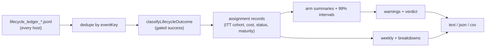

## Summary

Adds the randomised fleet experiment report. `fleet-experiment-report` is a
read-only command. It reads every host's lifecycle ledger (#3644), groups
assignments by the cohort recorded at assignment (intention-to-treat), and
reports **merged issues per estimated API-equivalent USD** for each arm. It
also reports the secondary metrics, 99% intervals, sample counts, maturity and
censoring, weekly and windowed views, and breakdowns by host, provider, role
combination and repository. Output is text, JSON or CSV. Warnings cover biased
assignment, low sample, missing cost, unequal exposure, unverified merges,
Fable use, unattributed events and unknown arms. A seeded synthetic history
generator (`--synthetic <seed>`) makes the experiment reproducible with
pending PRs and unequal model prices. Closes #3645.

Success is not decided here. It comes from `classifyLifecycleOutcome`
(`worker/deno/lib/lifecycle_outcomes.ts`, #3721): a merge counts only when
the merged head had passing `quality` and `review` gates before the merge,
as the PR observer records them. First-pass CI reads only the `quality` gate.

Partial: the execute phase still mints cohort `unassigned`, and nothing
enacts an arm yet. Enacting an arm needs per-role host configuration (#3643,
open). Until then every live assignment falls under `unassigned`, which the
report flags as an unknown arm. Not part of this change: the bandit
allocation and the pre-PR-verification on/off comparison.

## Spec

### Intent and Rationale

- The lifecycle ledger already records the assignment and the cost of every
  invocation and follow-on. The PR observer (#3721) records the gate and
  outcome events. The report reads that ledger rather than adding a second
  data source.
- The report is pure and read-only. It changes no allocation, gate or
  subscription spend, so it cannot bypass a quality gate.

### Essential Design Decisions

- Intention-to-treat: the cohort is taken from the earliest assignment event.
  A later fallback, or another host's assignment event, never moves an issue
  to another arm.
- Gated success is taken from `classifyLifecycleOutcome`, the owner of that
  rule, and is not copied. Any other merge is `merged_unverified` and never
  counts as a success. Legacy `quality_green`/`review_approved` outcome names
  verify nothing.
- Maturity depends on assignment age alone. An assignment is mature once it
  is at least the horizon old, so early resolvers are not favoured. A mature
  assignment that is still pending counts as not merged and is censored.
- The intervals are 99% (bootstrap for merged per USD, Wilson for merge
  rate), deliberately conservative against repeated looks. No arm is named
  the leader unless at least two arms are active, every active arm has 30 or
  more merged issues, no blocking warning is raised, and the leader's
  interval clears every other arm's.

### Undiscoverable Facts

- Owner decision (2026-10-16, issue comment): the incumbent control is a
  Sonnet manager with Haiku executors. The Opus-manager arms are dropped.
- Fable is excluded from every arm and fallback (2026-10-13). Arm validation
  refuses it, and the report warns when a ledger shows it.
- Astra/Sol and Astra/Haiku are listed as `awaiting-feasibility` pending
  #3647. Astra/Sol CLI availability is not assumed.
- Costs are estimated API-equivalent USD only. An unknown cost is never
  treated as zero.

## Evidence

Backend and CLI only; no UI file is touched.

`deno run mod.ts fleet-experiment-report --synthetic 42` gives identical
output on every run (`worker/deno/tests/fleet_experiment_report_command_test.ts::fleet-experiment-report - synthetic run is byte-identical across calls`).

The production event shape the report relies on was read from
`worker/deno/lib/lifecycle_pr_observation.ts`: `outcome` events
`pr_opened`/`merged`/`closed_unmerged` and `gate` events
`pr_open`/`quality`/`review`, each carrying `prNumber` and the PR run id
`pr-<n>-<head>`. The test helpers and the synthetic generator emit that shape.
The observer is called from `worker/deno/lib/pr_maintenance.ts` and
`worker/deno/lib/branch_cleanup.ts`.

The sweep top-up `docs/audits/lib-sweep-coverage/top-up-3645.json` records
`sweptAt` `a4ce4146`, which is `git merge-base origin/main HEAD`. The earlier
branch commit failed the pre-push ancestry gate.

**Docs sweep** — grep: "no experiment supplies cohorts", "#3645", "gate and outcome writer", "no production writer", `quality_green`, `review_approved`, `fleet-experiment-report`, `UNASSIGNED_COHORT`; section: `docs/INTERNALS.md#-randomised-fleet-experiments--merged-issues-per-dollar-issue-3645`; siblings: `backlog-report`, `green-gate-report` — neither appears in a manual list of every command, so no list gained a member; updated: `docs/INTERNALS.md` (new section "🧪 Randomised fleet experiments — merged issues per dollar (Issue #3645)", the cohort sentence in the ledger section, and the ledger-kinds sentence, which now names the PR observer as the gate and outcome writer); `worker/deno/lib/lifecycle_ledger.ts:180` — still true because the ledger union still accepts `quality_green` and `review_approved` outcomes, it is the report that no longer counts them

Evidence for #N citations: #3643: Configure manager, executor and reviewer independently per host and repository (open); #3644: Record end-to-end issue lifecycle, cohort attribution and fully loaded cost (closed); #3647: Validate subscription-only Codex and mixed-provider manager–worker feasibility (open); #3721: Terminal outcome classifier with gated success and cohort-cutoff censoring (closed).

## Acceptance Criteria

<!-- vibe-spec-review inputs="diff+issue-body" -->

- **met** — Reproducible experiment on synthetic randomized issue histories with pending PRs and unequal model prices. — evidence: `worker/deno/tests/fleet_experiment_synthetic_test.ts::fleet experiment synthetic - running twice gives identical events and report`, `worker/deno/tests/fleet_experiment_report_command_test.ts::fleet-experiment-report - synthetic run is byte-identical across calls` — reviewer: met
- **met** — No quality-gate bypass or premature success counting. — evidence: `worker/deno/tests/fleet_experiment_report_test.ts::fleet experiment report - a merge without review approval is unverified, not success`, `worker/deno/tests/fleet_experiment_report_test.ts::fleet experiment report - a merge whose quality gate passed only after the merge is unverified`, `worker/deno/tests/fleet_experiment_report_test.ts::fleet experiment report - an early merge younger than the horizon is immature and excluded from rates` — reviewer: met
- **partial** — Clear warning for biased assignment, low sample size, missing costs or unequal exposure. — evidence: `worker/deno/tests/fleet_experiment_report_test.ts::fleet experiment report - biased assignment fires on a skewed covariate`, `worker/deno/tests/fleet_experiment_report_test.ts::fleet experiment report - low sample fires below the per-arm minimum`, `worker/deno/tests/fleet_experiment_report_test.ts::fleet experiment report - one arm packed into a single host-day raises unequal-exposure (gate d)` — reviewer: met — reason: the reviewer's own caveats keep this partial: size, type and priority balance is checked only when a `--covariates` file supplies them (the ledger does not carry them), and exposure is measured in host-days rather than configured host capacity
- **unrequested** — `--covariates <file>` and `--ledger <paths>` options — reviewer: unrequested — reason: the ledger carries no issue size, type or priority, so `--covariates` is how the balance check gets them; `--ledger` lets an operator point the report at copied ledgers
- **unrequested** — `--synthetic <seed>` mode in the production command — reviewer: unrequested — reason: it makes the reproducible synthetic experiment the acceptance criterion asks for runnable by an operator
- **unrequested** — `excluded-model`, `unknown-arm`, `unattributed-events` and `unverified-merge` warnings — reviewer: unrequested — reason: they surface the Fable exclusion, the premature-success rule and data the report could not attribute
- **unrequested** — `docs/audits/lib-sweep-coverage/top-up-3645.json` — reviewer: unrequested — reason: the repository's sweep ledger needs a slice owning every new `worker/deno/lib` module
- **unrequested** — `docs/INTERNALS.md` edits outside the new section (cohort and ledger-kind sentences) — reviewer: unrequested — reason: those sentences named this report as future work or said gate and outcome events had no writer, which this branch makes false

## Standards Review

<!-- vibe-standards-review inputs="diff+CODING-STANDARDS.md" -->

- **clean** — no violation found. Checked: Australian English; fail loud (every catch in the command surfaces its error); path confinement (ledger paths come only from `readDir` names matching the ledger pattern); covariate refusals never echo file content; nothing exists only for a test to read; no named-but-absent tests; `@std/assert` imports; INTERNALS claim about the PR observer holds; persisted shape unchanged; review-enforced rules checked: removed and edited test assertions (`worker/deno/tests/mod_test.ts` 153 → 154, still red without the registration). Optional notes not chased: `Parsed<T>` uses `message` rather than `error`; arm validation throws rather than returning a Result; `readAllLedgers` loads every event into memory.

## Test Plan

- New: `worker/deno/tests/fleet_experiment_arms_test.ts`, `worker/deno/tests/fleet_experiment_report_test.ts`, `worker/deno/tests/fleet_experiment_synthetic_test.ts`, `worker/deno/tests/fleet_experiment_report_command_test.ts`.
- Removed from worker/deno/tests/mod_test.ts: `assertEquals(commands.length, 153);`
  - Required by: "Report weekly and rolling X-day dashboard"
  - Replaced by: `assertEquals(commands.length, 154);`, `assertEquals(commands.includes("fleet-experiment-report"), true);`
- Red-check for the edited count: without `registry.register(fleetExperimentReportCommand)` the count is 153 and the new `includes` assertion fails.
- Red-checks for the classifier rewire: restoring the names-based `statusOf` turned 12 tests red, including `fleet experiment report - legacy quality_green and review_approved outcomes do not verify a merge`; dropping the quality-only gate filter turned `fleet experiment report - first-pass CI reads only the quality gate` red; dropping the `judgedQuality` condition turned the same test red at the skipped-gate record; always attaching `prNumber` in the synthetic `outcome` helper turned `fleet experiment synthetic - only PR events carry a PR number` red.
- Every branch in the facts file was flipped one at a time and went red as recorded there. One flip, of the `?? CONTROL_ARM_ID` fallback, is exempt: validation makes it unreachable.
- `deno task test:unit` on the four new test files plus `tests/lifecycle_outcomes_test.ts`: 90 passed, 0 failed; the report and synthetic tests after the last additions: 39 passed, 0 failed.

<!-- vibe-branch-outcomes -->

🤖 Generated with [Claude Code](https://claude.com/claude-code)
