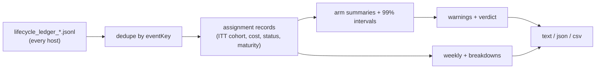

## Summary

Adds the randomised fleet experiment report: a read-only
`fleet-experiment-report` command that reads every host's lifecycle ledger
(#3644), groups assignments by the cohort recorded at assignment
(intention-to-treat), and reports **merged issues per estimated
API-equivalent USD** per arm. It also reports the secondary metrics, 99%
intervals, sample counts, maturity and censoring, weekly and windowed views,
and breakdowns by host, provider, role combination and repository. Output is
text, JSON or CSV. Warnings cover biased assignment, low sample, missing cost,
unequal exposure, unverified merges, Fable use, unattributed events and
unknown arms. A seeded synthetic history generator (`--synthetic <seed>`)
makes the experiment reproducible with pending PRs and unequal model prices.
Closes #3645.

Partial: the execute phase still mints cohort `unassigned`, and nothing
enacts an arm yet. Enacting an arm needs per-role host configuration (#3643,
open). There is no production writer for gate and outcome events yet, so
until one lands no live assignment can count as merged: young assignments
show as pending, and mature ones are censored as not merged. The bandit
allocation and the pre-PR-verification on/off comparison are not part of
this change.

The branch merges `origin/main` because the milestone branch did not yet
carry the #3644 lifecycle ledger that this report reads.

## Spec

### Intent and Rationale

- The lifecycle ledger (#3644) already records the assignment, the cost of
  every invocation and follow-on, and the gate and outcome events. The report
  reads that ledger rather than adding a second data source.
- The report is pure and read-only. It changes no allocation, gate or
  subscription spend, so it cannot bypass a quality gate.

### Essential Design Decisions

- Intention-to-treat: the cohort is taken from the earliest assignment event.
  A later fallback, or another host's assignment event, never moves an issue
  to another arm.
- Success is counted only when the `merged`, `quality_green` and
  `review_approved` outcomes are all present. A bare merge becomes
  `merged_unverified` and is never counted as a success.
- Maturity depends on assignment age alone. An assignment is mature once it
  is at least the horizon old, so early resolvers are not favoured. A mature
  assignment that is still pending counts as not merged and is censored.
- The intervals are 99% (bootstrap for merged per USD, Wilson for merge
  rate), deliberately conservative against repeated looks. No arm is named
  the leader unless at least two arms are active, every active arm has 30 or
  more merged issues, no blocking warning is raised, and the leader's
  interval clears every other arm's.

### Undiscoverable Facts

- Owner decision (2026-10-16, issue comment): the incumbent control is a
  Sonnet manager with Haiku executors. The Opus-manager arms are dropped.
- Fable is excluded from every arm and fallback (2026-10-13). Arm validation
  refuses it, and the report warns when a ledger shows it.
- Astra/Sol and Astra/Haiku are listed as `awaiting-feasibility` pending
  #3647. Astra/Sol CLI availability is not assumed.
- Costs are estimated API-equivalent USD only. An unknown cost is never
  treated as zero.

## Evidence

Backend and CLI only; no UI file is touched.

`deno run mod.ts fleet-experiment-report --synthetic 42` is identical on
every run.

**Docs sweep** — grep: "no experiment supplies cohorts", "#3645", "gate and outcome writers", `fleet-experiment-report`, `UNASSIGNED_COHORT`; section: `docs/INTERNALS.md#-lifecycle-ledger-and-issue-assignment-issue-3718`; siblings: `backlog-report`, `green-gate-report` — neither appears in a manual list of every command, so no list gained a member; updated: `docs/INTERNALS.md` (new section "🧪 Randomised fleet experiments — merged issues per dollar (Issue #3645)", and the cohort sentence in the ledger section); `docs/INTERNALS.md:1131` — still true because this change writes no gate or outcome events; `worker/deno/lib/lifecycle_ledger.ts:61` — still true because cohorts stay `unassigned` until an operator or a later change labels them

Evidence for #N citations: #3643: Configure manager, executor and reviewer independently per host and repository (open); #3644: Record end-to-end issue lifecycle, cohort attribution and fully loaded cost (closed); #3647: Validate subscription-only Codex and mixed-provider manager–worker feasibility (open).

## Acceptance Criteria

<!-- vibe-spec-review inputs="diff+issue-body" -->

- **met** — Reproducible experiment on synthetic randomized issue histories with pending PRs and unequal model prices. — evidence: `worker/deno/tests/fleet_experiment_synthetic_test.ts::fleet experiment synthetic - running twice gives identical events and report`, `worker/deno/tests/fleet_experiment_report_command_test.ts::fleet-experiment-report - synthetic run is byte-identical across calls` — reviewer: met
- **met** — No quality-gate bypass or premature success counting. — evidence: `worker/deno/tests/fleet_experiment_report_test.ts::fleet experiment report - a merge without review approval is unverified, not success`, `worker/deno/tests/fleet_experiment_report_test.ts::fleet experiment report - an early merge younger than the horizon is immature and excluded from rates` — reviewer: met — reason: the reviewer also flagged status-based maturity as survivor bias; maturity is now by assignment age alone, fixed in this diff
- **partial** — Clear warning for biased assignment, low sample size, missing costs or unequal exposure. — evidence: `worker/deno/tests/fleet_experiment_report_test.ts::fleet experiment report - biased assignment fires on a skewed covariate`, `worker/deno/tests/fleet_experiment_report_test.ts::fleet experiment report - low sample fires below the per-arm minimum`, `worker/deno/tests/fleet_experiment_report_test.ts::fleet experiment report - one arm packed into a single host-day raises unequal-exposure (gate d)` — reviewer: partial — reason: size, type and priority balance is checked only when a `--covariates` file supplies them (the ledger does not carry them), and exposure is measured in host-days rather than configured host capacity
- **unrequested** — `--covariates <file>` option — reviewer: unrequested — reason: the ledger carries no issue size, type or priority, so this is how the requested balance check gets them
- **unrequested** — `--synthetic <seed>` mode in the production command — reviewer: unrequested — reason: it makes the reproducible synthetic experiment the acceptance criterion asks for runnable by an operator
- **unrequested** — `excluded-model`, `unknown-arm`, `unattributed-events` and `unverified-merge` warnings — reviewer: unrequested — reason: they surface the Fable exclusion, the premature-success rule and data the report could not attribute

## Standards Review

<!-- vibe-standards-review inputs="diff+CODING-STANDARDS.md" -->

- **violation** — the verdict could name a leading arm with only one active arm, so a win was declared with no comparison — evidence: `worker/deno/lib/fleet_experiment_report.ts:996` — reason: fixed in this diff
- **clean** — fail loud (every refusal and read error returns `success: false` naming the argument or path, never echoing content); nothing exists only for a test to read; Australian English; no source-grep tests; temp directories from `Deno.makeTempDir`; the persisted ledger shape is unchanged (read-only); no workflow change; review-enforced rules checked: removed and edited test assertions (`tests/mod_test.ts` count 153 → 154 only)

## Test Plan

- New: `worker/deno/tests/fleet_experiment_arms_test.ts` (19), `worker/deno/tests/fleet_experiment_report_test.ts` (28), `worker/deno/tests/fleet_experiment_synthetic_test.ts` (7), `worker/deno/tests/fleet_experiment_report_command_test.ts` (21).
- Edited: `worker/deno/tests/mod_test.ts` — `assertEquals(commands.length, 153);` becomes 154 because this issue adds the `fleet-experiment-report` command. No assertion removed. Red-check: without `registry.register(fleetExperimentReportCommand)` the count is 153 and the new `includes` assertion fails.
- Every branch in the facts file was flipped one at a time and went red as recorded there. One flip, of the `?? CONTROL_ARM_ID` fallback, is exempt: validation makes it unreachable.
- `deno task test:unit` on the four new test files plus `tests/mod_test.ts` and `tests/lib_sweep_coverage_test.ts`: 132 passed, 0 failed.
- `./quality.sh` on the final code head (3736e352): PASSED (config integration skipped).

<!-- vibe-branch-outcomes -->

🤖 Generated with [Claude Code](https://claude.com/claude-code)
