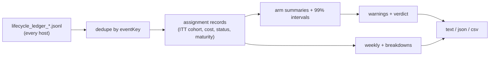

## Summary

Adds the randomised fleet experiment report: a read-only
`fleet-experiment-report` command that reads every host's lifecycle ledger
(#3644), groups assignments by the cohort recorded at assignment
(intention-to-treat), and reports **merged issues per estimated
API-equivalent USD** per arm. It also reports the secondary metrics, 99%
intervals, sample counts, maturity and censoring, weekly and windowed views,
and breakdowns by host, provider, role combination and repository. Output is
text, JSON or CSV. Warnings cover biased assignment, low sample, missing cost,
unequal exposure, unverified merges, Fable use, unattributed events and
unknown arms. A seeded synthetic history generator (`--synthetic <seed>`)
makes the experiment reproducible with pending PRs and unequal model prices.
Closes #3645.

Partial: the execute phase still mints cohort `unassigned`, and nothing
enacts an arm yet. Enacting an arm needs per-role host configuration (#3643,
open). There is no production writer for gate and outcome events yet, so
until one lands every live assignment reports as pending. The bandit
allocation and the pre-PR-verification on/off comparison are not part of
this change.

The branch merges `origin/main` because the milestone branch did not yet
carry the #3644 lifecycle ledger that this report reads.

## Spec

### Intent and Rationale

- The lifecycle ledger (#3644) already records the assignment, the cost of
  every invocation and follow-on, and the gate and outcome events. The report
  reads that ledger rather than adding a second data source.
- The report is pure and read-only. It changes no allocation, gate or
  subscription spend, so it cannot bypass a quality gate.

### Essential Design Decisions

- Intention-to-treat: the cohort is taken from the earliest assignment event.
  A later fallback, or another host's assignment event, never moves an issue
  to another arm.
- Success is counted only when the `merged`, `quality_green` and
  `review_approved` outcomes are all present. A bare merge becomes
  `merged_unverified` and is never counted as a success.
- Maturity depends on assignment age alone. An assignment is mature once it
  is at least the horizon old, so early resolvers are not favoured. A mature
  assignment that is still pending counts as not merged and is censored.
- The intervals are 99% (bootstrap for merged per USD, Wilson for merge
  rate), deliberately conservative against repeated looks. No arm is named
  the leader unless at least two arms are active, every active arm has 30 or
  more merged issues, no blocking warning is raised, and the leader's
  interval clears every other arm's.

### Undiscoverable Facts

- Owner decision (2026-10-16, issue comment): the incumbent control is a
  Sonnet manager with Haiku executors. The Opus-manager arms are dropped.
- Fable is excluded from every arm and fallback (2026-10-13). Arm validation
  refuses it, and the report warns when a ledger shows it.
- Astra/Sol and Astra/Haiku are listed as `awaiting-feasibility` pending
  #3647. Astra/Sol CLI availability is not assumed.
- Costs are estimated API-equivalent USD only. An unknown cost is never
  treated as zero.

## Evidence

Backend and CLI only; no UI file is touched.

`deno run mod.ts fleet-experiment-report --synthetic 42` is identical on
every run.
