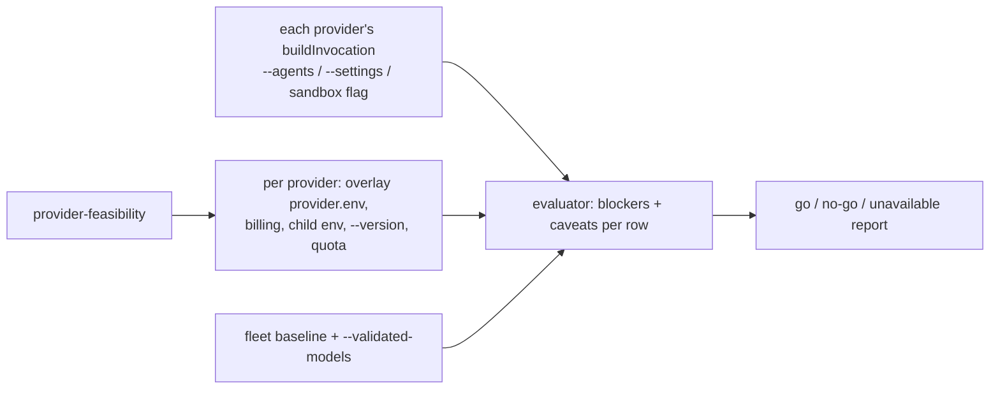

## Summary

Adds the go/no-go record for subscription-only Codex and mixed-provider manager–worker runs, and the read-only `provider-feasibility` smoke test that produces it on any host. No default, routing or billing path changes, and the Claude fleet is untouched. Closes #3647.

Some items stay `partial`, and the reasons are below. Live Codex verification (renewal, quota, resume, rate limits, Sol entitlement) needs a host with the Codex CLI and a ChatGPT login, and this host has neither. The live steps are recorded as an operator procedure in `docs/PROVIDER-FEASIBILITY.md` section 5.

- **New `provider-feasibility` command** (`worker/deno/commands/provider_feasibility.ts`, evaluator `worker/deno/lib/provider_feasibility.ts`). It covers each provider × model × role (manager, executor, reviewer). Each row gets `go`, `no-go` or `unavailable`, with every blocker and caveat named.
  - The only process it starts is `<binary> --version` under the provider's own scrubbed child env. It runs no model turn and makes no GitHub call.
  - It reuses the existing owners instead of restating them: `classifyProviderBilling`, the descriptors' `buildChildEnv` / `buildInvocation`, `parseProviderCredentialEntries`, `CodexBudgetAdapter`, `resolveCodexHome` and `lookupModelPricing`.
- **New `docs/PROVIDER-FEASIBILITY.md`**: verdict table, findings per work item, provider capability matrix, API-equivalent cost-attribution caveats with the missing data listed, the smoke test, and the opt-in live entitlement check (no API key).
- **Main verdicts:**
  - Claude manager/executor/reviewer: `go`.
  - Every Codex role: `no-go`. Codex carries neither `--agents` nor the `--settings` edit guard.
  - Cross-provider executor or reviewer (e.g. Sol under a Claude manager): `no-go`. Sub-agents run inside the manager's single CLI process.
  - Astra and Sol: `unavailable` until a host validates them. Neither has an API-equivalent price row.
  - Gemini and DeepSeek: `no-go`. Neither declares a fixed-price subscription.

## Spec

### Intent and Rationale

- Rollout needs evidence per combination, not a single opinion. A read-only command an operator can re-run on each host stays true as CLIs, pins and plans change. A one-off document goes stale.
- Capabilities come from each provider's own `buildInvocation` output (does it emit `--agents`, `--settings`, the Codex sandbox-bypass flag), so the verdict follows the code without a hard-coded provider table.

### Essential Design Decisions

- Fail closed: `metered`/`unknown` billing, a metered variable reaching the child, a missing CLI or missing host facts are all blockers. No API-key workaround is offered.
- `unavailable` wins over `no-go` when the model is unvalidated, because the issue asks for that label. The structural blockers stay listed, so validation alone never turns a Codex row `go`.
- Only the Claude fleet's production models (`DEFAULT_CLAUDE_MODEL`, `PHASE_MODEL_DEFAULTS`, the issue sub-agent constants) count as validated without an operator `--validated-models` record.

### Undiscoverable Facts

- The vendor page (https://developers.openai.com/codex/models → learn.chatgpt.com/docs/models, fetched 2026-10-17) lists:
  - `gpt-6.1-sol` in the Codex CLI on Plus, Pro, Business, Enterprise and Edu ("Free and Go are not included at launch").
  - `codex -m gpt-6-astra`, without saying which plans or sign-in methods get Astra.
  - The GPT-5.x line retiring under ChatGPT sign-in. It does not mention the worker's routed `gpt-5`, `gpt-5-codex` and `gpt-5-mini`.
- The cost decision recorded in the issue (2026-10-13): API-equivalent USD only, with no fee allocation or seat amortisation.
- Codex is not installed on this host (`codex: command not found`).

## Evidence

Backend/CLI change; no UI file touched.

- **Host run** (from `worker/deno`): `deno run --frozen --lock=deno.lock --allow-read --allow-env --allow-run --allow-sys=hostname mod.ts provider-feasibility`. It printed `[feasibility] rows=40 go=9 no-go=6 unavailable=25`.
  - The nine Claude rows were `go`.
  - Every Codex row was `unavailable`, carrying `billing-unknown (subscription-credential-missing)` and `quota-unknown (no-session-file)`, plus the CLI blocker. The CLI blocker read `cli-not-installed (not on PATH)` at the time and is now named `cli-not-runnable`.
  - The six Claude executor/reviewer rows under a Codex manager were `no-go` (`cross-provider-dispatch-not-implemented`).
- The run's stderr `[SECURITY] refusing to stage the gh credential` lines come from `mod.ts` start-up without `--allow-write`. Nothing was written.
- **Real-tool observation:** the Codex row's sandbox caveat comes from `--dangerously-bypass-approvals-and-sandbox` in `STANDARD_FLAGS` (`worker/deno/lib/codex_executor.ts`). Claude's `buildInvocation` emits `--agents` and `--settings` and Codex's emits neither. Asserted in `worker/deno/tests/provider_feasibility_test.ts::probeInvocationCapabilities reads what each provider builds`.
- **Load-bearing seams:** command tests drive `runProviderFeasibility` with a fake `runVersion` / `readCodexQuota`. Billing, child-env isolation and credential parsing run the production code: `classifyProviderBilling`, `buildIsolatedCodexChildEnv` via the Codex descriptor, and `parseProviderCredentialEntries`. `runCliVersion` and `readCodexQuotaVisibility` are tested against real executables and a real rollout fixture.
- **Follow-up filed:** #3955: Codex billing probe and child disagree on CODEX_HOME when it is not set explicitly. This is a pre-existing divergence found while verifying credential isolation.
- **Issue numbers cited:** #3647: Validate subscription-only Codex and mixed-provider manager–worker feasibility; #3955: as above.

**Docs sweep** — grep: `provider-feasibility`, `PROVIDER-FEASIBILITY`, `cli-not-installed`, "go/no-go"; section: `docs/PROVIDER-PARITY.md#provider-parity--codex-and-mixed-fleets`; siblings: `codex-budget`, `route-issue` (each sibling command is documented only in its own manual, and no doc lists the command set); updated: `docs/PROVIDER-FEASIBILITY.md`, `docs/PROVIDER-PARITY.md`, `README.md`; `docs/PROVIDER-FEASIBILITY.md:99` and `docs/PROVIDER-FEASIBILITY.md:149` — still true because they record that the label was `cli-not-installed` when the host run was captured.

## Acceptance Criteria

<!-- vibe-spec-review inputs="diff+issue-body" -->

- **partial** — Verify supported unattended Codex CLI access under existing fixed-price subscription and noninteractive renewal, quota/remaining-usage visibility, limits and failure behavior. Do not assume consumer ChatGPT Astra/Sol labels are exposed as stable CLI model identifiers. — evidence: `docs/PROVIDER-FEASIBILITY.md` sections 2 and 6; `worker/deno/tests/provider_feasibility_command_test.ts::a Codex home with a known budget reports it visible with a remaining percentage` — reviewer: partial — reason: read from code and the vendor page; live renewal, quota and failure checks still need a Codex host with a ChatGPT login (section 5 procedure)
- **partial** — Test Astra-as-manager / Sol-as-executor only if officially exposed to the supported coding agent under fixed-price terms; otherwise mark unavailable with evidence and no API-key workaround. — evidence: `docs/PROVIDER-FEASIBILITY.md` section 1; `worker/deno/tests/provider_feasibility_test.ts::codex manager on an unvalidated model is unavailable with every blocker` — reviewer: partial — reason: both are marked unavailable with vendor evidence and no API-key route. Sol's live entitlement turn was not run because Codex is not installed here. Astra-manager plus Sol-executor is covered by the Codex-manager rows, because rows are keyed by provider rather than by manager model
- **partial** — Verify credential isolation, per-host container CLI installation, session resume, sandboxed tools, zero manual intervention after setup, and rate-limit behavior. — evidence: `docs/PROVIDER-FEASIBILITY.md` section 2; `worker/deno/tests/provider_feasibility_command_test.ts::codex with a persisted ChatGPT login withholds the metered key from the child` — reviewer: partial — reason: isolation is exercised against production code. The image build, resume, restart and rate-limit observation are code-read only and still need the live soak on a Codex host
- **met** — Produce provider capability matrix, API-equivalent cost attribution caveats and a repeatable smoke test with no production side effects. — evidence: `docs/PROVIDER-FEASIBILITY.md` sections 3–5; `worker/deno/commands/provider_feasibility.ts`; `worker/deno/tests/provider_feasibility_command_test.ts::the read-only line is present and runVersion runs once per provider` — reviewer: met
- **partial** — Documented go/no-go for each provider/model/role combination. — evidence: `docs/PROVIDER-FEASIBILITY.md` sections 1 and 6 (`rows=40 go=9 no-go=6 unavailable=25`) — reviewer: partial — reason: every Codex row is `unavailable` until a Codex host validates its models. The issue names `unavailable` as the required label for an unexposed model, and each row also lists its no-go blockers. Gemini and DeepSeek are summarised rather than enumerated per model
- **met** — No usage-billed API route, silent fallback, or disruption to Claude fleet. — evidence: `worker/deno/tests/provider_feasibility_test.ts::metered billing is no-go with the variable named`; `worker/deno/tests/provider_feasibility_test.ts::a metered variable reaching the child is no-go with its name` — reviewer: met
- **partial** — Report estimated API-equivalent USD cost only, consistent with existing VibeCoder cost estimates. — evidence: `docs/PROVIDER-FEASIBILITY.md` section 4; the `api-equivalent-price-missing` caveat — reviewer: partial — reason: the caveats and missing data are documented and flagged. Attribution of retries outside the runner wrapper, and a per-role split of a Codex run, are listed as missing data, not delivered
- **unrequested** — `--models`, `--codex-home` and `--credential-dir` flags, plus reading the provider's `provider.env` — reviewer: unrequested — reason: lets the smoke test see the host's real provisioned credentials and evaluate a named model, which the "repeatable smoke test" needs on each host
- **unrequested** — Gemini and DeepSeek in the capability matrix and as optional candidates — reviewer: unrequested — reason: the issue asks for a go/no-go "for each provider", and all four are registered providers
- **unrequested** — Section 7 "What would change the verdicts", and the opt-in live entitlement procedure — reviewer: unrequested — reason: states what flips each no-go, and how to validate Sol through the supported agent on fixed-price terms without an API key
- **unrequested** — Follow-up #3955 for the `CODEX_HOME` divergence — reviewer: unrequested — reason: a pre-existing defect found while verifying credential isolation; filed rather than fixed, to stay in scope
- **unrequested** — `README.md` row, `docs/PROVIDER-PARITY.md` link, `docs/audits/lib-sweep-coverage/top-up-3647.json`, and `export` on `splitList` in `worker/deno/commands/audit_chain_verify.ts` — reviewer: unrequested — reason: docs reachability, the lib-sweep ledger test that every new module needs, and the Standards review's ask to reuse the owner instead of copying it

## Standards Review

<!-- vibe-standards-review inputs="diff+CODING-STANDARDS.md" -->

- **violation** — a failure reason must name the cause: a failed `--version` dropped stderr and was always labelled not-installed — evidence: `worker/deno/commands/provider_feasibility.ts:113` — reason: fixed in this diff (detail is now `exit <code>: <first stderr line>`, redacted and capped; blocker renamed `cli-not-runnable`)
- **violation** — in-repo helper re-implemented: `unique` copied between the two new files — evidence: `worker/deno/commands/provider_feasibility.ts:380` — reason: fixed in this diff (`uniqueInOrder` exported from `worker/deno/lib/provider_feasibility.ts` and imported)
- **violation** — private helper copied instead of widened: `splitList` from `audit_chain_verify.ts` — evidence: `worker/deno/commands/provider_feasibility.ts:247` — reason: fixed in this diff (`splitList` exported from `worker/deno/commands/audit_chain_verify.ts` and imported; `stringArg` has no exported identical owner, so it stays)
- **violation** — changed call site with no test: `execute` and its `credential-dir` argument — evidence: `worker/deno/commands/provider_feasibility.ts:391` — reason: fixed in this diff (`execute reads credential-dir and rejects before it runs the CLI when the credential is unreadable`)
- **violation** — branch outcome with no test: first-wins credential overlay — evidence: `worker/deno/commands/provider_feasibility.ts:212` — reason: fixed in this diff (branchless first-wins build plus `the first credential entry for a name wins in the child environment`)
- **clean** — Review-only rules checked: "Nothing exists only for a test to read", "A named test must exist", "Never let a unit test inherit the host's state" (temp dirs, injected env), "Shell code must behave the same on macOS" (POSIX `sh` test scripts), "A stub mirrors the real callee's contract". Also clean: fail-closed billing, Australian English, Deno-only tooling, no new dependency, no workflow change, and the Claude fleet untouched apart from one `mod.ts` registration.

## Test Plan

- Added `worker/deno/tests/provider_feasibility_test.ts` (evaluator: capabilities probe, every blocker/caveat, both operands of the two role conditions, verdict precedence, combinations, report format).
- Added `worker/deno/tests/provider_feasibility_command_test.ts` (argument refusals, including a hostile 5000-character spec; billing and child-env isolation through production code; credential-file overlay and first-wins; `runCliVersion` against real executables, covering not on PATH, permission denied, empty output, exit with and without stderr, and stderr redaction and cap; quota visibility against a real rollout fixture; `readOptionalTextFile`; `execute` with `credential-dir`).
- Removed from worker/deno/tests/mod_test.ts: `assertEquals(commands.length, 153);`
  - Required by: "a repeatable smoke test with no production side effects"
  - Replaced by: `assertEquals(commands.length, 154);`, `assertEquals(commands.includes("provider-feasibility"), true);`
- Edited expectation red-check (`mod_test.ts` count): commenting out `registry.register(providerFeasibilityCommand)` turned the count and include assertions red; restoring it turned them green.
- New-test red-checks: each guard was flipped one at a time (cross-provider check, validated-model check, metered-in-child, CLI check, billing check, sub-agent and settings checks, sandbox caveat, reviewer operands, stderr read, cap, redaction, `credential-dir`, first-wins, `readOptionalTextFile` catch-all, codex-home injection), and each turned at least one named test red before it was restored.
- `deno task test:unit tests/provider_feasibility_test.ts tests/provider_feasibility_command_test.ts tests/audit_chain_verify*_test.ts tests/mod_test.ts < /dev/null`: 97 passed, 0 failed.
- `./quality.sh < /dev/null` on the head before this summary: Result PASSED (with skipped checks; config integration SKIPPED).

<!-- vibe-branch-outcomes -->

🤖 Generated with [Claude Code](https://claude.com/claude-code)
