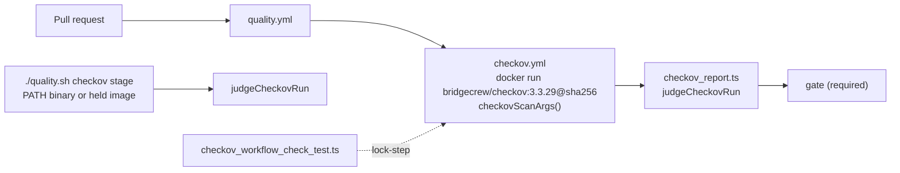

## Summary

Adds Checkov security scanning for AWS CloudFormation. Closes #3653.

- **CI gate.** A new reusable workflow, `.github/workflows/checkov.yml`, is called from `quality.yml` and listed in `gate`'s `needs`. It runs `bridgecrew/checkov:3.3.29@sha256:3cc125b5…` with `-d . --framework cloudformation -o json --skip-download`. The JSON report is then judged by `worker/deno/checkov_report.ts`. The job fails when any of these happens:
  - a check fails;
  - Checkov cannot parse a template (Checkov itself exits 0 on that);
  - a skip is not an inline `# checkov:skip=<ID>:<reason>` comment on the resource. A skip with no reason, or a `Metadata` skip block, is refused.

  There is no SARIF upload.
- **Local stage, the same scan before the push.** `./quality.sh` gains a `checkov` stage (`worker/deno/lib/checkov_check.ts`), registered only where `checkov.yml` exists. It uses the same `checkovScanArgs()` and the same `judgeCheckovRun` as CI. It runs either a `checkov` binary on PATH (any version other than the CI pin is named in the output) or the pinned image in a runtime that already holds it. When neither is available, it reports `SKIPPED (not run — …)`, and the required CI job stays authoritative.
- **Equivalence test.** `validateCheckovWorkflows` (`worker/deno/lib/checkov_workflow_check.ts`) checks that `checkov.yml` uses `CHECKOV_IMAGE` and `checkovScanArgs()`. It also checks that the workflow:
  - runs the judge with `--checkov-exit` and captures the exit code;
  - passes no flag that weakens the scan (`--soft-fail`, `--skip-check`, …);
  - declares no concurrency group;
  - is called by `quality.yml` and needed by `gate`.
- **Fleet audit.** `checkCfnLint` now reports the `aws-cloudformation` bucket as configured only when the workflows invoke both `cfn-lint` and Checkov. The issue text names whichever tool is missing, or both.
- `infra/cloudformation/linux-verification-host.yaml` already passes with zero failed checks, so it needed no change and carries no skip.

## Spec

### Intent and Rationale

- Nothing security-scanned CloudFormation. `cfn-lint` validates the schema only. Checkov flags security misconfigurations.
- CI runs the image directly and has the shared Deno judge read its report. The alternative was to run the image as a `container:` job, as `semgrep.yml` does. That would have needed the same judging logic again in Python or shell. With one judge, CI and the local stage cannot disagree about a verdict.

### Essential Design Decisions

- `checkovScanArgs()` and `CHECKOV_IMAGE` are the single source of truth. `checkov.yml` must match them, and `worker/deno/tests/checkov_workflow_check_test.ts` fails if it does not.
- Skips are judged from the report's `code_block`. Checkov records a reasonless inline skip and a `Metadata` skip exactly like a justified one, so only an inline marker naming the same check ID with a non-empty reason is accepted.
- `--entrypoint checkov` is required: the image's `/entrypoint.sh` ignores argv when `GITHUB_ACTIONS=true`.
- The local stage never pulls or installs Checkov. A missing tool reports `SKIPPED` with the reason, never `PASSED`. Checkov stays out of `container/tools.json`, as the issue agreed.

### Undiscoverable Facts

These were observed by running the real Checkov 3.3.29 in a scratch virtualenv:
- It exits 1 when a check fails.
- It exits 0 on a template it cannot parse; `summary.parsing_errors` is 1.
- With no templates it prints a summary-only object.
- An inline skip with no reason is reported as `suppress_comment: "No comment provided"` and still counts as SKIPPED.
- A `Metadata` skip looks the same in the report.

Two facts about the image:
- `bridgecrew/checkov:3.3.29` resolves to manifest-list digest `sha256:3cc125b5337717b7303dbddd4e79374c120687b5ff6a24f9abdad56b562469f3` (registry `docker-content-digest`), released 2026-10-13. That is older than the 24-hour quarantine.
- Its ENTRYPOINT is `/entrypoint.sh`, according to the registry's image config.

The issue's request to coordinate with #3689 cannot be met: #3689 is closed.

## Evidence

Backend and CI change only; there is no UI surface.

- **Real-tool run over this repository:** `checkov -d . --framework cloudformation -o json --skip-download` (3.3.29) reported `{'passed': 13, 'failed': 0, 'skipped': 0, 'parsing_errors': 0, 'resource_count': 11}` with exit 0. `deno run --frozen --lock=deno.lock --allow-read checkov_report.ts --report <that json> --checkov-exit 0` printed `checkov: PASSED (11 resource(s), 13 check(s) passed, 0 skipped with a reason)`.
- **Real reports judged** (by `checkov_report.ts`, the CI judge):

  | Report | Exit |
  | --- | --- |
  | one failed check | 1 |
  | inline skip with no reason | 1 |
  | `Metadata` skip | 1 |
  | unparseable template | 1 |
  | inline skip with a reason | 0 |
  | no templates | 0 |

- **Local stage:** with Checkov on PATH, `runCheckovCheck` returned `PASSED … via checkov 3.3.29 on PATH`. Without it, it returned `SKIPPED (not run — checkov is not installed and no container runtime holds bridgecrew/checkov:3.3.29@sha256:…; the required checkov CI job (.github/workflows/checkov.yml) still scans every template — …)`.
- **Workflow lint:** `actionlint .github/workflows/checkov.yml .github/workflows/quality.yml` exits 0.
- **Action pins:** the SHAs were resolved this run with `gh api repos/<owner>/<repo>/commits/<tag> --jq .sha`: `actions/checkout@v7.0.1` → `3d3c42e5…`, `denoland/setup-deno@v2.0.5` → `22d081ff…`. The `actions/cache` pin was copied from `validate-scripts.yml`.
- **Supply-chain gate:** passes after `--write-inventory`. `docs/audits/dependency-inventory.md` only gains `checkov.yml` on the existing `uses:` rows.
- **Fakes:** the test reports are trimmed copies of real Checkov 3.3.29 JSON output. `fakeInvocation` injects at the `detectInvocation` seam with Checkov's observed exit codes (0 and 1).
- **Callers checked when widening helper visibility:** `spawnWithDeadline` and `probe` in `semgrep_check.ts` gain an export and a defaulted `deadlineMs`, and semgrep's callers are unchanged. `joinContinuations` in `ci_install_pin_scanner.ts` gains only an export.
- **Provenance:** #3653: Add Checkov security scanning for AWS CloudFormation templates.

**Docs sweep** — grep: `cfn-lint`, "semgrep", "quality.sh", `checkov`; section: `docs/BEST-PRACTICES-SCAN.md` (CI-gate table), `docs/INTERNALS.md` (quality-gate stage paragraphs), `CONTRIBUTING.md` (Semgrep (SAST) before the push); siblings: "semgrep", `cfn-lint`, `tflint`; updated: `CONTRIBUTING.md`, `README.md`, `docs/INTERNALS.md`, `CODING-STANDARDS.md`, `DESIGN-PRINCIPLES.md`, `docs/BEST-PRACTICES-SCAN.md`, `docs/audits/dependency-inventory.md`; `docs/audits/security-sweep-2180-linux-verification-host.md:359` — still true because it is a dated audit record of that sweep; `docs/EXTENDING.md:243` — still true because it lists fleet-synced workflow specs, not this repository's own gates

## Acceptance Criteria

<!-- vibe-spec-review inputs="diff+issue-body" -->

- **met** — VibeCoder CI: a new Checkov CloudFormation scan workflow, called from `quality.yml` like `semgrep.yml` and listed in `gate`'s `needs`, so its result feeds the single required `gate` check; the job exits non-zero (red `gate`) when any Checkov CloudFormation check fails on any template in the repo — evidence: `.github/workflows/checkov.yml`, `worker/deno/tests/checkov_workflow_check_test.ts::the real checkov.yml and quality.yml satisfy every Checkov lock-step invariant` — reviewer: met
- **met** — Suppression is only by an inline `checkov:skip` comment on the resource naming the check ID and a reason; a skip with no reason is not accepted — evidence: `worker/deno/tests/checkov_check_test.ts::checkov_check - parseCheckovReport rejects a skip with no reason (t2)` — reviewer: met
- **met** — `infra/cloudformation/linux-verification-host.yaml` passes the Checkov CloudFormation scan with zero failed checks in the same PR; a finding is skipped inline only when its fix stops `infra/cloudformation/test-floci.sh` reaching `CREATE_COMPLETE`, and the skip reason says so — evidence: real Checkov 3.3.29 run over the repository (13 passed, 0 failed, 0 skipped, 0 parsing errors), judged PASSED by `worker/deno/checkov_report.ts` — reviewer: missing — reason: the reviewer saw the template unchanged in the diff and guessed CKV_AWS_126/135/130 would fire; Checkov 3.3.29 was run over the template and reported zero failed checks, so no fix or skip is needed and `floci.yml` is unaffected
- **met** — Fleet audit: the `aws-cloudformation` bucket requires both `cfn-lint` and Checkov. A repo is reported configured only when its workflows invoke both; otherwise it is reported not configured, and the issue text names whichever tool is missing (both when both are missing) — evidence: `worker/deno/tests/linter_in_ci_check_test.ts::aws-cloudformation #3653 — cfn-lint only (no Checkov) is not configured` — reviewer: met
- **met** — Results appear only in the CI job log and job status; no SARIF upload — evidence: `.github/workflows/checkov.yml` (no upload step, `contents: read` only) — reviewer: met
- **met** — Checkov is not added to the worker container (`container/tools.json`); CI is the only place it runs — evidence: `container/tools.json` unchanged; the local stage only uses a Checkov the host already has — reviewer: met
- **met** — The scan covers the whole repository (`-d .`), not only `infra/cloudformation/`, so a template added elsewhere is caught — evidence: `worker/deno/tests/checkov_check_test.ts::checkov_check - scan args are the whole repository, CloudFormation only` — reviewer: met
- **met** — The scan runs on every pull request with no path filter, because `gate` in `quality.yml` is the one required check — evidence: `.github/workflows/quality.yml`, `worker/deno/tests/checkov_workflow_check_test.ts::invariant a: a pull_request trigger on checkov.yml is a problem` — reviewer: met
- **met** — Checkov runs from the `bridgecrew/checkov` image pinned by release tag plus `sha256` digest, with any GitHub Action pinned to a 40-character commit SHA and `permissions: contents: read`, matching `semgrep.yml` (Issue #2123) — evidence: `worker/deno/tests/checkov_workflow_check_test.ts::the real checkov.yml and quality.yml raise no finding from WORKFLOW_FILE_CHECKS` — reviewer: met
- **met** — The fleet audit detects Checkov the same way it detects `cfn-lint`: a case-insensitive `checkov` match in any `.github/workflows/` file — evidence: `worker/deno/tests/linter_in_ci_check_test.ts::aws-cloudformation #3653 — Checkov matched case-insensitively` — reviewer: met
- **met** — Adding `cfn-lint` to VibeCoder's own CI is out of scope for this issue — evidence: no `cfn-lint` step added — reviewer: met
- **met** — `floci.yml`'s deploy behaviour is unchanged; any template fix must still reach `CREATE_COMPLETE` there — evidence: `.github/workflows/floci.yml` and the template untouched — reviewer: met
- **partial** — make the identical pinned Checkov version/rules available in an ephemeral pre-PR validation stage (installed on demand or a dedicated isolated runner, if unsuitable for the base worker image) — evidence: `worker/deno/lib/checkov_check.ts`, `worker/deno/tests/checkov_check_test.ts::quality gate - registers the checkov stage where checkov.yml exists` — reviewer: partial — reason: the local stage runs the same arguments, image and judgement but never installs Checkov on demand; the worker image has no pip or container runtime, so in a fleet run the stage reports SKIPPED; an on-demand install or isolated runner is still to do, and #3689 is closed so there was nothing to coordinate with
- **met** — Avoid silently skipping local scans when tooling is absent: record the check as unavailable/not run and leave mandatory CI authoritative — evidence: `worker/deno/tests/checkov_check_test.ts::checkov_check - runCheckovCheck SKIPPED when no invocation exists, naming the CI job` — reviewer: met
- **met** — Never suppress findings to obtain a green preflight, never weaken the required CI gate, and do not introduce metered API services — evidence: `worker/deno/tests/checkov_workflow_check_test.ts::invariant c: adding --soft-fail to the scan is a problem`; `--skip-download`, no API key — reviewer: met
- **met** — Add an equivalence test or configuration digest so local and CI scanning cannot silently drift — evidence: `worker/deno/tests/checkov_workflow_check_test.ts::the real checkov.yml and quality.yml satisfy every Checkov lock-step invariant` — reviewer: met
- **unrequested** — `docs/audits/lib-sweep-coverage/top-up-3653.json` — reviewer: unrequested — reason: the sweep-coverage ledger test requires every new `lib/` module to belong to a slice
- **unrequested** — exported `probe`/`spawnWithDeadline` (`semgrep_check.ts`) and `joinContinuations` (`ci_install_pin_scanner.ts`) — reviewer: unrequested — reason: CODING-STANDARDS requires widening an existing owner rather than copying it
- **unrequested** — local-stage instructions in `CONTRIBUTING.md` and `README.md` — reviewer: unrequested — reason: a code change owes a docs change; the stage serves the issue's first-pass pre-PR requirement

## Standards Review

<!-- vibe-standards-review inputs="diff+CODING-STANDARDS.md" -->

- **violation** — Call the existing owner, never copy it: continuation joining was re-implemented — evidence: `worker/deno/lib/checkov_workflow_check.ts:86` — reason: fixed in this diff (exports and calls `joinContinuations` from `ci_install_pin_scanner.ts`)
- **violation** — Every changed call site needs a test that goes red without it — evidence: `worker/deno/lib/quality_gate.ts:1789` — reason: fixed in this diff (two `runQualityGate` tests in `worker/deno/tests/checkov_check_test.ts`)
- **violation** — A workflow behaviour change extends the workflow validator: the "no concurrency group" invariant was documented but not validated — evidence: `.github/workflows/checkov.yml:29` — reason: fixed in this diff (invariant f with top-level and job-level negative tests)
- **clean** — Review-enforced rules checked:
  - Nothing exists only for a test to read
  - A new precondition must not stop existing tests short
  - Temp-dir isolation
  - macOS shell portability
  - Never fail silently
  - Named tests exist
  - Permissive stubs

  Also clean: action and image pins, gate wiring through `gate.sh`, and Australian spelling. No assertion was removed from an existing test, and no existing expectation changed. Optional notes: the stale CODING-STANDARDS gate list was fixed in this diff, and the Floci skip rule is documented but not machine-checked (the judge requires the reason, not its content).

## Test Plan

Added or edited tests:
- `worker/deno/tests/checkov_check_test.ts` (new):
  - scan and container args;
  - `inlineSkipScan`, including a hostile 100k-character line;
  - `parseCheckovReport` and `judgeCheckovRun`, over reports trimmed from the real t1, t2, t4, t5, t6 and t7 runs;
  - `runCheckovCheck` with an injected detector;
  - `checkovStageApplies`;
  - `checkov_report.ts` `main()`;
  - two `runQualityGate` registration tests.
- `worker/deno/tests/checkov_workflow_check_test.ts` (new):
  - the real-file lock-step and `WORKFLOW_FILE_CHECKS` tests;
  - one negative test per invariant (a–f);
  - the `--checkov-exit` positive control;
  - three hostile-input cases.
- `worker/deno/tests/linter_in_ci_check_test.ts`:
  - "cfn-lint invoked in CI is configured" is renamed "cfn-lint and Checkov invoked in CI is configured". Its fixture gains a `checkov` step, and its `configured`/`linter` assertions are unchanged.
  - The "#2177 — gates field stays undefined" fixture gains a `checkov` step.
  - The "no cfn-lint invocation" test gains details assertions.
  - Five new tests: cfn-lint only, Checkov only, case-insensitive, `uses:`, and `docker run`.
  - Removed assertions: none.
- `worker/deno/tests/pinned_actions_test.ts`: "checkov image is digest-pinned".

Red checks:
- **Fleet audit (each guard broken on purpose):**
  - Dropping the Checkov requirement turned "cfn-lint only (no Checkov)" red.
  - Dropping the cfn-lint requirement turned "Checkov only (no cfn-lint)" red.
  - Removing the lower-casing turned "Checkov matched case-insensitively" red.
  - Dropping the Checkov-missing clause turned "no cfn-lint invocation is not configured" red.
  - The renamed configured test went red when the Checkov regex was broken.
- **Skip judgement:** accepting a reasonless marker turned the t2 parse and judge tests red.
- **Validator:** each invariant clause (a–f) removed in turn turned its own negative test red.
- **Gate wiring:**
  - Removing the `checkov` stage push turned "quality gate - registers the checkov stage where checkov.yml exists" red.
  - Replacing the guard with `true` turned "quality gate - no checkov stage where checkov.yml is absent" red.

Results on the head:
- `deno task test:unit tests/checkov_check_test.ts tests/checkov_workflow_check_test.ts tests/ci_install_pin_scanner_test.ts tests/issue_3642_ci_install_pin_test.ts`: 111 passed, 0 failed.
- `tests/linter_in_ci_check_test.ts`: 47 passed.
- `deno task check:manifests`: PASSED.
- `./quality.sh < /dev/null` on the final code head: exit 0, `Result: PASSED (with skipped checks)` — `checkov` SKIPPED (no Checkov in this container; CI scans) and `config integration` SKIPPED (no `.config.json`)

<!-- vibe-branch-outcomes -->

🤖 Generated with [Claude Code](https://claude.com/claude-code)
