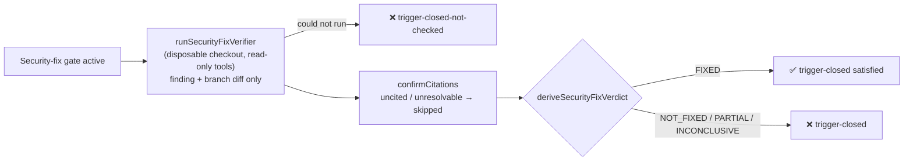

## Summary

The security-fix gate's `trigger-closed` item no longer trusts the PR summary.
The `TRIGGER_CLOSED` regex is deleted. When the gate is active, the completion
phase now runs one independent, read-only verifier pass
(`runSecurityFixVerifier`, `worker/deno/lib/security_fix_verifier.ts`). That
pass sees only the security finding (the issue title and body) and the branch
diff, never the summary or the implementation transcript. It answers
VulnHunter's four gates, and the worker derives a verdict from them. Only
`FIXED` satisfies `trigger-closed`. `NOT_FIXED`, `PARTIAL` and `INCONCLUSIVE`
block with `trigger-closed`. A pass that could not run blocks with the new
`trigger-closed-not-checked`. The verifier reuses the pre-PR verifier's
disposable-checkout runner, now extracted as `runInDisposableCheckout` in
`worker/deno/lib/pre_pr_verifier.ts`. Closes #3657.

## Spec

### Intent and Rationale

- The fixer graded its own fix: writing "no bypass exists" satisfied `trigger-closed` whatever the code did (the self-grading #3512 documents). A separate read-only judge that never sees the fixer's account removes that self-grading.
- The pre-PR verifier's clone/snapshot code is extracted and called from both verifiers, rather than copied, so the two disposable-checkout boundaries cannot drift.

### Essential Design Decisions

- The **worker**, not the model, derives the verdict (`deriveSecurityFixVerdict`, `security_fix_verdict.ts`). It also checks every citation at the head (`confirmCitations`): a `pass` or `fail` with no citation, a malformed one, a non-regular file, or a line past the end of the file is demoted to `skipped`. So a model that claims all four gates pass without evidence gets `INCONCLUSIVE`.
- Deliberate departure from VulnHunter's mapping: a `reachability` fail also maps to `NOT_FIXED` (VulnHunter names only `sink_mitigated`). Every non-FIXED verdict blocks either way.
- The verifier's built-in shell, edit, agent and web tools are denied (`SECURITY_FIX_VERIFIER_DISALLOWED_TOOLS`), so it only reads (Read/Grep/Glob) and is handed the diff in its prompt. `docs/archive/pr-summaries/` is excluded from the diff and removed from the clone.
- Every failure to run is `not_checked`, which blocks: runner error, timeout, unparseable reply, unresolvable base ref, an unreadable, empty or oversized diff (300,000-character cap), a citation lookup that fails, a change to the issue checkout, or no verifier wired.

### Undiscoverable Facts

- VulnHunter's `phase2_verify.md` verdict mapping (read from the upstream repository this run): FIXED = all applicable gates pass; NOT_FIXED = `sink_mitigated` fails; PARTIAL = sink passes but `sweep_complete` or `class_eliminated` fails; otherwise INCONCLUSIVE. VulnHunter also allows `n/a` for `sweep_complete`. This gate drops `n/a` because every gate must cite a `path:line`.
- The persisted verdict store (`security_fix_gate_feedback.ts`) still records only the missing kinds and declarations. The verifier's verdict and rationale reach only the operator: the block message and the issue comment (`buildSecurityFixGateBlockComment`) carry the "Independent verifier verdict:" block. The in-run retry prompt (`buildSecurityFixGateRetryPrompt`) is built from the persisted block, so it names the missing `trigger-closed` or `trigger-closed-not-checked` item but not the verdict, and nothing replays the verdict into a later run.

## Evidence

Backend-only change (no UI files). Tests that verify it:

- `worker/deno/tests/security_fix_verdict_test.ts`: parsing, citation checks, the verdict mapping, the no-citation-means-skipped rule, and hostile long inputs for both citation patterns.
- `worker/deno/tests/security_fix_verifier_test.ts`: the runner against a real temp git repo with a scripted model. It covers FIXED, NOT_FIXED, PARTIAL and INCONCLUSIVE, and these not-checked paths: a failed, timed-out or unparseable model run; an unresolvable base ref; a failed `git diff` ("security-fix verifier: a git diff that fails after the checkout is prepared is not checked and runs no model"); an empty or over-cap diff; an invalid issue number; a failed `ls-tree` or `cat-file` at the head; a failed removal of the PR summaries; and a changed or unreadable issue checkout. It also checks that the prompt carries no PR summary. The not-wired and throwing-verifier paths are covered in `completion_phase_security_gate_test.ts`.
- `worker/deno/tests/security_fix_gate_test.ts`: the gate's response to each verdict, and that prose cannot satisfy `trigger-closed`.
- `worker/deno/tests/completion_phase_security_gate_test.ts` and `worker/deno/tests/completion_phase_security_gate_retry_test.ts`: the live call site.
- `worker/deno/tests/pre_pr_verifier_3395_test.ts`: `runInDisposableCheckout` called directly, plus the unchanged pre-PR verifier tests.
- `worker/deno/tests/issue_worker_wiring_test.ts`: the production wiring.

**Docs sweep**: grep: `trigger-closed`, `TRIGGER_CLOSED`, "trigger closed", "no trivial bypass", "self-reported", "Self-reported", `runPrePrVerifier`, "disposable checkout". Section: `docs/security-fix-gate-feedback.md#the-independent-verifier-issue-3657`. Siblings: `discrimination-not-checked`, `diff-unavailable`, `security_fix_discrimination.ts`. Updated: `docs/security-fix-gate-feedback.md`, `docs/CONFIGURATION.md`, `docs/INTERNALS.md`, `docs/security/idle-task-scans-vs-anthropic-visa-harnesses-gap-analysis.md`, `docs/security/vulnhunter-methodology-evaluation.md`, `docs/workflows/issue-processing.md`. Hits left in place:

- `docs/security-fix-gate-feedback.md:15`: still true because it is the history of the original problem.
- `docs/security/vulnhunter-methodology-evaluation.md:127`: still true because "What VibeCoder has today" is the evaluation's dated record. The new "Delivered (#3657)" paragraph in that section records what shipped.
- `docs/security/idle-task-scans-vs-anthropic-visa-harnesses-gap-analysis.md:153`: still true because it is the original G4 gap statement.

## Acceptance Criteria

<!-- vibe-spec-review inputs="diff+issue-body" -->

- **met** — `trigger-closed` is satisfied by a `FIXED` verdict from the verifier, not by summary prose. — evidence: `worker/deno/tests/security_fix_gate_test.ts::evaluateSecurityFixGate - summary prose cannot satisfy trigger-closed past a NOT_FIXED verdict (Issue #3657)`, `worker/deno/tests/security_fix_verifier_test.ts::security-fix verifier: the prompt carries the finding and the diff but never the PR summary` — reviewer: met
- **met** — A verifier pass that errors, times out or returns unparseable output blocks the PR with a "not checked" reason. — evidence: `worker/deno/tests/security_fix_verifier_test.ts::security-fix verifier: a model run that fails is not checked`, `::security-fix verifier: a timed-out model run is not checked`, `::security-fix verifier: an unparseable reply is not checked`, `worker/deno/tests/completion_phase_security_gate_test.ts::completion - a throwing verifier blocks with trigger-closed-not-checked (Issue #3657)` — reviewer: met
- **met** — Each gate in the verdict cites a `file:line` at the head; a gate with no citation counts as `skipped`. — evidence: `worker/deno/tests/security_fix_verdict_test.ts::a reply claiming all pass with no citations is INCONCLUSIVE once confirmed (Issue #3657)`, `worker/deno/tests/security_fix_verifier_test.ts::security-fix verifier: a pass citing a missing file or a line past the end is demoted to skipped` — reviewer: met
- **met** — Tests cover `FIXED`, `NOT_FIXED`, `PARTIAL`, `INCONCLUSIVE` and the could-not-run outcome. — evidence: `worker/deno/tests/security_fix_verifier_test.ts::security-fix verifier: all four gates citing the head give FIXED`, `::security-fix verifier: a failed sink gate gives NOT_FIXED`, `::security-fix verifier: a sink fix that misses the class gives PARTIAL`, `::security-fix verifier: one skipped gate gives INCONCLUSIVE`, `worker/deno/tests/security_fix_gate_test.ts::evaluateSecurityFixGate - a not_checked verification blocks as not checked (Issue #3657)` — reviewer: met
- **met** — Reuse the existing disposable-checkout runner in `worker/deno/lib/pre_pr_verifier.ts` rather than building a second one. — evidence: `worker/deno/tests/pre_pr_verifier_3395_test.ts::runInDisposableCheckout: use gets a clone at the head, its result is returned, and the temp dir is removed` — reviewer: met
- **unrequested** — a `reachability` fail maps to `NOT_FIXED`, where VulnHunter's mapping names only `sink_mitigated` — reviewer: unrequested — reason: a mitigation off the original trigger's path leaves it open; every non-FIXED verdict blocks, so only the label differs
- **unrequested** — `docs/archive/pr-summaries/` is excluded from the diff and removed from the disposable clone — reviewer: unrequested — reason: enforces the issue's "finding body and the branch diff only", since the summary is committed on the branch
- **unrequested** — the verifier timeout is capped at `PRE_PR_VERIFIER_TIMEOUT_SECONDS` and the diff at 300,000 characters (over the cap is not checked) — reviewer: unrequested — reason: bounds on untrusted input and run time, and both fail closed
- **unrequested** — the prompt contract wording in `security_fix_gate_feedback.ts`, and `trigger-closed-not-checked` excluded from `REQUIRED_SECURITY_FIX_EVIDENCE` — reviewer: unrequested — reason: the up-front contract is built from the gate's descriptions and would otherwise still promise the old prose check
- **unrequested** — `SecurityGateRunVerdict.verification`, the "Independent verifier verdict:" block in the block message, and the `runSecurityFixVerifier` seam on `ClaudeDeps` — reviewer: unrequested — reason: the plumbing that carries the verdict to the gate, the run-state block record and the operator comment
- **unrequested** — docs updates (`CONFIGURATION.md`, `INTERNALS.md`, `security-fix-gate-feedback.md`, `issue-processing.md`, the gap analysis, the VulnHunter evaluation) and the sweep-ledger slice `docs/audits/lib-sweep-coverage/top-up-3657.json` — reviewer: unrequested — reason: the repository requires a docs change with a behaviour change, and requires every new lib module to be claimed by a sweep slice (`lib_sweep_coverage_test.ts`)

## Standards Review

<!-- vibe-standards-review inputs="diff+CODING-STANDARDS.md" -->

- **violation** — call the existing owner, never copy it: private `isPlainObject`, `hasControlCharacter` and `firstStderrLine` copied existing helpers — evidence: `worker/deno/lib/security_fix_verdict.ts:93` — reason: fixed in this diff. The owners are now exported: `isPlainObject` from `codegraph_context_config.ts` (a leaf module, so no import cycle), `hasControlCharacters` from `custom_label_prompts_config.ts`, and `firstLine` from `container_egress_probe.ts`. Both modules import them.
- **violation** — an outcome no input can reach is dead code, and a refusal test must be refused by the rule it names: the `DRIVE_PREFIX` check could never fire, because the citation pattern already excludes `:` — evidence: `worker/deno/lib/security_fix_verdict.ts:91` — reason: fixed in this diff. The check is removed, and a comment on the pattern and in the test records that the pattern refuses drive-letter paths.
- **clean** — Review-enforced rules checked: "Nothing exists only for a test to read" (every new export has a production reader); "A named test must exist"; "Every changed call site needs a test" (`createDefaultDeps`, the completion call site, and every caller of `buildSecurityFixGateMessage`); "A new argument reaches every caller" (`verification` is required on the gate input, on `SecurityGateRunVerdict` and on the message builder); "Never fail silently" (each verifier failure is `not_checked` with a reason). The optional note that the `countLines` throws dropped git's cause is fixed in this diff and tested. Also checked: shallow-history assumptions, `/tmp` usage (tests use `Deno.makeTempDir`), and Australian English.

## Test Plan

- New: `worker/deno/tests/security_fix_verdict_test.ts`, `worker/deno/tests/security_fix_verifier_test.ts`, and the `runInDisposableCheckout:` tests in `worker/deno/tests/pre_pr_verifier_3395_test.ts`.
- New tests in existing files:
  - `worker/deno/tests/security_fix_gate_test.ts`: FIXED; NOT_FIXED/PARTIAL/INCONCLUSIVE; `not_checked`; `null`; prose past NOT_FIXED; both message blocks.
  - `worker/deno/tests/completion_phase_security_gate_test.ts`: verdict (a)–(f) plus the verifier's own unresolvable-base branch, and the verifier's log lines: "completion - a checked verdict is logged as run with its verdict (Issue #3657)", "completion - a not checked verification is logged as not run with its reason (Issue #3657)" and "completion - a verifier kept from running by an unresolvable base ref is logged with the reason (Issue #3657)".
  - `worker/deno/tests/issue_worker_wiring_test.ts`: production wiring.
  - `worker/deno/tests/security_fix_gate_feedback_test.ts`: contract wording.
- Removed or changed assertions in existing tests, each with the requirement that makes it untrue:
  - `assertStringIncludes(message, "ORIGINAL TRIGGER");` (`worker/deno/tests/security_fix_gate_test.ts`). The `trigger-closed` description no longer asks for an "original trigger" statement, because #3657 replaces summary prose with the verifier verdict. It is replaced by `assertStringIncludes(message, "independent read-only verifier")`.
  - `assertStringIncludes(comment, "ORIGINAL TRIGGER");`, both occurrences (`worker/deno/tests/security_fix_gate_retry_test.ts`). Same requirement, same replacement.
  - Removed from `worker/deno/tests/completion_phase_security_gate_test.ts`: `assertEquals(block?.missing, [ "test-identifier-in-diff", "trigger-closed", ]);` in "completion - a gate block records its missing items in run state (Issue #4057)" — #3657 requires a verifier pass that could not run to block as not checked, and that scenario scripts no verifier, so `trigger-closed` is no longer the missing item. It now reads `assertEquals(block?.missing, [ "test-identifier-in-diff", "trigger-closed-not-checked", ]);`. Red-check: dropping the identifier item still turns it red, because the list then has one entry.
  - The renamed test "evaluateSecurityFixGate - flags a missing trigger-closed statement on a bare summary" is now "… flags trigger-closed on a bare summary when the verifier is not FIXED". Its `ok`/`missing` assertions are kept and it now scripts a NOT_FIXED verdict.
  - The other changed lines add the new required `verification` argument to existing calls; no assertion changed.
- Red-checks: each guard was broken on purpose, the named test went red, and the guard was restored.
  - `verdict !== "FIXED"` → `=== "NOT_FIXED"`: the NOT_FIXED/PARTIAL/INCONCLUSIVE gate test went red.
  - Removing the `not_checked` branch, or the `null` branch, turned each not-checked gate test red.
  - Dropping the `:(exclude)` pathspec turned the "never the PR summary" test red.
  - Skipping `confirmCitations` turned the demotion test red.
  - Passing `verification: null` at the completion call site, or skipping the call, turned completion tests (a) and (e) red.
  - Each new `runInDisposableCheckout` and verifier failure test was red-checked the same way in a scratch copy.
  - Changing the `git diff` guard in `security_fix_verifier.ts:211` to `diff.code === 99999` turned "security-fix verifier: a git diff that fails after the checkout is prepared is not checked and runs no model" red.
  - The four mutants of `runSecurityVerification` in `completion_phase.ts` each turned a log test red: deleting the `logger.warn` call at line 413 (the unresolvable-base log test); negating the `checked` condition at line 440, run with `--no-check` (the checked and not-checked log tests); deleting `verdict` at line 442 (the checked log test); and deleting `reason` at line 446 (the not-checked log test).
- Results on the final head:
  - Targeted run (301 tests, after the log and `git diff` tests were added): `deno test -A tests/security_fix_verdict_test.ts tests/security_fix_verifier_test.ts tests/security_fix_gate_test.ts tests/security_fix_gate_retry_test.ts tests/security_fix_gate_feedback_test.ts tests/completion_phase_security_gate_test.ts tests/completion_phase_security_gate_retry_test.ts tests/issue_worker_wiring_test.ts tests/pre_pr_verifier_3395_test.ts tests/completion_phase_pre_pr_verifier_3395_test.ts` passed.
  - The full `./quality.sh` passed on the code head before the log and `git diff` tests were added (no production code has changed since); the worker re-runs it on this head: "Result: PASSED (with skipped checks)"; only "config integration" was skipped. Deno tests passed in both the parallel run (7m22s) and the serial run (2m47s).
  - The pre-push gate (`runPrePushGate` with the milestone as `baseRef`) passed. It had blocked an earlier attempt because the sweep slice's `sweptAt` was a milestone merge commit; it now records `git merge-base origin/main HEAD` (`568f2366`), and `worker/deno/tests/lib_sweep_coverage_test.ts` passed.
  - `deno task pr-summary-check`: 0 gates blocked. The summary claim check is not checked here; the worker runs it when it raises the PR.

<!-- vibe-branch-outcomes -->
