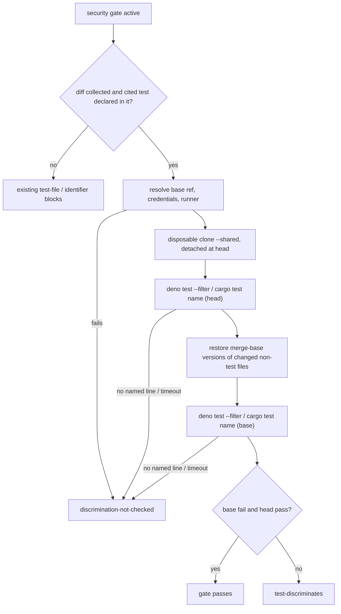

## Summary

The security-fix gate now executes the test a security-fix PR cites, instead of
accepting the PR summary's word that it fails before the fix. When the gate is
active and the summary cites a test declared in the branch diff, the worker (not
the agent) runs that test twice in a disposable checkout. The first run is at
the head and must pass. The second runs with the merge-base versions of the
branch's changed non-test files restored, and must fail. A test that is green on
both runs, or red on both, blocks as `test-discriminates`. A run that cannot
execute blocks as `discrimination-not-checked` and is never counted as the red
run. The prose `regression-test` requirement is removed. Closes #3659.

## Spec

### Intent and Rationale

- A test that passes on the vulnerable code proves nothing. Before this change
  the gate took "fails before the fix" from summary prose, written by the same
  agent the evidence is about. VulnHunter's Step E.5 records an executed pre-fix
  FAIL and post-fix PASS. This PR adopts that check, run by the worker.
- The runner reuses the mutation gate's `MutationRunnerSeams`
  (`defaultMutationRunnerSeams`: allowlisted child environment,
  kill-on-timeout), `findDenoConfigDir` and `isDenoTestFile`. The mutation
  runner mutates lines rather than running one named test, so `runMutationCheck`
  itself does not fit.

### Essential Design Decisions

- A run counts as pass or fail only when the runner prints the named test's own
  line: deno's unindented `<name> ... ok` or `<name> ... FAILED`, or cargo's
  `test <path> ... ok` or `... FAILED` for a Rust test. Several broken runs
  exit cleanly or print nothing for the test: a filter that matches nothing
  (exit 0, `0 passed`), a missing import, a timeout, a git failure, an exhausted
  budget. All of them return `not_checked`, so a runner fault can never read as
  "fails before the fix" (the #3615 shape).
- Base versions come from the merge base, matching the `<base>...HEAD` diff the
  gate reads. A production file the branch added has no base version, so it
  stays at its head version. The disposable checkout is a `git clone --shared`
  of the issue checkout, detached at the head, with no remote, and removed
  afterwards. The issue checkout is never modified.
- Deno and Rust tests can be executed today. A Deno test is a string-named
  `Deno.test` in a `*_test.*` / `*.test.*` file under a
  `deno.json`/`deno.jsonc`/`deno.lock` project, run with `deno test --filter`. A
  Rust test is a `#[test] fn` in a `.rs` file under a `Cargo.toml` package, run
  with `cargo test --no-fail-fast [--test <stem>] <name>` in the nearest
  `[package]` directory and read from the named `test <path> ... ok|FAILED` line
  (PR #3921 review). A security fix whose cited test is in another language
  blocks as `discrimination-not-checked`, with a reason that says the worker
  runs only Deno and Rust tests and lists the cited files (or, when no
  executable test was cited at all, says so), unless the repository sets
  `skip_security_fix_check`. That is fail-closed by design: "could not run"
  blocks.
- The record travels on the block verdict in run state
  (`SecurityGateRunVerdict.discrimination` in `state.securityGateBlocks`) and is
  rendered in the block message as "Recorded discrimination runs" (scrubbed and
  code-fenced). It is also persisted in the verdict store
  (`SecurityFixGateBlock.discrimination`, bounded on write and on read), so the
  in-run retry and the next run replay it with a note on what each outcome
  means; the retry prompt no longer calls the code "very likely already
  correct" or offers "commit nothing" for a discrimination block (PR #3921
  review). The field is optional in the version-1 file: an older file reads as
  having none, so the store key is not bumped. A passing run is logged at info
  and is not written to run state, because the gate writes run state only when
  it blocks.

### Undiscoverable Facts

- Observed with deno in this run:
  `deno test --no-check -A --filter "nomatch" a_test.ts` exits 0 and prints
  `ok | 0 passed | 0 failed | 3 filtered out`. A test importing a missing module
  exits 1 with `error: Module not found "file:///…/missing.ts".` on stderr and
  no named line. A passing test prints
  `rejects injection attempt ... ok (228µs)`, and a failing one prints
  `fails here ... FAILED (510µs)`. The `namedTestOutcome` fixtures are built
  from this output.
- The base ref is resolved by the completion phase's existing
  `resolveComparableBaseRef`. It fetches `origin/<base>` explicitly when the
  `--depth=1` checkout lacks it (#3494).

## Evidence

Backend/CLI change. No UI files are touched.

- `worker/deno/lib/security_fix_discrimination.ts`: the new runner,
  `runSecurityFixDiscrimination`, `namedTestOutcome` and, for Rust,
  `namedRustTestOutcome`; `findCargoPackageDir` in `mutation_runner.ts` resolves
  the package directory.
- `worker/deno/lib/security_fix_gate_feedback.ts` and
  `worker/deno/lib/security_fix_gate_retry.ts`: the bounded discrimination
  record in the persisted verdict, its replay in the feedback section and retry
  prompt, and the discrimination-specific escalation step.
- `worker/deno/lib/security_fix_gate.ts`:
  - New `citedSecurityTests` (hunk-aware, so an added line reading `+++ b/…`
    cannot re-attribute a test to another file); a `.rs` section is cited by its
    `fn` name.
  - New kinds `test-discriminates` and `discrimination-not-checked`, and
    `regression-test` removed.
  - The block message now renders the recorded runs.
- `worker/deno/lib/phases/completion_phase.ts`: runs the check when the gate is
  active and a cited test is declared in the diff.
- `worker/deno/lib/issue_worker_wiring.ts`: production wiring
  `quality.runSecurityFixDiscrimination`.
- `docs/audits/lib-sweep-coverage/top-up-3659.json`: registers the new module
  with the lib sweep ledger.

**Docs sweep (PR #3921 review)** — grep: `only Deno`, `string-named`,
`non-Deno`, `very likely already correct`, `commit nothing`,
`SecurityGateRunVerdict.discrimination`; section:
`docs/security-fix-gate-feedback.md#the-executed-red-to-green-check-issue-3659`
and `#the-verdict-store`; siblings: `declarations`, `blockCount`; updated:
`docs/security-fix-gate-feedback.md`, `docs/CONFIGURATION.md`,
`docs/INTERNALS.md`, `docs/security/vulnhunter-methodology-evaluation.md`; no
other hit — the `only Deno` text in `docs/archive/pr-summaries/pr-summary-870.md:77`
and `-2344.md:83` is about Deno source and the Deno seed, unrelated to the gate.

**Docs sweep** — grep: `regression-test`, `REGRESSION_TEST_REFERENCE`,
`BEFORE_AFTER_LINKAGE`, "No execution is required", "fail-before/pass-after",
"security-fix gate"; section:
`docs/security-fix-gate-feedback.md#the-executed-red-to-green-check-issue-3659`;
siblings: `diff-unavailable`, `test-identifier-in-diff`; updated:
`docs/security-fix-gate-feedback.md`, `docs/CONFIGURATION.md`,
`docs/INTERNALS.md`, `docs/security/vulnhunter-methodology-evaluation.md`,
`docs/security/idle-task-scans-vs-anthropic-visa-harnesses-gap-analysis.md`;
`docs/security-fix-gate-feedback.md:15` — still true because it is the history
of #4030, when the prompt omitted the then-current prose linkage;
`docs/workflows/issue-processing.md:1742` — still true because it describes the
bug-report reproduction gate, not the security-fix gate;
`worker/deno/lib/tail_anti_pattern.ts:20` — still true because "regression-test"
is a verb there, unrelated to the gate.

## Acceptance Criteria

<!-- vibe-spec-review inputs="diff+issue-body" -->

- **met** — A named security test that passes against the base-branch production
  files blocks the PR as non-discriminating. — evidence:
  `worker/deno/tests/security_fix_gate_test.ts::evaluateSecurityFixGate - green then green does not discriminate (Issue #3659)`,
  `worker/deno/tests/security_fix_discrimination_test.ts::discrimination: green at base and head is checked pass/pass`,
  `worker/deno/tests/completion_phase_security_gate_test.ts::completion - green-to-green blocks the PR and names the recorded runs (Issue #3659)`
  — reviewer: met
- **met** — A test run that cannot execute blocks as not checked, never as red.
  — evidence:
  `worker/deno/tests/security_fix_discrimination_test.ts::discrimination: a run that cannot start is not_checked, never red`,
  `worker/deno/tests/security_fix_gate_test.ts::evaluateSecurityFixGate - a not_checked record blocks and is never counted as red (Issue #3659)`,
  `worker/deno/tests/completion_phase_security_gate_test.ts::completion - an unwired runner blocks rather than passing unchecked (Issue #3659)`
  — reviewer: met
- **met** — The prose `regression-test` requirement is dropped, or kept only as
  a human-review aid, once the executed check exists. — evidence:
  `worker/deno/lib/security_fix_gate.ts` (kind and regexes removed),
  `worker/deno/tests/security_fix_gate_feedback_test.ts::gate feedback - an old block carrying the dropped regression-test kind keeps only the live kinds (Issue #3659)`
  — reviewer: met
- **met** — Tests cover red→green (pass), green→green (block), red→red (block)
  and could-not-run (block). — evidence:
  `worker/deno/tests/completion_phase_security_gate_test.ts` (red-to-green,
  green-to-green, red-to-red, not_checked tests) and
  `worker/deno/tests/security_fix_discrimination_test.ts` (the same four against
  a real git repo, plus one real `deno test` end-to-end) — reviewer: met
- **unrequested** — `citedSecurityTests` and `MAX_CITED_SECURITY_TESTS` —
  reviewer: unrequested — reason: the runner needs a file and raw test name,
  which the existing boolean `citedTestIdentifierInDiff` cannot supply
- **unrequested** — old persisted blocks carrying `regression-test` are read
  with that kind dropped — reviewer: unrequested — reason: a direct consequence
  of removing the kind; the persisted-shape rule requires old-shape tests
- **unrequested** — `buildSecurityFixGateMessage` takes a required
  `discrimination` parameter, and `declarations` lost its default — reviewer:
  unrequested — reason: the block message must show the recorded runs, and the
  standard bars a default that silently turns behaviour off
- **unrequested** — status updates to
  `docs/security/vulnhunter-methodology-evaluation.md`, the gap-analysis doc and
  `docs/INTERNALS.md` — reviewer: unrequested — reason: these docs described the
  prose check as current, and the docs-owe rule requires fixing them
- **unrequested** — info/warn log lines for the discrimination run in
  `completion_phase.ts` — reviewer: unrequested — reason: makes a passing or
  unrunnable check visible in the worker log, like the mutation gate's notes

The Spec reviewer also rated two proposal items `partial`. These are not
acceptance criteria. (a) "Record both outcomes in run state": a passing run is
logged but not written to run state, because the gate's verdict is carried in
run state and the verdict store only on a block today. (b) "Reuse its runner where it fits": the seams
and config-dir lookup are reused, but the named-test invocation and output
parsing are new, since `runMutationCheck` mutates lines rather than running one
test.

## Standards Review

<!-- vibe-standards-review inputs="diff+CODING-STANDARDS.md" -->

- **violation** — Every changed call site needs a test that goes red without it
  (production wiring, and `repoPath`/`budgetSeconds`/`credentialEnv` unasserted)
  — evidence: `worker/deno/lib/issue_worker_wiring.ts:791`,
  `worker/deno/lib/phases/completion_phase.ts:358` — reason: fixed in this diff
  (`worker/deno/tests/issue_worker_wiring_test.ts::createDefaultDeps - wires the real security-fix discrimination runner (Issue #3659)`,
  plus completion tests asserting every runner input including credentials)
- **violation** — Every outcome of a branch you add needs a test (unresolvable
  base ref, credential failure, each operand of the run condition) — evidence:
  `worker/deno/lib/phases/completion_phase.ts:333`,
  `worker/deno/lib/phases/completion_phase.ts:347`,
  `worker/deno/lib/phases/completion_phase.ts:2475` — reason: fixed in this diff
  (tests added for each branch; the two operands no input could reach were
  removed as dead code)
- **violation** — Writing a gate over text: an added `++ b/x` line renders as
  `+++ b/x` and could re-attribute declarations to another file — evidence:
  `worker/deno/lib/security_fix_gate.ts:422` — reason: fixed in this diff
  (hunk-aware parsing, with evasion tests that went red against the old parser)
- **clean** — named tests exist; the stub mirrors real deno output and is backed
  by a real-deno test; shallow checkout handled; old-shape persisted tests
  present; new required arguments reach every caller; fail-loud reasons quote
  the cause line; untrusted text is scrubbed and fenced; no test-only members;
  Australian English. Review-enforced rules checked: changed call sites, branch
  outcomes, gate-over-text evasion, removed assertions, new preconditions, named
  tests exist, stub contract, new arguments reach callers. Optional notes
  addressed: stale `evaluateSecurityFixGate` snippet in
  `docs/security-fix-gate-feedback.md` updated, and a hostile-input growth test
  added for `STRING_NAME_PATTERN`.

## Test Plan

- New `worker/deno/tests/security_fix_discrimination_test.ts` (45 tests):
  - `namedTestOutcome` cases built from observed deno output, and
    `namedRustTestOutcome` cases in the shape `cargo test` prints
    (`test <path> ... ok|FAILED`).
  - Rust scenarios with a fake cargo over a real git repository: red→green,
    red at the head, a build failure quoting rustc's cause, no package
    manifest, a virtual workspace manifest, a root package reached by climbing,
    a name that is not a function name, and a test outside `tests/`.
  - Real-git scenario tests for red→green, green→green, red→red, could-not-run,
    a missing base ref, a timeout, no Deno marker, empty or branch-added
    production files, an exhausted budget, and an unexpected throw.
  - One real `deno test` end-to-end run (fail at base, pass at head).
- `worker/deno/tests/security_fix_gate_test.ts`:
  - Discrimination evaluation (red→green, green→green, red→red, green→red,
    not_checked, null, missing identifier).
  - `citedSecurityTests`, including the two header-spoofing evasion cases, a
    Rust `#[test] fn` cited by its function name, and a Rust `fn` with no test
    attribute and a pytest `def` (neither yields a runnable citation).
  - Message rendering.
- New `worker/deno/tests/security_fix_gate_growth_test.ts`: linear-growth
  hostile case for `STRING_NAME_PATTERN` (wall-clock, serial lane).
- `worker/deno/tests/completion_phase_security_gate_test.ts`:
  - End-to-end red→green, green→green, red→red, not_checked, unwired runner,
    throwing runner, credential failure and unresolvable base ref.
  - One runner-not-called test per load-bearing operand, plus credential
    pass-through.
- `worker/deno/tests/issue_worker_wiring_test.ts`: the production wiring reaches
  the real runner.
- `worker/deno/tests/security_fix_gate_feedback_test.ts`: two old-shape
  persisted-block tests (`regression-test` dropped on read); and, for the
  persisted discrimination record, a round trip that renders for the next
  attempt, a file written before the field existed, a malformed or oversized
  record, `sanitiseDiscrimination` over both live shapes and each refusal, and a
  block without a discrimination kind that never renders the record.
- `worker/deno/tests/security_fix_gate_retry_test.ts`: seven tests that the
  retry prompt names the recorded base and head outcomes (green→green, red at
  the head, not checked with its cause), keeps the wording-fault guidance for
  other blocks, points the escalation at the recorded runs, and persists and
  replays the record (also when the store cannot be written). Fixtures take
  `discrimination: null`.
  `worker/deno/tests/completion_phase_security_gate_retry_test.ts`: fixtures
  updated for the new verdict field and the runner stub.
- Removed assertions. The issue drops the prose `regression-test` requirement,
  which makes each of these untrue:
  - `assertEquals(result.missing.includes("regression-test"), false);`
  - `assertEquals(result.missing.sort(), ["regression-test", "trigger-closed"]);`
    (now `["trigger-closed"]`)
  - `assertEquals(result.missing, ["regression-test"]);` (two deleted tests,
    "flags missing regression test only" and "regression test needs before/after
    linkage", replaced by the `test-discriminates` tests)
  - `"regression-test",` in the empty-content and gate-block expected lists
  - `assertStringIncludes(message, "regression test")` (replaced by "must FAIL
    against the base branch")
- Red checks. Each guard below was broken on purpose and the named tests went
  red, then the guard was restored:
  - Each operand of `preFix === "fail" && postFix === "pass"`.
  - The `!record` and `kind === "not_checked"` branches.
  - The identifier precondition.
  - The hunk counting.
  - The wiring line.
  - The `discrimination` argument to `evaluateSecurityFixGate`.
  - The `productionFiles` filter.
  - The `citedTestIdentifierInDiff` operand.
  - Every runner branch listed in the facts file.
- PR #3921 review: every branch the fix adds was flipped on its own and the
  named test went red, including each operand of the compound conditions (the
  runnable-test `filter`, the cargo name match, `sanitiseDiscrimination`'s checked
  guard and `blocksOnDiscrimination`); the entries are in the facts file.
- Edited expectations: the gate-block `missing` list in
  `completion_phase_security_gate_test.ts` still goes red when the identifier
  guard is removed.
- `./quality.sh < /dev/null` on the PR #3921 review-fix tree: passed — every stage passed (parallel and serial Deno test passes included) except `config integration`, which skipped because the checkout has no `.config.json`.

<!-- vibe-branch-outcomes -->
