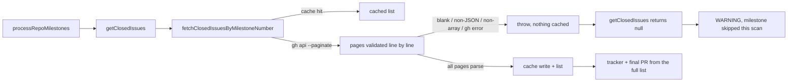

## Summary

The milestone-completion scan read each milestone's closed issues through `fetchClosedIssuesByMilestone`, which filters the repo-wide `gh issue list --state closed --limit 500` batch by milestone title. That batch holds only the 500 newest closed issues in the repository, so a milestone whose sub-issues were older came back empty. `processRepoMilestones` then skipped it as empty on every scan, and no tracker or final PR was ever raised. A milestone that was only partly visible got a tracker body and `Issues addressed` list that left out older delivered sub-issues.

A new helper, `fetchClosedIssuesByMilestoneNumber` (`worker/deno/lib/issue_query.ts`), reads one milestone's closed issues by milestone **number** with `gh api repos/<repo>/issues?milestone=<n>&state=closed&per_page=100 --paginate`. Pull requests are filtered out, and the result is cached per milestone under `issues_closed_milestone_<n>`. A failed read throws and is never cached. `getClosedIssues` in `worker/deno/lib/milestone_completion.ts` now uses it and returns `null` on a failed read, kept apart from `[]`. When the read fails, `processRepoMilestones` logs a `WARNING` and skips the milestone for that scan, so it is neither closed as "nothing to merge" nor treated as empty. On the same failure, `refreshOpenSummaryPrBodyWhileIncomplete` logs a `WARNING` and leaves the summary PR body unchanged. Closes #3662.

## Spec

### Intent and Rationale

- The issue's suggested fix was a per-milestone paginated REST read cached by milestone number. This PR does exactly that. The read is no longer bounded by the newest-500 window, so an old milestone's closed issues are always seen.
- `fetchClosedIssuesByMilestone` (by title) stays as it is for its other callers (`milestone_progress.ts`, `milestone_health.ts`). Its doc comment now records the 500-issue bound and points to the new helper.

### Essential Design Decisions

- A failed read throws instead of returning `[]`. The old fetcher turned gh failures into `[]`, which made an unreadable milestone look empty. `null` from `getClosedIssues` lets both callers skip it.
- `--paginate` prints one JSON array per page, so the payload is validated line by line. Blank output throws (Issue #4257), as do a non-JSON page and a non-array page.
- `noteGhIssueClose` does not invalidate the per-milestone cache key, because a close or reopen does not carry the milestone number. The entry refreshes on its 600 s TTL. This is documented in `docs/GH-API-OPTIMISATION.md`.

### Undiscoverable Facts

- `gh issue list` returns issues newest-created first, and the REST issues endpoint returns pull requests as well as issues (marked by a `pull_request` key). The issue body and GitHub's REST documentation for "List repository issues" are the source for both facts.

## Evidence

This is a backend-only change, so there are no screenshots.

- `worker/deno/tests/issue_query_test.ts::issue_query - #3662 regression: a milestone outside the repo-wide batch is read by number`: the repo-wide batch omits the milestone's issue, and the by-number read returns it.
- `worker/deno/tests/milestone_completion_test.ts::Issue #3662 - a complete milestone raises its tracker and summary PR from the REST closed read, though the repo-wide closed batch omits its issue` runs the whole scan end to end.

**Docs sweep** — grep: `fetchClosedIssuesByMilestone`, `fetchAllClosedIssues`, `getClosedIssues`, `issues_closed_all`, `issues_closed_milestone`, `CLOSED_ALL_DEFAULT_LIMIT`, `--limit 500`, "newest 500", "closed issues"; section: `docs/workflows/milestones.md#-milestone-completion`; siblings: `fetchAllIssues`, `fetchIssuesByLabel` (the cached-read list in `docs/GH-API-OPTIMISATION.md`, which now names `fetchClosedIssuesByMilestoneNumber`), `issues_all`, `issues_closed_all` (the close/reopen invalidation row, which now has a note saying `issues_closed_milestone_<n>` is not in it); updated: `docs/workflows/milestones.md` (the *Milestone completion* section now describes the by-number closed read and the skip on a failed read, and the *Nothing to merge* bullet records the same), `docs/GH-API-OPTIMISATION.md` (cached-read list entry and invalidation note). Stayed true, read through: `docs/workflows/issue-processing.md:3107` and `DESIGN-PRINCIPLES.md:3134` (they say a close drops `issues_all` / `issues_closed_all`, which is unchanged); `docs/INTERNALS.md:2960` (`build_milestone_summary_body() — list all closed issues`, now true for old milestones as well); `docs/workflows/milestones.md:158` ("lists all closed milestone issues", same reason). The other "closed issues" hits (`docs/workflows/grill-me.md`, `docs/MODEL-AND-CACHING.md:1703`) and the "--limit 500" hits (`docs/GH-API-OPTIMISATION.md:592`, `docs/pre-pr-ci-audit.md:144`) are about other features.

**Branch outcomes:**
- `worker/deno/lib/issue_query.ts:862` — error (milestone number not a positive integer, rejected before any gh call) — `worker/deno/tests/issue_query_test.ts::issue_query - fetchClosedIssuesByMilestoneNumber rejects a non-positive-integer number before calling gh (Issue #3662)` — flipped the guard to `<= -1`, test went red
- `worker/deno/lib/issue_query.ts:877` — success (cache hit, served without gh) — `worker/deno/tests/issue_query_test.ts::issue_query - fetchClosedIssuesByMilestoneNumber serves a second call from cache (Issue #3662)` and `worker/deno/tests/issue_query_test.ts::issue_query - fetchClosedIssuesByMilestoneNumber caches [] as a valid empty result (Issue #3662)` — flipped to never return the cached value, both went red
- `worker/deno/lib/issue_query.ts:896` — error (blank output is a failed call, not an empty list) — `worker/deno/tests/issue_query_test.ts::issue_query - fetchClosedIssuesByMilestoneNumber blank output throws and is not cached (Issue #3662)` — flipped the check to `false`, test went red
- `worker/deno/lib/issue_query.ts:906` — error (a page that is not JSON) — `worker/deno/tests/issue_query_test.ts::issue_query - fetchClosedIssuesByMilestoneNumber throws on a malformed page and does not cache it (Issue #3662)` — replaced `assertListOutput` with a parse that skips bad lines, test went red
- `worker/deno/lib/issue_query.ts:908` — error (a page that is JSON but not an array) — `worker/deno/tests/issue_query_test.ts::issue_query - fetchClosedIssuesByMilestoneNumber throws on a page that is not an array (Issue #3662)` — flipped the check to `false`, test went red
- `worker/deno/lib/issue_query.ts:912` — absent (a page entry that is not a record or has no numeric `number` is skipped) — `worker/deno/tests/issue_query_test.ts::issue_query - fetchClosedIssuesByMilestoneNumber skips a page entry with no numeric number (Issue #3662)` — replaced `continue` with a no-op, and separately dropped the `!isRecord(item)` half; the test went red both times
- `worker/deno/lib/issue_query.ts:915` — fallback (non-string title read as `""`) vs success (title kept) — `worker/deno/tests/issue_query_test.ts::issue_query - fetchClosedIssuesByMilestoneNumber reads one page by number and maps updated_at (Issue #3662)` — forced a constant title, test went red (along with 5 others)
- `worker/deno/lib/issue_query.ts:916` — success (non-empty `updated_at` mapped to `updatedAt`) vs absent (empty or missing `updated_at` omitted) — `worker/deno/tests/issue_query_test.ts::issue_query - fetchClosedIssuesByMilestoneNumber reads one page by number and maps updated_at (Issue #3662)` — flipped `!== ""` to `true` (red), and separately the whole condition to `false` (red)
- `worker/deno/lib/issue_query.ts:924` — success (cache written only after every page parsed) — `worker/deno/tests/issue_query_test.ts::issue_query - fetchClosedIssuesByMilestoneNumber keys the cache per milestone (Issue #3662)` and `worker/deno/tests/issue_query_test.ts::issue_query - fetchClosedIssuesByMilestoneNumber serves a second call from cache (Issue #3662)` — removed the write, both went red
- `worker/deno/lib/milestone_completion.ts:1875` — fail-closed (a failed read returns `null`, not `[]`) — `worker/deno/tests/milestone_completion_test.ts::Issue #3662 - a failed closed-issue read skips a complete milestone: no tracker, summary PR or close, and a WARNING is logged` and `worker/deno/tests/milestone_completion_test.ts::Issue #3662 - a failed closed-issue read leaves an open summary PR body as it is and logs a WARNING` — flipped to `return []`, both went red
- `worker/deno/lib/milestone_completion.ts:1930` — error (failed read: WARNING, summary PR body left as it is) — `worker/deno/tests/milestone_completion_test.ts::Issue #3662 - a failed closed-issue read leaves an open summary PR body as it is and logs a WARNING`; success counterpart `worker/deno/tests/milestone_completion_test.ts::Issue #3662 - a readable closed-issue list still refreshes an open summary PR body` — flipped the check to `false` (run with `--no-check`, since the type checker otherwise rejects the flip), test went red
- `worker/deno/lib/milestone_completion.ts:2412` — error (failed read: WARNING, milestone skipped for the scan) — `worker/deno/tests/milestone_completion_test.ts::Issue #3662 - a failed closed-issue read skips a complete milestone: no tracker, summary PR or close, and a WARNING is logged`; success counterpart `worker/deno/tests/milestone_completion_test.ts::Issue #3662 - the same complete milestone with a readable closed list still raises its tracker and summary PR` — flipped the check to `false` (run with `--no-check`), test went red

## Test Plan

- No assertion was removed from an existing test. The gate reported `assertEquals( args.includes("number,state,headRefName,isCrossRepository"), true, );` in `worker/deno/tests/milestone_completion_test.ts` as removed, but it is still present unchanged in the `classify3474` helper (`worker/deno/tests/milestone_completion_test.ts`, used by every `classifyMilestoneFinalPrs - …` test). `git diff fe8bf9ce HEAD -- worker/deno/tests/milestone_completion_test.ts` has no `-` line containing it, and the file holds exactly one copy both before and after the change.
- Added tests: 12 in `worker/deno/tests/issue_query_test.ts` (`fetchClosedIssuesByMilestoneNumber …` plus the #3662 regression) and 5 in `worker/deno/tests/milestone_completion_test.ts` (`Issue #3662 - …`).
- Edited fake `gh` runners so they answer the new by-number closed read. Only stub matching or stub data changed, no assertion:
  - `worker/deno/tests/milestone_completion_test.ts`: the `isClosedIssueRead` helper. `authoritativeStub` no longer answers `state=closed` reads with the open-children list. Two fakes return `updated_at` (REST field name) instead of `updatedAt`. One `cache.invalidate` now names `issues_closed_milestone_1` instead of `issues_closed_all`.
  - `worker/deno/tests/milestone_completion_cache_test.ts`: same split.
  - `worker/deno/tests/milestone_summary_pr_auto_merge_test.ts`, `worker/deno/tests/milestone_sync_pr_retirement_test.ts` and `worker/deno/tests/open_milestone_pages_3609_test.ts`: these fakes answered every `/issues?milestone=` read with `[]`, so after the switch they saw an empty milestone. 7 tests went red, which is why the mutation check's baseline failed. Each fake now answers the `state=closed` read with the issue it already served through the old `issue list --state closed` branch.
- Results: `worker/deno/tests/issue_query_test.ts` `ok | 98 passed | 0 failed`. The 55 test files that reference `checkAndHandleMilestoneCompletions`, `milestone_completion`, `fetchClosedIssuesByMilestone` or `issue_query` gave `ok | 1085 passed | 0 failed`, including the nine files the mutation check named.
- Flip checks: see **Branch outcomes** above. Each was run against `issue_query_test.ts`, `milestone_completion_test.ts` and `milestone_completion_cache_test.ts`, and the source was restored after each one.

<!-- vibe-branch-outcomes -->

🤖 Generated with [Claude Code](https://claude.com/claude-code)
