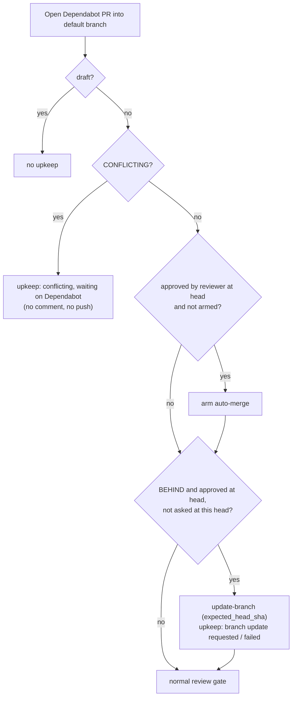

## Summary

The review-fleet-prs gate no longer posts `@dependabot rebase`. Dependabot
refuses that command from the reviewer App, but the gate recorded it as done
and never asked again at that head, so bump PRs stayed behind. Now a behind
Dependabot PR that is approved at its head is brought up to date with the same
`update-branch` call fleet PRs use, both from the gate pass and from `post.ts`
right after an approval. A conflicting Dependabot PR gets no comment and no
push, and upkeep reports `<repo>#<n> conflicting, waiting on Dependabot`.
`dependabot-rebase.json` and the `rebase` action are removed. Closes #3663.

## Spec

### Intent and Rationale

- Dependabot only obeys users with push access, so no App-posted command can
  work. The App already has Contents write, so `update-branch` (which fleet PRs
  already use) is a path that works.
- The `kind` parameter of `needsBranchUpdate` and `shouldUpdateBranch` existed
  only to exclude Dependabot, so it is removed rather than kept unused.

### Essential Design Decisions

- A behind Dependabot PR approved by the reviewer at its head and not yet armed
  has auto-merge armed **before** the branch update in the same pass. The update
  creates a merge commit the approval does not cover, so arming afterwards would
  wait for a re-review. BEHIND no longer blocks the auto-merge decision in
  `dependabotAction`.
- Dependabot PRs use the fleet rule unchanged: approved at the head by anyone
  (any host or by hand), behind, not a draft, not conflicting, once per head
  (`branch-update.json`). A refusal is reported as `branch update failed: …` and
  is not retried at that head.
- The conflicting line is reported on every pass, with no once-per-head memory.
  No action is taken, so there is nothing to repeat or suppress.

### Undiscoverable Facts

- PR #3639's comments show the refusal three times:
  `stsoftware-pr-reviewer[bot]: @dependabot rebase` followed by
  `dependabot[bot]: Sorry, only users with push access can use that command.`
  (`gh api repos/stSoftwareAU/VibeCoder/issues/3639/comments`).
- After `post.ts` updates an approved Dependabot PR that was not yet armed, the
  new merge-commit head is reviewed again before the gate arms auto-merge. The
  gate pass arms it first, so this only applies to the post-approval path.
- Grill-Me Round 1 accepted the trade-off: Dependabot stops self-rebasing a PR
  once someone else commits to it. If such a PR later conflicts, upkeep still
  says `waiting on Dependabot`, and a human closes it or comments
  `@dependabot recreate`.
- `dependabot-rebase.json` files left on existing hosts are no longer read.
  They are harmless and are not deleted.

## Evidence

Backend/CLI only (the review-fleet-prs skill scripts). No UI file is touched.

- Gate pass: `worker/deno/tests/review_fleet_prs_backlog_3225_test.ts`
  ("pass: a fleet or Dependabot PR approved at its head but behind is brought up
  to date once per head (Issue #3225, #3663)" and "pass: a Dependabot PR behind
  and approved by the reviewer gets auto-merge armed before it is updated
  (Issue #3663)").
- Post-approval path: `worker/deno/tests/review_fleet_prs_dependabot_test.ts`
  ("post.ts end to end: an approved, behind Dependabot PR is updated and never
  commented on (Issue #3663)"). Its `gh` stub follows GitHub REST "Update a pull
  request branch" (`PUT /repos/{owner}/{repo}/pulls/{pull_number}/update-branch`,
  202 with `message`/`url`; <https://docs.github.com/en/rest/pulls/pulls#update-a-pull-request-branch>).
  It answers only the three calls `post.ts` makes on this path (`pr view`,
  `pr review`, the update-branch `api` call) and exits 1 on any other call.
- Issue numbers cited: #3663: Dependabot refuses the reviewer App's
  @dependabot rebase; bump PRs stay behind. #3225: review-fleet-prs gets stuck
  on a backlog … never brings an approved PR up to date. #3639: chore(actions):
  bump the github-actions group with 4 updates.

**Docs sweep** — grep: "@dependabot rebase", "rebase requested",
`dependabot-rebase`, `REBASE_FILE`, "rebase failed", "never pushed",
`approved-fleet-prs-that-are-behind`, "rebas\w* request", `needsBranchUpdate`,
`shouldUpdateBranch`, `dependabotAction`; section:
`.claude/skills/review-fleet-prs/references/edge-cases.md#dependabot-prs`
(and `#approved-prs-that-are-behind`, renamed from
`#approved-fleet-prs-that-are-behind`); siblings: "auto-merge failed",
"branch update requested" (the upkeep-line set gained
`conflicting, waiting on Dependabot`; the edge-cases list names it, and SKILL.md's
upkeep pointer lists it); updated: `.claude/skills/review-fleet-prs/SKILL.md`,
`.claude/skills/review-fleet-prs/references/edge-cases.md`,
`.claude/skills/review-fleet-prs/references/running-unattended.md`,
`docs/CONFIGURATION.md`, and the header comments of `scripts/dependabot.ts`,
`scripts/branch_update.ts`, `scripts/post.ts` and `scripts/gate.ts`;
`docs/HUMAN-PR-POLICY.md:179` — still true because it describes the worker's own
bot-PR path, which never posts `@dependabot rebase`;
`worker/deno/lib/pr_branch_update.ts:543` — still true for the same reason;
`worker/deno/tests/review_fleet_prs_escalate_test.ts:293` — still true because
it is a redaction fixture string, not a gate behaviour.

## Acceptance Criteria

<!-- vibe-spec-review inputs="diff+issue-body" -->

- **met** — The reviewer App posts no `@dependabot rebase` (or any `@dependabot`) comment: a gate pass over a BEHIND or CONFLICTING Dependabot PR posts zero comments on it — evidence: `worker/deno/tests/review_fleet_prs_backlog_3225_test.ts::pass: a fleet or Dependabot PR approved at its head but behind is brought up to date once per head (Issue #3225, #3663)` — reviewer: met
- **met** — A Dependabot PR that is BEHIND, not CONFLICTING, not a draft, and approved by the reviewer at its head gets the `update-branch` endpoint with `expected_head_sha` — evidence: `worker/deno/tests/review_fleet_prs_backlog_3225_test.ts` (pass test, #34 and #37) and `worker/deno/tests/review_fleet_prs_dependabot_test.ts::post.ts end to end: an approved, behind Dependabot PR is updated and never commented on (Issue #3663)` — reviewer: met
- **met** — A BEHIND Dependabot PR not yet approved at its head gets no action; the review runs first — evidence: `worker/deno/tests/review_fleet_prs_backlog_3225_test.ts` (#35 has no update and no upkeep line, and is in `ready`) — reviewer: met
- **met** — A CONFLICTING Dependabot PR gets no comment and no push; upkeep reports `conflicting, waiting on Dependabot` — evidence: `worker/deno/tests/review_fleet_prs_backlog_3225_test.ts` (#36), `worker/deno/tests/review_fleet_prs_dependabot_test.ts::a conflicting Dependabot PR is left to Dependabot, approved or not (Issue #3663)` — reviewer: met
- **met** — `dependabot-rebase.json` and the `rebase` action are removed; `references/edge-cases.md` and the header comments in `scripts/dependabot.ts`, `scripts/branch_update.ts` and `scripts/post.ts` describe the new behaviour — evidence: `.claude/skills/review-fleet-prs/scripts/gate.ts`, `.claude/skills/review-fleet-prs/references/edge-cases.md` — reviewer: met
- **met** — Tests cover: BEHIND + approved → update requested; BEHIND + unapproved → no action; CONFLICTING → no comment, waiting line; no code path emits `@dependabot` — evidence: `worker/deno/tests/review_fleet_prs_dependabot_test.ts`, `worker/deno/tests/review_fleet_prs_backlog_3225_test.ts` — reviewer: met
- **unrequested** — Auto-merge is armed before the branch update for a behind, approved, unarmed Dependabot PR — reviewer: unrequested — reason: without it, the update's new merge-commit head would not be covered by the approval and would need a second review before auto-merge could be armed
- **unrequested** — SKILL.md rule 9 and pointers, `running-unattended.md` and `docs/CONFIGURATION.md` reworded; the anchor renamed to `#approved-prs-that-are-behind` — reviewer: unrequested — reason: those docs said Dependabot branches are never updated, which the change makes false
- **unrequested** — The `kind` parameter is removed from `needsBranchUpdate` and `shouldUpdateBranch`, and `review_fleet_prs_app_reviewer_test.ts` is updated for the two-argument `dependabotAction` — reviewer: unrequested — reason: the parameter only carried the exclusion the issue removes, so keeping it would leave it unused

## Standards Review

<!-- vibe-standards-review inputs="diff+CODING-STANDARDS.md" -->

- **violation** — A stub must mirror the real callee's contract: the new end-to-end test's `gh` stub answered every call with exit 0 — evidence: `worker/deno/tests/review_fleet_prs_dependabot_test.ts:137` — reason: fixed in this diff (the stub now answers only `pr view`, `pr review` and the update-branch call, exits 1 otherwise, and names the REST contract)
- **clean** — Checked: docs owed by the change (old-wording grep), Australian English (review-enforced), fail-loud handling (refusals still reported), log levels (review-enforced), no test-only members, every caller of the narrowed helpers updated (`gate.ts`, `post.ts`), each changed call site has a red test, persisted data (`dependabot-rebase.json` is only dropped; the remaining keys are unchanged), labels and shared state untouched (review-enforced), negative tests have fixtures that would trip them, test host-state isolation (temp `HOME` and `--state-dir`)

## Test Plan

- `deno task test:unit tests/review_fleet_prs_dependabot_test.ts tests/review_fleet_prs_backlog_3225_test.ts tests/review_fleet_prs_app_reviewer_test.ts tests/review_fleet_prs_upkeep_failure_2891_test.ts tests/review_fleet_prs_checklists_3594_test.ts tests/review_fleet_prs_gate_audit_3116_test.ts < /dev/null`: passed (58 passed, 0 failed) on the head.
- `./quality.sh < /dev/null`: passed on the final head (`Result: PASSED (with skipped checks)`; only `config integration` skipped, as on every run without a host config). deno tests, lint, type check, fmt, semgrep and markdownlint all passed.

Red checks (each restored afterwards):

- Re-excluding Dependabot at the gate's `needsBranchUpdate` call: the backlog pass test (#34) and the arm-before-update test went red.
- Replacing the `post.ts` `shouldUpdateBranch` call with `false`: the post.ts end-to-end Dependabot test went red (`branchUpdated` was `undefined`).
- `dependabotAction` returning `none` for CONFLICTING: the unit conflicting test and the backlog pass test's waiting-line assertion went red.
- Re-adding a `pr comment … "@dependabot rebase"` for CONFLICTING in `gate.ts`: the backlog pass test's no-comment assertion went red.

Assertions removed from existing tests, each with the requirement that makes it
untrue:

- `review_fleet_prs_dependabot_test.ts`: `dependabotAction(pr({ mergeStateStatus: "BEHIND" }), "nleck", undefined)` `.kind` → `"rebase"` and `dependabotAction(pr({ mergeable: "CONFLICTING" }), "nleck", "older").kind` → `"rebase"`: the `rebase` action is removed. `dependabotAction(pr({ mergeStateStatus: "BEHIND" }), "nleck", "head").kind` → `"none"`: the rebase memory is removed. The behind, unapproved case is now asserted as `{ kind: "none", reason: "not approved" }`.
- `review_fleet_prs_backlog_3225_test.ts`: `assertEquals(needsBranchUpdate(behind, "dependabot", undefined), false);` and `assertEquals(shouldUpdateBranch("approved", "dependabot", "BEHIND"), false);`: Dependabot PRs are now updated. `assertEquals(shouldUpdateBranch("approved", undefined, "BEHIND"), true);`: the `kind` argument no longer exists, and the same case is kept as `shouldUpdateBranch("approved", "BEHIND")`. The `calls.some((c) => c[0] === "pr" && c[1] === "comment" && c[2] === "34")` → `true` assertion: the gate no longer comments, so it is flipped to "no `pr comment` call and no `@dependabot` argument".
- Edited expectations: the update list `[30, 31]` → `[30, 31, 34]` and `ready` `[33]` → `[33, 35]` both went red when Dependabot was re-excluded (the first red check above).

<!-- vibe-branch-outcomes -->
