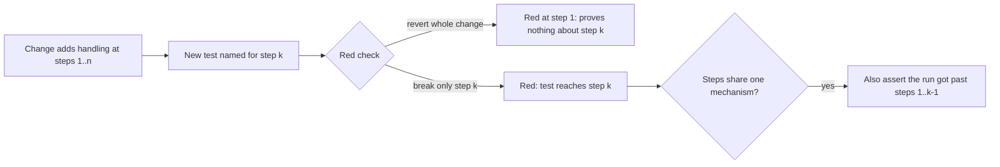

## Summary

Adds a per-step red check to the testing guidance. When a change adds the same handling at more than one step of a path, a new test named for a later step must go red with only its own step broken and the earlier steps left in place. Reverting the whole change also removes the earlier step, so it does not show which step a test reached. When the steps share one mechanism, the test must also assert that the run got past the earlier steps (a positive control), and the Test Plan gets one line per such test. Closes #3666.

## Spec

### Intent and Rationale

- Four fleet PRs (NEAT-AI-Discovery#2400, VibeCoder#3308 and two private fleet PRs) shipped a test named for a later step whose fixture stopped at an earlier step with the same outcome. Each author's red check reverted the whole change, so it went red at the earlier step.
- The rule is a separate paragraph right after **A new test must go red without its change**, and that paragraph now points to it, in the same way it points to the negative-test and edited-expectation rules. This leaves the existing per-phrase wording and its #3093 drift test unchanged.

### Essential Design Decisions

- The paragraph is identical in `CODING-STANDARDS.md` and `prompts/coding_guidelines/prompt.md`, and the new drift test asserts that.
- The step-only break applies to every such test. The positive control is required only when the steps share one mechanism (one deadline, one stub pattern, one error mapper), because then the code may have no per-step branch to break.

### Undiscoverable Facts

- The issue lists the review brief (`prompts/pr_review_brief/prompt.md` step 4) as optional. It is included because the worker's pre-PR verifier and the fleet reviewer both render it.

## Evidence

Prompt and documentation change only, with no production code. The new drift test `worker/deno/tests/test_named_for_step_3666_docs_test.ts` pins the rule on all six surfaces.

**Docs sweep** — grep: "A new test must go red without its change", "only its change removed", "without its change", "revert the fix locally"; section: `CODING-STANDARDS.md#test-coverage-expectations`; siblings: "A negative test must be able to fail", "An edited expectation must still go red without its guard" — the new-test paragraph's pointer sentence now lists the new rule beside them; updated: `CODING-STANDARDS.md`, `prompts/coding_guidelines/prompt.md`, `prompts/issue/prompt.md`, `prompts/pr_feedback/prompt.md`, `prompts/pr_review_brief/prompt.md`, `docs/workflows/issue-processing.md`; `CODING-STANDARDS.md:970` and `prompts/coding_guidelines/prompt.md:1691` — still true because the failure-reason rule only cross-references the new-test rule; `docs/workflows/issue-processing.md:1588` — still true because the #3093 history paragraph describes that rule as landed.

Issue numbers cited: #3666: Fleet tests named for a later step stop at an earlier one: the red check reverts the whole change, so it cannot see which step a test reached; #3376: Compound conditions are flipped as one outcome: one operand of an || is left untested or cited with a test that only reaches the other; VibeCoder#3308 (PR): Pre-commit gate: accept hidden paths the repo's tracked .gitignore re-allows (#3296). `gitignoreReallowed` exists at `worker/deno/lib/pre_commit_safety.ts:404`, and its `defaultRef === null` early return is at line 446.

Related existing rules checked: **A new test must go red without its change** (now points to the new rule), **Every outcome of a branch you add needs a test that reaches it** (the per-operand form the new rule cites, unchanged), **A new precondition must not stop existing tests short** (#3530, covers existing tests, consistent), **A negative test must be able to fail** and **An edited expectation must still go red without its guard** (unchanged), the pr_feedback **A requested red run is shown, not claimed** (extended so it no longer says to revert the whole fix for a multi-step change), and the issue prompt's Test Plan step (extended). No rule contradicts the new one.

Applied the rule to this PR's own diff: the new drift test reads six documents. Each test is named for one surface, and each pinned phrase was checked on its own (below), so no test is stopped by an earlier step. The diff adds no multi-step handling, so no per-step Test Plan line applies.

## Test Plan

- Added `worker/deno/tests/test_named_for_step_3666_docs_test.ts` (6 tests). `deno test -A tests/test_named_for_step_3666_docs_test.ts` passed 6/6 on the final head.
- Re-ran `worker/deno/tests/new_test_must_go_red_3093_test.ts`, `worker/deno/tests/compound_condition_operands_3376_docs_test.ts`, `worker/deno/tests/coding_guidelines_layers_2574_test.ts` and `worker/deno/tests/pr_review_brief_shared_3395_test.ts`: 28 passed, 0 failed.
- Per-pin base check (`deno task drift-pins-on-base origin/main …`, exit 0 for every run). Each phrase below was absent from the base section:
  - `CODING-STANDARDS.md` § Test coverage expectations and `prompts/coding_guidelines/prompt.md` § Test Coverage Expectations: "break only that step and leave the earlier ones in place", "does not show which step a test reached", "got past the earlier steps", "the step-only break", "only its own step is broken", "below is this rule for a change that adds the same handling at more than one step".
  - `prompts/issue/prompt.md` § PR Summary File: "with only that step broken and the earlier steps left in place", "also asserts that the run got past the earlier steps".
  - `prompts/pr_feedback/prompt.md` § Making Changes: "revert only that step and keep the earlier ones".
  - `prompts/pr_review_brief/prompt.md` § Review Mode — one change against its linked issue: "gets past every earlier step giving the same outcome".
  - `docs/workflows/issue-processing.md` § Reproduction status on a bug fix: "break only its own step and leave the earlier ones in place".
- No existing test was edited and no assertion was removed.
- `./quality.sh` ran on the final head: `Result: PASSED (with skipped checks)`. Only `config integration` was skipped, which is the gate's own environment skip and not related to this diff.

<!-- vibe-branch-outcomes -->

🤖 Generated with [Claude Code](https://claude.com/claude-code)
