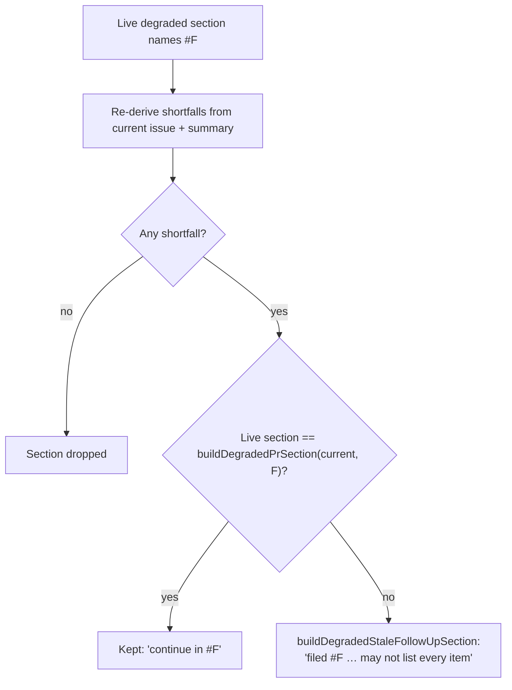

## Summary

A PR-body re-sync of a degraded run's `Degraded run — partial delivery` section no longer claims the current shortfalls "continue in #F" when they differ from the ones follow-up #F was filed with. `rederiveDegradedSection` now keeps a section that names a follow-up only when it is byte-identical to the section the same shortfalls would build. Any other shortfall set is rendered by the new `buildDegradedStaleFollowUpSection`, which keeps #F and the original reason but says the worker filed #F when the PR was raised, that a re-sync does not rewrite it, and that it may not list every item below. `parseDegradedSection` also reads the number from that wording, so later re-syncs keep it. Closes #3677.

## Spec

### Intent and Rationale

- The issue offered two fixes: rewrite #F from the sync path, or stop claiming #F holds items it does not. This takes the second, which is what PR #3676 review settled for the healthy-run section (`rederiveReportedGapSection` / `buildReportedGapStaleFollowUpSection`). There, the sync deliberately never writes to the follow-up, because it would copy freshly fetched, unverified issue text into an `idle-task` issue the fleet works as trusted (THREAT-MODEL AP-7).

### Essential Design Decisions

- The re-sync stays read-only towards the follow-up: no `gh issue list/edit/create` call. A sync test asserts this.
- "Unchanged" means byte-equal to `buildDegradedPrSection(verdict, F)`, the same rule the healthy path uses. A section raised with older wording, or one already in the stale wording, therefore takes the stale wording. That errs towards "check against the diff", never towards claiming more than #F holds.

### Undiscoverable Facts

- PR #3676 (Issue #3506), which this issue waited on, is merged into this milestone branch. Its review is the source of the "the sync never writes to the follow-up" constraint.

## Evidence

Backend-only change. No UI files are touched.

**Docs sweep** — grep: "continue in #", `rederiveDegradedSection`, `buildDegradedPrSection`, `parseDegradedSection`, "re-sync"; section: `docs/workflows/issue-processing.md` (the "A re-sync re-derives the section (Issue #3350)" bullet); siblings: `buildDegradedUnfiledGapSection`, `buildReportedGapStaleFollowUpSection`; updated: `docs/workflows/issue-processing.md`, the module doc and the `parseDegradedSection` / `rederiveDegradedSection` doc comments in `worker/deno/lib/degraded_delivery.ts`; `docs/audits/security-sweep-2562-degraded-delivery.md:22` — still true because it is a dated #2562 sweep record and `buildDegradedPrSection` still renders markdown; `worker/deno/lib/pr_body_sync.ts:7` — still true because the module doc only says the section is re-derived and that the sync never writes to the follow-up; `docs/workflows/issue-processing.md:2574` — still true because it describes the healthy-run builder, which is unchanged

Issue numbers cited: #3677 (this issue); #3676 is the PR for #3506, "A healthy run that closes out a criterion as partial or missing still closes the issue with no follow-up (three private fleet PRs)"; #3350 and #2562 are existing citations already in the code.

## Test Plan

- `worker/deno/tests/degraded_delivery_test.ts`
  - New: `rederiveDegradedSection - changed shortfalls no longer claim to continue in the follow-up (Issue #3677)`. This is the issue's scenario: #77 was filed for "the export works"; now that is `met` and "the import works" is `partial`.
  - New: `rederiveDegradedSection - a section already marked stale re-syncs under the same follow-up number (Issue #3677)`.
  - New: `buildDegradedStaleFollowUpSection - renders the heading, the stale follow-up line and the bullets (Issue #3677)`. It pins the whole rendered section, blank lines included.
  - Edited: `parseDegradedSection - round-trips a reason with parentheses from each builder` gains a round-trip assertion for the new builder.
  - Edited: `rederiveDegradedSection - keeps the follow-up number and reason` gains `assertEquals(out, liveSection)`. Its live fixture now names the criterion as the issue states it (`the export works`), so the section really is unchanged. No assertion was removed.
- `worker/deno/tests/pr_body_sync_test.ts`
  - New: `sync - a degraded-run section whose rebuilt gaps differ never claims they continue in the follow-up (Issue #3677)`. It also asserts that no non-`view` `issue` call is made.
  - New: `sync - a degraded-run section with the same gaps keeps naming its follow-up (Issue #3677)`. This is the positive control.
  - Edited: `sync - keeps a leading degraded-run section (Issue #2562)`. Removed assertion `assertStringIncludes(synced, "continue in #77");`. Issue #3677 makes it untrue: the test's hand-written legacy-worded section (bullet `- the export`) is not what the current shortfalls build, so the sync must no longer claim #77 holds them. It is replaced by an assertion that the section still names #77 in the stale wording.
- Red checks, each run on purpose and then restored:
  - `rederiveDegradedSection` returning `buildDegradedPrSection` unconditionally (the base behaviour) → 4 red: both "changed"/"stale" degraded tests, the #3677 sync "differ" test, and the edited #2562 sync test.
  - Forcing the equality to `false` → red: the "keeps" test and the #3677 "same gaps" sync test.
  - Removing the `filed` operand from the `parseDegradedSection` regex → red: the round-trip test and the "already marked stale" test.
  - Deleting each `""` separator in `buildDegradedStaleFollowUpSection` (`worker/deno/lib/degraded_delivery.ts:537`, `:545`, `:547`, `:548`) → red: the new `renders the heading…` test.
  - Edited #2562 test: making the sync drop the re-derived leading section (`body = "" + …`) → red at its `startsWith` assertion.
- `deno task test:unit tests/degraded_delivery_test.ts tests/pr_body_sync_test.ts`: 125 passed, 0 failed on the final head.
- `./quality.sh < /dev/null`: PASSED (with skipped checks: config integration) on the final head.

<!-- vibe-branch-outcomes -->

🤖 Generated with [Claude Code](https://claude.com/claude-code)
