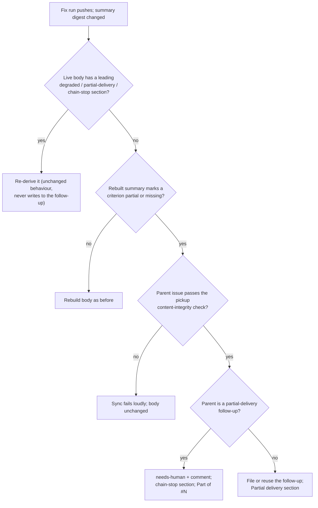

## Summary

A fix run (review-fix, CI-fix or merge-conflict) that rewrites the PR summary to newly mark an acceptance criterion `partial` or `missing`, on a PR raised without a leading degraded-run or partial-delivery section, now gets the follow-up the completion phase would have filed. `syncPrBodyFromSummary` reads the parent issue and re-verifies its title and body with the pickup content-integrity check. It then files or reuses the `idle-task` follow-up through `fileDegradedFollowUp` and prepends `buildReportedGapPrSection`. If the parent is itself a partial-delivery follow-up, it hands the gaps to a human and adds the chain-stop section instead. The sync fails loudly when any step fails. Closes #3678.

## Spec

### Intent and Rationale

- The sync re-derived only a section the live body already had, and fix runs never run `applyDegradedDeliveryGuard`, so a gap a fix run introduced was recorded only in the archived summary and the merge closed the issue (the silent loss #3506 describes).
- The new step reuses the completion guard's own helpers (`assessReportedGaps`, `fileDegradedFollowUp`, `buildReportedGapPrSection`, `isPartialDeliveryFollowUp`, `handFollowUpToHuman`, `buildFollowUpChainStopSection`) rather than copying them.

### Essential Design Decisions

- The sync fetched the issue fresh, so its text passes `verifyPickupContentIntegrity` (`pickup_content_integrity.ts`, THREAT-MODEL AP-7) before any of it reaches a follow-up or a comment. A blocked or missing approval baseline fails the sync; it never files from unverified text.
- `SyncPrBodyDeps.followUpFiling` is a required key (`SyncFollowUpFiling | undefined`), so the compiler names every builder. `undefined` fails the sync loudly instead of filing nothing.
- The step runs only when the live body has no leading section; once the section exists, later syncs re-derive it as before and never write to the follow-up.
- The trigger (`summaryReportsGap`) is checked before the issue is fetched, so a sync whose summary reports no gap makes no extra `gh` call.

### Undiscoverable Facts

- The content-approval baseline is per host. A fix run on a host that never captured the parent's snapshot fails the sync with `no-approval-snapshot` (logged at warning by `runPrBodySync`), and a later sync on a summary change retries.

## Evidence

Backend-only change; verified by unit tests.

- Observed `gh issue view 3678 --repo stSoftwareAU/VibeCoder --json title,author,labels,milestone`: `author` is `{"login":…}`, `labels` is `[{"name":…}]`, and `milestone` is `{"title":…}` (and `{"milestone":null}` for an issue with none — `gh issue view 1 --json milestone`). `parseSyncParentIssue` and its tests are built from that shape.
- The `issue list` / `issue create` / `issue edit` stubs in the sync tests mirror the calls the production `fileFindingOnce` and `fileDegradedFollowUp` (`worker/deno/lib/idle_task_snapshot.ts`, `worker/deno/lib/degraded_delivery.ts`) make; those helpers run unmodified in the tests.
- The fake `SyncFollowUpFiling` stands in for `buildSyncFollowUpFiling`; the property relied on is that a blocked verdict files nothing. `worker/deno/tests/pr_body_sync_follow_up_test.ts` runs the production builder: no snapshot → blocked, and a matching snapshot → not blocked.
- Guards kept from the completion path: content verification (pickup check), the chain stop on a partial-delivery follow-up, `ensureLabelExists(idle-task)` best-effort, fleet-author dedup (`resolveFleetMaintenanceAuthorSet`, the set `fleetAuthorsFor` uses), joining the parent's milestone, and fail loud. The sync's own guards (worker marker, summary digest, checkout is the PR head) still run first — `sync - a stale checkout is skipped before any gap is filed (Issue #3678)`. Excluded: the degraded-run verdict (a sync cannot judge the fix run's model routing, so only the reported-gap verdict applies) and the completion phase's claim-freshness retraction (a fix run holds no issue claim).
- Callers checked: `syncPrBodyFromSummary` is reached only through `runPrBodySync` from `pr_feedback_processor.ts`, `pr_ci_processor.ts` and `pr_merge_conflict_processor.ts`; each forwards `syncFollowUpFiling` (one test per processor goes red when its forward is replaced by `undefined`). Production wiring passes `buildSyncFollowUpFiling(config, githubUser)` at the three processor calls in `run_core_production_deps.ts` and in `commands/pr_feedback_processor.ts` (with the `GITHUB_USER` fallback the processor uses for its footer).
- Issue numbers cited: #3506: A healthy run that closes out a criterion as partial or missing still closes the issue with no follow-up (three private fleet PRs); #3676: (PR) the same, for #3506; #3677: PR-body re-sync relists a degraded run's current shortfalls under its original follow-up without updating that follow-up; #3089: Review-fix pushes refresh pr-summary-N.md but never the GitHub PR body; #1243: Security: finding-id dedup in idle_task_snapshot.ts trusts an unauthenticated issue body.

**Docs sweep** — grep: "re-sync", "only reads the issue", "never files", "never edits or files", `syncPrBodyFromSummary`, `SyncPrBodyDeps`; section: `docs/workflows/issue-processing.md#a-healthy-runs-own-gaps-get-a-follow-up-too-issue-3506`; siblings: `syncPrBodyFn`, `runGitCommand`; updated: `docs/USAGE.md`, `docs/workflows/issue-processing.md`, `docs/workflows/pr-feedback.md`, `docs/INTERNALS.md`, `worker/deno/lib/degraded_delivery.ts` (module doc), `worker/deno/lib/pr_body_sync.ts` (module doc); `docs/workflows/ci-fix.md:78` — still true because it says only that the description is re-synced; `docs/workflows/issue-processing.md:1054` — still true because the `Part of` assembly is unchanged

## Test Plan

- `worker/deno/tests/pr_body_sync_test.ts` — ten new sync tests (Issue #3678 section) covering filing, reuse, blocked content, filing failure, no filer, the chain stop, an unreadable issue, no gap, a stale checkout and a label failure; `followUpFiling: undefined` added to every existing `SyncPrBodyDeps` literal, no assertion removed or changed.
- `worker/deno/tests/pr_body_sync_follow_up_test.ts` — new: `parseSyncParentIssue`, `summaryReportsGap`, `buildSyncFollowUpFiling` and the `addReportedGapSectionOnSync` failure and milestone outcomes.
- `worker/deno/tests/pr_feedback_processor_test.ts`, `worker/deno/tests/pr_ci_processor_test.ts`, `worker/deno/tests/pr_merge_conflict_processor_test.ts` — one forwarding test each; replacing that processor's `followUpFiling: processorDeps.syncFollowUpFiling` with `undefined` turned only that test red.
- Red-check of the new behaviour: disabling the new `else if (summaryReportsGap(body))` branch turned eight of the new sync tests red (all but the no-gap and stale-checkout tests, which pin the paths that must not file).
- `./quality.sh` — passed on the final code commit (`Result` line shows no FAILED stage; config integration SKIPPED).
- Exempt from the mutation check:
  - `worker/deno/lib/run_core_production_deps.ts:2375`, `worker/deno/lib/run_core_production_deps.ts:2624`, `worker/deno/lib/run_core_production_deps.ts:3060`, `worker/deno/commands/pr_feedback_processor.ts:207` — exempt (untestable): the processors are static imports in `createProductionRunCoreDeps` with no seam, and the tests that drive it (`worker/deno/tests/pr_feedback_authorised_commenters_test.ts`, `worker/deno/tests/run_core_test.ts`) stub the PR scans to return nothing, so no processor is reached; the CLI command has no test harness that runs `processPrFeedback`.
  - `worker/deno/lib/pr_body_sync_follow_up.ts:138`, `worker/deno/lib/pr_body_sync_follow_up.ts:139`, `worker/deno/lib/pr_body_sync_follow_up.ts:141` — exempt (untestable): labels, author and login only change which approval label and editor trust a changed-content verdict uses, which needs a live GitHub timeline (`resolveLastIssueEditor`); `worker/deno/tests/pickup_content_integrity_test.ts` is the harness for that and calls `verifyPickupContentIntegrity` directly, not through this builder.
  - `worker/deno/lib/pr_body_sync_follow_up.ts:143` — exempt (untestable): the production `ensureLabelExists` calls the GitHub API; the sync tests inject the filer.

<!-- vibe-branch-outcomes -->
