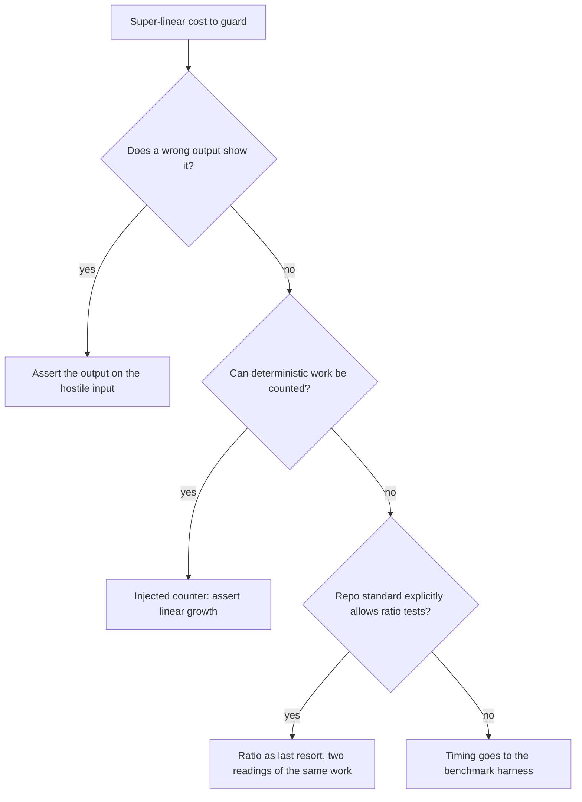

## Summary

Fleet guidance no longer calls wall-clock ratio tests safe. The coding
guidelines drop the "Ratio timing assertions are the exception, and they are
permitted" bullet and its VibeCoder-only `assertLinearGrowth` / Issue #530
citation. In their place: the target repository's own testing standard wins on
timing, super-linear cost is guarded by output first and then by a
deterministic work count, timing comparisons go in the benchmark harness, and
a ratio is a last resort only where the repository's standard explicitly
allows one. `test_audit` check 3 now flags ratio assertions unless the
repository's own standard explicitly allows ratio tests, and check 13 defers
to check 3. `CODING-STANDARDS.md` keeps `assertLinearGrowth` as this
repository's own last resort, reworded to agree with the PR #1170 lesson.
`security_scan` never prescribes a wall-clock ratio regression test, and it
cites a precedent file only after confirming it exists. Closes #3680.

## Spec

### Intent and Rationale

- Fleet PRs kept adding N-vs-4N timing-ratio tests to repositories whose
  standards forbid timing in pass/fail, and quoted VibeCoder's "a slow host
  inflates both readings" wording to justify them. The fix is at the source:
  the injected guidance and the auditor that repeated it.
- A ratio was kept as a last resort, not banned outright, because
  `plan_coverage_gate_bounds_1245_test.ts` in this repository has no other
  detector (Issue #1245). This repository's own standard now says so
  explicitly, which is the condition `test_audit` checks for.

### Essential Design Decisions

- The check is whether the repository's own standard explicitly allows ratio
  tests, read from a sentence in that standard. Ratio tests already in the
  suite are not evidence that the standard allows them.
- `coding_guidelines` and `test_audit` are filed into other repositories, so
  neither names `assertLinearGrowth`, `growth.ts` or Issue #530. Only
  `CODING-STANDARDS.md` names the helper.
- `security_scan` never prescribes a ratio, even where a repository allows
  one. There a ratio stays the implementer's last resort, not a fix for the
  scan to suggest. This wording came out of the Standards review, so the
  security rule agrees with the last-resort rule.

### Undiscoverable Facts

- stSoftwareAU/NEAT-AI-Discovery PRs #2321 and #2345 (both merged) replaced
  fleet-written ratio tests with deterministic work counters. I confirmed
  both with `gh pr view`. `CODING-STANDARDS.md` cites them as the pattern.

## Evidence

This is a prompt, docs and policy-test change with no runtime code. The policy
test `worker/deno/tests/timing_assertion_policy_test.ts` pins four of the
changed surfaces: `prompts/coding_guidelines/prompt.md`,
`prompts/test_audit/prompt.md`, `CODING-STANDARDS.md` and
`prompts/security_scan/prompt.md`. It does not read
`prompts/best_practices/prompt.md`, `docs/TEST-AUDIT-SCAN.md` or
`docs/SECURITY-SCAN.md`; those edits are covered only by the docs sweep below.

**Docs sweep** — grep: "Ratio timing assertion", "Ratio assertions are not", "ratio assertion is permitted", "silent under checks 3 and 13", "stays green, which", `assertLinearGrowth`, "carve-out"; section: `prompts/coding_guidelines/prompt.md#unit-tests-vs-benchmarks`, `CODING-STANDARDS.md#unit-tests`, `docs/TEST-AUDIT-SCAN.md` checks 3 and 13, `docs/SECURITY-SCAN.md` `## Suggested fix`; siblings: none — no existing set gained a member; updated: `prompts/coding_guidelines/prompt.md`, `CODING-STANDARDS.md`, `prompts/test_audit/prompt.md`, `prompts/security_scan/prompt.md`, `prompts/best_practices/prompt.md`, `docs/TEST-AUDIT-SCAN.md`, `docs/SECURITY-SCAN.md`; `CODING-STANDARDS.md:1255` — still true because it names `assertLinearGrowth` as the precedent never to cite in another repository; `CODING-STANDARDS.md:1264` — still true because this repository keeps the helper as its own last resort; `worker/deno/lib/parallel_unsafe_test_manifest.ts` doc comment on ratio assertions — still true because it describes this repository's serial pass, which is unchanged.

**Related existing rules checked:** `coding_guidelines` "No absolute
wall-clock thresholds" (agrees). `CODING-STANDARDS.md` "Guard super-linearity
by behaviour first" (agrees, and the new bullets build on it). `test_audit`
check 13 restatement (changed in the same diff to defer to check 3).
`best_practices` "How a test asserts belongs to `test-audit`" (changed to
include ratios). `docs/TEST-AUDIT-SCAN.md` rows 3 and 13 (changed).

**Rule applied to this PR's own diff:** no timing assertion was added. The
Standards review found two `test_audit` example excerpts that named test files
the repository does not have, and `security_scan` wording that contradicted
the last-resort rule. Both were fixed in this diff.

**Provenance numbers added:** #3680: Fleet guidance calls wall-clock ratio
tests safe, so fleet PRs keep adding them where the repo forbids timing tests,
and they flake under load (NEAT-AI-Discovery#2296, #2320, #2409).
NEAT-AI-Discovery#2321: Wall-clock ratio test
locality_grouping_cost_does_not_grow_quadratically fails under load
(src/analysis/synapse/issue_2161_locality_cancellation_test.rs) (Issue #2296).
NEAT-AI-Discovery#2345: Replace wall-clock ratio tests with deterministic work
counters (#2320).

## Acceptance Criteria

<!-- vibe-spec-review inputs="diff+issue-body" -->

- **met** — `prompts/coding_guidelines/prompt.md`, "Unit Tests vs Benchmarks": drop the "Ratio timing assertions are the exception, and they are permitted" bullet, or reduce it to a last resort — evidence: `worker/deno/tests/timing_assertion_policy_test.ts::timing policy - the guidelines no longer call ratio tests permitted and name no VibeCoder-only helper (Issue #3680)` — reviewer: met
- **met** — `prompts/security_scan/prompt.md` and other scan prompts that suggest a regression test: never prescribe a wall-clock ratio test, and cite a precedent file only after checking that it exists — evidence: `worker/deno/tests/timing_assertion_policy_test.ts::timing policy - security_scan never prescribes a wall-clock ratio regression test (Issue #3680)` — reviewer: partial — reason: the reviewer saw no audit of the other scan prompts. I grepped every other scan prompt for elapsed/timing/ratio/regression-test wording: none prescribes a regression test, and `best_practices` (the one overlap) is updated.
- **met** — `prompts/test_audit/prompt.md` check 3 and check 13: limit the ratio carve-out to repos whose own standard explicitly allows ratio tests. Elsewhere, report a ratio test like any other timing assertion — evidence: `worker/deno/tests/timing_assertion_policy_test.ts::timing policy - the auditor flags ratio assertions unless the repository allows them (Issues #786, #3680)`, `worker/deno/tests/test_audit_unit_suite_checks_943_test.ts` — reviewer: met
- **met** — `CODING-STANDARDS.md`: make the carve-out agree with the PR #1170 lesson in the paragraph above it — evidence: `worker/deno/tests/timing_assertion_policy_test.ts::timing policy - CODING-STANDARDS keeps the ratio only as this repository's last resort (Issue #3680)` — reviewer: met
- **met** — Policy tests over the changed prompt sections: the coding guidelines no longer call ratio tests permitted, and they state that the target repo's standard wins — evidence: `worker/deno/tests/timing_assertion_policy_test.ts::timing policy - every surface says the target repository's own standard wins (Issue #3680)` — reviewer: met
- **missing** — Over the next few weeks, fleet PRs that guard super-linear cost add work-count or output assertions, not `Instant`/`performance.now()` ratios — reviewer: missing — reason: the reviewer said this is "not assessable from a diff". It is an observation of later fleet PRs and `log.jsonl`, which can only be made after this lands.
- **unrequested** — `docs/TEST-AUDIT-SCAN.md` and `docs/SECURITY-SCAN.md` edits — reviewer: unrequested — reason: the operator manuals that describe the changed prompt rules, updated under "A Code Change Owes a Docs Change"
- **unrequested** — `prompts/best_practices/prompt.md` overlap sentence — reviewer: unrequested — reason: it routed timing assertions to `test-audit`, and now covers ratios too so the two prompts agree
- **unrequested** — new `test_audit` worked example `ratio-assertion-where-the-standard-forbids-timing`, and the reworded `slow-unit-test-by-shape` reason — reviewer: unrequested — reason: the old example said ratios are silent under check 3, which the issue makes untrue; the new example is the issue's PR #2409 case
- **unrequested** — the general "Cite only what exists in the repository you are working" bullet, and the CODING-STANDARDS serial-pass and step-counter wording — reviewer: unrequested — reason: the issue's point 3 plus its precedent-file requirement, and the reason a regex guard cannot use a work count

## Standards Review

<!-- vibe-standards-review inputs="diff+CODING-STANDARDS.md" -->

- **violation** — A named test must exist: example excerpts named `tests/cluster_test.rs:88` and `src/growth_test.ts:40` — evidence: `prompts/test_audit/prompt.md:812`, `prompts/test_audit/prompt.md:932` — reason: fixed in this diff
- **violation** — Every restatement of a rule gives the same answer: `security_scan` said "never a ratio" while the standards allow one as a last resort — evidence: `prompts/security_scan/prompt.md:1794`, `docs/SECURITY-SCAN.md:640` — reason: fixed in this diff
- **clean** — Australian English. Removed assertions are justified by the issue. Drift-test conditions 1–4 hold: positive pins are section-scoped, absence checks are whole-file, no pin is subsumed by another, and every pin is absent on base. Test imports exist, and scoped headings exist. Review-enforced rules checked: "A named test must exist", "A stub mirrors the real callee", documentation-drift conditions, "Change only what the issue changes", "A new test must go red without its change", "An edited expectation must still go red".

## Test Plan

- `worker/deno/tests/timing_assertion_policy_test.ts` adds four Issue #3680 tests and edits two existing ones. On the final head:
  `deno task test:unit tests/timing_assertion_policy_test.ts` passed (8 passed).
- Removed assertions, each made untrue by the issue:
  - `assertStringIncludes(collapsed, HELPER);` — the issue forbids the injected guidelines from citing the VibeCoder-only `assertLinearGrowth`. A whole-file absence check replaces it.
  - `assertStringIncludes(collapsed, "Ratio assertions are not a finding");` — the issue limits the carve-out to repositories that explicitly allow ratios. Pins on "A ratio of two readings is a timing assertion too" and "Stay silent on a ratio only where the repository's own testing standard explicitly allows ratio tests" replace it, plus a whole-file absence check of the old phrase.
- Edited in place, so the gate counts the old form as removed: in `timing policy - the guidelines no longer ban measuring outright (Issue #786)`, removed from `worker/deno/tests/timing_assertion_policy_test.ts`: `assertEquals( phraseAnywhere(whole, "Do not measure performance inside unit tests"), false, "coding_guidelines still carries the flat ban, which forbids the ratio " + "assertions CODING-STANDARDS.md requires", );` — #3680 reduces the ratio to a last resort, so "CODING-STANDARDS.md requires" ratio assertions is untrue. The same assertion stays in the same test with only its message changed to "assertions CODING-STANDARDS.md allows as a last resort"; the whole-file absence check on the flat ban is unchanged.
- Red-check: I copied the new test file into a worktree of the base branch `origin/milestone/fleet-guidance-tests-twins-and-portability` and ran it there.
  - All five new or edited Issue #3680 tests went red, each on its own pin or absence check.
  - The edited auditor test also went red: section is missing pin "A ratio of two readings is a timing assertion too".
  - The three unchanged #786 tests stayed green, as expected.
- Drift pins: `deno task drift-pins-on-base origin/milestone/fleet-guidance-tests-twins-and-portability <doc> <section> <phrases>` reported each pinned phrase absent on base:
  - Guidelines: "The target repository's own testing standard wins on timing", "count **deterministic work**", "benchmark harness", "last resort", "Cite only what exists in the repository you are working".
  - test_audit: "explicitly allows ratio tests", "A ratio of two readings is a timing assertion too", "Stay silent on a ratio only where the repository's own testing standard explicitly allows ratio tests".
  - CODING-STANDARDS: "The target repository's own testing standard wins on timing", "this repository allows a ratio as a last resort".
  - security_scan: "A suggested regression test never times the work", "never a wall-clock ratio test", "only after confirming it exists in the scanned repository".
  - A pin on `assertLinearGrowth` was already in the base CODING-STANDARDS section, so I removed it.
- `worker/deno/tests/test_audit_unit_suite_checks_943_test.ts` is unchanged and passes. Its check 13 pins all still hold.
- `./quality.sh < /dev/null` passed on commit a0f50f7c (one check, config integration, skipped). Later commits change only prose and the policy test; markdownlint and the touched test files pass on them.

<!-- vibe-branch-outcomes -->

🤖 Generated with [Claude Code](https://claude.com/claude-code)
