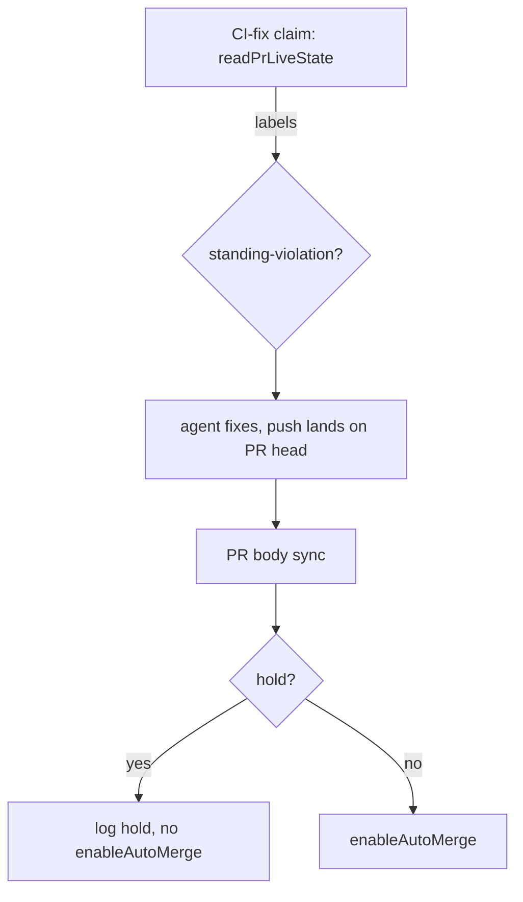

## Summary

The CI-fix pass no longer re-arms auto-merge on a PR that carries the
`standing-violation` label. After a fix lands on the PR's own head, the pass
reads the label from the live `gh pr view` read it already takes at its claim
point (`guardPrStillOpen`, which returns `labels`). When the label is present it
skips `deps.pr.enableAutoMerge` and logs the hold at info. Unlabelled PRs are
re-armed exactly as before. Closes #3685.

## Spec

### Intent and Rationale

- The completion phase holds a PR with a standing Standards violation by labelling it rather than arming it (Issue #3382), but the CI-fix re-arm in `_processCiWithHeartbeat` undid that hold, so a green CI could merge the breach before the Priority 1.65 sweep disarmed it.
- The claim-point read already carries `labels` (Issue #3517), so the hold costs no extra `gh` call. This is the issue's own suggested fix.

### Essential Design Decisions

- `standingViolationHold` is a **required** parameter on `_processCiFailureLocked` and `_processCiWithHeartbeat`, with no default, so neither call site (the unguarded no-worker-id path and the locked path) can leave it out silently.
- The pass only skips arming; it never disarms. Disarming an already-armed PR is still the sweep's job (Issue #3517).
- An absent `labels` list never holds a PR. This matches the sweep and the `PrLiveStateReading` contract.

### Undiscoverable Facts

- The label is read at the claim point, before the agent runs. A label added during the CI-fix run is not seen by this pass, and the next sweep handles it.

## Evidence

Backend-only change, with no UI files.

- `worker/deno/tests/pr_ci_processor_standing_violation_test.ts`: a labelled PR is not re-armed, on both the no-worker-id path and the locked path, and an unlabelled PR still is.
- Issue numbers cited: #3685: CI-fix pass re-arms auto-merge on a PR held with the standing-violation label; #3517: Auto-merge sweep ignores the standing-violation hold label, so a held PR can still be armed (#3382 follow-up); #3382: Standing-violation refusal (#3196) is routed to a recovery turn that may not change code, so the self-flagged breach ships as summary_incomplete (VibeCoder#3308, #3380).

**Docs sweep**: grep: "Only the sweep checks the label", "without reading it", "re-arm\w* auto-merge", `STANDING_VIOLATION_LABEL`, `standing-violation`; section: `docs/workflows/issue-processing.md#-the-in-run-recovery-from-a-summary-rule-block`; siblings: none, because no existing set gained a member; updated: `README.md`, `docs/workflows/issue-processing.md`, `docs/MERGE.md`, `docs/INTERNALS.md`, `worker/deno/lib/standing_violation_routing.ts`, `worker/deno/lib/pr_live_state.ts`. `docs/workflows/pr-feedback.md:727` is still true because it describes only the sweep's hold, which is unchanged.

## Test Plan

- Added `worker/deno/tests/pr_ci_processor_standing_violation_test.ts` with three tests. No existing test was edited.
- Red checks, each restored afterwards:
  - Forcing the guard to always arm turned the labelled tests (no-worker-id path and locked path) red.
  - Forcing it to never arm turned the unlabelled test red.
  - Passing `false` at the locked call site turned only the locked-path test red.
  - Passing `false` at the no-worker-id call site turned only the no-worker-id test red.
- `deno task test:unit tests/pr_ci_processor_standing_violation_test.ts tests/pr_ci_processor_test.ts tests/pr_ci_processor_lock_test.ts tests/pr_ci_processor_milestones_test.ts` passed: 55 passed, 0 failed.
- Call sites checked: both `_processCiFailureLocked` calls in `processCiFailure`, and the one `_processCiWithHeartbeat` call. `enableAutoMerge` has no other production caller in `worker/deno/lib` outside the PR manager.
- New members: `standingViolationHold` is set in `processCiFailure` and read in `_processCiWithHeartbeat`.
- `./quality.sh`: see the gate result line below.

<!-- vibe-branch-outcomes -->
