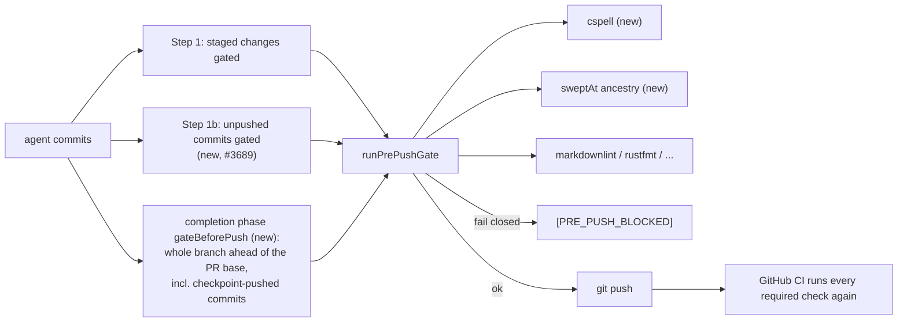

# Pre-PR gate now catches the CI failures it was missing (spelling, sweep ancestry, unpushed commits)

## Summary

An audit of recent VibeCoderST implementation PRs in GRQ, VibeCoder and
GRQ-AutoTrader found three gaps, fixed here, where the first failing required
GitHub CI job was something the pre-PR worker could have caught, and did not.
It also found local failures (gitleaks, semgrep, Floci) with no pre-PR stage;
those are tracked as follow-ups, not fixed here. Each of the three gaps is
fixed with a negative test; the full classification is in
`docs/pre-pr-ci-audit.md`.

- **GRQ Spelling (cspell).** The worker image had no cspell and the pre-push
  gate never ran it, so unknown words in pushed markdown failed GitHub's
  Spelling job. cspell is now pinned in `container/tools.json`, installed by the
  `Containerfile`, and run by `pre_push_gate.ts` on changed spell-checked files.
  A configured repo whose binary is missing fails closed.
- **VibeCoder `sweptAt` ancestry.** CI requires every `sweptAt` in
  `docs/audits/lib-sweep-coverage*` to be a commit on the default branch; the
  worker only checked the JSON shape. New `pre_push_sweep_check.ts` runs the
  same ancestry check on the slices the changed ledger/top-up files hold (a
  changed ledger file contributes every slice in it, including its own in-file
  `top-up-<n>` slices) and fails closed.
- **Ungated Step 2 push.** `commitAndPushPending` gated newly staged changes but
  pushed already-committed agent commits unchecked, and the completion phase
  pushed with no gate. Step 1b (`gateUnpushedCommits`, only when a pre-flight spec
  exists) now gates commits on no remote-tracking ref. The completion-phase
  `gateBeforePush()` (always, with an empty command list when no spec exists)
  gates every non-merge commit the branch has ahead of the PR base, because the
  execute phase's WIP checkpoints (periodic and phase-end, no spec, ungated)
  have usually pushed the agent's commits already; the GRQ first-failing SHAs
  e9a7f8fd, 3e313843 and 65d0d714 are such checkpoint commits and 6b3eeaef is
  "Merge remote WIP checkpoints". The check runs before `gh pr create`
  (PR #3716 review).

Closes #3689

## Spec

### Intent and Rationale

Unattended workers should stop on a failure CI would later report on the same
SHA, instead of pushing and waiting for the red run. The audit reconciles real
failed runs with what the worker could run locally; the fixes cover only the
gaps where a local command exists and the worker did not run it. CI is not
weakened: it still runs every required check independently after PR creation.

### Essential Design Decisions

- **Left to CI, deliberately.** Bootstrap drift (needs the remote bootstrap)
  and GRQ-AutoTrader's `version-bump` job (#3248, the designed enforcer; needs
  base-PR state). They are recorded as such, never as PASS, and no follow-up is
  filed: no pre-PR gap was demonstrated.
- **Local failures that were not fixed here, each tracked.** gitleaks
  (run 38201375574) and Floci (run 38033819415) are local checks with no
  pre-PR stage; the semgrep failure (run 38123883049) ran past an existing
  local semgrep stage that the logs cannot explain. They are tracked in #3725,
  #3727 and #3726 respectively, and are not claimed as fixed by this PR.
- **Fail closed.** A configured cspell with no binary, an unresolvable default
  ref, or a failed gate blocks the push rather than skipping.
- **Step 1b only when a pre-flight spec exists.** WIP-preservation callers have
  no spec and are not gated (pinned by a test); the completion phase falls back
  to `{ commands: [] }` so the changed-file checks still run.
- **Completion gate scope is the whole branch (PR #3716 review).**
  `gateUnpushedCommits(..., baseRef)` lists files with
  `git log --no-merges <head> --not <baseRef>` instead of `--not --remotes`, and
  skips only when `git rev-list --count --no-merges <baseRef>..HEAD` is 0. The
  base is resolved by `resolveComparableBaseRef` once, before the first gate
  (the ahead-of-base guard reuses it). If it cannot be resolved the gate falls
  back to the unpushed-only check and the guard logs the failure as an error.
  The WIP checkpoint pushes themselves stay ungated so work is never lost.
- **Doc comments that described the old contract** were corrected in the same
  push: `PreFlightGateSpec` (omitting the spec disables the gate; an empty
  `commands` list still runs the changed-file checks), `RepoConfig.preFlight` in
  `worker/deno/types.ts`, and the `pre_push_gate.ts` module header (cspell,
  `sweptAt`, fail-closed on a missing cspell, and the three callers).
- **Unrequested, but needed for the fix to work:**
  - `git fetch --unshallow origin` fallback in `pre_push_sweep_check.ts`: the
    worker clones `--depth=1` and `ensureHistoryDepth` returns immediately for a
    depth-1 clone of `main`, so without it an older, legitimate `sweptAt` on
    `main` would be reported as missing.
  - `findBinary` refactor in `pre_push_gate.ts`: shares the lookup between the
    existing markdownlint binary search and the new cspell search instead of
    duplicating it.
  - `Containerfile` install-loop merge: the file was 21 bytes from its
    15,000-byte cap; adding cspell as a separate RUN would have exceeded it.
  - `prompts/security_scan/prompt.md` "Prior sweep records" rule: tells the
    sweep agent that `sweptAt` must be a default-branch commit, the same
    contract the new check enforces.

### Undiscoverable Facts

- GitHub's Spelling job reads `docs/cspell.json` (nested) or a root config; the
  local call is `cspell --no-progress --no-summary --no-must-find-files <file>`
  with `--config` only for the nested config.
- The `[PRE_PUSH_BLOCKED]` hook (#3394) gates the agent's own `git push`; the
  worker's `commitAndPushPending` and completion-phase pushes did not go through
  it.
- Evidence feeds #3644: the per-repo tables in `docs/pre-pr-ci-audit.md` give
  the check, first failing SHA and whether pre-flight ran an equivalent. This PR
  adds no metrics code (#3644 owns that).

## Evidence

Backend/tooling change — no web interface to screenshot.

Representative failures (full table, run links and SHAs in
`docs/pre-pr-ci-audit.md`):

| Gap | Repo | Runs (first failing SHA) | Cause |
| --- | --- | --- | --- |
| cspell | GRQ | 38375639111 (e9a7f8fd), 38462363800 (6b3eeaef), 38030791481 (3e96c55d), 37921633370 (3e313843), 38395012672 (65d0d714), 37865294665 (9e39e325) | unknown words `fsmonitor`, `mawk`, `unthresholded`, `unacted`, `nosemgrep`, `backtester` |
| sweptAt ancestry | VibeCoder | 38354507478 (45bf3c6f), 38134932391 (1e432ed1), 38060624463 (817e49b5), 38058126021 (1be1b9c0), 38051763868 (a5553ff5) | branch-only `sweptAt` in a top-up file |
| ungated push | VibeCoder / GRQ-AutoTrader | 38476298053 (035d0353), 38074155287 (5f2a4e7b), 38486741580 (a85026a6) | MD018 in `USAGE.md:117`, MD018 in `mutation-check.md:147`, rustfmt in `handler.rs:67` |
| left to CI | GRQ-AutoTrader | 38407346744, 38455750470, 38357245453 | bootstrap drift, version-bump |
| local, tracked as follow-ups | VibeCoder | 38201375574, 38123883049, 38033819415 | gitleaks (#3725), semgrep (#3726), Floci (#3727) |
| covered by `quality.sh` | VibeCoder / GRQ | 38126786967, 38345577457, 38484707749 | type check/tests, disk, `mermaid_blocks` |

Two GRQ Spelling runs (37770312438, 37687047960) have no recorded unknown word
and are classified as cspell on the evidence of the failing job only.

Follow-up issues cited as provenance, each looked up with `gh issue view` after
`gh issue create` returned it:

- #3725: Pre-push gate: scan unpushed commits with gitleaks before the PR exists
- #3726: Explain why the local semgrep stage missed detect-non-literal-regexp on c384c70e (run 38123883049)
- #3727: Pre-PR gate: run the Floci CloudFormation deploy test locally for infra changes

Observed from the run logs (`gh run view <id> --log-failed`): gitleaks
38201375574 `RuleID: generic-api-key`, `leaks found: 1`; semgrep 38123883049
`SEMGREP_APP_TOKEN:` empty, `1 Blocking Code Finding`
`detect-non-literal-regexp` at `mutation_gate.ts:627`; Floci 38033819415
`ValidationException ... PutParameter`.

- Targeted tests: 126 passed, 0 failed (`worker/deno/tests/lib_sweep_coverage_test.ts`,
  `worker/deno/tests/pre_push_sweep_check_test.ts`, `worker/deno/tests/pre_push_gate_test.ts`,
  `worker/deno/tests/git_push_preflight_test.ts`,
  `worker/deno/tests/toolchain_selfcheck_test.ts`,
  `worker/deno/tests/completeness_checks_test.ts`,
  `worker/deno/tests/completion_phase_pre_push_gate_3689_test.ts`), run inside
  an agent run with its injected `core.hooksPath` (`GIT_CONFIG_COUNT=1`) set,
  and again with a `pre-push` hook that always exits 1: `git_push_preflight_test.ts`
  passes either way because its git calls set `GIT_CONFIG_COUNT=0`. The wider
  completion/issue-worker suites (456 tests) also pass;
  `deno fmt --check`, `deno lint`, `deno check` clean.
- Unattended-path verification is by unit tests of Step 1b and
  `gateBeforePush()` through their real entry points, including a real-git test
  where the bad commit is already on origin through a checkpoint push; no live
  worker run was performed in this run.
- Observed with the real tool: `gh api repos/stSoftwareAU/GRQ/commits/<sha>`
  gives the first message line `WIP checkpoint: periodic agent progress snapshot`
  for e9a7f8fd and 65d0d714, `... (Issue #4170)` for 3e313843, and
  `Merge remote WIP checkpoints (#5221)` for 6b3eeaef.
- `./quality.sh < /dev/null` result is recorded in the PR body.

Docs sweep: grep terms `pre-push gate`, `commitAndPushPending`, `unpushed`,
`gateBeforePush`, `cspell`, `sweptAt`, `network/credential`, `Left to CI`; section: `docs/CONFIGURATION.md` pre-flight
gate section; siblings: "markdownlint", "gitleaks"; files updated:
`worker/deno/types.ts` (`RepoConfig.preFlight`), `worker/deno/lib/git_push.ts`
(`PreFlightGateSpec`, `gateUnpushedCommits`), `worker/deno/lib/pre_push_gate.ts`
(module header), `docs/CONFIGURATION.md` (the whole-branch completion gate paragraph and the "runs at four points" item 3 added in PR #3716's review; the `pre-flight` table row, the "runs at four points" list, the Behaviour bullets, the flowchart and the changed-file-check list, so each names Step 1b and the completion-phase gate), the `commitAndPushPending` JSDoc in `worker/deno/lib/git_push.ts` (step list and `@param preFlight`), `docs/CONTAINER.md`, `docs/CONTAINER-IMAGE.md`,
`docs/pre-pr-ci-audit.md`, `docs/audits/dependency-inventory.md`, `README.md`,
`prompts/security_scan/prompt.md`. Remaining hits, each still true and left
unchanged:
- `docs/MERGE.md` (`assertPushTargetAllowed` default-branch rule and Issue #1661 unstaging): describes the push guard, which this change does not alter.
- `docs/INTERNALS.md` (`commitAndPushPending` reports `finalUnpushedCount` and `finalUnpushedSource`): the fields still exist with the same meaning.
- `docs/SECURITY-SCAN.md` (the `sweptAt` default-branch-ancestor rule): this change enforces that rule, so the text is consistent.
- `docs/USAGE.md`, `docs/workflows/pr-feedback.md`, `docs/workflows/ci-fix.md`, `prompts/spelling_fix/prompt.md` (spelling-route classification): unaffected.
- `docs/AGENT-ACCOUNTABILITY.md` and `prompts/coding_guidelines/prompt.md` (commit trailer stamping): unaffected.
- `docs/audits/security-sweep-*` (about 140 hits): historical records of past state, not edited.
- The hook gating the agent's own push, and archived PR summaries: historical records or unaffected behaviour.

## Acceptance Criteria

<!-- vibe-spec-review inputs="diff+issue-body" -->

- Real representative failures are classified with links to CI/review evidence.
  reviewer: Partial — 25 failed CI runs (8 cspell, 5 sweep, 3 unpushed, 3 left to CI, 3 local and tracked as follow-ups, 3 covered by quality.sh) across the three repos are classified
  with run IDs and first failing SHAs in `docs/pre-pr-ci-audit.md`; two GRQ rows
  have no recorded cause, and no blocking reviewer-finding rows were audited.
- The end-to-end pre-PR verifier and executable checks are verified on the
  unattended worker path, not just unit tests.
  reviewer: Partial — Step 1b and `gateBeforePush()` are exercised through
  their real entry points in unit tests, but no live unattended worker run was
  done and there is no per-PR disposable-checkout reproduction.
- Missing check coverage is repaired or tracked as specific follow-ups with no
  duplicate of existing issues.
  reviewer: Met — the three gaps with a local fix in scope are repaired; the
  gitleaks, semgrep and Floci failures are local and tracked as #3725, #3726
  and #3727 (searched first; none duplicates an open issue); bootstrap drift
  and the GitHub-exclusive version-bump check are documented as Left to CI
  because no pre-PR gap was shown; no duplicate of #2945, #2932, #2968 or #3395.
  A systematic mapping of every required check to a local command is not
  included.
- CI still independently runs every required check after PR creation.
  reviewer: Met — no workflow or required check is changed or weakened; the
  new local checks are additive.

## Standards Review

<!-- vibe-standards-review inputs="diff+CODING-STANDARDS.md" -->

No violations found. Optional notes from the reviewer, none requiring change:
the unquoted `set -- ${spec}` in the `Containerfile` loop is intentional
word-splitting of a pinned spec; `pre_push_sweep_check.ts` calls
`git fetch --unshallow` directly (justified in the Spec section); the compound
`rootCspell || nestedCspell` condition has a test per operand.

## Test Plan

- **Added** `worker/deno/tests/git_push_preflight_test.ts` — "commitAndPushPending
  - unpushed agent commit failing the gate is not pushed (#3689)", "…clean
  unpushed agent commit passes the gate and is pushed (#3689)", "…staged
  changes run pre-flight exactly once (#3689)", "…no preFlight spec: bad
  unpushed commit still pushed (#3689 WIP path)". Red-check: removing Step 1b
  turns the first red. Every git call in the file now sets
  `GIT_CONFIG_COUNT=0` (`NO_HOST_GIT_CONFIG`), so the result does not depend on
  the agent run's ambient `core.hooksPath`; red-check: dropping it from the
  WIP test while a hook that exits 1 is ambient fails that test.
- **Added** four `gateUnpushedCommits` tests in the same file (PR #3716 review):
  "bad commit already pushed by a checkpoint is blocked against the PR base"
  (with the unpushed-only call as a passing positive control showing the gap),
  "clean checkpointed branch passes against the PR base", "branch with no
  commit ahead of the PR base is a no-op" (pre-flight runner not called), and
  "unresolvable or option-like base ref fails closed". Red-check: passing
  `undefined` instead of `baseRef` to `runPrePushGate` turns the first red.
- **Added** `worker/deno/tests/pre_push_sweep_check_test.ts` — nine tests
  (ledger-file selection, main/top-up pass, branch-only `sweptAt` blocks naming
  slice and sha, only changed slices checked, a branch-only `sweptAt` on the
  ledger file's own in-file `top-up-<n>` slice blocks, shallow clone deepened,
  unresolvable default ref blocks, `runPrePushGate` blocks on a pushed top-up,
  no sweep file means no git calls). Red-check: deleting the ancestry comparison turns the
  blocking cases red.
- **Added** `worker/deno/tests/pre_push_gate_test.ts` — one `listPushedFiles`
  `baseRef` test (PR #3716 review, described under Branch outcomes) and six cspell tests (root
  operand, nested `--config` operand, no config, configured-but-missing binary,
  non-spell-checked extensions, failing cspell blocks the push). Red-check:
  dropping the cspell plan, or forcing either operand of
  `rootCspell || nestedCspell` false, turns the matching test red.
- **Added** `worker/deno/tests/completion_phase_pre_push_gate_3689_test.ts`
  — five tests that the completion phase gates the first push and the retry
  push, falls back to `{ commands: [] }` without a spec, passes the resolved PR
  base (`origin/main`) to both gate calls, and passes no base when it cannot be
  resolved. Red-check: removing `gateBeforePush()` turns the first three red;
  passing `undefined` for the base turns the base test red.
- **Added** one fixture entry in `worker/deno/tests/toolchain_selfcheck_test.ts`
  (`REAL_IMAGE_OUTPUT`): `cspell: { command: "10.3.6\n" }`, so the start-up
  self-check reads the bare version the pinned binary prints.
- **Removed:** none. No existing assertion was deleted; the existing tests'
  git options only gained `env: NO_HOST_GIT_CONFIG`, which removes the host's
  hook from the fixture and leaves each assertion unchanged.

**Branch outcomes:**

- `worker/deno/lib/git_push.ts` Step 1b gate fails → commits not pushed —
  "unpushed agent commit failing the gate is not pushed (#3689)"; removing the
  gate turns it red.
- `worker/deno/lib/git_push.ts` Step 1b gate passes → pushed — "clean unpushed
  agent commit passes the gate and is pushed (#3689)".
- `worker/deno/lib/git_push.ts` staged changes already ran pre-flight → not
  re-run — "staged changes run pre-flight exactly once (#3689)".
- `worker/deno/lib/git_push.ts` no pre-flight spec → ungated — "no preFlight
  spec: bad unpushed commit still pushed (#3689 WIP path)".
- `worker/deno/lib/pre_push_gate.ts` `rootCspell` operand — "planChangedFileChecks:
  cspell config and a changed .md plans cspell with the files".
- `worker/deno/lib/pre_push_gate.ts` `nestedCspell` operand — "…a docs/cspell.json
  config is passed with --config".
- `worker/deno/lib/pre_push_gate.ts` `spelling.length > 0` operand — "…only
  non-spellchecked extensions means no cspell check".
- `worker/deno/lib/pre_push_gate.ts` no config → no check — "…no cspell config
  means no cspell check".
- `worker/deno/lib/pre_push_gate.ts` binary missing → error — "…cspell
  configured but binary missing is an error naming cspell".
- `worker/deno/lib/pre_push_gate.ts` cspell failure → blocked — "runPrePushGate:
  a failing cspell blocks the push".
- `worker/deno/lib/pre_push_sweep_check.ts` ledger-file filter — "touchesSweepLedger:
  only the ledger and its top-up files count".
- `worker/deno/lib/pre_push_sweep_check.ts` sweptAt on main → pass / branch-only →
  block / unchanged slice → skipped / shallow → deepened / ref unresolvable →
  block — one test each under "checkSweptAtAncestry"; flipping the comparison
  turns the block cases red.
- `worker/deno/lib/pre_push_sweep_check.ts` slice selection when the ledger
  file changes — every slice the ledger file itself holds (parsed without the
  top-up directory), including its in-file `top-up-<n>` slices, is checked —
  "checkSweptAtAncestry: a branch-only sweptAt on the ledger file's own top-up
  slice blocks"; the earlier chunk-name filter (`!/^top-up-\d+$/`) turns it red.
- `worker/deno/lib/pre_push_gate.ts` sweep check wired into the gate — tests
  `runPrePushGate: a branch-only sweptAt in a pushed top-up blocks the push` and
  `runPrePushGate: no sweep file changed means no sweep git calls` in
  `worker/deno/tests/pre_push_sweep_check_test.ts`.
- `worker/deno/lib/phases/completion_phase.ts` `gateBeforePush()` before first and
  retry push, empty-spec fallback — the first three completion-phase tests.
- `worker/deno/lib/phases/completion_phase.ts` `comparableBase.ok ? … : undefined`
  → gate gets the PR base — "the gate covers the whole branch against the PR
  base, first and retry" (`worker/deno/tests/completion_phase_pre_push_gate_3689_test.ts`);
  passing `undefined` turns it red. The unresolvable-base
  fallback (`undefined`, unpushed-only check) — "an unresolvable PR base degrades
  the gate to the unpushed-only check"; always passing `origin/main` turns it red.
- `worker/deno/lib/git_push.ts` `gateUnpushedCommits` `baseRef` mode — whole-branch
  range: "bad commit already pushed by a checkpoint is blocked against the PR
  base" (red when `baseRef` is not passed on); 0 commits ahead → no-op: "branch
  with no commit ahead of the PR base is a no-op"; `rev-list` failure →
  `[PRE_PUSH_BLOCKED]` and option-like ref refused: "unresolvable or option-like
  base ref fails closed"; clean branch passes: "clean checkpointed branch passes".
- `worker/deno/lib/pre_push_gate.ts` `listPushedFiles` `baseRef` argument —
  `worker/deno/tests/pre_push_gate_test.ts` "listPushedFiles: baseRef lists
  pushed commits ahead of the base; an option-like baseRef is refused (#3689)":
  the default range is empty once origin holds the commit, the `baseRef` range
  still lists `README.md`, and `--all` is refused with `unsafe base ref`.
  Ignoring `baseRef`, and deleting the unsafe-ref refusal, each turn it red.

Entry points checked: `commitAndPushPending` (Step 1 and Step 1b), the completion
phase first and retry push (both pass the PR base), `runPrePushGate` (cspell and sweep checks). Callers of
the changed `gateUnpushedCommits`: `commitAndPushPending` (Step 1b, in
`worker/deno/lib/git_push.ts`) and the completion phase's `gateBeforePush()`
(`worker/deno/lib/phases/completion_phase.ts`, as `deps.git.gateUnpushedCommits`),
which `worker/deno/lib/issue_worker_wiring.ts` wires into `GitDeps`. The new
`baseRef` parameter is optional and only the completion phase passes it; Step 1b
deliberately does not (its callers are the worker's final-mile pushes, which
must not re-check commits already on origin).

## Pre-PR Security Self-Check

- [x] **Input validation**: cspell and sweep checks take file lists and shas from
      `git diff`; shas are validated before use and paths are passed as
      arguments, never interpolated into a shell.
- [x] **Secrets**: none staged; no hidden paths beyond the allow-list.
- [x] **Injection surface**: subprocesses use argv arrays; the cspell tarball is
      pinned by sha256 in `container/tools.json`.
- [x] **Output encoding**: n/a.
- [x] **Authentication/authorisation**: no change; all new gates fail closed and
      no required CI check is weakened.
- [x] **Error handling**: failures name the check and cause and block the push.
- [x] **Dependencies**: one new pinned tool (cspell 10.3.6, sha256 pinned); the
      dependency inventory was regenerated.
- [x] **Path confinement**: n/a — only repo-relative paths from `git diff` are
      passed to cspell.
