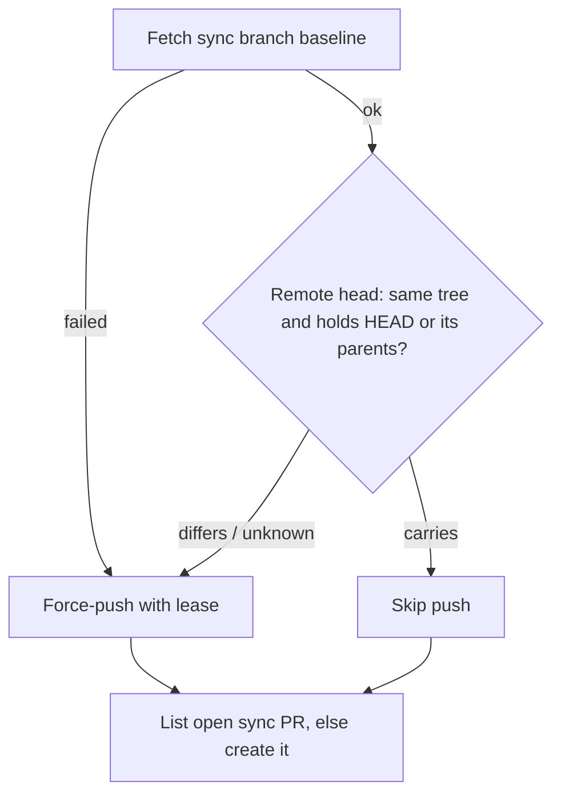

## Summary

Measures the milestone sync and conflict PR overhead for 2026-10-07 to
2026-10-14 by repository, and closes one repeat path. `raiseMilestoneSyncPr`
no longer force-pushes the sync branch when the freshly fetched remote
`sync/milestone-<name>` head already holds the same merge (same tree, same
tips), so an open sync PR's required checks are not restarted for no change.
Closes #3690.

The per-issue estimated API-equivalent cost is reported as unknown, not zero:
#3644's lifecycle ledger is not on the default branch yet. No lifetime or
overlap experiment was run; the data for one is recorded.

## Spec

### Intent and Rationale

- The remote sync branch is shared, fleet-wide state; the existing "last synced
  tip" record is per host, so a sibling host or a restart could re-merge the
  same tips and force-push a new SHA with identical content.
- Only the push to the unprotected `sync/milestone-*` branch is skipped; PR
  listing and creation still run, so an interrupted sync still gets its PR.

### Essential Design Decisions

- "Carries" needs a successful baseline fetch, an equal tree, and HEAD (or
  every parent of HEAD) already in the remote head. Anything else pushes as
  before (fail towards syncing, like `milestone_sync_claim.ts`). A remote ref
  `rev-parse --verify --quiet` cannot resolve (any non-zero exit) reads
  `differs` and pushes with no log line; a read that fails after the ref
  resolves reads `unknown` and is logged as "could not be read" first.
- The push and its stale-info retry sit in one `pushWithStaleRetry` closure
  that runs only when the guard did not read `carries`, so the skipped path
  carries no placeholder push result.
- 0-file sync PRs are not skipped: they still record the default branch in the
  milestone's ancestry (Issue #1048).

### Undiscoverable Facts

- In the window, 0 identical re-pushes were observed: every inspected
  sync-branch force-push carried a moved tip. The guard closes a path the code
  allowed, not a measured saving.
- Private repo data is reported as counts only ("private repo P1").

## Evidence

Backend change. Baseline, method and the gh commands used:
`docs/milestone-sync-overhead.md`.

Observed git behaviour the guard relies on (git 2.x, scratch repo):
`git rev-parse --verify --quiet <missing ref>` exits 1 with no output;
`git merge-base --is-ancestor HEAD HEAD` exits 0; with an unknown object it
exits 128 (`fatal: Not a valid commit name`).

Callers of `raiseMilestoneSyncPr` checked: `lib/git_pull.ts`
(`pushSyncedMilestoneBranch`, reads `pushed` through `syncPrLandingNote`),
`lib/milestone_rollback.ts` (its git wrapper now passes `stdout`, so the guard
can read git there; a rebuilt roll-back branch reads `differs` and pushes) and
`lib/conflict_milestone_rebuild.ts` (`abandonAndRebuildMilestone`, through
`deps.raiseSyncPr ?? raiseMilestoneSyncPr`). The rebuild copies only `branch`
and `opened` into its `delivery` and ignores `pushed`. That is safe: when any
sub-PR replays, HEAD's first parent is a cherry-pick made in that call (this
run's committer time), so no remote sync head contains it, the guard reads
`differs` and the push goes ahead as before. When no sub-PR replays and an
earlier identical rebuild already sits on the sync branch, the guard reads
`carries` and skips the push. The open sync PR then already holds that exact
tree and tips, so the rebuild's report, which names the sync PR carrying the
rebuild, is still true. Its "updated" wording just means no new commit was
pushed.
Fixtures returning the outcome type updated:
`worker/deno/tests/fixtures/conflict_replay_driver.ts`,
`worker/deno/tests/conflict_abandon_restart_test.ts`.

New member `pushed` (`MilestoneSyncPrOutcome`): production reader
`syncPrLandingNote`, called by `pushSyncedMilestoneBranch`.

Issue numbers cited, each looked up this run: #3644: Record end-to-end issue
lifecycle, cohort attribution and fully loaded cost; #2030: Milestone Branch
Sync blocks the whole cycle … sibling hosts resolve the same conflict at once;
#1967: A milestone sync PR left open when the milestone's final PR merges is
retargeted …; #1048: A squash-style main → milestone sync silently resurrects
files main deleted; #589: The milestone branch sync pushes directly … raise a
PR instead; #3718/#3723: lifecycle ledger sub-issues; #3385, #3691: parents of
the sibling milestones cited.

**Docs sweep** — grep: `raiseMilestoneSyncPr`, `MilestoneSyncPrOutcome`,
"UPDATED the open sync PR", "force-push\w* (the|that) sync"; section:
`docs/workflows/milestones.md#milestone-branch-sync` (item 7, gated branches);
siblings: `opened` (the existing `MilestoneSyncPrOutcome` field, no doc lists
it); updated: `docs/workflows/milestones.md`, `README.md`,
`docs/milestone-sync-overhead.md` (new); no other hits outside
`docs/archive/` and `docs/audits/`.

## Acceptance Criteria

<!-- vibe-spec-review inputs="diff+issue-body" -->

- **partial** — Baseline sync/conflict PR overhead and cost measured by repository. — evidence: `docs/milestone-sync-overhead.md` (Baseline, VibeCoder CI) — reviewer: partial — reason: PR counts, ratios and elapsed time are measured for VibeCoder and private repo P1, CI runs for VibeCoder only; API-equivalent cost is unknown because #3644's ledger is not on the default branch, and two repos with 2 sync PRs each have no baseline row
- **met** — At least one repeated/no-op sync pattern prevented or evidence documented that none exist. — evidence: `worker/deno/tests/milestone_sync_pr_test.ts::sync push guard - simultaneous workers: a sibling already pushed the same merge, so nothing is pushed (Issue #3690)` and `docs/milestone-sync-overhead.md#what-repeats` — reviewer: met
- **met** — Branch protections, reviewed change boundaries and required tests are unchanged. — evidence: no ruleset or workflow change in the diff; the guard only skips a push to the unprotected `sync/milestone-*` branch — reviewer: met
- **met** — No duplicate implementation of existing merge recovery issues. — evidence: `worker/deno/lib/milestone_sync_pr.ts::syncBranchAlreadyCarries` is a pre-push check inside the existing `raiseMilestoneSyncPr` — reviewer: met
- **unrequested** — New operator log messages for the skipped-push outcomes (`syncPrLandingNote`) — reviewer: unrequested — reason: needed to report the new `pushed` outcome rather than claim an update that did not happen
- **unrequested** — README docs-table row and one sentence in `docs/workflows/milestones.md` — reviewer: unrequested — reason: the code change owes a docs change (CODING-STANDARDS.md)

## Standards Review

<!-- vibe-standards-review inputs="diff+CODING-STANDARDS.md" -->

- **violation** — the required `pushed` field was not threaded through test fixtures that build the outcome, so they failed type checking — evidence: `worker/deno/tests/fixtures/conflict_replay_driver.ts:544`, `worker/deno/tests/conflict_abandon_restart_test.ts:2275` — reason: fixed in this diff
- **violation** — the new message branches in `pushSyncedMilestoneBranch` had no test — evidence: `worker/deno/lib/git_pull.ts:296` — reason: fixed in this diff (moved to `syncPrLandingNote` with one test per outcome)
- **clean** — Australian English; a code change owes a docs change; check where you insert; behaviour another issue delivers not described as present (#3644 ledger stated absent); named tests exist; nothing exists only for a test (`pushed` read by `syncPrLandingNote`); no workflow change; no shared `/tmp` paths in tests; Mermaid present. Optional, applied: the roll-back git wrapper now passes `stdout` so the guard does not log "could not be read" on every roll-back

## Test Plan

- `worker/deno/tests/milestone_sync_pr_test.ts`: timeline fixtures for
  simultaneous workers, base advance, milestone advance, interrupted sync,
  fast-forward, unknown state (unreadable ancestry, unreadable tree), stale
  remote-tracking ref and first run; a classifier test for
  `syncBranchAlreadyCarries`; one test per `syncPrLandingNote` outcome. The
  scripted git fake only answers the exact
  `rev-parse --verify --quiet refs/remotes/origin/<branch>` lookup, and refuses
  (exit 129, as git does) a `merge-base --is-ancestor` that does not name the
  remote head, so dropping `--quiet` or the remote head turns the classifier
  and guard tests red.
- `worker/deno/tests/milestone_sync_ancestry_test.ts::syncMilestoneBranchWithDefault - a rule-refused push says the sync PR was raised (Issues #589, #3690)`:
  real git with a pre-receive hook refusing `milestone/*`, and `gh` stubbed at
  the process boundary (`_setGhSpawnRunner`); asserts the sync's message
  carries `syncPrLandingNote`'s "RAISED a sync PR from 'sync/milestone-…'".
- `worker/deno/tests/milestone_rollback_test.ts::executeRollback - an existing sync branch is compared through the roll-back's own git, then updated (Issue #3690)`:
  a sync branch left on the remote by an earlier cycle, so the guard runs
  through the roll-back's git wrapper; asserts nothing logs "could not be
  read" (a wrapper without `stdout` reads every comparison as `unknown`) and
  that the rebuilt merge is pushed to the sync branch.
- Mutation check: each of the five listed survivors was applied by hand and
  re-run. Dropping `value` at `lib/git_pull.ts:297` turned the ancestry test
  above red. Dropping `stdout` at `lib/milestone_rollback.ts:615` turned the
  roll-back test above red. Dropping `--quiet` or `remoteHead` in
  `syncBranchAlreadyCarries` turned 4 tests red each in
  `milestone_sync_pr_test.ts`. The `stderr: ""` placeholder push result
  (`lib/milestone_sync_pr.ts:438`) was dead, since it was never read when the
  push was skipped. It is gone (see `pushWithStaleRetry` above).
  Second round, two more survivors: `let staleRetried = true`
  (`lib/milestone_sync_pr.ts:443`) now turns "raiseMilestoneSyncPr - pushes a
  sync branch and opens a PR into the milestone" red, because that test now
  captures the log and asserts a push accepted first time reports no "stale
  info" retry; `return undefined` in place of `return null`
  (`lib/milestone_sync_pr.ts:467`) now turns 16 tests red, because the caller
  checks `pushError !== null` instead of truthiness.
  Required-status-check protection is covered by the existing tests that
  reach `raiseMilestoneSyncPr` only after a rule-refused push; conflict
  takeover is untouched by this change.
- Red checks: forcing the guard to always return `differs` turned 4 tests red
  (fast-forward, interrupted sync, simultaneous workers, unreadable ancestry);
  forcing `carries` as the guard's answer in the `carried` assignment (the
  fetch-failure path left as `differs`) turned 10 red in
  `milestone_sync_pr_test.ts`. That is 5 existing tests (pushes a sync branch,
  establishes the lease baseline, the two stale-info tests, any other push
  failure) and 5 new ones (base advance, milestone advance, the two unknown
  states, first run). Forcing `return "carries"` at the top of
  `syncBranchAlreadyCarries` turned 11 red: the same 10 plus the classifier
  test. Making the fetch condition always true turned only the stale-ref test
  red. Each `unknown` return flipped to `carries` turned the classifier test
  red.
- Edited existing test "raiseMilestoneSyncPr - a stale-info rejection is
  refetched and retried, then the PR is raised (Issue #2613)": removed
  `const verbs = git.map((args) => args[0]);` and
  `assertEquals(git[2], git[0], "the refetch refreshes the same lease baseline");`
  — the guard's new `rev-parse` git calls make the unfiltered verb list and
  positional indices untrue (issue requirement: deterministic dedup before the
  push). Replaced by the same checks over `fetch`/`push` verbs only
  (`fetches[1]` against `fetches[0]`); the expected `["fetch", "push", "fetch",
  "push"]` is unchanged and still goes red if the stale-info retry is removed.
- Edited existing test "executeRollback - a ruleset-rejected push lands
  through the sync PR": its inline pre-receive hook moved, unchanged, into the
  `gateMilestoneRefs` helper that the new roll-back test shares. No assertion
  changed.
- Edited existing test "raiseMilestoneSyncPr - pushes a sync branch and
  opens a PR into the milestone": its deps gain a `log` capture and one new
  assertion (no "stale info" log on a first-time push). No assertion removed.
- Fixture edits (`pushed: true`) in
  `worker/deno/tests/fixtures/conflict_replay_driver.ts` and
  `worker/deno/tests/conflict_abandon_restart_test.ts`: no assertion changed.
- From `worker/deno`, with `< /dev/null`: `deno test --allow-all
  tests/milestone_sync_pr_test.ts tests/milestone_rollback_test.ts
  tests/milestone_sync_ancestry_test.ts` gave 30 + 19 + 8 passed, 0 failed.
  The 22 test files that reach `raiseMilestoneSyncPr`,
  `syncMilestoneBranchWithDefault`, `executeRollback` or
  `abandonAndRebuildMilestone` gave 262 passed, 1 failed. The failure is
  `milestone_sync_conflict_resolution_test.ts::syncMilestoneBranchWithDefault - two appended ledger slices are unioned by value, not escalated (Issue #2013)`:
  its fixture's own `git push` is refused by this host's `core.hooksPath`
  pre-push hook (`PRE_PUSH_BLOCKED … refs/remotes/origin/HEAD is not a
  symbolic ref`), and it fails the same way on the unchanged head. `deno
  check` and `deno lint` are clean on the changed files.

<!-- vibe-branch-outcomes -->
