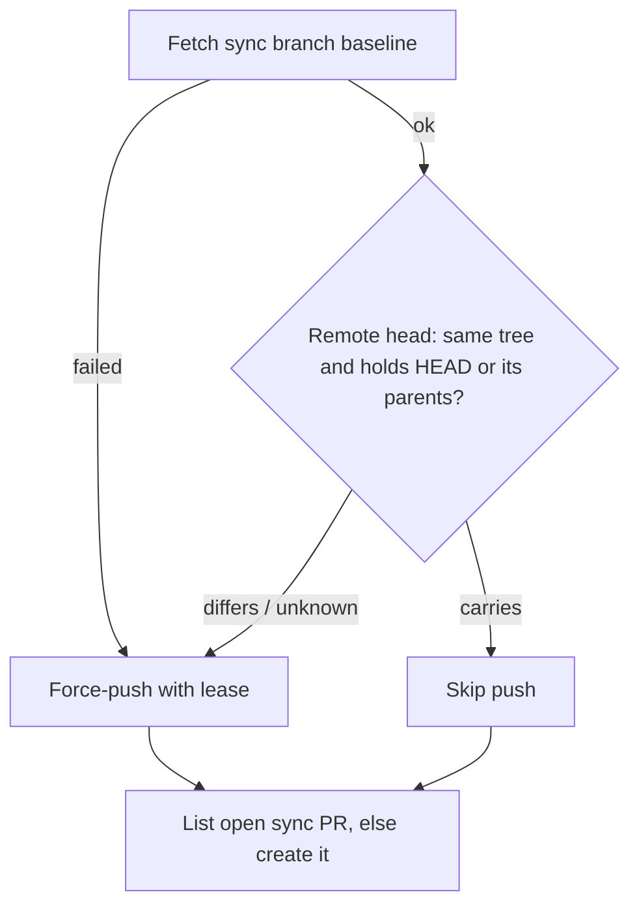

## Summary

Measures the milestone sync and conflict PR overhead for 2026-10-07 to
2026-10-14 by repository, and closes one repeat path. `raiseMilestoneSyncPr`
no longer force-pushes the sync branch when the freshly fetched remote
`sync/milestone-<name>` head already holds the same merge (same tree, same
tips), so an open sync PR's required checks are not restarted for no change.
Closes #3690.

The per-issue estimated API-equivalent cost is reported as unknown, not zero:
#3644's lifecycle ledger is not on the default branch yet. No lifetime or
overlap experiment was run; the data for one is recorded.

## Spec

### Intent and Rationale

- The remote sync branch is shared, fleet-wide state; the existing "last synced
  tip" record is per host, so a sibling host or a restart could re-merge the
  same tips and force-push a new SHA with identical content.
- Only the push to the unprotected `sync/milestone-*` branch is skipped; PR
  listing and creation still run, so an interrupted sync still gets its PR.

### Essential Design Decisions

- "Carries" needs a successful baseline fetch, an equal tree, and HEAD (or
  every parent of HEAD) already in the remote head. Anything git cannot answer
  logs and pushes as before (fail towards syncing, like `milestone_sync_claim.ts`).
- 0-file sync PRs are not skipped: they still record the default branch in the
  milestone's ancestry (Issue #1048).

### Undiscoverable Facts

- In the window, 0 identical re-pushes were observed: every inspected
  sync-branch force-push carried a moved tip. The guard closes a path the code
  allowed, not a measured saving.
- Private repo data is reported as counts only ("private repo P1").

## Evidence

Backend change. Baseline, method and the gh commands used:
`docs/milestone-sync-overhead.md`.

Observed git behaviour the guard relies on (git 2.x, scratch repo):
`git rev-parse --verify --quiet <missing ref>` exits 1 with no output;
`git merge-base --is-ancestor HEAD HEAD` exits 0; with an unknown object it
exits 128 (`fatal: Not a valid commit name`).

Callers of `raiseMilestoneSyncPr` checked: `lib/git_pull.ts`
(`pushSyncedMilestoneBranch`, reads `pushed` through `syncPrLandingNote`) and
`lib/milestone_rollback.ts` (its git wrapper now passes `stdout`, so the guard
can read git there; a rebuilt roll-back branch reads `differs` and pushes).
Fixtures returning the outcome type updated:
`worker/deno/tests/fixtures/conflict_replay_driver.ts`,
`worker/deno/tests/conflict_abandon_restart_test.ts`.

New member `pushed` (`MilestoneSyncPrOutcome`): production reader
`syncPrLandingNote`, called by `pushSyncedMilestoneBranch`.

Issue numbers cited, each looked up this run: #3644: Record end-to-end issue
lifecycle, cohort attribution and fully loaded cost; #2030: Milestone Branch
Sync blocks the whole cycle … sibling hosts resolve the same conflict at once;
#1967: A milestone sync PR left open when the milestone's final PR merges is
retargeted …; #1048: A squash-style main → milestone sync silently resurrects
files main deleted; #589: The milestone branch sync pushes directly … raise a
PR instead; #3718/#3723: lifecycle ledger sub-issues; #3385, #3691: parents of
the sibling milestones cited.

**Docs sweep** — grep: `raiseMilestoneSyncPr`, `MilestoneSyncPrOutcome`,
"UPDATED the open sync PR", "force-push\w* (the|that) sync"; section:
`docs/workflows/milestones.md#milestone-branch-sync` (item 7, gated branches);
siblings: `opened` (the existing `MilestoneSyncPrOutcome` field, no doc lists
it); updated: `docs/workflows/milestones.md`, `README.md`,
`docs/milestone-sync-overhead.md` (new); no other hits outside
`docs/archive/` and `docs/audits/`.

## Acceptance Criteria

<!-- vibe-spec-review inputs="diff+issue-body" -->

- **partial** — Baseline sync/conflict PR overhead and cost measured by repository. — evidence: `docs/milestone-sync-overhead.md` (Baseline, VibeCoder CI) — reviewer: partial — reason: PR counts, ratios and elapsed time are measured for VibeCoder and private repo P1, CI runs for VibeCoder only; API-equivalent cost is unknown because #3644's ledger is not on the default branch, and two repos with 2 sync PRs each have no baseline row
- **met** — At least one repeated/no-op sync pattern prevented or evidence documented that none exist. — evidence: `worker/deno/tests/milestone_sync_pr_test.ts::sync push guard - simultaneous workers: a sibling already pushed the same merge, so nothing is pushed (Issue #3690)` and `docs/milestone-sync-overhead.md#what-repeats` — reviewer: met
- **met** — Branch protections, reviewed change boundaries and required tests are unchanged. — evidence: no ruleset or workflow change in the diff; the guard only skips a push to the unprotected `sync/milestone-*` branch — reviewer: met
- **met** — No duplicate implementation of existing merge recovery issues. — evidence: `worker/deno/lib/milestone_sync_pr.ts::syncBranchAlreadyCarries` is a pre-push check inside the existing `raiseMilestoneSyncPr` — reviewer: met
- **unrequested** — New operator log messages for the skipped-push outcomes (`syncPrLandingNote`) — reviewer: unrequested — reason: needed to report the new `pushed` outcome rather than claim an update that did not happen
- **unrequested** — README docs-table row and one sentence in `docs/workflows/milestones.md` — reviewer: unrequested — reason: the code change owes a docs change (CODING-STANDARDS.md)

## Standards Review

<!-- vibe-standards-review inputs="diff+CODING-STANDARDS.md" -->

- **violation** — the required `pushed` field was not threaded through test fixtures that build the outcome, so they failed type checking — evidence: `worker/deno/tests/fixtures/conflict_replay_driver.ts:544`, `worker/deno/tests/conflict_abandon_restart_test.ts:2275` — reason: fixed in this diff
- **violation** — the new message branches in `pushSyncedMilestoneBranch` had no test — evidence: `worker/deno/lib/git_pull.ts:296` — reason: fixed in this diff (moved to `syncPrLandingNote` with one test per outcome)
- **clean** — Australian English; a code change owes a docs change; check where you insert; behaviour another issue delivers not described as present (#3644 ledger stated absent); named tests exist; nothing exists only for a test (`pushed` read by `syncPrLandingNote`); no workflow change; no shared `/tmp` paths in tests; Mermaid present. Optional, applied: the roll-back git wrapper now passes `stdout` so the guard does not log "could not be read" on every roll-back

## Test Plan

- `worker/deno/tests/milestone_sync_pr_test.ts`: timeline fixtures for
  simultaneous workers, base advance, milestone advance, interrupted sync,
  fast-forward, unknown state (unreadable ancestry, unreadable tree), stale
  remote-tracking ref and first run; a classifier test for
  `syncBranchAlreadyCarries`; one test per `syncPrLandingNote` outcome.
  Required-status-check protection is covered by the existing tests that
  reach `raiseMilestoneSyncPr` only after a rule-refused push; conflict
  takeover is untouched by this change.
- Red checks: forcing the guard to always return `differs` turned 4 tests red
  (fast-forward, interrupted sync, simultaneous workers, unreadable ancestry);
  always `carries` turned 12 red (7 existing push tests, 5 new). Making the
  fetch condition always true turned only the stale-ref test red. Each
  `unknown` return flipped to `carries` turned the classifier test red.
- Edited existing test "raiseMilestoneSyncPr - a stale-info rejection is
  refetched and retried, then the PR is raised (Issue #2613)": removed
  `const verbs = git.map((args) => args[0]);` and
  `assertEquals(git[2], git[0], "the refetch refreshes the same lease baseline");`
  — the guard's new `rev-parse` git calls make the unfiltered verb list and
  positional indices untrue (issue requirement: deterministic dedup before the
  push). Replaced by the same checks over `fetch`/`push` verbs only
  (`fetches[1]` against `fetches[0]`); the expected `["fetch", "push", "fetch",
  "push"]` is unchanged and still goes red if the stale-info retry is removed.
- Fixture edits (`pushed: true`) in
  `worker/deno/tests/fixtures/conflict_replay_driver.ts` and
  `worker/deno/tests/conflict_abandon_restart_test.ts`: no assertion changed.
- `deno test --allow-all tests/milestone_sync_pr_test.ts < /dev/null` (from
  `worker/deno`): 30 passed, 0 failed.

<!-- vibe-branch-outcomes -->
