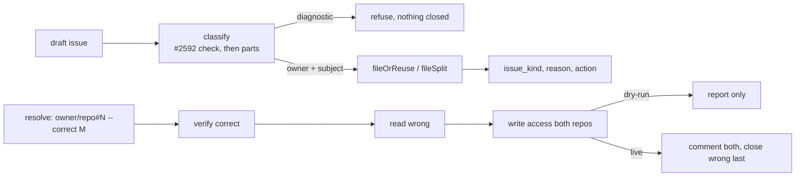

# PR Summary — Issue #3691

## Summary
Base: `f108cad7`.
Deterministic cross-repository issue routing and wrong-repo duplicate prevention. The issue-creation path classifies each draft into an owner repository and a subject repository, records why, and offers a no-mutation dry-run. A wrong-repo duplicate is resolved by verifying or creating the correct issue first, linking both, and closing the duplicate last. Repo-scoped fast-failure diagnostics (#2592) are refused, never closed as wrong-repo.
- `worker/deno/lib/issue_routing.ts`: classifier, `findMatches`, `requireWriteAccess`, `fileOrReuse`, `fileSplit`, `routeIssueCreation`, `resolveWrongRepoDuplicate`.
- `worker/deno/commands/route_issue.ts`: `route-issue` create, resolve and `--part` modes.
- `worker/deno/commands/suggest_improvements.ts`: classifier wired into the suggestion path.
- `docs/ISSUE-ROUTING.md` (new) and the policy rows in the docs and prompts.
Scope: 26 files against `f108cad7`, +4026/−39.

Closes #3691.

## Spec

### Intent and Rationale
- Issues were filed in whichever repo the worker happened to be running in, so product fixes, worker fixes and repo-scoped diagnostics ended up in the wrong place and duplicated.
- Routing follows the policy in `/tmp/issue-3691-body.md`: product code goes to the repo that versions it; worker, fleet, prompt and orchestration changes go to VibeCoder; repo-scoped diagnostics stay in the monitored repo (#2592).
- Owner is ambiguous when signals conflict. The basis is stated in `reason`, and nothing is auto-closed.

### Essential Design Decisions
- **Diagnostics are exempt.** `isRepoFastFailureIssue` and `isRepoFastFailureTallyIssue` are checked at classify and again in `resolveWrongRepoDuplicate`. A diagnostic is refused with a reason, not closed.
- **Resolve order.** Verify the correct issue, read the wrong one, check write access on both repos, return on dry-run, comment on both, close the wrong issue last. A failed comment stops before the close.
- **Split needs two or more parts.** `--part` takes a JSON array. A single part is refused, so a split cannot quietly become one issue. Parts share the title and cross-link with `Depends on` or `Related`.
- **Dry-run does every read-only check and writes nothing.** Permission refusals still fire in dry-run.

### Undiscoverable Facts
- The `gh` guard refuses `gh issue close --help`. The resolve path closes with reason "not planned"; that path is not exercised live in this run.
- Classify step 1 (the #2592 check on the draft body) runs before the parts check. A library caller whose body carries a fast-failure marker and whose parts span repos gets one issue and the parts are dropped silently. The CLI passes an empty body and avoids this. Disclosed as a known limitation.
- `mod.ts` keeps only the last value of a repeated flag, which is why parts are one JSON array.
- Dedup is exact normalised-title match within `ISSUE_ROUTING_RECENTLY_CLOSED_DAYS` (30); concurrent filers resolve to the lowest number.

## Evidence

Docs sweep — grep: `route-issue`, `wrong-repo`, `follow-up issue`, `where the code lives`; section: `docs/ISSUE-ROUTING.md` §2 (policy row, line 38) and §5 (`--part`, lines 72–84; `--body-file` note, line 83), `CODING-STANDARDS.md` "File a follow-up where the code lives" (~L1918), `DESIGN-PRINCIPLES.md` "Follow-up issues are filed where the code lives", `README.md` doc table Issue Routing row; updated: all of the above; siblings: "Merge conflicts are the worker's to resolve" (DESIGN-PRINCIPLES.md) and the other doc-table rows in README.md; the follow-up bullet added to `prompts/{ci_fix,issue,planning,pr_feedback,retro}/prompt.md` (+2 each) and `prompts/coding_guidelines/prompt.md` (+24). The retro outcome issue stays in the current repo (carve-out).

Issues cited as provenance:
- #2592: File repo fast-failure diagnostics in the monitored repo, not VibeCoder
- #3607: PWA iPhone home-screen app: too big a gap above the header
- #3242: PWA iPhone: remove excessive blank space above header (regression after #2711)
- #3184: fix(worker): stSoftwareAU/GRQ-AutoTrader keeps failing at setup — runs die in the first minute
- #3630: Lane worktree creation wedges when the shared clone's HEAD dangles — heal it to the default branch
- #3455: Fleet PRs add production fields and props that only tests read: no pre-PR check for a production reader (three private fleet PRs)
- #3689: Audit deployed pre-PR quality stages against actual GitHub CI failures across GRQ, VibeCoder and GRQ-AutoTrader
- #3690: Quantify and reduce avoidable milestone sync/conflict PR cycles without bypassing branch protection
- #3594: PR reviewer: apply the review checklists a target repository declares for the paths a diff touches
- #3674: Partial-rollup PR body and base-integrity PR comments still cite VibeCoder issue numbers in target repos
- #3691: Deterministic cross-repository issue routing and wrong-repo duplicate prevention

Mermaid diagram (copy this block):

## Acceptance Criteria
<!-- vibe-spec-review inputs="diff+issue-body" -->
Read `/tmp/issue-3691-body.md` and quote each deliverable's wording from the issue body under its own bullet, then the verdict. The deliverables are: a documented classifier on the issue-creation path; auditable `owner_repository`, `subject_repository`, `issue_kind` and reason fields with the diagnostic exception; a no-mutation dry-run; for a duplicate or wrong-repo issue, create or verify the correct issue first, link both, then close the duplicate; permission checks before cross-repo filing; preserved security guardrails.
- Verdicts are the author's. No independent spec-reviewer ran in this session.
- Honest partial: the classifier is pattern-based (`VIBE_PATH_RE`, `VIBE_KEYWORD_RE`, `PRODUCT_RE`), so an unusual wording can route differently than a human would. Ambiguous cases are reported, not guessed.
- Honest partial: the known limitation in Undiscoverable Facts stands for library callers.
- Unrequested entries: `worker/deno/mod.ts` (+6) makes the config optional. Disclosed; it was not asked for.

## Standards Review
<!-- vibe-standards-review inputs="diff+CODING-STANDARDS.md" -->
- Fixed in this diff — test-only members (#3455): `draft.parts` and `dependsOnRepos` were set only by tests. `route_issue.ts` now sets both from the `--part` CLI (`for (const part of parts)`, `dependsOnRepos: part.dependsOnRepos`, `parts: routedParts`).
- Fixed in this diff — docs promised an unreachable split: docs and prompts described a split production could not produce. The `--part` mode now produces it, and `worker/deno/tests/route_issue_test.ts` drives it through the CLI.
- Clean: no hidden or secret path is staged; the pre-commit gate runs on the explicit stage list.

## Test Plan

- Unit: `deno task test:unit tests/issue_routing_test.ts` from `worker/deno`: 56 passed, 0 failed (latest run, this session). `worker/deno/tests/route_issue_test.ts`, `worker/deno/tests/command_args_test.ts` were green in the executor runs; the quality gate below re-runs them.
- Red-check runs. Each row flips one branch, runs the named tests, confirms red, restores the code, and shows the diff is empty.

| Check | Branch flipped | Failing tests |
|---|---|---|
| (a) | early dry-run return in `resolveWrongRepoDuplicate` restored | 6: `resolve: same-repo duplicates check permission once; dry-run reads and writes nothing` and 5 `route-issue --resolve-duplicate - dry-run …` CLI tests |
| (b) | write-access check skipped on dry-run in `fileSplit` | 1: `route-issue --part - dry-run still refuses when a non-target part repository is read-only` |
| (c) | single-part guard removed | 2: `validateRouteIssueArgs refuses a single --part …` and `route-issue --part - a single part string is refused …` |
| (d) | `Depends on` / `Related` swapped | 2: `route: split files one issue per repo …` and `route-issue --part - a live split files one issue per part …` |
| (e) | `--body-file` / `--part` conflict check removed | 2: `validateRouteIssueArgs refuses --body-file alongside --part` and `route-issue --part - combining --part with --body-file is refused …` |
| (f) | diagnostic refusal in `resolveWrongRepoDuplicate` (`if (false && (…))`), `issue_routing.ts:786` | 1: `resolve: refuses to close a diagnostic and says why` (55 passed, 1 failed) |
| (g) | closed short-circuit in `resolveWrongRepoDuplicate` (`if (false && …)`), `issue_routing.ts:795` | 1: `resolve: a wrong issue that is already closed is left alone` (55 passed, 1 failed) |

Earlier red-checks, same method: PR window check disabled (2 failed); CLI resolve stubbed (4 failed); mixing-modes refusal removed (1 failed).

**Branch outcomes:**
- `issue_routing.ts` diagnostic refusal (`carries a fast-failure marker`, `issue_routing.ts:791`; check at `issue_routing.ts:786`): refused, reason names #2592 — `resolve: refuses to close a diagnostic and says why`; flip (f) went red.
- `issue_routing.ts` closed short-circuit (`toUpperCase() === "CLOSED"`, `issue_routing.ts:795`): left alone — `resolve: a wrong issue that is already closed is left alone`; flip (g) went red.
- `issue_routing.ts` dry-run return (`dry-run: would link and close`, `issue_routing.ts:809`): reports only — `resolve: same-repo duplicates check permission once; dry-run reads and writes nothing`; flip (a) went red.
- `issue_routing.ts` `fileSplit` dry-run write-access (`requireWriteAccess` at `issue_routing.ts:574`, inside `fileSplit` at `issue_routing.ts:563`): refuses on read-only part repo — CLI dry-run refusal test; flip (b) went red.
- `route_issue.ts` single-part guard: refused with JSON-array hint — flip (c) went red.
- `route_issue.ts` `--body-file` + `--part`: refused before create — flip (e) went red.
- `issue_routing.ts:616` `Depends on` / `Related` branch: flip (d) went red. The grep for `Depends on:` / `Related:` failed earlier because the code builds the string without a colon. The branch is `${dependsOn ? "Depends on" : "Related"}` at that line.
- `issue_routing_context.ts` `ISSUE_ROUTING_RECENTLY_CLOSED_DAYS` window (`issue_routing_context.ts:22`): closed inside it reused, outside not — `route: closed within the window is reused; outside it is not`; PR-window flip went red.
- Classifier branches (`classify:` tests in `worker/deno/tests/issue_routing_test.ts`, incl. ambiguous and parts-across-repos): these outcomes are reached by tests, but their own flips were NOT run in this session. Disclosed as not flipped.

**Callers checked:** `route_issue.ts` (create, resolve, `--part`); `suggest_improvements.ts` (classifier wired in); `mod.ts` dispatch for `route-issue`; the prompts/ docs follow-up bullet (the retro carve-out is the only exception and is stated).

**Lifecycle-guard note:** `--resolve-duplicate` closes the wrong issue with `gh issue close`. In an issue run the `gh` guard refuses close on the issue being worked, so a run that resolves its own issue as a duplicate fails loud rather than closing it. This is a risk to a human reviewing the command, not something exercised live here.

🤖 Generated with [Claude Code](https://claude.com/claude-code)
