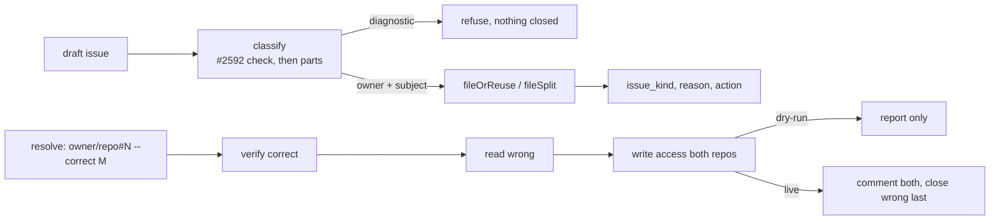

# PR Summary — Issue #3691

## Summary
Base: `f108cad7`.
Deterministic cross-repository issue routing and wrong-repo duplicate prevention. The issue-creation path classifies each draft into an owner repository and a subject repository, records why, and offers a no-mutation dry-run. A wrong-repo duplicate is resolved by verifying or creating the correct issue first, linking both, and closing the duplicate last. Repo-scoped fast-failure diagnostics (#2592) are refused, never closed as wrong-repo.
- `worker/deno/lib/issue_routing_classifier.ts`: `classifyIssueRouting` (owner, subject, `issue_kind`, reason).
- `worker/deno/lib/issue_routing_filing.ts`: `fileOrReuse`, `fileSplit`, `routeIssueCreation`.
- `worker/deno/lib/issue_routing_resolve.ts`: `resolveWrongRepoDuplicate`.
- `worker/deno/lib/issue_routing_github.ts`: `findMatches`, `requireWriteAccess`. Also `issue_routing_context.ts`, `issue_routing_types.ts` and `issue_routing_audit.ts`; `issue_routing.ts` re-exports them all.
- `worker/deno/commands/route_issue.ts`: `route-issue` create, resolve and `--part` modes.
- `worker/deno/commands/suggest_improvements.ts`: classifier wired into the suggestion path.
- `docs/ISSUE-ROUTING.md` (new) and the policy rows in the docs and prompts.
Scope: 34 files against `f108cad7`, +4385/−43.

Closes #3691.

## Spec

### Intent and Rationale
- Issues were filed in whichever repo the worker happened to be running in. As a result, product fixes, worker fixes and repo-scoped diagnostics landed in the wrong repo and were duplicated.
- Routing follows the policy in issue #3691:
  - Product code goes to the repo that versions it.
  - Worker, fleet, prompt and orchestration changes go to VibeCoder.
  - Repo-scoped diagnostics stay in the monitored repo (#2592).
- The owner is ambiguous when signals conflict. In that case `reason` states the basis, and nothing is closed automatically.

### Essential Design Decisions
- **Diagnostics are exempt.** `isRepoFastFailureIssue` and `isRepoFastFailureTallyIssue` are checked when classifying and again in `resolveWrongRepoDuplicate`. A diagnostic is refused with a reason; it is never closed.
- **Resolve order.** The steps run in this order:
  1. Verify the correct issue.
  2. Read the wrong issue.
  3. Check write access on both repos.
  4. Return here on a dry-run.
  5. Comment on both issues.
  6. Close the wrong issue last.

  A failed comment stops before the close.
- **A split needs two or more parts.** `--part` takes a JSON array, and a single part is refused, so a split cannot quietly become one issue. The parts share the title and cross-link with `Depends on` or `Related`.
- **A dry-run does every read-only check and writes nothing.** Permission refusals still fire in a dry-run.

### Undiscoverable Facts
- The `gh` guard refuses `gh issue close --help`. The resolve path closes with the reason "not planned". That path was not exercised live in this run.
- Classify step 1 (the #2592 check on the draft body) runs before the parts check. Known limitation: if a library caller's body carries a fast-failure marker and its parts span repos, one issue is filed and the parts are silently dropped. The CLI passes an empty body, so it avoids this.
- `mod.ts` keeps only the last value of a repeated flag, which is why the parts are passed as one JSON array.
- Dedup is an exact normalised-title match within `ISSUE_ROUTING_RECENTLY_CLOSED_DAYS` (30 days). When two filers race, the lowest-numbered issue wins.

## Evidence

Docs sweep — grep: `route-issue`, `wrong-repo`, `follow-up issue`, `where the code lives`; section: `docs/ISSUE-ROUTING.md` §2 (policy row) and §5 (`--part` and the `--body-file` note), `CODING-STANDARDS.md` "File a follow-up where the code lives", `DESIGN-PRINCIPLES.md` "Follow-up issues are filed where the code lives", `README.md` doc table Issue Routing row; updated: all of the above, plus the follow-up bullet added to `prompts/{ci_fix,planning,pr_feedback,retro}/prompt.md` (+2 each) and `prompts/coding_guidelines/prompt.md` (+35/−4); siblings: "Merge conflicts are the worker's to resolve" (DESIGN-PRINCIPLES.md) and the other doc-table rows in README.md. The retro outcome issue stays in the current repo (carve-out).

Issues cited as provenance:
- #2592: File repo fast-failure diagnostics in the monitored repo, not VibeCoder
- #3607: PWA iPhone home-screen app: too big a gap above the header
- #3242: PWA iPhone: remove excessive blank space above header (regression after #2711)
- #3184: fix(worker): stSoftwareAU/GRQ-AutoTrader keeps failing at setup — runs die in the first minute
- #3630: Lane worktree creation wedges when the shared clone's HEAD dangles — heal it to the default branch
- #3455: Fleet PRs add production fields and props that only tests read: no pre-PR check for a production reader (three private fleet PRs)
- #3087: a new path to an existing outcome keeps that outcome's guards
- #3253: a new argument reaches every caller that needs it
- #3691: Deterministic cross-repository issue routing and wrong-repo duplicate prevention

## Acceptance Criteria
<!-- vibe-spec-review inputs="diff+issue-body" -->
These verdicts come from an independent spec-reviewer that read only the diff and the issue body.
- "a documented classifier on the issue-creation path" — reviewer: partial.
  - The code calls the classifier from `createGitHubIssuesWithPartialFailures` (`suggest_improvements`) and from `route-issue`.
  - The agent prompts (`ci_fix`, `planning`, `pr_feedback`, `retro`, `coding_guidelines`) only tell the agent to use `route-issue`. No `gh` guard change refuses a bare `gh issue create`.
  - The retro outcome issue stays in the current repo.

  reason: agreed partial. Making the guard shim refuse `gh issue create` affects every phase, so it needs its own issue.
- "auditable `owner_repository`, `subject_repository`, `issue_kind` and reason fields", with the diagnostic exception — reviewer: met. Evidence: `formatRoutingAuditBlock`, and classify rule 1 reuses `isRepoFastFailureIssue`/`isRepoFastFailureTallyIssue`. Tests: `classify: fast-failure diagnostic stays, even with worker paths` and `audit block: visible line and hidden marker, inert values`.
- "no-mutation dry-run" with fixtures — reviewer: met. Tests: `route: dry-run performs no writes` and `route: dry-run still enforces permission on a foreign destination`.
- "create or verify the correct issue, link both, then close the duplicate" — reviewer: partial.
  - The manual path is met. Tests: `resolve: verifies, links both, then closes the wrong one last` and `resolve: a failed comment stops before the close`. The comment records `Labels not migrated:`.
  - Automatic matching is by exact normalised title only.
  - A reused match is neither linked nor commented on.

  reason: agreed partial. Fuzzy matching would be a guess, and the issue says to close nothing automatically when unsure. Duplicates with different titles therefore go through `--resolve-duplicate`.
- "permission checks before cross-repo filing" — reviewer: met. `IssueRoutingPermissionError` is thrown before any write. Tests: `route: insufficient permission throws…`, `route: destination outside the allowlist throws before any gh call`, and `route-issue - a permission refusal fails the command and creates nothing`.
- "preserved security guardrails" — reviewer: met. Caveat: the reviewer saw no test of the `monitored_repos_allowlist.ts` refactor. It narrows types only, and `deno check` covers it.
- Scenario VibeCoder#3607 vs GRQ-AutoTrader#3242 — reviewer: partial. Test: `classify: #3607-style PWA gap filed in VibeCoder belongs to GRQ-AutoTrader`. The titles differ, so closing the duplicate needs a manual `--resolve-duplicate`. reason: same as the duplicate-resolution partial above.
- Scenario GRQ-AutoTrader#3184 vs VibeCoder#3630 — reviewer: met. Test: `route: diagnostic and worker-fix stay in their repos`.
- Scenario: an AutoTrader finding that needs a VibeCoder fix — reviewer: met. Tests: `classify: AutoTrader finding needing a prompts/ fix belongs to VibeCoder` and `route: AutoTrader finding needing a prompts fix is filed in VibeCoder`.
- Scenario: a GRQ scoring bug — reviewer: met. Test: `classify: GRQ scoring bug moves from VibeCoder, stays in GRQ`.
- Scenario: a cross-repo split — reviewer: met. Tests: `route: split files one issue per repo and links them…` and `route-issue --part - a live split files one issue per part and cross-links…`.
- Edge cases (closed, permission, ambiguous, concurrent) — reviewer: met. Tests: `route: closed within the window is reused; outside it is not`, `route: ambiguous is filed in the target, nothing closed`, and `route: post-create lower-numbered duplicate wins, ours closed with explanation`.
- Unrequested changes — reviewer: unrequested.
  - `docs/audits/lib-sweep-coverage/top-up-3691.json`.
  - The `parallel_unsafe_test_manifest.ts` entry, which the wall-clock growth test needs.
  - The `--part`/depends-on and `--resolve-duplicate` CLI surface.
  - The `CODING-STANDARDS.md`, `DESIGN-PRINCIPLES.md` and `README.md` edits.
  - The `monitored_repos_allowlist.ts` refactor.
  - The closed-PR window.
  - `worker/deno/mod.ts` (+6), which makes the config optional.

  reason: each one supports a requested deliverable and is kept. The CLI is how the agent prompts reach the classifier, and the docs carry the policy.

## Standards Review
<!-- vibe-standards-review inputs="diff+CODING-STANDARDS.md" -->
An independent standards-reviewer found no violations.
- Clean — test-only production members (#3455). `__testDeps` follows the same pattern as 11 existing commands and defaults to the real dependencies. `toRouteIssueReport` and the `routing` parameter both have production callers.
- Clean — fail loud. Every `catch` rethrows with `cause`.
- Clean — CLI trust boundary. Unknown keys are refused through validators and `KNOWN_OPTIONS`, and `gh` receives an argument array.
- Clean — regexes on untrusted text. They use bounded character classes and have an `assertLinearGrowth` test.
- Clean — guard order on the new resolve path (#3087), branch coverage, and the new argument passed at every caller (#3253).
- Clean — Australian English.
- Optional, not adopted. None of these is a written rule; each is a possible follow-up.
  - `docs/ISSUE-ROUTING.md` restates "default 30" with no drift test pinning it.
  - `findMatches` passes no `--limit` to `gh pr list`, so the `gh` default of 30 applies.
  - The `toRouteIssueReport` tests use `as never` casts.
- Fixed earlier in this diff: `draft.parts` and `dependsOnRepos` used to be set only by tests. `route_issue.ts` now sets both from `--part`.

## Test Plan

- Unit: from `worker/deno`, `deno task test:unit tests/issue_routing_test.ts` gave 56 passed, 0 failed. `worker/deno/tests/route_issue_test.ts` and `worker/deno/tests/command_args_test.ts` passed in the executor runs.
- Gate: `./quality.sh < /dev/null` PASSED (the config integration stage was skipped).
- Red-check runs. Each row flips one branch, runs the named tests and confirms they fail. The code is then restored and the diff confirmed empty.

| Check | Branch flipped | Failing tests |
|---|---|---|
| (a) | early dry-run return in `resolveWrongRepoDuplicate` removed | 6: `resolve: same-repo duplicates check permission once; dry-run reads and writes nothing` and 5 `route-issue --resolve-duplicate - dry-run …` CLI tests |
| (b) | write-access check skipped on dry-run in `fileSplit` | 1: `route-issue --part - dry-run still refuses when a non-target part repository is read-only` |
| (c) | single-part guard removed | 2: `validateRouteIssueArgs refuses a single --part …` and `route-issue --part - a single part string is refused …` |
| (d) | `Depends on` / `Related` swapped | 2: `route: split files one issue per repo …` and `route-issue --part - a live split files one issue per part …` |
| (e) | `--body-file` / `--part` conflict check removed | 2: `validateRouteIssueArgs refuses --body-file alongside --part` and `route-issue --part - combining --part with --body-file is refused …` |
| (f) | diagnostic refusal in `resolveWrongRepoDuplicate` disabled, `issue_routing_resolve.ts:104` | 1: `resolve: refuses to close a diagnostic and says why` |
| (g) | closed short-circuit in `resolveWrongRepoDuplicate` disabled, `issue_routing_resolve.ts:108` | 1: `resolve: a wrong issue that is already closed is left alone` |

Earlier red-checks used the same method:
- PR window check disabled: 2 failed.
- CLI resolve stubbed: 4 failed.
- Mixing-modes refusal removed: 1 failed.

**Branch outcomes:**
- `issue_routing_resolve.ts:104` diagnostic refusal (`carries a fast-failure marker`; the check is just above it): the close is refused and the reason names #2592. Test: `resolve: refuses to close a diagnostic and says why`. Flip (f) went red.
- `issue_routing_resolve.ts:108` closed short-circuit (`toUpperCase() === "CLOSED"`): the wrong issue is left alone. Test: `resolve: a wrong issue that is already closed is left alone`. Flip (g) went red.
- `issue_routing_resolve.ts:122` dry-run return (`dry-run: would link and close`): the result is reported only. Test: `resolve: same-repo duplicates check permission once; dry-run reads and writes nothing`. Flip (a) went red.
- `issue_routing_filing.ts:141` `requireWriteAccess` in `fileSplit`: a read-only part repo is refused, even on a dry-run. Test: `route-issue --part - dry-run still refuses when a non-target part repository is read-only`. Flip (b) went red.
- `route_issue.ts` single-part guard: refused with a JSON-array hint. Flip (c) went red.
- `route_issue.ts` `--body-file` with `--part`: refused before any create. Flip (e) went red.
- `issue_routing_filing.ts:180` `${dependsOn ? "Depends on" : "Related"}`: both arms are reached. Flip (d) went red.
- `issue_routing_context.ts:22` `ISSUE_ROUTING_RECENTLY_CLOSED_DAYS` window: an issue closed inside the window is reused; one closed outside it is not. Test: `route: closed within the window is reused; outside it is not`. The PR-window flip went red.
- Classifier branches (the `classify:` tests in `worker/deno/tests/issue_routing_test.ts`, including ambiguous and parts-across-repos): tests reach these outcomes, but their individual flips were NOT run. This is disclosed as not flipped.

**Callers checked:**
- `route_issue.ts`: create, resolve and `--part`.
- `suggest_improvements.ts`: classifier wired in through `createGitHubIssuesWithPartialFailures`.
- `mod.ts`: dispatch for `route-issue`.
- The follow-up bullet in the prompts and docs. The retro carve-out is the only exception, and it is stated.

**Lifecycle-guard note:** `--resolve-duplicate` closes the wrong issue with `gh issue close`. In an issue run, the `gh` guard refuses to close the issue being worked. A run that tries to resolve its own issue as a duplicate therefore fails loud instead of closing it. This was not exercised live.

🤖 Generated with [Claude Code](https://claude.com/claude-code)
