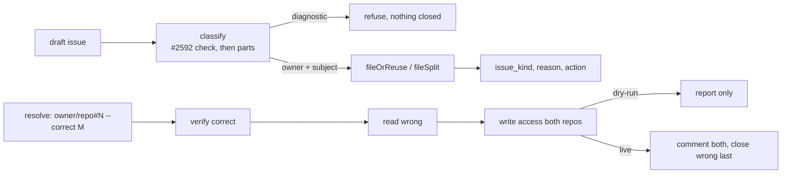

# PR Summary — Issue #3691

## Summary
Base: `2685151f` (merge base with `origin/main`).
Deterministic cross-repository issue routing and wrong-repo duplicate prevention. The issue-creation path classifies each draft into an owner repository and a subject repository, records why, and offers a no-mutation dry-run. A wrong-repo duplicate is resolved by verifying or creating the correct issue first, linking both, and closing the duplicate last. A wrong issue carrying a fast-failure or tally marker (#2592), for any repo and in any letter case, is refused, never closed as wrong-repo.
- `worker/deno/lib/issue_routing_classifier.ts`: `classifyIssueRouting` (owner, subject, `issue_kind`, reason).
- `worker/deno/lib/issue_routing_filing.ts`: `routeIssueCreation` (exported), with the module-private helpers `fileOrReuse` and `fileSplit`.
- `worker/deno/lib/issue_routing_resolve.ts`: `resolveWrongRepoDuplicate`.
- `worker/deno/lib/issue_routing_github.ts`: `findMatches`, `requireWriteAccess`. Also `issue_routing_context.ts` (`buildIssueRoutingContext`), `issue_routing_types.ts` and `issue_routing_audit.ts`.
- `worker/deno/lib/issue_routing.ts`: the facade. It re-exports the types, `IssueRoutingPermissionError`, `classifyIssueRouting`, `formatRoutingAuditBlock`, `routeIssueCreation` and `resolveWrongRepoDuplicate`. It does not re-export `issue_routing_context.ts` or `issue_routing_github.ts`; callers import those directly.
- `worker/deno/commands/route_issue.ts`: `route-issue` create, resolve and `--part` modes. It is a `mod.ts` subcommand (`deno run --allow-all mod.ts route-issue`), not an executable on the agent's `PATH`.
- `worker/deno/commands/suggest_improvements.ts`: classifier wired into the suggestion path.
- `docs/ISSUE-ROUTING.md` (new) and the policy rows in the docs and prompts.
Scope: 34 files against `2685151f`, +5063/−42.

Closes #3691.

## Spec

### Intent and Rationale
- Issues were filed in whichever repo the worker happened to be running in. As a result, product fixes, worker fixes and repo-scoped diagnostics landed in the wrong repo and were duplicated.
- Routing follows the policy in issue #3691:
  - Product code goes to the repo that versions it.
  - Worker, fleet, prompt and orchestration changes go to VibeCoder.
  - Repo-scoped diagnostics stay in the monitored repo (#2592).
- The owner is ambiguous when signals conflict. In that case `reason` states the basis, and nothing is closed automatically.

### Essential Design Decisions
- **Diagnostics are exempt.** `fastFailureMarkerRepos` (in `issue_routing_classifier.ts`) finds the fast-failure and tally markers in a body.
  - The classifier keeps a draft in the target repo when a marker names that repo; the comparison uses `sameRepo`, so letter case does not matter.
  - `resolveWrongRepoDuplicate` refuses to close a wrong issue that carries any such marker, whatever repo it names, and says why.
  - Only these markers are recognised. A lock, lease, back-off or escalation-anchor diagnostic carries no marker, so the code does not exempt it; `docs/ISSUE-ROUTING.md` §4 says so.
- **Worker keywords are worker-specific.** The keyword signal is `vibe[ -]?coder`, `fleet`, `orchestrat`, `lane worktree` and `prompt template`, plus the `worker/deno/`, `prompts/` and `prompt.md` paths. Generic words such as `worker`, `provider`, `claim` and `container image` also name product code (a service worker, a price provider), so they are not signals.
- **Agents file with `gh issue create`, in their own repo.** `route-issue` is not on the agent's `PATH`. The prompts therefore give the routing policy and tell the agent to apply it itself and file with `gh issue create --repo <owner>/<repo>` in the owning repo.
  - The agent's `gh` guard limits its writes to the run's own repo. An issue run seeds the write allowlist with only the claimed repo (`seedWriteRepoAllowlist(ctx.repo)`, `worker/deno/lib/issue_worker.ts:284`), and `gh_guard_decision.ts` refuses a `gh issue create` or `gh issue comment` anywhere else with `WRITE_REPO_BLOCKED`.
  - So when the owning repo is not the current repo, the prompts tell the agent to file in the current repo, name the owning repo and the routing basis in the body, and leave the move to an operator running `route-issue`. The allowlist is not widened: that would be a security change for its own issue.
  - For a wrong-repo duplicate, the agent comments only in the current repo. The comment in the other repo and the close are left to an operator running `route-issue --resolve-duplicate`.
- **Resolve order.** The steps run in this order:
  1. Verify the correct issue.
  2. Read the wrong issue.
  3. Check write access on both repos.
  4. Return here on a dry-run.
  5. Comment on both issues.
  6. Close the wrong issue last.

  A failed comment stops before the close.
- **A split needs two or more parts.** `--part` takes a JSON array, and a single part is refused, so a split cannot quietly become one issue. The parts share the title and cross-link with `Depends on` or `Related`.
- **A dry-run does every read-only check and writes nothing.** Permission refusals still fire in a dry-run.

### Undiscoverable Facts
- The `gh` guard refuses `gh issue close --help`. The resolve path closes with the reason "not planned". That path was not exercised live in this run.
- Classify step 1 (the #2592 marker check on the draft body) runs before the parts check. Known limitation: if a library caller's body carries a fast-failure marker and its parts span repos, one issue is filed and the parts are silently dropped. The CLI passes an empty body, so it avoids this.
- `mod.ts` keeps only the last value of a repeated flag, which is why the parts are passed as one JSON array.
- Dedup is an exact normalised-title match within `ISSUE_ROUTING_RECENTLY_CLOSED_DAYS` (30 days). When two filers race, the lowest-numbered issue wins.

## Evidence

Docs sweep — grep: `route-issue`, `wrong-repo`, `follow-up issue`, `where the code lives`, `gh issue create`, `lock or lease`; section: `docs/ISSUE-ROUTING.md` §2 (policy row, and the classifier-table row for one other repo plus worker signals: only a `--part` call with parts in two or more repos is split, otherwise one `filed-ambiguous` issue is filed in VibeCoder), §4 (what the code recognises), §5 (the `mod.ts` invocation note, the agent's `WRITE_REPO_BLOCKED` refusal outside its own repo, `--part`, the diagnostic refusal, and `createGitHubIssuesWithPartialFailures` as the `suggest-improvements` caller) and §6 (permission scope), `CODING-STANDARDS.md` "File a follow-up where the code lives" (now also names the `WRITE_REPO_BLOCKED` refusal), `DESIGN-PRINCIPLES.md` "Follow-up issues are filed where the code lives", `README.md` doc table Issue Routing row; updated: all of the above, plus the "Issue routing" paragraph added to `prompts/{ci_fix,planning,pr_feedback,retro}/prompt.md` (+2 each) and `prompts/coding_guidelines/prompt.md` (+32/−3), which now carries the `WRITE_REPO_BLOCKED` fallback and the full `stSoftwareAU/VibeCoder#2592` reference; siblings: "Merge conflicts are the worker's to resolve" (DESIGN-PRINCIPLES.md) and the other doc-table rows in README.md. The retro outcome issue stays in the current repo (carve-out).

Issues cited as provenance:
- #2592: File repo fast-failure diagnostics in the monitored repo, not VibeCoder
- #3607: PWA iPhone home-screen app: too big a gap above the header
- #3242: PWA iPhone: remove excessive blank space above header (regression after #2711)
- #3184: fix(worker): stSoftwareAU/GRQ-AutoTrader keeps failing at setup — runs die in the first minute
- #3630: Lane worktree creation wedges when the shared clone's HEAD dangles — heal it to the default branch
- #3455: Fleet PRs add production fields and props that only tests read: no pre-PR check for a production reader (three private fleet PRs)
- #3087: a new path to an existing outcome keeps that outcome's guards
- #3253: a new argument reaches every caller that needs it
- #3691: Deterministic cross-repository issue routing and wrong-repo duplicate prevention

## Acceptance Criteria
<!-- vibe-spec-review inputs="diff+issue-body" -->
These verdicts come from an independent spec-reviewer that read only the diff and the issue body.
- "a documented classifier on the issue-creation path" — reviewer: partial.
  - The code calls the classifier from `createGitHubIssuesWithPartialFailures` (`suggest_improvements`) and from `route-issue`.
  - The agent prompts (`ci_fix`, `planning`, `pr_feedback`, `retro`, `coding_guidelines`) carry the routing policy. `route-issue` is not on the agent's `PATH`, so they tell the agent to apply the policy itself and file with `gh issue create --repo <owner>/<repo>` (changed after the reviewer ran, on the pre-PR verifier's finding). No `gh` guard change refuses a bare `gh issue create`.
  - The `gh` guard refuses an agent's write to any repo but its own (`WRITE_REPO_BLOCKED`). An issue owned elsewhere is therefore filed in the current repo, naming the owning repo and the routing basis, for an operator to move with `route-issue`. This text was also changed after the reviewer ran, on a later pre-PR verifier finding.
  - The retro outcome issue stays in the current repo.
  - The reviewer found no review-learning filing path named in the diff. Any such filer is an agent prompt, so it gets the prose policy only.

  reason: agreed partial. Putting `route-issue` on the agent's `PATH`, or making the guard shim refuse `gh issue create`, touches the agent's security boundary in every phase, so it needs its own issue.
- "auditable `owner_repository`, `subject_repository`, `issue_kind` and reason fields", with the diagnostic exception — reviewer: met for the fields; partial for the exception.
  - Evidence: `formatRoutingAuditBlock`, and classify rule 1 checks the fast-failure and tally markers through `fastFailureMarkerRepos`. Tests: `classify: fast-failure diagnostic stays, even with worker paths` and `audit block: visible line and hidden marker, inert values`.
  - The exception covers only diagnostics that carry a fast-failure or tally marker. Marker-less diagnostics (lock, lease, back-off, escalation anchor) are not exempt; `docs/ISSUE-ROUTING.md` §4 says so.

  reason: agreed partial. The issue gives no marker for those diagnostics, and a keyword guess could keep a real wrong-repo issue open or close a diagnostic.
- "no-mutation dry-run" with fixtures — reviewer: met. Tests: `route: dry-run performs no writes` and `route: dry-run still enforces permission on a foreign destination`.
- "create or verify the correct issue, link both, then close the duplicate" — reviewer: partial.
  - The manual path is met. Tests: `resolve: verifies, links both, then closes the wrong one last` and `resolve: a failed comment stops before the close`. The resolve comments carry no labels line; `Labels not migrated:` is appended only to the body of a new issue filed outside the target repo (`fileOrReuse`).
  - Automatic matching is by exact normalised title only.
  - A reused match is neither linked nor commented on, except in a `--part` split, where every part is linked to the others.

  reason: agreed partial. Fuzzy matching would be a guess, and the issue says to close nothing automatically when unsure. Duplicates with different titles therefore go through `--resolve-duplicate`.
- "permission checks before cross-repo filing" — reviewer: met. When the destination is not the target repo, `IssueRoutingPermissionError` is thrown before any write. A filing that stays in the target repo has no separate check; a missing permission there surfaces as the `gh issue create` error. Tests: `route: insufficient permission throws…`, `route: destination outside the allowlist throws before any gh call`, and `route-issue - a permission refusal fails the command and creates nothing`.
- "preserved security guardrails" — reviewer: met. Caveat: the reviewer saw no test of the `monitored_repos_allowlist.ts` refactor. It narrows types only, and `deno check` covers it.
- Scenario VibeCoder#3607 vs GRQ-AutoTrader#3242 — reviewer: partial. Test: `classify: #3607-style PWA gap filed in VibeCoder belongs to GRQ-AutoTrader`. The titles differ, so closing the duplicate needs a manual `--resolve-duplicate`. reason: same as the duplicate-resolution partial above.
- Scenario GRQ-AutoTrader#3184 vs VibeCoder#3630 — reviewer: met. Test: `route: diagnostic and worker-fix stay in their repos`.
- Scenario: an AutoTrader finding that needs a VibeCoder fix — reviewer: met. Tests: `classify: AutoTrader finding needing a prompts/ fix belongs to VibeCoder` and `route: AutoTrader finding needing a prompts fix is filed in VibeCoder`.
- Scenario: a GRQ scoring bug — reviewer: met. Test: `classify: GRQ scoring bug moves from VibeCoder, stays in GRQ`.
- Scenario: a cross-repo split — reviewer: met. Tests: `route: split files one issue per repo and links them…` and `route-issue --part - a live split files one issue per part and cross-links…`.
- Edge cases (closed, permission, ambiguous, concurrent) — reviewer: met. Tests: `route: closed within the window is reused; outside it is not`, `route: ambiguous is filed in the target, nothing closed`, and `route: post-create lower-numbered duplicate wins, ours closed with explanation`.
- Unrequested changes — reviewer: unrequested.
  - `docs/audits/lib-sweep-coverage/top-up-3691.json`.
  - The `parallel_unsafe_test_manifest.ts` entry, which the wall-clock growth test needs.
  - The `--part`/depends-on and `--resolve-duplicate` CLI surface.
  - The `CODING-STANDARDS.md`, `DESIGN-PRINCIPLES.md` and `README.md` edits.
  - The `monitored_repos_allowlist.ts` refactor.
  - The closed-PR window.
  - `worker/deno/mod.ts` (+6), which makes the config optional.

  reason: each one supports a requested deliverable and is kept. The CLI is how the agent prompts reach the classifier, and the docs carry the policy.

## Standards Review
<!-- vibe-standards-review inputs="diff+CODING-STANDARDS.md" -->
An independent standards-reviewer found no violations.
- Clean — test-only production members (#3455). `__testDeps` follows the same pattern as 10 other commands and defaults to the real dependencies. `toRouteIssueReport` and the `routing` parameter both have production callers.
- Clean — fail loud. Every `catch` in the `issue_routing_*.ts` modules rethrows with `cause`. `route_issue.ts` catches each error and returns a failed command result whose message carries it. `createGitHubIssuesWithPartialFailures` records every failed improvement in `failures` and carries on with the next; only an `IssueRoutingPermissionError` is also logged, at warn level. `suggest-improvements` then returns `success: false` with "(K failed)", so no failure reads as success. Tests: `github - createGitHubIssuesWithPartialFailures warns and records a routing permission refusal` and `… does not warn on a non-permission failure`.
- Clean — CLI trust boundary. Unknown keys are refused through validators and `KNOWN_OPTIONS`, and `gh` receives an argument array.
- Clean — regexes on untrusted text. They use bounded character classes and have an `assertLinearGrowth` test, including the fast-failure marker regex.
- Clean — guard order on the new resolve path (#3087), branch coverage, and the new argument passed at every caller (#3253).
- Clean — Australian English.
- Optional, not adopted. None of these is a written rule; each is a possible follow-up.
  - `docs/ISSUE-ROUTING.md` restates "default 30" with no drift test pinning it.
  - `findMatches` passes no `--limit` to `gh pr list`, so the `gh` default of 30 applies.
  - The `toRouteIssueReport` tests use `as never` casts.
- Fixed earlier in this diff: `draft.parts` and `dependsOnRepos` used to be set only by tests. `route_issue.ts` now sets both from `--part`.

## Test Plan

- Removed from `worker/deno/tests/github_test.ts`: `assertEquals(result.failures.length, 0);` — #3691 routes each suggestion through `routeIssueCreation`, which throws when `gh issue create` returns no issue number, so that output is now recorded as one failure and a count of 0 is untrue. The test is renamed `github - createGitHubIssuesWithPartialFailures reports output without issue number as a failure` and asserts `assertEquals(result.failures.length, 1)` and the `returned no issue number` message.
- Removed from `worker/deno/tests/mod_test.ts`: `assertEquals(commands.length, 152);` — #3691 registers the `route-issue` command, so the registry holds 153 commands and 152 is untrue. The test now asserts `assertEquals(commands.length, 153)` and `assertEquals(commands.includes("route-issue"), true)`.
- Unit, run from `worker/deno` at the head, all 0 failed:
  - `tests/issue_routing_test.ts`: 82 passed.
  - `tests/route_issue_test.ts`: 38 passed.
  - `tests/github_test.ts`: 54 passed, 1 ignored.
  - `tests/command_args_test.ts`: 39 passed.
  - `tests/mod_test.ts`: 18 passed.
  - `tests/github_retry_test.ts`: 15 passed.
  - `tests/issue_routing_context_test.ts`: 3 passed.
- Gate: `./quality.sh < /dev/null` exited 0 ("PASSED (with skipped checks)") at the head of this round; the config integration stage was skipped. An earlier run was stopped by the harness time limit before reporting, so this is the rerun.
- Mutation check. Each mutant of `worker/deno/commands/route_issue.ts` the gate reported as surviving was applied by hand and run with `deno test --no-check tests/route_issue_test.ts`; each one now turns a test red.

  | Mutant | Failing tests |
  |---|---|
  | `"label"` deleted from `KNOWN_OPTIONS` | `route-issue - --label on a wrong-repo draft is reported as not migrated, with the kind and reason` |
  | `issue_kind` deleted from `toRouteIssueReport` | that test and `route-issue - toRouteIssueReport copies every audit field onto the report` |
  | `reason` deleted from `toRouteIssueReport` | the same two tests |
  | `labels_not_migrated` deleted from `toRouteIssueReport` | the same two tests |
  | `logger` deleted from the context build | `route-issue --resolve-duplicate - an unreadable config warns and falls back to the wrong issue's repo only` |
  | `nowMs` deleted from the context build | `route-issue - a closed duplicate is reused inside the recently-closed window and refiled outside it` |

  The create and resolve modes used to build the routing context separately. The resolve copy's `nowMs` was never read, because the resolve path does no duplicate search. Both modes now share one `routingFor` builder in `execute`, so the closed-window test pins `nowMs` for both.
- Latest pre-PR verifier round (docs and prompts only, no code change):
  - The prompts told the agent to file and comment in another repo, which the `gh` guard refuses. Confirmed at the head: `issue_worker.ts:284` seeds only `ctx.repo`, and `gh_guard_decision.ts` returns `WRITE_REPO_BLOCKED` for any other repo. The five prompts, `docs/ISSUE-ROUTING.md` §5 and `CODING-STANDARDS.md` now give the file-in-the-current-repo fallback.
  - `docs/ISSUE-ROUTING.md` named a function that does not exist as the `suggest-improvements` caller; it now names `createGitHubIssuesWithPartialFailures` (`worker/deno/lib/github.ts`).
  - The classifier-table row said one other repo plus worker signals is split; it now says what `issue_routing_filing.ts:218-252` does.
  - Every test file under `worker/deno/tests` that reads a prompt or doc (220 files, `deno test --allow-all --no-check`): 2590 passed, 0 failed, 1 ignored.
- Pre-PR verifier findings, each red-checked by restoring the previous `issue_routing_classifier.ts` and `issue_routing_resolve.ts` (6 failed), then restoring the fix:
  - Generic worker words: `classify: product wording stays in the target (…)` for "Service worker serves stale cached bundle after deploy", "Price provider returns stale quotes", "Docker container image is missing the timezone data" and "Insurance claim form loses the attachment".
  - Letter case in the classifier: `classify: a marker naming the target in another letter case is a diagnostic`.
  - Letter case and repo in resolve: `resolve: refuses a diagnostic whatever letter case or repository its marker names`, which passes `stsoftwareau/vibecoder#3607` as the wrong issue.
  - The four single-word cases (`worker`, `container image`, `claim`, `provider`) are dropped from the `classify: Vibe Coder signal alone routes to VibeCoder (…)` loop, and two fixtures change "The worker leaves…" to "The fleet leaves…". All of these were added on this branch, not on `main`.
- Red-check runs from earlier rounds. Each row flips one branch, runs the named tests and confirms they fail. The code is then restored and the diff confirmed empty.

| Check | Branch flipped | Failing tests |
|---|---|---|
| (a) | early dry-run return in `resolveWrongRepoDuplicate` removed | 6: `resolve: same-repo duplicates check permission once; dry-run reads and writes nothing` and 5 `route-issue --resolve-duplicate - dry-run …` CLI tests |
| (b) | write-access check skipped on dry-run in `fileSplit` | 1: `route-issue --part - dry-run still refuses when a non-target part repository is read-only` |
| (c) | single-part guard removed | 2: `validateRouteIssueArgs refuses a single --part …` and `route-issue --part - a single part string is refused …` |
| (d) | `Depends on` / `Related` swapped | 2: `route: split files one issue per repo …` and `route-issue --part - a live split files one issue per part …` |
| (e) | `--body-file` / `--part` conflict check removed | 2: `validateRouteIssueArgs refuses --body-file alongside --part` and `route-issue --part - combining --part with --body-file is refused …` |
| (f) | diagnostic refusal in `resolveWrongRepoDuplicate` disabled (then the `isRepoFastFailureIssue` check; now `issue_routing_resolve.ts:99`) | 1: `resolve: refuses to close a diagnostic and says why` |
| (g) | closed short-circuit in `resolveWrongRepoDuplicate` disabled, `worker/deno/lib/issue_routing_resolve.ts:106` | 1: `resolve: a wrong issue that is already closed is left alone` |
| (h) | resolve-catch error/non-Error message ternary swapped, `worker/deno/commands/route_issue.ts:157` | 2: the resolve error-message tests in `worker/deno/tests/route_issue_test.ts`, including the non-Error close throw |
| (i) | create-catch error/non-Error message ternary swapped, `worker/deno/commands/route_issue.ts:276` | 2: the create error-message tests in `worker/deno/tests/route_issue_test.ts`, including the non-Error throw |
| (j) | `logger.warn` removed from the routing-permission branch, `worker/deno/lib/github.ts:681` | 2: `github - createGitHubIssuesWithPartialFailures warns and records a routing permission refusal` and the existing `… records a permission refusal in failures and logs it at warn level` |
| (k) | `instanceof IssueRoutingPermissionError` check forced true, `worker/deno/lib/github.ts:680` | 1: `github - createGitHubIssuesWithPartialFailures does not warn on a non-permission failure` |

Earlier red-checks used the same method:
- PR window check disabled: 2 failed.
- CLI resolve stubbed: 4 failed.
- Mixing-modes refusal removed: 1 failed.

**Branch outcomes:**
- `worker/deno/lib/issue_routing_resolve.ts:99` diagnostic refusal (`fastFailureMarkerRepos(wrongBody).length > 0`): the close is refused and the reason names #2592. Tests: `resolve: refuses to close a diagnostic and says why` and `resolve: refuses a diagnostic whatever letter case or repository its marker names`. Flip (f) went red, and so did restoring the case-sensitive check.
- `worker/deno/lib/issue_routing_resolve.ts:106` closed short-circuit (`toUpperCase() === "CLOSED"`): the wrong issue is left alone. Test: `resolve: a wrong issue that is already closed is left alone`. Flip (g) went red.
- `worker/deno/lib/issue_routing_resolve.ts:117` dry-run return (`dry-run: would link and close`): the result is reported only. Test: `resolve: same-repo duplicates check permission once; dry-run reads and writes nothing`. Flip (a) went red.
- `worker/deno/lib/issue_routing_filing.ts:141` `requireWriteAccess` in `fileSplit`: a read-only part repo is refused, even on a dry-run. Test: `route-issue --part - dry-run still refuses when a non-target part repository is read-only`. Flip (b) went red.
- `worker/deno/lib/command_args.ts:389` single-part guard (`parts.length < 2`): refused with a JSON-array hint. Flip (c) went red.
- `worker/deno/lib/command_args.ts:314` `--body-file` with `--part`: refused before any create. Flip (e) went red.
- `worker/deno/lib/issue_routing_filing.ts:180` `${dependsOn ? "Depends on" : "Related"}`: both arms are reached. Flip (d) went red.
- `worker/deno/lib/issue_routing_context.ts:22` `ISSUE_ROUTING_RECENTLY_CLOSED_DAYS` window: an issue closed inside the window is reused; one closed outside it is not. Test: `route: closed within the window is reused; outside it is not`. The PR-window flip went red.
- `worker/deno/commands/route_issue.ts:157` resolve-catch message (`Error` vs non-`Error` throw): both are reported with their text. Tests: the resolve error-message tests in `worker/deno/tests/route_issue_test.ts`. Flip (h) went red.
- `worker/deno/commands/route_issue.ts:276` create-catch message (`Error` vs non-`Error` throw): same. Tests: the create error-message tests in `worker/deno/tests/route_issue_test.ts`. Flip (i) went red.
- `worker/deno/lib/github.ts:680` `instanceof IssueRoutingPermissionError`: a routing refusal is warn-logged and recorded; any other failure is only recorded. Tests: `github - createGitHubIssuesWithPartialFailures warns and records a routing permission refusal` and `… does not warn on a non-permission failure`. Flips (j) and (k) went red.
- Classifier branches (worker/deno/lib/issue_routing_classifier.ts:108, :121, :136-220; the `classify:` tests in `worker/deno/tests/issue_routing_test.ts`, including ambiguous and parts-across-repos): tests reach these outcomes, but their individual flips were NOT run. This is disclosed as not flipped.

**Callers checked:**
- `route_issue.ts`: create, resolve and `--part`, which now share one routing-context builder.
- `suggest_improvements.ts`: classifier wired in through `createGitHubIssuesWithPartialFailures`.
- `mod.ts`: dispatch for `route-issue`.
- The "Issue routing" paragraph in the prompts and docs: the prompts tell the agent to file with `gh issue create --repo <owner>/<repo>` in the owning repo, because `route-issue` is not on its `PATH`. When the `gh` guard refuses another repo (`WRITE_REPO_BLOCKED`), the agent files in the current repo, names the owning repo, and leaves the move to an operator. The retro carve-out keeps the outcome issue in the current repo, and it is stated.

**Lifecycle-guard note:** `--resolve-duplicate` closes the wrong issue with `gh issue close`. In an issue run, the `gh` guard refuses to close the issue being worked. A run that tries to resolve its own issue as a duplicate therefore fails loud instead of closing it. This was not exercised live.

🤖 Generated with [Claude Code](https://claude.com/claude-code)
