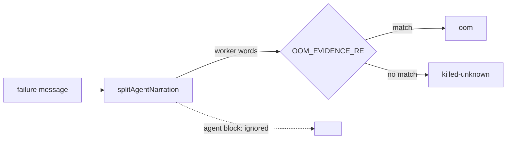

## Summary

A run that an external SIGTERM ended (exit 143) was auto-filed as an `oom` worker defect. The only "evidence" was `"tool_use_result":"Error: Exit code 137"` in the agent's quoted stream-json tail, which was a command the agent ran getting SIGKILLed, not the agent itself. `classifyRunFailure`'s `killed` arm now matches `OOM_EVIDENCE_RE` against the worker's own words only (`splitAgentNarration(message).worker`), the same split the secondary-rate-limit and crash rules already use (Issue #249). Closes #3694.

## Spec

### Intent and Rationale

- The `killed` category covers both SIGKILL and external SIGTERM. Exit-137 text inside the agent's quoted output describes a child process the agent ran, so it says nothing about the agent's own memory. Scoping the scan to the worker's text stops these false `oom` auto-files and keeps every worker-written signal.

### Essential Design Decisions

- Worker-written evidence still counts. That covers the kill headline `Claude was killed (exit 137, SIGKILL)`, the `Processes at the kill` block with kernel OOM lines, and the `Memory pressure at kill: high` probe line.
- The CLI's own V8 heap abort is not lost: the runner's `detectOutOfMemory` catches it before the kill path runs and returns `outOfMemory`. The classifier then sees `buildOutOfMemoryMessage`'s worker-worded headline.

### Undiscoverable Facts

- The source run's message is the one quoted in the issue: an external SIGTERM after 49 s, with `Kernel OOM lines: none in the readable dmesg tail`. Nothing in the worker's own diagnostics showed memory exhaustion.

## Evidence

Backend-only change. The regression tests below build the message with the real `formatDetailedFailureMessage` and diagnose it with the real `detectFailureCategory` (asserted `killed`) before classifying.

**Docs sweep** — grep: `OOM_EVIDENCE_RE`, "OOM evidence", "out-of-memory evidence", "memory evidence", `killed-unknown`; section: none — no manual documents the run-failure classifier's OOM rule (`docs/INTERNALS.md#-out-of-memory-is-terminal` covers the runner's `detectOutOfMemory`, which this change leaves alone); siblings: none — no existing set gained a member; updated: the `OOM_EVIDENCE_RE` doc comment in `worker/deno/lib/run_outcome_classifier.ts`. Hit left in place: `docs/RELEASE-NOTES.md:318` — still true because it describes the #1658 slug-boundary change, which this PR keeps.

## Reproduction

- **symptom** — an external-SIGTERM kill whose agent tail quoted a tool's `Error: Exit code 137` was classified `oom` (code_fixable) and auto-filed
- **status** — `verified` — the regression test failed against the unfixed whole-message scan (class `oom`) and passes after the fix
- **regression test** — `worker/deno/tests/run_outcome_classifier_test.ts::classify #3694 - a SIGTERM kill whose agent quoted 'Exit code 137' is killed-unknown, not oom`

Logged line it starts from: `Claude was killed by an external SIGTERM (exit 143) — the worker did not request this shutdown`, with `"tool_use_result":"Error: Exit code 137"` in the `Last output from Claude` block.

## Test Plan

- Added three tests to `worker/deno/tests/run_outcome_classifier_test.ts`:
  - `classify #3694 - a SIGTERM kill whose agent quoted 'Exit code 137' is killed-unknown, not oom`: the regression test. Red with the scan reverted to the whole message (class `oom`), green after the fix.
  - `classify #3694 - heap-exhaustion prose inside the agent block alone is killed-unknown`: a negative test. Red with the scan reverted to the whole message, green after the fix.
  - `classify #3694 - a kernel OOM line in the worker's Processes block still makes the kill oom`: a positive control showing worker-side evidence still counts. Red with the condition forced `false`.
- No existing test was edited, and no assertion was removed.
- `deno task test:unit tests/run_outcome_classifier_test.ts tests/run_failure_issue_test.ts tests/run_outcome_test.ts`: 57 passed, 0 failed.
- `./quality.sh < /dev/null`: `Result: PASSED (with skipped checks)` on the final head (config integration skipped). An earlier run on the same commit reported `deno tests FAILED` but did not keep the failing test's output. The full re-run passed with no code change in between.
- Callers checked: `classifyRunFailure` is the only reader of `OOM_EVIDENCE_RE`, and the `killed` arm is its only use.

<!-- vibe-branch-outcomes -->
