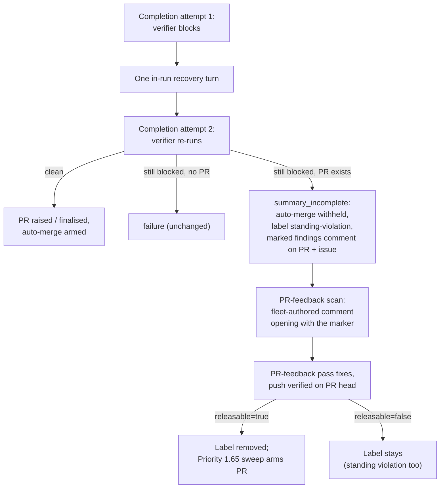

## Summary

A pre-PR verifier (#3395) finding that is still present after the run's one
in-run recovery turn no longer ships with auto-merge armed. When that block
finalises an existing PR as `summary_incomplete`, the worker withholds
auto-merge and labels the PR `standing-violation` (the #3382 hold path, so the
Priority 1.65 auto-merge sweep and the CI-fix pass honour it with no change to
either). It also posts the verifier's findings on the PR as well as on the
issue. This holds whether the verifier blocked on its own or was folded into an
earlier summary gate's block.

The held PR is not left stranded. The findings comment on the PR opens with a
worker marker (`<!-- vibe-pre-pr-verifier-held releasable="true|false" -->`).
The PR-feedback pass now treats a fleet-authored comment that opens with that
marker as actionable feedback, although the worker's own comments are otherwise
skipped. Once that pass pushes a verified fix on the PR's own head, it removes
`standing-violation` when the marker says `releasable="true"`, that is, when the
verifier finding alone held the PR. The auto-merge sweep then arms the PR. A hold
that also covers a standing own-line Standards violation is marked
`releasable="false"` and keeps its label until a human removes it.

The verifier gate comment and the recovery-turn prompt now say plainly that a
verifier finding is closed only by fixing it or disputing it with evidence.
Marking a criterion `partial`, listing a known gap or noting a test as "not
red-checked" does not close it. Closes #3697.

The issue's optional third step, a second recovery turn scoped to the
verifier's findings, is not in this PR.

## Spec

### Intent and Rationale

- The worker already holds a reviewer-grade "changes requested" verdict before the PR exists. Shipping over it cost a full fleet-review round trip on five PRs in a day.
- The PR reuses the `standing-violation` hold instead of adding a sibling label. The auto-merge sweep (#3517) and the CI-fix pass (#3685) already honour that label, so the new hold needs no change to either consumer.
- The PR-feedback pass is the one that acts on the held findings. It already claims, de-duplicates (fleet 👀) and fixes PR comments, so the findings reach a code-fixing pass without waiting for a fleet review.

### Essential Design Decisions

- The marker is parsed only at index 0 of a comment body, and only from the worker's own login or a fleet author's comment. Agent-written finding text sits later in the body and cannot forge it. An outsider's comment carrying the marker is not trusted through this path.
- Label removal follows "remove only what you can prove you added". The marker comment, written by the completion phase when it applied the label, is the provenance. `releasable` is `false` whenever a standing violation also held the PR, so a verifier fix never lifts a hold it does not own.
- Release happens only after a push the processor verified on the remote, and only on the PR's own head. A fix delivered through a milestone fix branch has not reached the PR yet, so it does not release. A failed removal is logged at error, and the PR stays held.
- `SummaryRuleBlock.prePrVerifierFindings` is a required field. Both block builders set it (the fold path and the standalone verifier gate), so the compiler names any future builder that omits it.

### Undiscoverable Facts

- The fleet reviewer skill (`.claude/skills/review-fleet-prs`) is unchanged. It may still review a held PR before the PR-feedback pass has fixed it. The hold only stops auto-merge.
- The CLI `pr-feedback-processor` command handles a single comment id given on the command line. It does not know the comment's author, so it never releases a hold.

## Evidence

Backend-only change: no UI files are touched. The behaviour is shown by the
tests below. The completion-phase tests drive `workOnIssueCompletion` with a
scripted verifier, the scan tests drive `findPrCommentsToFix` with a scripted
`gh`, and the processor tests drive `processPrFeedback`.

**Docs sweep** — grep: `standing-violation`, `holdAutoMerge`, "pre-PR verifier", "arm\w* auto-merge", `summary_incomplete`, "own comments", "thumbs-up", "remov\w* the label"; section: `docs/workflows/pr-feedback.md#-priority-1--pr-feedback`, `docs/workflows/issue-processing.md#pre-pr-verifier-issue-3395`; siblings: `standingViolations`, `allowsTestChanges`, `commentCreatedAt`, `failingCheckName`, "trusted-bot"; updated: `README.md`, `DESIGN-PRINCIPLES.md`, `SECURITY.md`, `docs/MERGE.md`, `docs/OVERVIEW.md`, `docs/CONFIGURATION.md`, `docs/workflows/issue-processing.md`, `docs/workflows/pr-feedback.md`, `worker/deno/lib/standing_violation_routing.ts`, `worker/deno/lib/worker_label_guard.ts`, `worker/deno/lib/summary_rule_gate_retry.ts`; `docs/INTERNALS.md:584` — still true because it is a one-line summary row that already omitted the trusted-review-bot path, and the full list is in `docs/workflows/pr-feedback.md`; `docs/OVERVIEW.md:195` — still true for the same reason; `docs/workflows/README.md:196` — still true for the same reason; `README.md:663` — still true because it is about non-authorised human commenters; `docs/INTERNALS.md:1895` — still true because it describes the claim-point label read, unchanged; `SECURITY.md:800` — still true because it is about `authorized_commenters` bots

Issue numbers cited as provenance:

- #3697: A pre-PR verifier finding that survives the recovery turn still ships with auto-merge armed, and the fleet reviewer sends the same finding back (NEAT-AI-Discovery#2407, VibeCoder#3695 and three private fleet PRs)

Related existing rules checked: the #3382 standing-violation hold in
`recoverAndFinaliseExistingPr`, and step 2 of the recovery prompt in
`summary_rule_gate_retry.ts` (the Issue #3395 code-fix exception for a verifier
item). The new closure sentence extends that exception and does not contradict
it. I applied the new rule to this PR's own summary and found nothing it would
flag: no criterion is marked `partial`, and no gap is recorded in place of a
fix.

Guards kept on the new path to an existing outcome (the label removal, which
lets the sweep arm the PR): the sweep's own base check, draft check and
branch-update gating are unchanged, because removal only lets the next sweep
pass treat the PR like any other. The processor's push verification is kept:
removal is inside the verified-push branch only.

## Test Plan

New and extended tests:

- `worker/deno/tests/completion_phase_pre_pr_verifier_3395_test.ts`
  - "completion - verifier findings that survive the recovery turn over an existing PR hold auto-merge, label the PR and post the findings on it (Issue #3697)". The verifier blocks on both the first run and the re-run, with an existing PR. Asserts `summary_incomplete`, no `finalisePr` call (auto-merge not armed), a `standing-violation` label call, and one PR comment that opens with the `releasable="true"` marker and carries the finding.
  - "completion - verifier findings folded into an earlier gate's block still hold the existing PR (Issue #3697)". Same assertions on the fold path.
  - "completion - a verifier finding and a standing own-line violation that both survive hold the existing PR as not releasable (Issue #3697)". Asserts the PR comment opens with the `releasable="false"` marker.
  - "completion - a verifier finding cleared by the recovery turn does not hold the PR (Issue #3697)".
  - "completion - a failed PR comment is logged and the hold still stands (Issue #3697)".
- `worker/deno/tests/completion_phase_docs_sweep_test.ts` — "completion - a PR found after a failed creation is armed, not held, and gets only the advisory comment (#3237, #3697)".
- `worker/deno/tests/pre_pr_verifier_3395_test.ts` — the gate-comment closure sentence, and the held-PR comment for both `releasable` values.
- `worker/deno/tests/pre_pr_verifier_hold_3697_test.ts` — the marker round-trips; it is rejected when it is not at index 0, for another value or name, and for an empty body; a hostile run of 100,000 spaces is rejected; a later second marker does not override the first.
- `worker/deno/tests/pr_maintenance_verifier_hold_3697_test.ts` — the scan acts on a held comment written by the worker's own login or a sibling fleet author. It ignores one by an outsider, one whose marker is not at index 0, one already marked with a fleet 👀, an own comment without the marker, and an own inline review comment. It sets `releasesVerifierHold` only for `releasable="true"`.
- `worker/deno/tests/pr_feedback_processor_verifier_hold_3697_test.ts` — a verified fix on the PR's own head removes the label. Nothing is removed when the flag is unset, when the push did not land, or when the fix went through a fix branch. A failed removal is logged at error and the result is still processed.
- `worker/deno/tests/summary_rule_gate_retry_test.ts` — "summary-rule retry - a verifier finding is closed only by a fix or a dispute (Issue #3697)".

Red checks (each change was made temporarily and then restored):

- Hold condition reduced to `standingViolations.length > 0`: the surviving-findings, folded and failed-comment tests went red.
- `releasable` argument forced to `true`: the both-survive test went red.
- Scan: `|| held !== null` dropped from the actionable condition → the own-login, sibling-fleet and non-releasable cases went red. `&& held === null` dropped from the own-comment skip → the own-login cases went red. The `releasesVerifierHold` spread dropped → the own-login and sibling cases went red on the flag.
- Processor: the `releaseVerifierHold` call deleted → the verified-fix and failed-removal tests went red. `!fixBranch` removed → the fix-branch test went red. `input.releasesVerifierHold === true &&` removed → the without-flag test went red.
- Drift pins: each pinned phrase ("closed only by fixing it", "not red-checked", "A verifier finding is closed only by fixing it or by disputing it with evidence", "Auto-merge is held") is new text this diff adds, absent from the base versions of `pre_pr_verifier.ts` and `summary_rule_gate_retry.ts`.

Mutation check, deletions that cannot be told apart at runtime:

- `worker/deno/lib/phases/completion_phase.ts:3759` exempt (untestable): deleting `holdAutoMerge: false` leaves the field `undefined`, which the `prNumber > 0 && holdAutoMerge` guard reads exactly as `false`, so only the type checker (the field is required) can reject it.
- `worker/deno/lib/phases/completion_phase.ts:3898` exempt (untestable): the same deletion of `holdAutoMerge: false`, for the same reason.
- `worker/deno/lib/run_core_production_deps.ts:2336` exempt (untestable): the production PR-feedback dispatch runs `setupRepo` and real `git fetch`/`checkout` before it calls the directly imported `processPrFeedback`, and neither is injectable. The harness search covered `worker/deno/tests/run_core_production_deps_test.ts`, `worker/deno/tests/pr_feedback_authorised_commenters_test.ts` and `worker/deno/tests/auto_merge_sweep_disarm_wiring_test.ts`, the tests that build `createProductionRunCoreDeps`. None of them can observe the `PrFeedbackInput` without real git and network access.

No existing assertion is removed or weakened. `worker/deno/tests/completion_phase_merged_pr_closure_test.ts` only gains `heldFindingsComment: ""` on its `recoverAndFinaliseExistingPr` calls, because the new option is required.

Results on the final head: RESULTS_FILLED_AFTER_RUN

<!-- vibe-branch-outcomes -->
