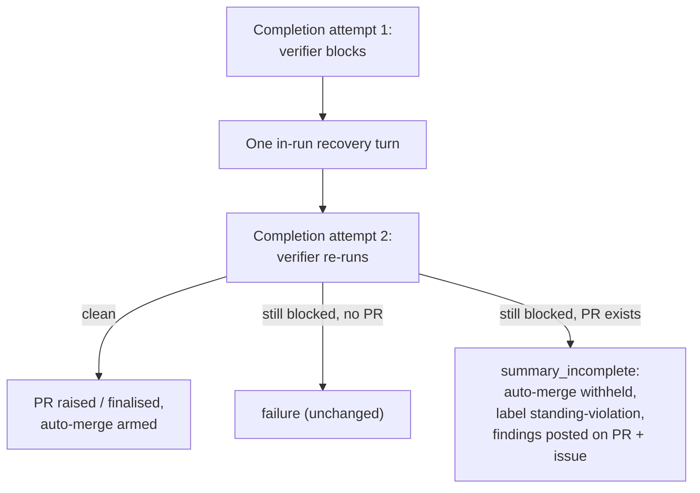

## Summary

A pre-PR verifier (#3395) finding that is still present after the run's one
in-run recovery turn no longer ships with auto-merge armed. When that block
finalises an existing PR as `summary_incomplete`, the worker now withholds
auto-merge and labels the PR `standing-violation` (the #3382 hold path, so the
Priority 1.65 auto-merge sweep and the CI-fix pass honour it with no change to
either). It also posts the verifier's findings on the PR as well as on the
issue. This holds whether the verifier blocked on its own or was folded into an
earlier summary gate's block. The verifier gate comment and the recovery-turn
prompt now say plainly that a verifier finding is closed only by fixing it or
disputing it with evidence. Marking a criterion `partial`, listing a known gap
or noting a test as "not red-checked" does not close it. Closes #3697.

The issue's optional third step, a second recovery turn scoped to the
verifier's findings, is not in this PR.

## Spec

### Intent and Rationale

- The worker already holds a reviewer-grade "changes requested" verdict before the PR exists. Shipping over it cost a full fleet-review round trip on five PRs in a day.
- The PR reuses the `standing-violation` hold instead of adding a sibling label. The auto-merge sweep (#3517) and the CI-fix pass (#3685) already honour that label, so the new hold needs no change to either consumer.

### Essential Design Decisions

- `SummaryRuleBlock.prePrVerifierFindings` is a required field: the verifier's gate comment, or `""`. Both block builders set it: `foldInLateSummaryVerdicts` (fold path) and the standalone verifier gate. The compiler therefore names any future builder that omits it.
- The hold is decided at the existing-PR finalise in `reportSummaryRuleBlock`, which runs only on the run's second (or later) block, after the recovery turn. A first block still gets its recovery turn. With no PR, a surviving block still fails the run, unchanged.
- `recoverAndFinaliseExistingPr`'s new `heldFindingsComment` option has no default. Its two other callers pass `""`. A failure to post the comment is logged at error, and the label hold still stands.

### Undiscoverable Facts

- The PR-feedback pass skips comments the worker's own account posts (`worker/deno/lib/pr_maintenance.ts:1163`, `if (comment.login === githubUser) continue;`). The findings comment on the PR is therefore a visible record for the PR's next reader. It does not trigger the pr_feedback pass on its own.

## Evidence

Backend-only change: no UI files are touched. The behaviour is shown by the
completion-phase tests below, which drive `workOnIssueCompletion` with a
scripted verifier.

**Docs sweep** — grep: `standing-violation`, `holdAutoMerge`, "pre-PR verifier", "arm\w* auto-merge", `summary_incomplete`; section: `docs/workflows/issue-processing.md#pre-pr-verifier-issue-3395`; siblings: `standingViolations`, `allowsTestChanges`; updated: `README.md`, `DESIGN-PRINCIPLES.md`, `docs/MERGE.md`, `docs/workflows/issue-processing.md`, `worker/deno/lib/standing_violation_routing.ts`, `worker/deno/lib/worker_label_guard.ts`, `worker/deno/lib/summary_rule_gate_retry.ts`; `docs/workflows/pr-feedback.md:728` — still true because the sweep skips any PR carrying the label, whatever applied it; `docs/INTERNALS.md:1895` — still true because it describes the claim-point label read, unchanged

Issue numbers cited as provenance:

- #3697: A pre-PR verifier finding that survives the recovery turn still ships with auto-merge armed, and the fleet reviewer sends the same finding back (NEAT-AI-Discovery#2407, VibeCoder#3695 and three private fleet PRs)

Related existing rules checked: the #3382 standing-violation hold in
`recoverAndFinaliseExistingPr`, and step 2 of the recovery prompt in
`summary_rule_gate_retry.ts` (the Issue #3395 code-fix exception for a verifier
item). The new closure sentence extends that exception and does not contradict
it. I applied the new rule to this PR's own summary and found nothing it would
flag: no criterion is marked `partial`, and no gap is recorded in place of a
fix.

## Test Plan

New tests:

- `worker/deno/tests/completion_phase_pre_pr_verifier_3395_test.ts`
  - "completion - verifier findings that survive the recovery turn over an existing PR hold auto-merge, label the PR and post the findings on it (Issue #3697)". The verifier blocks on both the first run and the re-run, with an existing PR. Asserts `summary_incomplete`, no `finalisePr` call (auto-merge not armed), a `standing-violation` label call, and one PR comment carrying the verifier heading and the finding.
  - "completion - verifier findings folded into an earlier gate's block still hold the existing PR (Issue #3697)". The verifier is folded into a surviving result-placeholder block, and the same hold assertions apply.
  - "completion - a verifier finding cleared by the recovery turn does not hold the PR (Issue #3697)". The placeholder survives and the verifier is clean on the re-run. Auto-merge is armed, with no label and no verifier comment on the PR.
  - "completion - a failed PR comment is logged and the hold still stands (Issue #3697)". It also asserts the error is logged with the context `{ repo, prNumber, error: "PR comment failed" }`.
- `worker/deno/tests/completion_phase_docs_sweep_test.ts`
  - "completion - a PR found after a failed creation is armed, not held, and gets only the advisory comment (#3237, #3697)". `gh pr create` fails, the issue-number lookup then finds the PR, and the self-heal path recovers it. Asserts auto-merge is armed (`finalise`), no `standing-violation` label, and exactly one PR comment: the docs-sweep advisory one.
- `worker/deno/tests/pre_pr_verifier_3395_test.ts`
  - "the gate comment says a finding is closed only by a fix or evidence (Issue #3697)". It also pins the blank line that sets the closure sentence apart as its own paragraph.
  - "the held-PR comment names the hold, the label and carries the gate comment (Issue #3697)"
- `worker/deno/tests/summary_rule_gate_retry_test.ts`
  - "summary-rule retry - a verifier finding is closed only by a fix or a dispute (Issue #3697)"

Red checks (each change was made temporarily and then restored):

- Hold condition reduced to `standingViolations.length > 0` (verifier dropped): the surviving-findings, folded and failed-comment tests went red.
- `foldInLateSummaryVerdicts` never sets `prePrVerifierFindings`: only the folded test went red. The standalone test stayed green, as expected, because it uses the other builder.
- Post-on-PR block removed: the surviving-findings, folded and failed-comment tests went red.
- New closure sentence removed from the recovery prompt: the summary-rule retry test went red.
- Drift pins: each pinned phrase ("closed only by fixing it", "not red-checked", "A verifier finding is closed only by fixing it or by disputing it with evidence", "Auto-merge is held") is new text this diff adds, absent from the base versions of `pre_pr_verifier.ts` and `summary_rule_gate_retry.ts`.

- Held comment built unconditionally (the line-819 ternary forced to its non-empty arm): the cleared-finding test went red, because it asserts that no PR comment contains "Auto-merge is held".
- Standing-violation operand forced to `false`: the existing #3382 hold tests in `worker/deno/tests/completion_phase_summary_incomplete_test.ts` went red.

Mutation check: the gate listed 10 surviving mutants. Each was applied in turn and run with `deno test --no-check`, as the gate runs it, then restored:

- `completion_phase.ts:1109` (delete `repo`), `:1110` (delete `prNumber`), `:1111` (negate the `instanceof` ternary; delete `error`): the failed-PR-comment test went red on its logged-context assertion.
- `completion_phase.ts:3892` (delete `docsSweepHitsComment`): the new failed-creation test went red, because no advisory comment was posted.
- `completion_phase.ts:3893` (`false` -> `true`): the failed-creation test went red, because auto-merge was not armed.
- `completion_phase.ts:3894` (delete `heldFindingsComment`): the failed-creation test went red, because a second PR comment was posted.
- `pre_pr_verifier.ts:810` (delete the `""` element): the gate-comment test went red on the blank-line pin.

Two deletion mutants cannot be told apart from the original at runtime:

- `worker/deno/lib/phases/completion_phase.ts:3754` exempt (untestable): deleting `holdAutoMerge: false` leaves the field `undefined`, which the `prNumber > 0 && holdAutoMerge` guard reads exactly as `false`, so the deletion has no runtime effect and only the type checker (the field is required) can reject it.
- `worker/deno/lib/phases/completion_phase.ts:3893` exempt (untestable): the same deletion of `holdAutoMerge: false` has no runtime effect, for the same reason. The other mutant on this line, `false` -> `true`, is killed by the failed-creation test above.

No existing assertion is removed or weakened. The failed-PR-comment test's message check now also checks the logged context. `worker/deno/tests/completion_phase_merged_pr_closure_test.ts` only gains `heldFindingsComment: ""` on its five `recoverAndFinaliseExistingPr` calls, because the new option is required.

Results on the final head:

- The targeted completion-phase (verifier, docs-sweep, summary-incomplete, merged-PR-closure), `issue_worker`, verifier and retry-prompt test files: passed, along with `deno fmt`, `deno lint` and `deno check` on the changed test files.
- `./quality.sh < /dev/null` on the previous head: `Result: PASSED (with skipped checks)`. The only skipped stage is `config integration`; deno tests, lint, type check, fmt, markdownlint, mermaid and semgrep all passed. The mutation-check follow-up only adds tests, and the worker re-runs the quality gate on this head.

<!-- vibe-branch-outcomes -->
