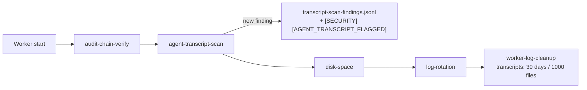

## Summary

Agent transcripts now have their own retention: **30 days**, with an explicit
**1000-file** cap counted separately from worker logs (worker logs keep 3 days
and 200 files). A new `agent-transcript-scan` step runs at every worker start,
before any rotation or retention step. It reads the retained transcripts and
flags egress attempts, reads of credential paths and disallowed-tool attempts.
Each new finding is appended to `transcript-scan-findings.jsonl` in the log
directory, and the step fails loud in the worker log with
`[SECURITY] [AGENT_TRANSCRIPT_FLAGGED]`.

Closes #3700. One criterion stays **partial**: the issue asked for the scan as
"an idle task". It ships as a startup housekeeping step instead, for the
security reason under Spec below.

## Spec

### Intent and Rationale

- Transcripts used to share the 3-day / 200-file worker-log policy, so an
  incident older than three days could not be reconstructed, and nothing read
  the transcripts at all.
- The scan is a housekeeping step, not an idle-task template. An idle-task
  template runs inside one monitored repository's clone and files its findings
  as issues in that repository. Transcripts are host-local and hold raw content
  from every repository the host worked on, so a template would copy one
  repository's content into another's issues. The startup housekeeping sequence
  is the existing schedule for host-local checks: `audit-chain-verify`
  (Issue #3712) already runs there.

### Essential Design Decisions

- The scan runs second, straight after `audit-chain-verify` and before
  `disk-space`, `log-rotation` and `worker-log-cleanup`, so no transcript is
  rotated or deleted before it has been scanned.
- Each finding is reported once. `transcript-scan-state.json` memoises scanned
  files by size and mtime, so a rotation rename is not rescanned, and SHA-256
  fingerprints in the ledger stop a rescan from re-reporting a finding. The
  state carries `rulesVersion`, so a rules change forces a full rescan.
- Fail closed. The ledger is appended before the state is written, and a failed
  append throws. A gzipped transcript is reported as not checked. An unreadable
  transcript, an unreadable ledger or a failed state write fails the step.
- The credential-path check reuses `FORBIDDEN_STAGED_PATTERNS` from
  `pre_commit_safety.ts`, and the transcript selector reuses
  `AGENT_TRANSCRIPT_PATTERN`. `sha256Hex`, `isRecord` and `messageOf` are
  widened from their existing owners rather than copied.

### Undiscoverable Facts

- I observed the stream-json shapes on this host's 16 real transcripts. A
  `tool_result` carries `is_error`, and its `content` is a string or an array
  of text blocks. `result` events carry `permission_denials` (empty in every
  real transcript; the entry shape `{tool_name, tool_use_id, tool_input}` is
  the one `issue_executor_enforcement.ts` parses). The common benign errors are
  `No such tool available: bash. Tool names are case-sensitive` and
  `[SECURITY] [GH_BODY_UNREDACTABLE]`. Neither is flagged.
- Scanning those 16 real transcripts (13 MB) gave 0 findings and 6 unparsed
  lines. The unparsed lines are a pre-existing defect: the transcript writer's
  secret redaction swallows the `\` of an escaped quote, so the line is no
  longer valid JSON. That is filed as #3826, out of scope here. The scan reports
  such lines as `unparsed lines N`, never as clean.
- The scan is a heuristic over the agent's own stream. It does not see network
  traffic. A client hidden behind an option that takes a value
  (`sudo -u bob curl …`) is missed, and a string that merely names a credential
  path is flagged.

## Evidence

Backend/CLI change only, with no UI file. Run order:

- `./quality.sh < /dev/null` was run on `4d65a8f6`. Its first run failed on two
  manifest registrations (the sweep-coverage slice and the wall-clock manifest),
  which were fixed in that commit. Its result was `PASSED (with skipped checks)`;
  only config integration was skipped. The later commits change only the
  scanner's helper imports and tests, and the targeted suites were re-run on
  them (Test Plan).
- I ran the worker's own mutation gate (`runMutationCheck`, cap 40) on the
  branch diff. Round 1 left 18 survivors: the `data` property on two command
  results, each `NETWORK_CLIENTS` entry, and each `WRAPPER_WORDS` entry. Four
  tests were added, and round 2 gave 40 tried, 40 killed, 0 survived. The other
  147 candidates are past the cap and untested, which the gate reports as a
  warning, not a pass.
- Observed tool behaviour: I read the event shapes above from real
  `~/logs/agent-*.jsonl` with a read-only Python pass (`python3 -I`). The
  fixtures `worker/deno/tests/fixtures/agent_transcripts/flagged.jsonl` and
  `clean.jsonl` are built from them.
- Fakes: none. Every test runs the real cleanup helper, scanner and command
  against temp directories.
- Provenance cited in the diff: #3700 (this issue); #3712 (scheduled
  audit-chain verification, cited as the housekeeping precedent); #3826
  (filed this run: transcript redaction breaks stream-json JSON).
- Related existing rules checked: no prompt or `CODING-STANDARDS.md` rule is
  added or changed. The retention rules in `worker_log_cleanup.ts`, and their
  restatements in `docs/CONFIGURATION.md` and `agent_transcript.ts`, all now
  say 30 days and 1000 files.

**Docs sweep** — grep: "3 days", "three days", "3-day", "200-file", `worker-log-cleanup`, `AGENT_TRANSCRIPT_PATTERN`, "Retention"; section: `docs/CONFIGURATION.md#local-retention`; siblings: `audit-chain-verify`, `worker-log-cleanup` (the housekeeping step set gained `agent-transcript-scan`); updated: `docs/CONFIGURATION.md`, `docs/INTERNALS.md`, `worker/deno/lib/agent_transcript.ts`, `worker/deno/lib/worker_log_cleanup.ts`, `worker/deno/lib/run_housekeeping.ts`; `docs/CONFIGURATION.md:2102` — still true because it names the worker-log cap; `docs/INTERNALS.md:478` — still true because it describes worker-PID logs; `docs/INTERNALS.md:500` — still true because the diagram is the worker-log lifecycle; `docs/DEPLOYMENT.md:917` — still true because it describes worker logs; `docs/security/agent-containment-gap-analysis.md:44` — still true because the analysis is dated at base `f108cad7` and cites #3700 as the follow-up; `worker/deno/lib/worker_log_cleanup.ts:19` — still true because it describes worker logs; `docs/CONTAINER.md:1076` — still true because it is about audit journals

## Acceptance Criteria

<!-- vibe-spec-review inputs="diff+issue-body" -->

- **met** — Raise the default retention to at least 30 days. Keep the cap explicit and document it. — evidence: `worker/deno/lib/worker_log_cleanup.ts` (`DEFAULT_TRANSCRIPT_MAX_AGE_DAYS = 30`, `DEFAULT_TRANSCRIPT_HARD_CAP_COUNT = 1000`), `docs/CONFIGURATION.md#local-retention` — reviewer: met
- **partial** — Add a scheduled scan (an idle task) over retained transcripts for flagged signals: egress attempts, reads of credential paths, disallowed-tool attempts. — evidence: `worker/deno/lib/agent_transcript_scan.ts`, `worker/deno/tests/run_housekeeping_test.ts::runStartupHousekeeping - agent-transcript-scan fails loud on a flagged transcript end to end (Issue #3700)` — reviewer: partial — reason: all three signals are scanned on every worker start, but as a housekeeping step, not an idle-task template, because a template files findings into one monitored repo and would leak other repos' transcript content there
- **met** — Record each finding where an operator will see it. — evidence: `worker/deno/tests/agent_transcript_scan_command_test.ts::agentTranscriptScanCommand - fails loud naming each flagged signal` (ledger `transcript-scan-findings.jsonl` plus the `[SECURITY] [AGENT_TRANSCRIPT_FLAGGED]` worker-log line) — reviewer: met
- **met** — Default retention is at least 30 days, with a unit test on the cleanup helper. — evidence: `worker/deno/tests/worker_log_cleanup_test.ts::cleanupWorkerLogs - default transcript retention is at least 30 days (Issue #3700)` — reviewer: met
- **met** — The scan flags a seeded fixture transcript that contains a flagged signal, and passes a clean one. — evidence: `worker/deno/tests/agent_transcript_scan_test.ts::scanAgentTranscripts - flags a seeded transcript carrying flagged signals (Issue #3700)`, `worker/deno/tests/agent_transcript_scan_test.ts::scanAgentTranscripts - passes a clean transcript (Issue #3700)` — reviewer: met
- **unrequested** — scan state memo, ledger fingerprint dedupe, and the `AGENT_TRANSCRIPT_SCAN_FAILED` / `AGENT_TRANSCRIPT_SCAN_INCOMPLETE` failure modes — reviewer: unrequested — reason: a scan that runs on every worker start must report each finding once, and must fail loud rather than pass input it could not read
- **unrequested** — `deno task agent-transcript-scan`, its `mod.ts` registration and the `--log-dir` flag — reviewer: unrequested — reason: the housekeeping dispatcher needs a registered command, and an operator needs to re-run the scan on demand
- **unrequested** — `AGENT_TRANSCRIPT_MAX_AGE_DAYS` / `AGENT_TRANSCRIPT_HARD_CAP_COUNT` env overrides, the `--transcript-*` flags, and a cap counted separately from worker logs — reviewer: unrequested — reason: "keep the cap explicit"; sharing the 200-file worker cap would evict transcripts long before 30 days
- **unrequested** — `docs/audits/lib-sweep-coverage/top-up-3700.json` and the `WALL_CLOCK_TEST_FILES` entry — reviewer: unrequested — reason: the repository's completeness checks require every new module and growth test to be registered
- **unrequested** — hostile-input growth tests, and the wrapper-word and quote handling — reviewer: unrequested — reason: the coding standards require one hostile case per pattern run on agent-written text, and command-position parsing keeps `git commit -m "… ssh …"` from being flagged

## Standards Review

<!-- vibe-standards-review inputs="diff+CODING-STANDARDS.md" -->

- **violation** — An edited expectation must still go red without its guard — evidence: `worker/deno/tests/worker_log_cleanup_test.ts:298` — reason: fixed in this diff (a 4-day transcript now must survive; it goes red with the window set back to 3 days)
- **violation** — In-repo helpers re-implemented by hand (`isRecord`, `messageOf`, SHA-256 hex) — evidence: `worker/deno/lib/agent_transcript_scan.ts:182` — reason: fixed in this diff (widened `isRecord` in `workflow_job_needs.ts`, `messageOf` in `clone_contention.ts` and `sha256Hex` in `audit_entry.ts`, and imported them)
- **violation** — Unmarked security corner cut: over-long tokens skipped the credential check, and no test reached it — evidence: `worker/deno/lib/agent_transcript_scan.ts:251` — reason: fixed in this diff (the token's tail is now checked under a `SIMPLE-ON-PURPOSE` line, with a test that goes red under the old skip)
- **violation** — Fail-loud branches covered only by permission tests that are ignored as root — evidence: `worker/deno/tests/agent_transcript_scan_test.ts:452` — reason: fixed in this diff (the tests probe whether chmod blocks access and are ignored, not passed, where it does not; they ran on this uid-1000 host, and the command-level unreadable branch now has its own test)
- **clean** — Australian English; Deno-only tooling; no source-grepping tests; named tests exist; every new export has a production reader; the new persisted files are versioned and do not match the foreign-debris patterns; fail loud on findings, unreadable input and state failure; review-enforced rules checked: avoid over-engineering (helpers reused), `SIMPLE-ON-PURPOSE` marking, check where you insert

## Security-fix evidence

- Regression test: `worker/deno/tests/worker_log_cleanup_test.ts::cleanupWorkerLogs - default transcript retention is at least 30 days (Issue #3700)` reproduces the flaw: a 29-day transcript is deleted under the 3-day window. It fails against the unfixed code (the constant is missing on base, and red-checked with the window set to 3) and passes after the fix.
- Regression test: `worker/deno/tests/agent_transcript_scan_test.ts::scanAgentTranscripts - flags a seeded transcript carrying flagged signals (Issue #3700)` fails against the unfixed code, where no scanner exists, and passes after the fix.
- Original trigger closed: transcripts can no longer age out after 3 days, because pass 2 of `cleanupWorkerLogs` selects the 30-day transcript window for every name matching `AGENT_TRANSCRIPT_PATTERN`, and pass 3 caps transcripts in their own group. Without an operator override, a retained transcript can no longer go unscanned: the scan runs before rotation and retention on every start, and a file it cannot read fails the step loud instead of passing.

## Test Plan

- `deno task test:unit` on `worker/deno/tests/agent_transcript_scan_test.ts`, `worker/deno/tests/agent_transcript_scan_command_test.ts`, `worker/deno/tests/worker_log_cleanup_test.ts`, `worker/deno/tests/worker_log_cleanup_command_test.ts`, `worker/deno/tests/run_housekeeping_test.ts` and `worker/deno/tests/mod_test.ts`, re-run on the final head `a7e91d30`: parallel pass `ok | 81 passed | 0 failed`, serial pass `ok | 25 passed | 0 failed`.
- `./quality.sh` on `4d65a8f6`: `Result: PASSED (with skipped checks)`.
- Edited existing tests:
  - `worker/deno/tests/worker_log_cleanup_test.ts` "ages out agent transcripts after the transcript window (Issue #4169, #3700)". It was renamed, three fixture ages moved from `DEFAULT_MAX_AGE_DAYS + 1` to `DEFAULT_TRANSCRIPT_MAX_AGE_DAYS + 1`, and a 4-day survivor was added. No assertion was removed. Red check: with `DEFAULT_TRANSCRIPT_MAX_AGE_DAYS` set to 3 the test goes red (the survivor is deleted).
  - `worker/deno/tests/mod_test.ts`: `assertEquals(commands.length, 152)` became `153`, because the issue requires registering `agent-transcript-scan`. Red check: without the registration, 152 ≠ 153.
  - `worker/deno/tests/run_housekeeping_test.ts`: assertions added only.
- New-test red checks: each test in the branch-outcomes list went red with only its change removed, as recorded per entry. The two permission tests probe whether `chmod` blocks access and are ignored, not passed, on root or Windows.
- Entry points checked: the `agent-transcript-scan` housekeeping step (dispatch entry removed → end-to-end test red); the `worker-log-cleanup` step args (dropped → window test red); the `--transcript-max-age-days` / `--transcript-hard-cap-count` CLI flags (each dropped → command test red); the `mod.ts` registration (`mod_test.ts` count).
- Callers checked for the new retention options: `buildHousekeepingSteps` (passes both) and the `worker-log-cleanup` CLI (parses both). No other caller of `cleanupWorkerLogs` exists.
- New persisted records: `transcript-scan-state.json` is a memo, rewritten every pass with only the files present; `transcript-scan-findings.jsonl` is an append-only event ledger, not a condition record, so it is deliberately not cleared on a healthy pass.

<!-- vibe-branch-outcomes -->
