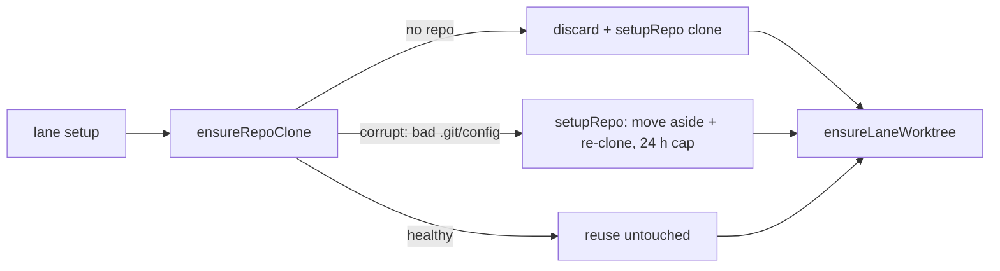

## Summary

Lane runs against `stSoftwareAU/VibeCoder` died at setup within a minute
because the shared clone's `.git/config` was corrupt. `ensureRepoClone` — the
clone check every lane uses before `ensureLaneWorktree` — now notices a clone
git reports as corrupt and passes it to `setupRepo`. `setupRepo` already moves
a corrupt clone aside and re-clones it (Issue #2957). Closes #3708.

## Spec

### Intent and Rationale

- The lane path (issue slots, the PR-branch-update pass and idle-task routes) calls `ensureRepoClone`, never `setupRepo`. `ensureRepoClone` only discarded a directory git calls "not a git repository". A clone failing with `fatal: bad config line 1 in file .git/config` therefore counted as "already cloned", and `setupRepo`'s corrupt-clone recovery was never reached.
- The fix reuses the existing owners: `probeCorruptClone` (`worker/deno/lib/broken_clone.ts`) detects the fault, and `setupRepo` (`worker/deno/commands/git_operations.ts`) recovers from it. Nothing is copied.

### Essential Design Decisions

- `ensureRepoClone` removes nothing itself. The move-aside, the once-per-repo-per-24 h cap, the `.corrupt-*` sibling handling and the repeat-corruption escalation (Issue #2958) all stay inside `setupRepo`/`recoverCorruptClone`.
- A healthy existing clone is still left untouched: no fetch and no `reset --hard`.
- `ensureRepoClone` calls for the same clone path are serialised in-process with a keyed promise queue (`runExclusive`, `worker/deno/lib/ensure_repo_clone.ts`). Lanes, the PR-branch-update pass and the idle-task route reach it in parallel for one repository; unserialised, two callers that both saw a corrupt clone would both call `setupRepo`, and the loser would be refused by the 24 h cap and escalated as a repeat corruption (PR #3712 review). A caller that waited re-probes, finds the fresh clone and reuses it. Different clone paths do not wait on each other, and a failed call does not block the next one.

### Undiscoverable Facts

- The two tally comments on #3708 quote the failing line: `/home/vibe/auto-issue-work/VibeCoder is not a usable git repository: fatal: bad config line 1 in file .git/config`.
- After the re-clone, a lane's existing worktree points at administration the new clone lacks. `ensureLaneWorktree` already clears and re-adds such an orphan (Issue #1561).

## Evidence

Backend-only change; no UI files touched.

Observed real git (2.47.3) on a clone with a garbage first line in `.git/config`:
`GIT_CEILING_DIRECTORIES=$d git rev-parse --git-dir` printed
`fatal: bad config line 1 in file .git/config` and exited 128. That is the
exact line in the issue. `isCloneCorruption` classifies it as `clone-corrupt`
(`worker/deno/lib/host_fault.ts` `CLONE_CORRUPT_PATTERNS`). The test fixture
reproduces it the same way.

Issue numbers cited in the diff: #2957: Move a corrupt clone aside and re-clone it, at most once per repo per 24 h; #2848: fix(worker): stSoftwareAU/VibeCoder keeps failing at setup — runs die in the first minute; #3708: this issue.

**Docs sweep** — grep: `ensureRepoClone`, "genuinely missing", "only when the clone is", "clone is missing"; section: `docs/IDLE-TASK-FRAMEWORK.md` (the "repo is cloned on demand before a template runs" point) and `docs/workflows/README.md` (the PR-branch-update worktree paragraph); siblings: none — no existing set gained a member; updated: `docs/IDLE-TASK-FRAMEWORK.md`, `docs/workflows/README.md`, plus the doc comments in `worker/deno/lib/ensure_repo_clone.ts`, `worker/deno/lib/issue_worker_wiring.ts` and `worker/deno/lib/run_core_production_deps.ts`; `docs/TROUBLESHOOTING.md:997` — still true because `setupRepo` is still what moves the clone aside and re-clones it; `worker/deno/lib/merge_fallback_issue.ts:461` — still true because it is about a missing label, not a clone.

## Reproduction

- **symptom** — every lane run on the host failed at setup with `Could not repair the fetch refspec of stSoftwareAU/VibeCoder before taking a s2 worktree: /home/vibe/auto-issue-work/VibeCoder is not a usable git repository: fatal: bad config line 1 in file .git/config`, because `ensureRepoClone` reused the corrupt clone
- **status** — `verified` — the regression test failed against the unfixed `ensureRepoClone` (`cloned: false`, `setupRepo` never called) and passes after the fix
- **regression test** — `worker/deno/tests/ensure_repo_clone_test.ts::ensureRepoClone - a clone with a corrupt .git/config is handed to setupRepo, not reused (Issue #3708)`

## Test Plan

- Added `worker/deno/tests/ensure_repo_clone_test.ts::ensureRepoClone - a clone with a corrupt .git/config is handed to setupRepo, not reused (Issue #3708)`. It uses a real `git init` clone with a garbage first line in `.git/config`. With the probe removed (base behaviour), it failed: `cloned: false` vs `cloned: true`.
- Added `worker/deno/tests/ensure_repo_clone_test.ts::ensureRepoClone - a corrupt clone whose recovery is refused fails loud (Issue #3708)`. It checks that a refused `setupRepo` recovery (the 24 h cap) comes back as `ok: false` and still names the cause `bad config line 1`. It also failed with the probe removed.
- Added three review-round tests in the same file: `::ensureRepoClone - concurrent callers on one corrupt clone recover it once, none refused as a repeat (PR #3712 review)` (two concurrent calls on one real corrupt clone; fake `setupRepo` refuses a second call as the 24 h cap would; asserts both `ok`, one `setupRepo` call, `cloned` `[true, false]`; red with the queue removed: `AssertionError: Values are not equal`), `::ensureRepoClone - a failed call does not block the next caller for the same clone path, and other paths run in parallel`, and `::ensureRepoClone - a caller arriving after an earlier one finished still waits for the one still running (PR #3712 review)` (red when the queue entry is deleted unconditionally on completion).
- No existing test was edited, and no assertion was removed.
- `deno task test:unit tests/ensure_repo_clone_test.ts tests/broken_clone_test.ts tests/lane_worktree_test.ts tests/regression_git_operations_test.ts`: 84 passed, 0 failed, on the head (re-run after the review round).
- `deno lint` (3232 files), `deno fmt --check` (3247 files) and `deno check` on the four changed TS files: all passed.
- `./quality.sh`: every stage up to and including `release-tag ruleset` passed, including completeness checks, semgrep and markdownlint. The full `deno tests` stage did not finish inside the 580 s foreground cap (exit 124), so the full suite was not run here.

<!-- vibe-quality-gate-skipped reason="full deno tests stage exceeded the 580s foreground tool cap (exit 124); all earlier gate stages passed, plus deno lint, deno fmt --check, deno check and the touched test files; CI runs the full suite" -->

**Branch outcomes:**

- `worker/deno/lib/ensure_repo_clone.ts:136` — healthy existing clone (`corruption === null`) is reused untouched — `worker/deno/tests/ensure_repo_clone_test.ts::ensureRepoClone - default directory probe reuses a real clone untouched` and `::ensureRepoClone - existing clone is left untouched (no setupRepo call)` — making the null case fall through to `setupRepo` turned both red
- `worker/deno/lib/ensure_repo_clone.ts:136` — corrupt clone (non-null corruption) falls through to `setupRepo` — `worker/deno/tests/ensure_repo_clone_test.ts::ensureRepoClone - a clone with a corrupt .git/config is handed to setupRepo, not reused (Issue #3708)` — removing the probe (the old early return) turned it red
- `worker/deno/lib/ensure_repo_clone.ts:66` — a second caller for a clone path with an earlier call in flight waits for it (`cloneQueues.get(key) ?? …`) — `worker/deno/tests/ensure_repo_clone_test.ts::ensureRepoClone - concurrent callers on one corrupt clone recover it once, none refused as a repeat (PR #3712 review)` — replacing the queued predecessor with an immediate promise turned it red
- `worker/deno/lib/ensure_repo_clone.ts:73` — queue entry dropped only if still this call's tail — `worker/deno/tests/ensure_repo_clone_test.ts::ensureRepoClone - a caller arriving after an earlier one finished still waits for the one still running (PR #3712 review)` — deleting unconditionally turned it red
- `worker/deno/lib/ensure_repo_clone.ts:68` — a rejected call does not wedge the queue (`run.catch`) — `worker/deno/tests/ensure_repo_clone_test.ts::ensureRepoClone - a failed call does not block the next caller for the same clone path, and other paths run in parallel` — queuing on the raw rejected promise turned it red
