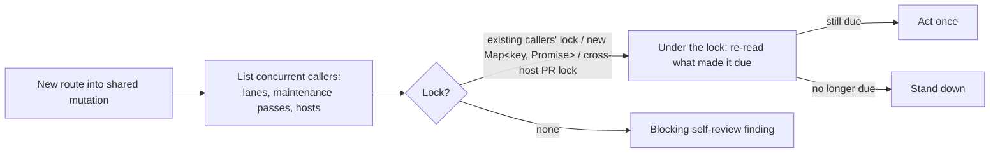

## Summary

Adds the self-review rule **A new caller of a shared mutation names its
concurrent callers** to `CODING-STANDARDS.md` and, word for word, to
`prompts/coding_guidelines/prompt.md`. It goes in the test-coverage section,
right after the multi-write finisher rule (#3562). The issue prompt's Test Plan
self-review checklist (PR Summary File, item 7) restates it, and
`docs/workflows/issue-processing.md` records why it was added (VibeCoder#3065,
#3712). A new drift test pins all three surfaces. Closes #3714.

## Spec

### Intent and Rationale

- Two fleet PRs added a route into a shared mutation (a PR head, the shared
  clone) and never asked who else could be in that code at the same time.
  Their single-caller tests stayed green, and review only caught it after the
  PR was raised. The rule makes the author list the concurrent callers before
  writing the code.
- The text is the issue's proposed text, split into two bullets, "Serialise
  it" and "Decide under the lock". Each names a real example from the worker.

### Essential Design Decisions

- This is a self-review rule backed by a two-caller test, not a deterministic
  gate. Whether code mutates shared state is a semantic question.
- The test must break each half on its own: drop the lock, and separately move
  the re-read back before it. Either fault alone causes the race, so one
  combined revert would not show that the test catches both.
- The issue said "two callers through `createRendezvous`". The rule says "a
  barrier rather than a sleep", naming `createRendezvous` as the Vibe Coder
  helper. The coding guidelines also go to fleet repositories that do not have
  that helper. The worker's own two-caller test (`ensure_repo_clone_test.ts`)
  uses a held-open stub plus `waitUntil`, which this wording also accepts.

### Undiscoverable Facts

- What #3065 and #3712 got wrong comes from their review rounds, as the issue
  quotes them. The fix that merged in #3712 is in the head code: `runExclusive`
  in `worker/deno/lib/ensure_repo_clone.ts:62-74` serialises callers per clone
  path, and the doc comment on `ensureRepoClone` (lines 80-86) says a waiting
  caller re-probes.

## Evidence

This changes documentation and prompts only, plus one drift test. No
production code changes.

Code the rule names (each read at the head):

- `runExclusive`, a per-process `Map<string, Promise<unknown>>` queue:
  `worker/deno/lib/ensure_repo_clone.ts:62-74`.
- `acquireBranchUpdateLock`, the cross-host PR lock the conflict takeover
  takes: `worker/deno/lib/conflict_takeover.ts:929`, imported from
  `worker/deno/lib/pr_branch_lock.ts`.
- `createRendezvous`: `worker/deno/tests/support/rendezvous.ts:68`.

Related existing rules checked:

- **A new path to an existing outcome keeps that outcome's guards** (#3087).
  The new rule treats the existing callers' lock as one of those guards and
  points at that rule, so the two agree. The new rule also covers a shared
  mutation that has no lock yet.
- **Rendezvous, never sleep, to prove concurrency** (`CODING-STANDARDS.md`).
  The new rule points at it for the two-caller test.
- **Record that an action ran**: spacing for a once-per-window action. It
  agrees with the new rule, which says to re-read under the lock whether the
  window is still unspent.
- **Code that deletes or replaces state proves everything it destroys is safe
  to lose** (#3107). It covers a single caller's clone swap and says nothing
  about concurrency, so there is no conflict.
- **Never spin-wait** and the unit-test "avoid sleep/polling loops" rule. Both
  agree: the test uses a barrier, never a sleep.

I applied the rule to this PR's own diff and found nothing to fix. The diff adds
no route into a shared mutation; the only new code is a drift test that reads
files.

Every restatement gives the same answer to the edge case the rule decides: "a
decision read before the lock is a finding even when a lock is taken". That
holds in both rule paragraphs (word for word), the issue-prompt clause and the
`issue-processing.md` entry.

**Docs sweep** — grep: "concurren\w* caller", "shared mutation",
`createRendezvous`, "cross-host PR lock", "Rendezvous, never sleep"; section:
`CODING-STANDARDS.md#test-coverage-expectations`; siblings: "Every step of a
multi-write operation has a named finisher", "A new path to an existing
outcome keeps that outcome's guards" (the set of self-review rules, each
restated in the issue prompt and the issue-processing manual; the new rule is
added to all three); updated: `CODING-STANDARDS.md`,
`prompts/coding_guidelines/prompt.md`, `prompts/issue/prompt.md`,
`docs/workflows/issue-processing.md`; `CODING-STANDARDS.md:601` — still true
because the Rendezvous testing note is unchanged and the new rule only points
at it.

Issue numbers cited:

- #3714: Fleet PRs route a new caller into a shared mutation without
  serialising it against the lanes and hosts already running it (VibeCoder#3065,
  #3712).
- #3065: Milestone: #2965 worker deno lib: conflict next-step ownership.
- #3712: fix(worker): stSoftwareAU/VibeCoder keeps failing at setup — runs die
  in the first minute (Issue #3708).

## Test Plan

- Added `worker/deno/tests/concurrent_callers_3714_test.ts`, a
  documentation-drift test with two tests:
  - "both surfaces carry the concurrent-callers rule, identical, right after
    the multi-write finisher rule (Issue #3714)" pins the rule on both
    `CODING-STANDARDS.md` and `prompts/coding_guidelines/prompt.md`. It checks
    the rule's position and that the text is identical on both.
  - "issue prompt PR Summary File step restates the concurrent-callers rule
    (Issue #3714)" pins the issue-prompt clause.
- `deno task test:unit tests/concurrent_callers_3714_test.ts
  tests/multi_write_finisher_3562_test.ts` (from `worker/deno`): 5 passed,
  0 failed.
- Red checks:
  - Deleted "stand down if it no longer is" from `CODING-STANDARDS.md` only.
    The first test went red with `section is missing pin "stand down if it no
    longer is"`.
  - Removed the new clause from `prompts/issue/prompt.md`. The second test went
    red with a missing pin on `**A new caller of a shared mutation names its
    concurrent callers**`.
  - Both files were restored and the tests went green again.
- Pins on base: `deno task drift-pins-on-base` was run against
  `origin/milestone/fleet-guidance-guards-side-effects-and-concurrency`. Every
  pinned phrase is absent on base: the 16 phrases checked in
  `CODING-STANDARDS.md` § Test coverage expectations, and all 5 in
  `prompts/issue/prompt.md` § PR Summary File.
- No existing test is edited and no assertion is removed.
- `./quality.sh < /dev/null` on the final head: see the gate result below.

<!-- vibe-branch-outcomes -->
