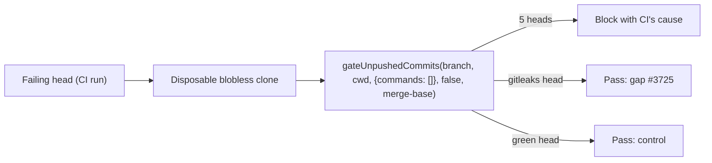

## Summary

Finishes the two items the degraded #3689 run left partial, in
`docs/pre-pr-ci-audit.md`:

- Blocking review findings are now classified: 12 `CHANGES_REQUESTED` fleet
  reviews still standing on 11 VibeCoderST PRs (2026-10-07 to 2026-10-14),
  each with its review link. The 187 reviews on 77 PRs the fleet dismissed
  in the same window are counted per repo (private-repo-C 22 on 11,
  private-repo-A 60 on 31, VibeCoder 105 on 35), so private-repo-C's 0
  standing reviews is not read as no blocking findings. Each repo's issue
  timelines show all 187 were `changes_requested` before dismissal.
- Every private-repo row is described at concept level: VibeCoder is public,
  so the doc names, links and quotes only VibeCoder's runs, reviews and code.
- The two private-repo-C cspell rows now record their cause.
- The completion-phase gate was replayed on seven real heads in disposable
  checkouts.
- The pre-PR verifier's live outcomes come from this host's worker logs.

Two new gaps are filed: #3769 and #3770. Closes #3717.

The unattended-path criterion stays **partial**. The completion-phase gate
logs nothing when it passes, so no live run records which checks it reached.
#3770 tracks that.

## Spec

### Intent and Rationale

- #3689's audit verified the worker path only through unit tests and fixtures,
  and covered CI jobs only. This PR adds evidence from the real path: the
  gate's own entry point on real failing heads, and the worker's own logs.
- The replay calls `gateUnpushedCommits` with a base ref. That is the exact
  call `gateBeforePush()` makes, so it exercises the deployed code rather than
  a re-implementation.

### Essential Design Decisions

- This PR changes docs only. Missing coverage goes to follow-ups (#3769
  Mermaid validator, #3770 gate pass log), so this PR does not widen into new
  gate code.
- The verifier evidence is labelled single-host. It is never presented as
  fleet-wide.

### Undiscoverable Facts

- This host's worker logs (2026-10-12 03:19Z to 2026-10-15 03:11Z) show:
  - the verifier raised blocking findings on 18 issue runs in the three repos;
  - `Pre-PR verifier blocked PR creation` was logged 6 times;
  - `not checked` was logged 0 times;
  - the verifier missed at least three findings, on heads it ran on without
    blocking: two private-repo-A PRs (one with a standing review, one
    dismissed) and VibeCoder#3676 (head d6203dc6, review 5503578036,
    dismissed). The count is a lower bound from logs that show a verifier
    checkout, not a miss rate.
- The verifier reached `main` at ac214bd7 (2026-10-11 10:04Z). PRs opened
  earlier, milestone roll-ups and PR-feedback rounds never pass through it.
- private-repo-C's quality workflow auto-applies `deno fmt`. On one of its
  heads the local gate therefore stops first on a check CI fixes for itself.
  With `deno fmt` committed, cspell blocks on the same words CI reported.
- VibeCoder's `check-mermaid` passes a flowchart label that mixes unquoted
  text with a quoted string, the block a private-repo-A review rejected.
  Observed with
  `deno run --allow-read --allow-env mod.ts check-mermaid --script-dir <dir>`,
  which printed `mermaid: PASSED (1 file(s), 1 block(s) checked)`.

## Evidence

Backend/docs only; no UI file changed.

Replay output, quoted from the commands run in the worker container:

- private-repo-C: cspell blocked on the unknown word CI reported
- VibeCoder 035d0353: `docs/USAGE.md:117:1 error MD018/no-missing-space-atx`
- VibeCoder 45bf3c6f: `slice top-up-3535 (#3535): sweptAt d1cc7d24… is not an ancestor of origin/main`
- private-repo-A: `cargo fmt --all --check` failed with the diff CI reported
- VibeCoder 958fc276 (gitleaks) and 7ba349e5 (green control): `VERDICT: PASS`
  after deno fmt, deno lint and markdownlint
- The documented `deno eval` rerun command, run from `worker/deno` against the
  035d0353 checkout, reproduced the MD018 block.

Review data came from these commands:

- `gh pr list -R stSoftwareAU/<repo> --author VibeCoderST --state all --search "created:2026-10-07..2026-10-14" --limit 500 --json number,reviews`,
  run on 2026-10-15 at 07:11Z. It gave 12 standing `CHANGES_REQUESTED`
  reviews on 11 PRs and 187 `DISMISSED` reviews on 77 PRs.
- `gh api repos/stSoftwareAU/<repo>/issues/<n>/timeline --paginate`, whose
  `review_dismissed` events gave each dismissed review's earlier state
  (`changes_requested` for all 187).
- `gh api repos/stSoftwareAU/<repo>/pulls/<n>/commits`, which gave the commit
  times compared with this host's verifier log lines.
- `gh api repos/stSoftwareAU/<repo>/pulls/<n>/reviews`, which gave each
  review's `commit_id` and link.

Issue numbers this diff cites:

- #3769: Mermaid validator accepts a flowchart label that mixes unquoted text
  with a quoted string
- #3770: Pre-push gate leaves no log line when it passes, so its checks run on
  live worker runs are not observable
- #3725: Pre-push gate: scan unpushed commits with gitleaks before the PR exists
- #3716: Audit deployed pre-PR quality stages against actual CI failures
  (#3689), the PR that merged the gate
- #3584: Milestone: Fleet guidance: issue and feedback prompts, the merge that
  carried the verifier
- #3395: the pre-PR verifier

**Docs sweep** — grep: `pre-pr-ci-audit`, "review-finding", "not retained",
"unattended worker path"; section: `docs/pre-pr-ci-audit.md#method-and-limits-of-this-audit`;
siblings: none — no existing set gained a member; updated: `README.md`,
`docs/pre-pr-ci-audit.md`; `README.md:527` — still true because it is the
updated index row.

## Acceptance Criteria

<!-- vibe-spec-review inputs="diff+issue-body" -->

- **met** — Real representative failures are classified with links to CI/review evidence. — evidence: `docs/pre-pr-ci-audit.md` "Blocking review findings" table (12 standing reviews; VibeCoder's linked, private repos' described at concept level; private-repo-C has none standing, so its 22 dismissed reviews are in the separate per-repo counts table) and private-repo-C rows C7 and C8 — reviewer: met
- **partial** — The end-to-end pre-PR verifier and executable checks are verified on the unattended worker path, not just unit tests. — evidence: `docs/pre-pr-ci-audit.md` "Unattended worker path" (seven disposable-checkout replays of `gateUnpushedCommits`, the verifier's live log outcomes) — reviewer: partial — reason: the completion-phase gate logs nothing on a pass, so no live run records which checks it reached (#3770); the replays did not run repo-configured pre-flight commands
- **met** — Missing check coverage is repaired or tracked as specific follow-ups with no duplicate of existing issues. — evidence: #3769 and #3770, filed after `gh issue list` searches found no open match; cited in `docs/pre-pr-ci-audit.md` "Known remaining limits" — reviewer: met
- **met** — CI still independently runs every required check after PR creation. — evidence: the diff touches only `README.md` and `docs/pre-pr-ci-audit.md`; no workflow or required check changes — reviewer: met
- **unrequested** — README row and doc intro reworded to name the review findings and #3717 — reviewer: unrequested — reason: keeps the docs index true for the extended audit, as the docs-change rule requires
- **unrequested** — "Known remaining limits" bullets for #3769 and #3770 — reviewer: unrequested — reason: the gaps this audit found have to be tracked, and these bullets record that
- **unrequested** — paragraph noting that private-repo-C's workflow auto-applies `deno fmt` — reviewer: unrequested — reason: explains why the C8 replay first blocks on a check other than CI's first failure

## Standards Review

<!-- vibe-standards-review inputs="diff+CODING-STANDARDS.md" -->

- **clean** — docs-change rule (README row and stale limit bullets updated), check-where-you-insert, counts agree (12 standing reviews / 11 PRs, with private-repo-C at 0 standing and 22 dismissed in the per-repo table; seven replays), follow-up references consistent, Australian English; no tests touched, no stubs, no workflow change; CODING-STANDARDS.md marks no rule as "by review only"

## Test Plan

- No test added or modified: the diff changes docs only.
- The disposable-checkout replays and the `deno eval` rerun line were run as
  described under Evidence.
- Local `./quality.sh < /dev/null` printed `Result: PASSED (with skipped
  checks)` on an earlier head of this branch, before the documentation was
  reworded: Mermaid, markdownlint, semgrep, deno tests, lint, type check and
  fmt passed; "config integration" was SKIPPED. It has not been rerun on this
  head.
- CI passed all 21 checks, including markdownlint and the Mermaid check, on
  the head before the last documentation fixes. `markdownlint-cli2` on
  `docs/pre-pr-ci-audit.md`, `docs/archive/pr-summaries/pr-summary-3717.md`
  and `README.md` reports 0 issues on the head this summary describes.
- `deno task pr-summary-check` reported 0 gates blocked. The summary claim
  check was not checked, because it needs a model call.

<!-- vibe-branch-outcomes -->

🤖 Generated with [Claude Code](https://claude.com/claude-code)
