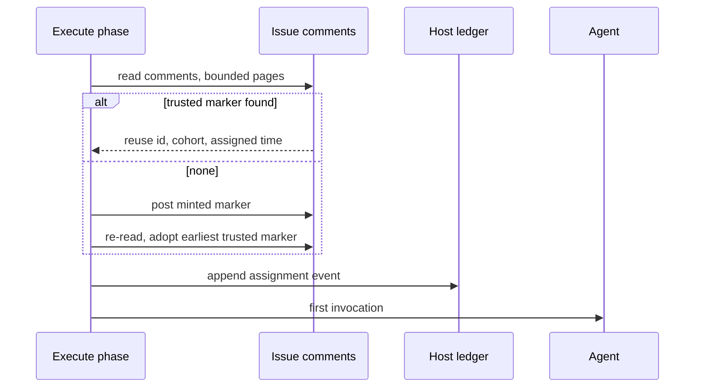

## Summary

Each worked issue now gets one stable assignment ID with its treatment, recorded before the agent runs, on a new append-only per-host lifecycle ledger. Closes #3718.

- `worker/deno/lib/lifecycle_ledger.ts` defines the ledger: a typed union of all five event kinds (`assignment`, `invocation`, `follow_on`, `gate`, `outcome`) with a deterministic `eventKey` for each, so later sub-issues of #3644 only import it. It has an allowlisted serialiser and validator, a plain-append JSONL writer at `WORK_DIR/lifecycle_ledger_<hostname>.jsonl`, and a reader that dedupes on `eventKey`. A bad line raises `LifecycleLedgerReadError` naming the path and line, and a failed append raises `LifecycleLedgerAppendError`.
- `worker/deno/lib/issue_assignment.ts` reads the issue's hidden `<!-- vibe-assignment id="…" cohort="…" assigned="…" -->` marker. Only a fleet-authored marker is trusted, and the earliest one wins. If one exists, its ID and cohort are reused. Otherwise the run mints a UUID with cohort `unassigned`, posts the marker, then re-reads so that racing hosts converge. It then appends the `assignment` event with the treatment:
  - host and run id
  - provider, model and effort for each of the manager, executor and reviewer roles
  - worker version and commit (from `workerBuildFacts`, the build facts the callback context emits)
  - assignment time and cohort
  - optional operator label `subscription_allocation_label`
- `lib/phases/execute_phase.ts` records the assignment immediately before the first `invokeAgent`, after every early exit. A failure is logged at error level and the run continues.
- New host config key `subscription_allocation_label`. It is a label only, never an email, ID or fee. Values are validated with the ledger's own label rule, and a refusal never echoes the value.

## Spec

### Intent and Rationale

- Cohort attribution across restarts and hosts needs one ID that outlives a run. The issue thread is the only state every host shares, so the ID lives in an issue comment marker, and each host's ledger file records its own runs.
- Dedupe happens on read, so the writer stays a plain `O_APPEND`. A retried execute-phase body or a replay writes the same `eventKey` again, and the reader keeps one copy.

### Essential Design Decisions

- The allowlist works at the key level and the value level. An unknown key is refused. Identifiers match a bounded token pattern with no `@` or whitespace. Labels are lowercase `[a-z0-9._-]{1,64}`. Prompt text, issue bodies, tokens, emails and user identities therefore cannot be written. The reader re-validates every line and recomputes its `eventKey`.
- Marker trust uses `isFleetAuthor` against `resolveFleetMaintenanceAuthorSet`. This is the same control as the `CLAIM_LOCK` author gate. A forged marker is ignored, which fails towards minting a new ID, the harmless direction.
- The assignment is recorded in the execute phase rather than at claim time. The issue only assumed the claim phase, and the execute phase is the module that sets the run start time. The setup phase's milestone presync agent runs earlier, but it is milestone-branch maintenance memoised once per run and shared by every issue of the milestone, not this issue's work. The parent milestone asks for maintenance to be kept separate from implementation.
- Owner direction on #3644 (2026-10-13): "estimated API-equivalent USD cost only … do not implement subscription fee allocation". The subscription field is therefore an operator label only. Nothing computes or allocates fees, and `estimatedApiCostUsd` is an optional, unwritten invocation field. This narrows the sub-issue's "subscription allocation label" bullet rather than replacing it.

### Undiscoverable Facts

- Cohorts are not supplied by any experiment yet, so every minted assignment is `unassigned`. Not yet: #3645 (open) will supply cohorts.
- The per-role configuration is today's per-phase resolution. Not yet: #3643 (open) will configure roles independently.
- `invocation`, `follow_on`, `gate` and `outcome` events are defined but not written by this PR.

## Evidence

Backend/CLI change. No UI files are touched. Verified by the tests under Test Plan and the full gate.

- **Observed tool output:** `gh api --paginate repos/stSoftwareAU/VibeCoder/issues/3718/comments --jq '.[] | select(.body | contains("CLAIM_LOCK")) | {body: .body, created_at: .created_at, author: .user.login}'` returned `{"author":"VibeCoderST","body":"<!-- CLAIM_LOCK:…","created_at":"2026-10-14T10:53:42Z"}`. That confirms the REST fields the store reads: `user.login`, `created_at` and `body`, with `<` escaped and undone by `JSON.parse`. The shipped store reads the same fields through the existing bounded `fetchIssueCommentPages`, not `--paginate`.
- **Fakes:** the in-memory `AssignmentMarkerStore` stands in for `ghAssignmentMarkerStore`. The property relied on is that a list returns every marker-bearing comment with its author and creation time. The production adapter is tested directly against a fake `runGh` built from the REST page shape, covering page 1 args, the page-2 follow, a non-array page, unattributable items and post args.
- **Exports read only by tests:** `readLifecycleLedger` and the four unwritten event types have no production reader yet. The issue explicitly asks for the reader and the full union as the API later sub-issues import, so they are exempt.
- **Callers and siblings checked:** `recordIssueAssignment` has one production caller (`execute_phase.ts` through `InfrastructureDeps.recordIssueAssignment`). The standalone `execute_claude_phase.ts` command path does not record an assignment, because it is not a fleet issue run. `sanitiseHostname` is now exported, with callers `fleetTelemetryPath` and `lifecycleLedgerPath`.
- **Issue numbers cited in the diff:**
  - #3644: Record end-to-end issue lifecycle, cohort attribution and fully loaded cost
  - #3645: Run randomized fleet experiments and report merged issues per dollar
  - #3718: Issue assignment record and append-only lifecycle ledger

**Docs sweep** — grep: `vibe-assignment`, `lifecycle_ledger`, `subscription_allocation`, `sanitiseHostname`, "fleet_telemetry_\w*"; section: `docs/INTERNALS.md#-lifecycle-ledger-and-issue-assignment-issue-3718`, `docs/CONFIGURATION.md` host-key table; siblings: `fleet_run_archive`, `issue_reviewer_agents`, `fleet_telemetry_<hostname>.json`; updated: `docs/INTERNALS.md`, `docs/CONFIGURATION.md`, `docs/audits/lib-sweep-coverage/top-up-3718.json`; `docs/CONFIGURATION.md:496` — still true because that sentence describes the `<fleet_data_source>` prompt text, which `lib/prompt_builder.ts` builds naming only the telemetry sidecar and credit log.

## Acceptance Criteria

<!-- vibe-spec-review inputs="diff+issue-body" -->

- **met** — Two claims of the same issue (restart, or a second host) produce one assignment ID and one cohort. — evidence: `worker/deno/tests/issue_assignment_test.ts::issue assignment - a restart and a second host reuse one assignment`, `::a racing earlier trusted marker is adopted after the re-read` — reviewer: met
- **met** — The assignment event is appended before the first agent invocation. — evidence: `worker/deno/tests/execute_phase_assignment_3718_test.ts::execute_phase assignment - the assignment event is on the ledger before the first agent invocation (Issue #3718)` — reviewer: partial — reason: the reviewer flagged the setup phase's milestone presync agent as possibly earlier. That agent is milestone-branch maintenance memoised once per run across all of the milestone's issues, not this issue's agent work, so it is not attributed to the issue's assignment (see Spec).
- **met** — Reading a ledger that contains the same `eventKey` twice yields one event. — evidence: `worker/deno/tests/lifecycle_ledger_test.ts::lifecycle ledger - a replayed event is read back once` — reviewer: met
- **met** — A redaction test proves a non-allowlisted field (for example a prompt or an email) cannot be serialised. — evidence: `worker/deno/tests/lifecycle_ledger_redaction_test.ts::lifecycle redaction - an extra top-level key is refused, naming the key`, `::an e-mail address as cohort is refused` — reviewer: met
- **met** — A corrupt ledger line produces a typed error, not an empty result. — evidence: `worker/deno/tests/lifecycle_ledger_test.ts::lifecycle ledger - a corrupt line is refused with its line number` — reviewer: met
- **met** — Tests and `./quality.sh` pass. — evidence: `./quality.sh < /dev/null` on the final code head, `Result: PASSED (with skipped checks)` — reviewer: missing — reason: the reviewer saw only the diff and could not run the gate. It was run here and passed, with only `config integration` skipped (no `.config.json` on this host).
- **unrequested** — `subscription_allocation_label` host config key and its validation — reviewer: unrequested — reason: the issue requires an "operator-configured label" but names no source. A config key is the minimal source, and it reuses the ledger's label rule.
- **unrequested** — `sanitiseHostname` exported from `fleet_telemetry_sidecar.ts`; `isPlainObject` exported from the ledger — reviewer: unrequested — reason: the ledger reuses the existing owner instead of copying it.
- **unrequested** — `docs/INTERNALS.md` section, `docs/CONFIGURATION.md` row and lib-sweep top-up slice — reviewer: unrequested — reason: the repository's docs-with-code rule and the sweep-coverage test require them.

## Standards Review

<!-- vibe-standards-review inputs="diff+CODING-STANDARDS.md" -->

- **violation** — Log Levels: a recoverable assignment failure is logged at ERROR while the run continues — evidence: `worker/deno/lib/phases/execute_phase.ts:549` — reason: required by #3718 ("a failed append raises an error the caller logs at error level — never swallowed")
- **violation** — Doc claimed racing hosts converge, but the code recorded each minted id — evidence: `docs/INTERNALS.md:1088`, `worker/deno/lib/issue_assignment.ts:328` — reason: fixed in this diff. A minting run now re-reads after posting and adopts the earliest trusted marker, and the doc states the GitHub-listing caveat.
- **violation** — Nothing exists only for a test to read: `readLifecycleLedger` has no production caller — evidence: `worker/deno/lib/lifecycle_ledger.ts:777` — reason: required by #3718, which asks for "a reader that dedupes on a deterministic `eventKey`" as the API later sub-issues import
- **violation** — Duplicated plain-object guard (`isRecord` copy beside `isPlainObject`) — evidence: `worker/deno/lib/lifecycle_ledger.ts:302` — reason: fixed in this diff. `issue_assignment.ts` now imports the ledger's exported `isPlainObject`, because no exported owner existed elsewhere.
- **violation** — Refusal tests asserted only `ok === false` or the field — evidence: `worker/deno/tests/config_subscription_allocation_label_3718_test.ts:89` — reason: fixed in this diff. Each refusal now asserts the field and the label-rule message, paired with an accepted control.
- **clean** — Australian English; fail-loud paths; new persisted shape (schema 1, newer refused); no workflow changes; no source-grepping tests; temp dirs from `Deno.makeTempDir`; no existing test edited or assertion removed. Review-enforced rules checked: log levels, doc-prose accuracy, nothing-only-for-tests, helper reuse, refusal-test rule, negative-test rule, failure-reason cause, Australian English. Optional finding fixed: `SIMPLE-ON-PURPOSE` is now a `//` line.

## Test Plan

New tests (all under `worker/deno/tests/`). Every one was run on the final head with `deno task test:unit < /dev/null`, and the full `./quality.sh` passed.

- `lifecycle_ledger_test.ts`: five-kind round trip, dedupe, key determinism, corrupt, invalid, future-schema and tampered-key lines, missing and unreadable files, append failure, hostname confinement, and the table of validator refusals.
- `lifecycle_ledger_redaction_test.ts`: unknown keys at every level, emails, prose and prompt text refused, a positive control, a hostile long run, and a redactor pass-through.
- `issue_assignment_test.ts`: reuse, mint, forged marker, earliest wins, race adoption, list, post and re-read failures, build facts, labels, the marker round trip, the gh store against REST page shapes, and role treatments.
- `execute_phase_assignment_3718_test.ts`: ordering before the first agent call, request contents, executor role on a split run, subscription label pass-through, and failure logged with the run continuing.
- `config_subscription_allocation_label_3718_test.ts`: validation, loader trim and blank handling, and known-key checks.

No existing test was edited, so no assertion was removed and no expectation changed. New environment precondition: none. The execute phase's new call goes through the mocked `recordIssueAssignment` in `createMockDeps`, so existing execute-phase tests are unaffected. All `execute_phase_*` tests pass in the full gate.

Red-checks (each restored and verified with `cmp`):

- Moving the call after `invokeAgent` turned the ordering test red.
- Swallowing the `logger.error` turned the failure test red.
- Dropping the `subscriptionAllocation` spread turned its test red.
- Removing race adoption turned `issue assignment - a racing earlier trusted marker is adopted after the re-read` red.
- 23 mutations of the ledger and assignment logic all went red. They covered dedupe, the parse-failure throw, NotFound and unreadable handling, future-schema, each allowlist level, the token and label patterns, the eventKey check, the append error, the trust filter, earliest ordering, post-when-reused and never-post, build facts, the subscription spread, the Claude gate, explorer mapping, the claudeModel override, the prefix filter and the unattributable skip.

**Branch outcomes:**

- `worker/deno/lib/lifecycle_ledger.ts:838` — duplicate `eventKey` skipped vs kept — `lifecycle ledger - a replayed event is read back once` / `distinct events stay distinct` — removing the skip went red
- `worker/deno/lib/lifecycle_ledger.ts:785` — NotFound → `[]` vs other error → `unreadable` — `a missing ledger reads as empty` / `an unreadable ledger is refused as unreadable` — flipping each went red
- `worker/deno/lib/lifecycle_ledger.ts:815` — newer schema → `future-schema` — `a newer schema is refused as future-schema` — removing it went red
- `worker/deno/lib/lifecycle_ledger.ts:618` — unknown top-level key refused (and `:455` role keys, `:478` treatment keys) — `lifecycle redaction - an extra top-level key is refused, naming the key` / `an extra key on a role item is refused` / `an extra key on treatment is refused` — disabling each went red
- `worker/deno/lib/lifecycle_ledger.ts:634` — operand `typeof eventKey !== "string"` — `lifecycle ledger - each refusal names the field it broke` — forcing it false went red; `:635` operand key mismatch — `a tampered eventKey is refused` — skipping it went red
- `worker/deno/lib/lifecycle_ledger.ts:201` — outcome keyed per PR vs per run — `a PR outcome counts once across runs and hosts` / `events without prNumber or agent are accepted and keyed` — flipping went red
- `worker/deno/lib/lifecycle_ledger.ts:731` — write failure → `LifecycleLedgerAppendError` — `an append into a missing directory is refused` — swallowing went red
- `worker/deno/lib/issue_assignment.ts:213` — untrusted author dropped — `issue assignment - a forged marker from an untrusted author is ignored` — ignoring the filter went red
- `worker/deno/lib/issue_assignment.ts:289` — reuse vs mint — `an existing trusted marker is reused without posting` / `a restart and a second host reuse one assignment` — flipping went red
- `worker/deno/lib/issue_assignment.ts:327` — post only when minted — `a restart and a second host reuse one assignment` / `a failing post rejects and writes nothing` — always-post and never-post both went red
- `worker/deno/lib/issue_assignment.ts:341` — settled marker differs → adopt — `a racing earlier trusted marker is adopted after the re-read` — removing adoption went red
- `worker/deno/lib/issue_assignment.ts:169` — non-marker comment skipped — `the gh store reads page 1 and keeps only marker comments` — removing the filter went red
- `worker/deno/lib/issue_assignment.ts:405` — operand `provider.id !== CLAUDE_PROVIDER_ID` — `a non-Claude provider lists the manager only` — removing it went red; operand `args.agents === undefined` — `an explicit Claude model overrides the manager` — reached with agents absent
- `worker/deno/lib/issue_assignment.ts:410` — explorer (no role) skipped — `the Claude run lists the manager, executor and reviewers` — mapping it as a role went red
- `worker/deno/lib/issue_assignment.ts:397` — `claudeModel` override set vs unset — `an explicit Claude model overrides the manager` — dropping it went red
- `worker/deno/lib/phases/execute_phase.ts:536` — subscription label present vs absent — `execute_phase assignment - the configured subscription allocation is passed on the request (Issue #3718)` — dropping the spread went red
- `worker/deno/lib/phases/execute_phase.ts:547` — failure → error log, run continues — `execute_phase assignment - a failed assignment is logged at error level and the run continues (Issue #3718)` — swallowing went red
- `worker/deno/lib/validation.ts:728` — operand `trimmed !== ""` — `subscription_allocation_label - accepts a blank value, which records no label (Issue #3718)`; operand label-rule failure — `rejects an email, naming the key and never echoing it (Issue #3718)` — each reached
- `worker/deno/lib/config.ts:1002` — blank → undefined vs trimmed value — `config loader maps a blank value to undefined (Issue #3718)` / `config loader trims the value (Issue #3718)` — reached
- `worker/deno/lib/issue_assignment.ts:430` — `productionIssueAssignmentSeams` — exempt (untestable): it calls `getRunId()`, which sets `VIBE_RUN_ID` in the process environment, and `lib/run_id.ts` forbids tests mutating it. The harness search found `tests/issue_assignment_test.ts` and `tests/execute_phase_assignment_3718_test.ts`, both of which inject seams or the deps mock instead.

🤖 Generated with [Claude Code](https://claude.com/claude-code)
