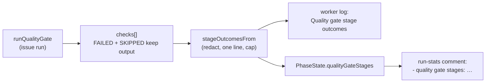

## Summary

The local semgrep stage's miss on c384c70e (run 38123883049) cannot be explained from retained evidence, because the worker kept only "quality gate: passed on attempt N". This PR records every quality-gate stage's outcome — PASSED, SKIPPED with its reason, or FAILED — on the issue's run-stats comment (`- quality gate stages: …`) and in the worker log ("Quality gate stage outcomes"), so the next CI-only failure can be matched to a stage that was skipped locally. It also settles the question the issue raised: inside the fleet container image a missing semgrep binary now fails the stage, while an unreachable registry or an over-deadline scan stays SKIPPED and is recorded. Closes #3726.

## Spec

### Intent and Rationale

- The audit (#3689/#3717) could not tell whether semgrep PASSED, SKIPPED or never ran on c384c70e; recording the per-stage outcome on the run-stats comment makes that answerable from the issue alone, without host logs.
- The run-stats comment was chosen over the agent-written PR summary because the worker writes it from the gate's own result, so the agent cannot omit or misstate it.
- Decision on blocking: the image bakes semgrep in, so in the container its absence is an image fault and is reported FAILED with "not installed or not in PATH", which `detectFailureCategory` classes as `missing_tools` (a host fault, not blamed on the issue). A registry outage or an oversized scan is not caused by the change and would fail every fleet run, so those stay SKIPPED; the blocking `semgrep.yml` remains the backstop.

### Essential Design Decisions

- The existing `- quality gate: passed on attempt N` line is stable by contract (the #2320 pilot counts off it) and is unchanged; the stages ride a new line after it.
- A SKIPPED reason is untrusted tool output: it is redacted with `redactSecrets` before the 200-character cap, collapsed to one line, backticks replaced and HTML comments neutralised so it cannot forge a worker marker.
- Stage outcomes live on `PhaseState.qualityGateStages`, separate from `qualityGateOutcome`, so nothing persisted changes: `measureIssuePhaseRun` still records only `gatePassedOnAttempt`.
- `GateStageOutcome` / `formatGateStageOutcomes` are gate-agnostic so the pre-push gate (#3770, open) can reuse one shape, as the triage comment asked.

### Undiscoverable Facts

- Triage (issue comment, 2026-10-15) names #3730 as the likely cause: when the merge-base with `origin/HEAD` cannot be resolved, `resolveDiffBase` falls back to `HEAD`, so a change the agent already committed is not scanned and the stage reports PASSED. This PR does not fix #3730; `docs/pre-pr-ci-audit.md` records it as likely, not proven.
- Only the issue-run quality-gate phase records stages; the CI-fix and PR-feedback paths that shell out to `./quality.sh` are unchanged.
- semgrep 1.173.0 is on PATH in the current fleet image (`/usr/local/bin/semgrep`), so the new FAILED path does not fire on a healthy image; this run's own `./quality.sh` reported `semgrep PASSED`.

## Evidence

Backend/worker change; no UI file touched. Covered by unit tests listed under Test Plan.

Observed behaviour relied on: `semgrep --version` in this container prints `1.173.0` and `VIBE_IMAGE_AGENT_PROVIDERS=claude`; `detectFailureCategory` maps "not installed or not in PATH" to `missing_tools` (`worker/deno/lib/failure_diagnosis.ts`), asserted by `worker/deno/tests/semgrep_check_test.ts`.

Issue numbers cited as provenance: #3726: Explain why the local semgrep stage missed detect-non-literal-regexp on c384c70e (run 38123883049); #3730: Semgrep quality-gate stage scans only uncommitted files when the merge-base with origin/HEAD cannot be resolved, then reports PASSED; #3770: Pre-push gate leaves no log line when it passes, so its checks run on live worker runs are not observable; #559: Two PRs are blocked on the same semgrep rule the local gate never runs; #2345: Report the quality-gate pass attempt on every implementation run-stats comment; #1852: A repo whose own quality gate already fails (non-diffable check) fails every run at quality_gate.

**Docs sweep** — grep: `failedOutput`, "Recorded for FAILED checks", "only failures are kept", `semgrep.*SKIPPED`, `quality gate: passed on attempt`, `qualityGateOutcome`; section: `CONTRIBUTING.md` semgrep bullets ("Install it or it skips, loudly."), `docs/CONTAINER-IMAGE.md#semgrep`, `docs/MODEL-AND-CACHING.md` run-stats bullets, `docs/pre-pr-ci-audit.md` semgrep row and notes; siblings: `qualityGate`, `graft`, `rtk` (the run-stats comment arguments the new `qualityGateStages` joins) and `IN_IMAGE_ENV`-style container readers listed in `worker/deno/lib/container_stamp.ts`; updated: `CONTRIBUTING.md`, `docs/CONTAINER-IMAGE.md`, `docs/MODEL-AND-CACHING.md`, `docs/pre-pr-ci-audit.md`, `worker/deno/lib/container_stamp.ts`, `worker/deno/lib/quality_helpers.ts`; `docs/MODEL-AND-CACHING.md:596` — still true because the attempt line is unchanged; `docs/MODEL-AND-CACHING.md:1663` — still true because the attempt line is unchanged; `docs/audits/security-sweep-2757-lib-delta-12d-12f.md:224` — still true because it is a dated sweep record of the module at its sweptAt commit.

## Test Plan

- `./quality.sh < /dev/null` on the final code head: `Result: PASSED (with skipped checks)` — `config integration` SKIPPED (pre-existing), every other stage PASSED including `semgrep`, `completeness checks` and `deno tests`.
- New `worker/deno/tests/gate_stage_outcome_test.ts`: order kept; reason only for SKIPPED; first non-empty line; credential redacted; HTML comment and backticks neutralised; 200-char cap; whitespace-only output has no reason; grouping and `none recorded`.
- New `worker/deno/tests/quality_gate_skip_reason_test.ts`: the real `runQualityGate` keeps the semgrep SKIPPED reason ("not a git repository") and the Deno-directory reason.
- `worker/deno/tests/quality_gate_attempt_report_test.ts`: stages recorded from the last gate run; stale stages cleared when the gate errors.
- `worker/deno/tests/issue_run_stats_comment_test.ts`: stages line absent without stages, rendered after the unchanged `- quality gate:` line.
- `worker/deno/tests/completion_phase_run_stats_test.ts`: `state.qualityGateStages` reaches the posted comment.
- `worker/deno/tests/semgrep_check_test.ts`: in-container missing semgrep is FAILED and classed `missing_tools`; a blank stamp stays SKIPPED; an unreachable registry stays SKIPPED inside the container (pins existing behaviour, expected green on base).
- Existing tests edited, no expected value changed: `runSemgrepCheck - SKIPPED loudly when semgrep cannot be run` and `runSemgrepCheck - SKIPPED outside a git repository` gained `env: () => undefined` so they stay hermetic inside the container image.
- Removed assertion in `worker/deno/tests/quality_gate_test.ts` (`runQualityGate - a FAILED check carries the output it printed (Issue #1852)`): the second loop's `if (check.status === "FAILED") continue;` now also skips SKIPPED checks, so `non-failing check '${check.name}' should record no output` no longer applies to SKIPPED checks — untrue because #3726 requires a SKIPPED stage's reason to be recorded; the SKIPPED output is now asserted by `worker/deno/tests/quality_gate_skip_reason_test.ts`. Red check of the edited test against its guard: deleting the FAILED operand of `recordedOutput` turns it red ("FAILED check 'completeness checks' recorded no output"). With the empty fixture no check PASSES, so the remaining PASSED-records-nothing loop is vacuous, as it was on base.
- Call sites checked: `runQualityGateBody` (assignment and clear), `postWorkOnRunStats` in `worker/deno/lib/phases/completion_phase.ts`, `postIssueRunStatsComment` → `buildIssueRunStatsComment`; each revert went red (see Branch outcomes). The bump-audit recheck deliberately records nothing: its result is a pass/fail attribution, not the gate run the comment reports.

<!-- vibe-branch-outcomes -->

🤖 Generated with [Claude Code](https://claude.com/claude-code)
