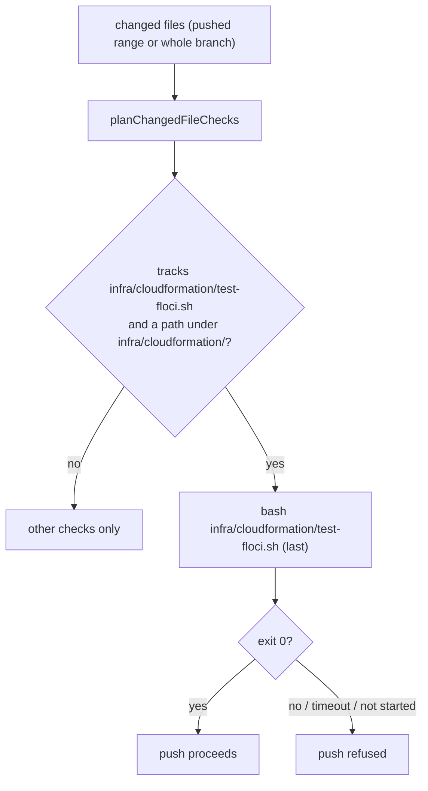

## Summary

The worker's pre-push gate now runs the Floci CloudFormation deploy test,
`bash infra/cloudformation/test-floci.sh`, as an always-on changed-files check
whenever the commits it checks add or modify a file under
`infra/cloudformation/` and the repository tracks that script. Any non-zero
exit, failure to start or timeout refuses the push. That covers the agent's own
`git push`, Step 1b of `commitAndPushPending` and the completion phase's
whole-branch gate before `gh pr create`. Closes #3727.

Inside today's worker container the check cannot deploy the repository's only
template, so it would not have caught the failure in run 38033819415 there; see
Undiscoverable Facts.

## Spec

### Intent and Rationale

- CI's `Deploy CloudFormation into Floci` job had no pre-PR equivalent (the
  #3689 audit gap). The changed-files list in `planChangedFileChecks` already
  knows what a branch touches and already runs over the whole branch in the
  completion phase, so the script is one more planned check rather than a new
  stage.
- The script owns its fail-closed rules (Floci not startable, no answer, `aws`
  CLI missing, stack not `CREATE_COMPLETE`), so the gate adds no parallel logic.

### Essential Design Decisions

- The check is planned last, so the cheap format, lint and spelling checks fail
  first.
- It is keyed on the tracked script `infra/cloudformation/test-floci.sh` and on
  the `infra/cloudformation/` prefix with its trailing slash, so a repository
  without the script, or a sibling such as `infra/cloudformation-old/`, never
  gets it.
- It runs through `runPreFlightGate`, so it gets pre-flight's filtered
  environment and timeout.
- The script's `SKIPPED (needs Docker)` result passes the gate. That is the
  script's documented local contract. The skip is printed by the script, and
  CI, which has a Docker socket, still deploys the template.

### Undiscoverable Facts

- Observed in the worker container on this run: `floci` is on `PATH`, but there
  is no `/var/run/docker.sock` and no `aws` CLI. Running the script there
  printed `SKIPPED (needs Docker): linux-verification-host.yaml` and
  `Nothing to deploy; every template was skipped.`, then exited 0. The only
  template creates an `AWS::EC2::Instance`.
- At the failing head ab6a832f the script (fetched with
  `gh api …/contents/infra/cloudformation/test-floci.sh?ref=ab6a832f`) also
  skipped that template before its `aws ssm put-parameter` seeding step, so in
  the worker container this gate would not have caught run 38033819415. A host
  with Docker and the `aws` CLI would have.
- The baked Floci does raise the exact error without Docker. A direct
  `AmazonSSM.PutParameter` for `/aws/service/ami-amazon-linux-latest/x` sent
  with curl returned
  `{"__type":"ValidationException","message":"Parameter name: can't be prefixed with \"aws\" or \"ssm\" …"}`.
- Through the real `runPreFlightGate` runner, a temporary copy of the script
  with a non-instance template (`AWS::SQS::Queue`) blocked with exit 1 and
  `::error::aws CLI not found — the worker image does not ship it; install AWS CLI v2`.
  In the worker container, then, a deployable template blocks the push until
  the image ships the `aws` CLI.

## Evidence

Backend/CLI change, so there is no UI to screenshot. Tests are in
`worker/deno/tests/pre_push_gate_test.ts`. The script's own fail-closed exits
remain covered by `worker/deno/tests/issue_3369_floci_script_test.ts`.

**Docs sweep** — grep: `test-floci`, "pre-push gate", `sweptAt` ancestry, "not a gate", "never skipped", "No pre-PR stage runs it"; section: `docs/CONFIGURATION.md#agent-pre-push-hook-and-the-changed-files-check`; siblings: `cspell`, `markdownlint-cli2` — the stage-1 list and the parenthetical in that section, the fail-closed paragraph, the module doc of `worker/deno/lib/pre_push_gate.ts` and the `runPrePushGate` doc comment now name the Floci check; updated: `docs/CONFIGURATION.md`, `docs/CONTAINER.md`, `docs/EC2-LINUX-VERIFICATION.md`, `docs/pre-pr-ci-audit.md`, `infra/cloudformation/test-floci.sh` (header comment), `worker/deno/lib/pre_push_gate.ts` (doc comments); `docs/pre-pr-ci-audit.md:110` — the "Pre-PR equivalent ran?" cell stays `No`, because it records the 2026-10 run; `docs/BEST-PRACTICES-SCAN.md:266` — still true, because test scripts still start `floci` on demand and print the Docker skip.

Related existing rules checked: none changed. No prompt, `CODING-STANDARDS.md`
rule or shared prompt constant is added or edited.

Provenance numbers added by this diff: #3727: Pre-PR gate: run the Floci
CloudFormation deploy test locally for infra changes.

Version bump: none, because this repository has no `VERSION` file.

## Test Plan

- Added to `worker/deno/tests/pre_push_gate_test.ts`:
  - `planChangedFileChecks: a changed template plans the Floci deploy test once`
  - `planChangedFileChecks: a change to test-floci.sh itself plans the Floci deploy test`
  - `planChangedFileChecks: no Floci deploy test outside infra/cloudformation/`
  - `planChangedFileChecks: no Floci deploy test when the repo does not track the script`
  - `runPrePushGate: a failing Floci deploy test blocks the push` (a real temp
    git repo; the recording runner fails the Floci command)
- Red checks:
  - Deleting the `if` block turned red the two plan-positive tests and the
    `runPrePushGate` test.
  - Deleting only the `tracked.includes(FLOCI_TEST_SCRIPT)` operand turned red
    the not-tracked test.
  - Dropping the prefix's trailing slash turned red the outside-directory test.
- `deno task test:unit tests/pre_push_gate_test.ts` (from `worker/deno`) passed:
  52 passed, 0 failed. No existing test was edited or lost an assertion. The
  new check is appended after the existing ones and adds no precondition before
  them.
- Changed call site: `runPrePushGate` reaches the new plan entry through
  `planChangedFileChecks`, and the `runPrePushGate` test above goes red when the
  block is removed.
- `./quality.sh` on the final code commit passed with skipped checks
  (`config integration` and `checkov` SKIPPED; every other stage PASSED).

<!-- vibe-branch-outcomes -->
