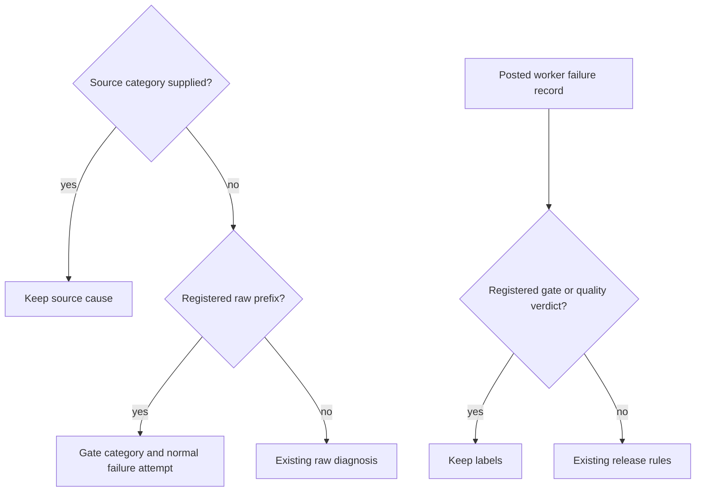

## Summary

Raw worker-gate reasons use one `WORKER_GATE_MARKERS` registry in
`worker/deno/lib/failure_diagnosis.ts`. The raw message adapters recognise a
registered prefix before reading quoted tool or agent text; the outcome and
coding-failure classifiers recognise the resulting gate category. Registered
summary, security-fix and pre-push refusals retain their gate verdict, normal
failure attempt and labels. Closes #3735.

Integration with main preserves #3738's source-declared categories and
substantive verifier records. A declared cause remains authoritative over a
quoted marker. Both label-release sweeps retain registered gate records and
headed `quality-failure` records, including records without repository-quality
Source lines. The existing marker-anchoring changes for #3696 remain in this
milestone.

## Spec

### Intent and Rationale

- A gate reason quotes external text. Reading that quotation as infrastructure
  could suppress a real failure attempt or release its labels.
- Centralise registered gate recognition while retaining the source-provenance
  and verifier protections already delivered on main.

### Essential Design Decisions

- `workerGateCategoryOf` reads anchored raw prefixes; `isWorkerGateCategory`
  narrows the existing category union. A new prefix is one registry entry;
  a new category also extends the existing union.
- Typed source categories remain authoritative. `classifyCodingFailure` and
  infrastructure retry use raw diagnosis only without a supplied category;
  `detectHostFault` preserves declared causes before consulting raw markers.
- `isWorkerGateFailureRecord` recognises an anchored headed record whose
  display category belongs to the registry. Both release sweeps also retain
  `isSummaryOrQualityFailureRecord`, preserving substantive verifier records
  independently of the registry. A category quoted deeper in a record cannot
  forge its worker-written head.
- `PRE_PUSH_LOOKUP_FAILED_MARKER` is not registered: failed branch-state
  lookup remains infrastructure `push_failure`.

### Undiscoverable Facts

- The verifier regressions use synthetic headed-record fixtures and the real
  label writers. They do not claim to capture a production incident.

## Evidence

Backend-only change. Registry cases run hostile rate-limit, timeout, signal,
missing-tool, disk, exception, broken-ref, deadline, scheduled-release and
milestone-refusal quotations through the actual classifiers, retry decision,
label writers and release sweeps. Unmarked controls demonstrate that real
infrastructure and repository refusals retain their original behaviour.

The integration regressions cover declared source causes despite a quoted
registered marker, and substantive verifier records through both release
sweeps. A minimal headed-record fixture also exercises the refusal guard
without the current writer's follow-up advice mentioning quality checks.
Every earlier assertion remains; the existing raw-classifier call now supplies
its explicit raw-provenance argument required by main.

**Docs sweep** — grep: `WORKER_GATE_MARKERS`, `isWorkerGateFailureRecord`,
`isSummaryOrQualityFailureRecord`; updated: `CODING-STANDARDS.md`,
`docs/INTERNALS.md`, `docs/workflows/issue-processing.md` and
`prompts/coding_guidelines/prompt.md`; section:
`docs/INTERNALS.md#worker-gate-markers-are-one-registry-issue-3735`;
siblings: `SUMMARY_RULE_GATE_MARKER`, `SECURITY_FIX_GATE_MARKER`,
`PRE_PUSH_GATE_MARKER` remain the registered gate set; the separate
`PRE_PUSH_LOOKUP_FAILED_MARKER` retains its infrastructure role.
Existing source-category guidance and raw-diagnosis compatibility remain valid.

## Test Plan

- `worker/deno/tests/worker_gate_markers_3735_test.ts` covers every registry
  entry, real posted gate/quality records, unmarked controls and declared-source
  precedence. `worker_gate_marker_rule_3735_test.ts` checks the documented rule.
- Existing failure-diagnosis, host-fault, both release-sweep, coding-ladder,
  outcome-classifier and text-matcher suites remain in the focused integration
  run. No existing test or assertion was removed or weakened.
- The earlier branch's 703-test focused run and full local quality result are
  historical evidence. The integrated source is validated separately; no full
  local quality-gate pass is claimed for this merge.
- The integrated nine-suite run passes with type checking: 289 tests, no
  failures. Independently forcing each of the two release-guard operands true
  and false (eight mutations), plus moving raw marker handling before the
  declared-source checks, causes behavioural assertion failures. Production
  sources were restored before the final passing run.
- PR #4003 CI integration also removes an overwritten empty map in the drift
  checker and aligns the adoption test fake with its two-argument callback
  contract. The security
  sweep baseline narrowly records the deliberate template-interpolation source
  fixture in `failure_diagnosis_test.ts`; its literal text is parsed, never
  evaluated. No assertion or scanner rule is removed.
- Adoption, drift-check and security-sweep regression suites pass: 150 tests.
  The baseline parser validates every citation; a distant same-rule control
  remains unbaselined. The module type check, changed-source lint and formatting
  checks pass.
- Required hosted checks and independent review remain merge gates.

<!-- vibe-branch-outcomes -->
