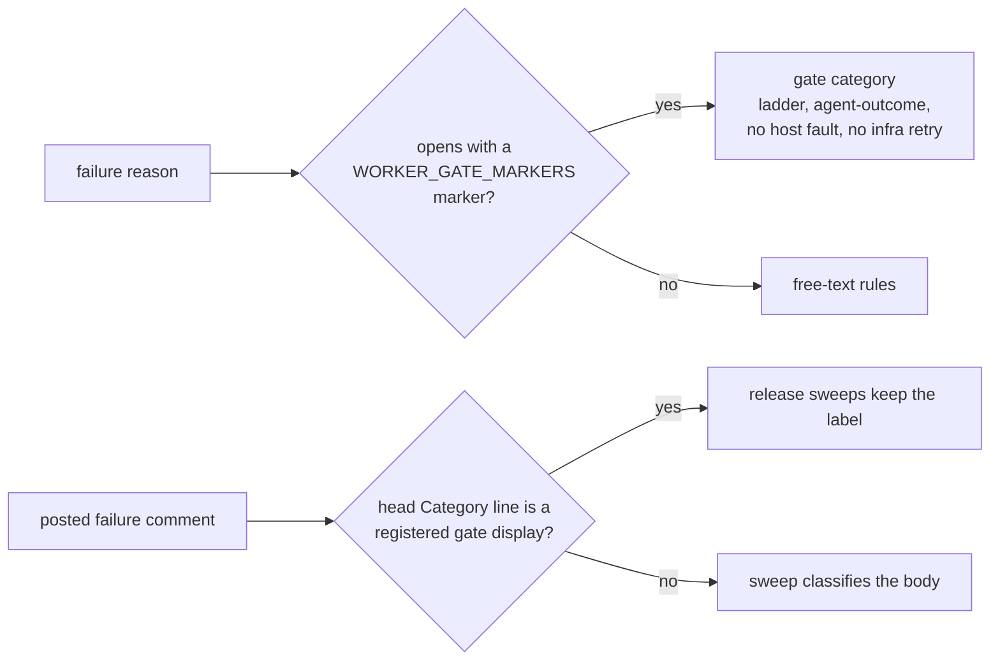

## Summary

Worker gate markers now live in one registry, `WORKER_GATE_MARKERS` in
`worker/deno/lib/failure_diagnosis.ts`, which maps each marker to its failure
category. Every classifier reads that registry first: `detectFailureCategory`,
`classifyRunFailure`, `classifyCodingFailure`, `detectHostFault`, and both
label-release sweeps through `isWorkerGateFailureRecord`.
`shouldRetryInfrastructureFailure` follows through `detectFailureCategory`. A
new gate is now one registry entry instead of an edit to each classifier. This
also closes a gap: the host-fault and milestone-refusal sweeps used to
recognise only `summary-incomplete` records. A posted security-fix-gate or
pre-push-gate failure comment that quoted `ignoring broken ref` or a `GH013`
rejection could therefore have its `failed-once`/`failed` label stripped. The
rule is now written down in `CODING-STANDARDS.md` and restated in
`prompts/coding_guidelines/prompt.md`. Closes #3735.

## Spec

### Intent and Rationale

- Each new gate marker had to be wired into five classifiers by hand, and
  #3440 needed a review round for each classifier it missed. A registry lets
  the classifiers reach a new marker without being edited, and the test that
  iterates the registry covers each new entry automatically.
- Guidance alone was not enough. The existing rule "A failure reason names
  the cause" told authors to quote tool output, which made the
  misclassification more likely, so the new rule sits directly after it.

### Essential Design Decisions

- `isWorkerGateCategory` is a type predicate (`category is
  WorkerGateCategory`), so the exhaustive switch in `classifyRunFailure` still
  narrows without unreachable arms. A new gate category must be added to the
  `WorkerGateCategory` union. The compiler enforces this.
- `PRE_PUSH_LOOKUP_FAILED_MARKER` is deliberately not registered. A failed
  branch-state lookup is `push_failure` (infrastructure), not an agent
  outcome.
- `isWorkerGateFailureRecord` replaces `isSummaryGateFailureRecord`. It reads
  only the anchored head `**Category:**` line and compares the display name
  against the registry, so a gate category quoted further down cannot forge
  it.

### Undiscoverable Facts

- None.

## Evidence

Backend-only change, with no UI files. Verified by:

- `worker/deno/tests/worker_gate_markers_3735_test.ts`: for every registry
  entry, each hostile quote (`rate limit`, `timed out`, `SIGKILL`,
  `command not found`, `ENOSPC`, `Error:`, `TypeError:`, `ignoring broken ref`,
  the deadline-bound and scheduled-release markers, a `GH013` refusal) is
  checked in two forms:
  - **Raw reason:** gives the gate's own category, an `agent-outcome` class, a
    `ladder` disposition with `non_transient` cooldown, no host fault, and no
    infrastructure retry.
  - **Posted comment:** the comment built by the real `markIssueAsFailedOnce` /
    `markIssueAsFailed` is a worker gate record, and both release sweeps
    leave it alone.

  Positive controls show each quote is hostile when the marker is missing.
- `worker/deno/tests/worker_gate_marker_rule_3735_test.ts`: a
  documentation-drift test for the new rule in `CODING-STANDARDS.md`, its
  coding-guidelines restatement, and the rule 5 pointer.
- Provenance cited by the diff: #3735: Fleet PRs add failure reasons that quote
  tool or agent output without a leading worker marker every classifier checks
  first, so the quoted text picks the category (VibeCoder#3440, #3716).
- Related rules checked: **A failure reason names the cause, not just the
  failure** (the new bullet follows it and qualifies it), rule 5 of **Writing a
  gate over text** (#3696, now names the registry), and **A failure-reason test
  asserts the cause** (no conflict). I applied the new rule to this PR's own
  diff and found nothing to fix: the diff adds no new failure reason.

**Docs sweep**: grep: `isSummaryGateFailureRecord`, `SUMMARY_GATE_RECORD`,
"no label-release record check", "right after the summary-gate marker";
section: `docs/INTERNALS.md#worker-gate-markers-are-one-registry-issue-3735`;
siblings: `SUMMARY_RULE_GATE_MARKER`, `SECURITY_FIX_GATE_MARKER`,
`PRE_PUSH_GATE_MARKER`; updated: `CODING-STANDARDS.md`,
`prompts/coding_guidelines/prompt.md`, `docs/INTERNALS.md`,
`docs/workflows/issue-processing.md`; no remaining hits outside
`docs/archive/`.

## Test Plan

- Added `worker/deno/tests/worker_gate_markers_3735_test.ts` and
  `worker/deno/tests/worker_gate_marker_rule_3735_test.ts`. No existing test
  was edited.
- Red checks. Each mutation was made on its own and then restored:
  - Removing the registry check in `detectHostFault`: 9 tests red.
  - Removing it in `classifyCodingFailure`: 4 red.
  - Removing it in `classifyRunFailure`: a compile error from the exhaustive
    switch. With the switch default also relaxed, 5 red.
  - Removing it in the host-fault sweep (`classifyFailureRecord`): 4 red.
  - Removing it in `refusalIsMostRecentFailure`: 4 red.
  - Dropping the pre-push registry entry: 5 red.
  - `isWorkerGateFailureRecord` always returning false: 6 red.
  - `isWorkerGateFailureRecord` with a missing head returning true: the
    no-heading test went red.
  - `isWorkerGateFailureRecord` treating any head display as a gate: 3 red.
  - `workerGateCategoryOf` returning `"pre_push_gate"` instead of null: 4 red.
- Drift pins: `deno task drift-pins-on-base
  origin/milestone/failure-classification-worker-markers-and-declared` reports
  every pinned phrase `absent on base`. Removing the new bullet turns the drift
  test red.
- `deno task test:unit` over the 43 test files that import the changed
  modules: 703 passed, 0 failed.
- `./quality.sh < /dev/null` on commit `9f6ccc1c`, which holds all of the
  production code: `Result: PASSED (with skipped checks)`. Only
  `config integration` was skipped. The later commit added only the no-heading
  test, this summary and the facts file. Re-run on the head, the two new test
  files give 19 passed, 0 failed, and `deno task pr-summary-check` reports
  0 gates blocked.

<!-- vibe-branch-outcomes -->

🤖 Generated with [Claude Code](https://claude.com/claude-code)
