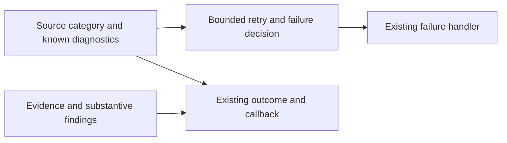

## Summary

Closes #3738.

Worker failures declare their existing category at the source and retain it
through infrastructure retry, failure bookkeeping and the existing outcome and
callback. A typed pre-push network failure stays infrastructure. Source-declared
worker gate/verifier verdicts resist contrary quotations. Raw quality-output
diagnosis retains its existing compatibility behaviour.

Verifier diagnostics distinguish evidence-contract failures from substantive
implementation/test findings and retain simultaneous causes. Known execution,
handover and host diagnostics remain visible without inventing missing causes.
The accepted role configuration and merge protections are unchanged.

## Spec

### Intent and Rationale

Stop transport failures consuming coding-failure attempts solely because a new
worker wrapper chose different prose. Preserve the opposite protection too:
quoted outage, billing and timeout text must not exempt a substantive defect.

### Essential Design Decisions

- Require the existing `FailureCategory` on phase failure/early-exit results and
  unsuccessful work results. Migrate existing literal causes and carry them
  through the orchestrator and production failure handler.
- Reuse the existing pre-push error classes with discriminating kinds. Completion
  maps infrastructure and verdict cases exhaustively. Both still block the push.
  Declared hand-off push/token failures retain their actual source category.
- Keep raw/legacy text diagnosis as an explicit adapter. The classifier requires
  callers to choose raw or declared provenance; optional existing classification
  and runner termination fields travel through existing results and callbacks.
  The raw external quality-output adapter is captured once and its existing
  infrastructure retry behaviour is retained.
  Declared timeout diagnostics retain the established error-shaped disk-evidence
  refinement, while billing quotations cannot replace an execution timeout.
- Accept only evidence or quality tags on verifier findings; omissions and
  unsupported tags are treated as substantive when consumed. Every finding
  blocks. Folding keeps all causes and chooses quality when present. Existing-PR
  holds and blocked-PR callbacks retain the same diagnostics.
- Preserve stored summary/quality verdicts in label-release sweeps before
  examining quoted evidence. Do not falsely mark verifier prose as repository
  quality-gate output. Existing milestone protection is retained through the
  shared renamed predicate; its real writer already includes quality diagnosis.
- Reuse the existing language-aware source lexer in the phase source-scan test.
  No second parser, failure taxonomy, telemetry store or model invocation is added.
  Semantic already-landed reconciliation remains #3977's responsibility.

### Undiscoverable Facts

None. Live fleet improvement and deployed-build adoption are not established by
these deterministic fixtures; #3980 owns that measurement.

## Evidence

- #3738: Fleet PRs add failure paths whose git or network errors classify as the branch's fault, so an outage uses a ladder attempt (VibeCoder#3095, #3716).
- #3977: Reconcile already-merged work before push recovery and failure labelling.
- #3980: Measure stabilization by default-branch delivery and full rework cost using the existing lifecycle ledger.

- #3738 supplies both public failure paths and the four stabilisation criteria.
- The pre-push source-to-decision regression failed before categories were
  carried. Typed-error, verifier-tag, known-host, stored-record, timeout-billing,
  blocked-PR and source-scan edge regressions each produced assertion failures
  during development, then passed after repair.
- The original twenty-two changed test suites pass: 627 tests, no failures. Their imports
  and fixtures type-check.
- Thirty-nine retained production mutations each fail a named regression
  assertion. An unobservable secondary category-selection branch was removed;
  no surviving mutation is represented as red.
- Integration with main `60392646` passes five completion/quality/summary suites: 115 tests with type checking enabled, including typed divergence, generic git-error and terminal turn-limit controls. The assertion ledger accounts for all 22 replacements.
- Foreground `./quality.sh --sequential < /dev/null` passed at implementation head `74bdb230dbac4e26bace51fd98254cdcb5f305f3`: both unit passes, completeness, lint, type check, format, Markdown/Mermaid, Semgrep and the repository static/security checks. Optional local configuration integration was skipped because `.config.json` is absent. Required CI and merge protections remain in force.
- Independent Spec and Standards source reviews found no remaining material
  findings. Their earlier findings drove the source-provenance, callback and
  lexer fixes described here.
- Docs sweep — grep: `FailureCategory`, `detectFailureCategory`,
  `isSummaryGateFailureRecord`, `pre_push_gate`; updated `CODING-STANDARDS.md`,
  `docs/INTERNALS.md`, `docs/workflows/issue-processing.md` and
  `prompts/pr_review_brief/prompt.md`; section:
  `docs/workflows/issue-processing.md` → "Source-declared failure causes";
  siblings: existing `summary_incomplete`, `quality_check`, `push_failure`,
  `token_scope`, `scheduled_release`, `timeout`, `killed`, `internal_error` and
  `clone_corrupt` retain their existing enum ownership; no enum member is added.

## Acceptance Criteria

<!-- vibe-spec-review inputs="diff+issue-body" -->

- **met** — The same git/network fault retains its infrastructure cause through the final failure handler and does not spend a coding-failure attempt merely because a gate wrapper caught it. — evidence: typed pre-push and declared-hand-off source → retry/ladder → callback fixtures, plus production forwarding. — reviewer: met
- **met** — Evidence-only, substantive and mixed verifier findings remain distinguishable in the existing diagnostic/event output; real defects still block. — evidence: completion, existing-PR and blocked-PR fixtures assert primary/all causes and retained holds. — reviewer: met
- **met** — Known handover/host causes are not presented as code defects, while unknown and genuine execution failures remain visible. — evidence: runner provenance, genuine disk diagnostics, legacy/unknown controls and a quoted billing timeout that still uses the ladder. — reviewer: met
- **met** — Tests exercise source result → retry/label decision → emitted outcome, including quoted output that resembles another category. — evidence: completion and hand-off composed production paths, real failure-record writers and callback regressions. — reviewer: met

## Standards Review

<!-- vibe-standards-review inputs="diff+CODING-STANDARDS.md" -->

- **violation** — Source host and stop diagnostics were initially lost at a category-only boundary. — evidence: `worker/deno/lib/phases/execute_phase.ts:1444` — reason: fixed in this diff by carrying the existing classification and runner fields; the disk regression failed before the repair.
- **violation** — Existing-PR and blocked-PR callbacks initially lost selected or simultaneous verifier causes. — evidence: `worker/deno/lib/run_callback_context.ts:179` — reason: fixed in this diff in the existing outcome/callback contracts with assertion-sensitive regressions.
- **violation** — A duplicate source lexer missed computed keys/type assertions and rejected a legal regex. — evidence: `worker/deno/tests/failure_diagnosis_test.ts:937` — reason: fixed in this diff by removing the duplicate in favour of the shared source lexer and edge/legal controls.
- **violation** — A raw timeout refinement allowed quoted billing text to skip the ladder. — evidence: `worker/deno/lib/run_outcome_classifier.ts:349` — reason: fixed in this diff by declared provenance plus the narrow existing disk refinement; the source-to-callback billing regression failed before repair.
- **clean** — Independent source review checked Result contracts, shared ownership, explicit provenance, assertion preservation, blocking findings and unchanged role/merge controls. Full quality evidence is recorded after the required gate completes.

## Test Plan

The current source tests include the source → failure decision → emitted outcome
path, contrary quoted categories, valid legacy/raw controls and real posted
failure records. Type checking enforces required category/provenance contracts.
No test, skip, threshold or meaningful existing expectation is weakened.

- `worker/deno/tests/completion_phase_head_reconcile_test.ts` preserves typed divergence refusal and the opposite bounded infrastructure retry.
- `worker/deno/tests/quality_gate_attempt_report_test.ts` preserves the terminal turn-limit stop despite quoted rate-limit prose.

- `worker/deno/tests/coding_failure_ladder_test.ts` checks declared-cause precedence and retains raw/legacy controls.
- `worker/deno/tests/completion_phase_pre_pr_verifier_3395_test.ts` checks evidence/substantive/mixed causes and retained blockers.
- `worker/deno/tests/completion_phase_pre_push_gate_3689_test.ts` checks source git faults through retry, failure decisions and emitted outcomes.
- `worker/deno/tests/declared_handoff_phase_3088_test.ts` checks source git faults through retry, failure decisions and emitted outcomes.
- `worker/deno/tests/execute_phase_scheduled_release_424_test.ts` checks stop provenance, known disk diagnostics and quoted billing controls.
- `worker/deno/tests/failure_diagnosis_test.ts` checks the shared-lexer phase guard and preserves legacy diagnosis.
- `worker/deno/tests/git_push_preflight_test.ts` retains existing behaviour with the typed result/error or explicit provenance contract.
- `worker/deno/tests/haiku_refusal_retry_test.ts` retains existing behaviour with the typed result/error or explicit provenance contract.
- `worker/deno/tests/host_fault_release_test.ts` checks real posted substantive records retain their failure labels.
- `worker/deno/tests/host_fault_test.ts` checks declared-cause precedence and retains raw/legacy controls.
- `worker/deno/tests/issue_worker_infra_retry_test.ts` checks declared-cause precedence and retains raw/legacy controls.
- `worker/deno/tests/label_manager_test.ts` checks declared-cause precedence and retains raw/legacy controls.
- `worker/deno/tests/merged_pr_precheck_phase_test.ts` retains existing behaviour with the typed result/error or explicit provenance contract.
- `worker/deno/tests/merged_pr_precheck_reapproval_test.ts` retains existing behaviour with the typed result/error or explicit provenance contract.
- `worker/deno/tests/milestone_branch_refusal_release_test.ts` retains existing behaviour with the typed result/error or explicit provenance contract.
- `worker/deno/tests/pre_pr_verifier_3395_test.ts` checks evidence/substantive/mixed causes and retained blockers.
- `worker/deno/tests/pre_push_gate_failure_category_test.ts` retains existing behaviour with the typed result/error or explicit provenance contract.
- `worker/deno/tests/run_callback_context_test.ts` checks all causes survive a blocked PR callback.
- `worker/deno/tests/run_outcome_classifier_test.ts` checks declared worker diagnostics and explicit legacy raw-text provenance.
- `worker/deno/tests/security_fix_gate_retry_test.ts` retains existing behaviour with the typed result/error or explicit provenance contract.
- `worker/deno/tests/work_on_issue_command_test.ts` retains existing behaviour with the typed result/error or explicit provenance contract.
- `worker/deno/tests/work_on_issue_idle_task_routing_test.ts` retains existing behaviour with the typed result/error or explicit provenance contract.

The source-scan corpus is the 13 existing direct `.ts` members of
`worker/deno/lib/phases/`; it does not scan other directories or classify live
run prose. The reviewed current phase corpus has no prohibited result-literal
calls and produces zero false positives. It contains no independent real
positive examples, so real-world false negatives/recall are unknown. Eight
synthetic prohibited shapes and eight legal/comment/literal controls all pass
the regression's expected decisions; those fixtures are not fleet measurements.

The replacement ledger below accounts for the required category field in four
whole-result expectations and explicit raw provenance in legacy classifier calls.
Their existing payload and classification expectations remain intact.

- Removed from `worker/deno/tests/haiku_refusal_retry_test.ts`: `assertEquals(h.result, { status: "early_exit", reason: "no_changes" });`
  Required by: "Migrate mechanically, then stop the fallback spreading."
  Replaced by: `assertEquals(h.result, {
    status: "early_exit",
    category: "unknown",
    reason: "no_changes",
  });`

- Removed from `worker/deno/tests/merged_pr_precheck_phase_test.ts`: `assertEquals(result, { status: "early_exit", reason: MERGED_PR_PRECHECK_EARLY_EXIT_REASON, });`
  Required by: "Migrate mechanically, then stop the fallback spreading."
  Replaced by: `assertEquals(result, {
      status: "early_exit",
      category: "unknown",
      reason: MERGED_PR_PRECHECK_EARLY_EXIT_REASON,
    });`

- Removed from `worker/deno/tests/merged_pr_precheck_reapproval_test.ts`: `assertEquals(result, { status: "early_exit", reason: MERGED_PR_PRECHECK_EARLY_EXIT_REASON, });`
  Required by: "Migrate mechanically, then stop the fallback spreading."
  Replaced by: `assertEquals(result, {
      status: "early_exit",
      category: "unknown",
      reason: MERGED_PR_PRECHECK_EARLY_EXIT_REASON,
    });`

- Removed from `worker/deno/tests/pre_push_gate_failure_category_test.ts`: `assertEquals( classifyRunFailure("pre_push_gate", gateReason).failureClass, "agent-outcome", );`
  Required by: "Migrate mechanically, then stop the fallback spreading."
  Replaced by: `assertEquals(
    classifyRunFailure("pre_push_gate", gateReason, false).failureClass,
    "agent-outcome",
  );`

- Removed from `worker/deno/tests/run_outcome_classifier_test.ts`: `assertEquals( classifyRunFailure("rate_limit", "rate limit reached").failureClass, "usage-limit", );`
  Required by: "Migrate mechanically, then stop the fallback spreading."
  Replaced by: `assertEquals(
    classifyRunFailure("rate_limit", "rate limit reached", false).failureClass,
    "usage-limit",
  );`

- Removed from `worker/deno/tests/run_outcome_classifier_test.ts`: `assertEquals( classifyRunFailure("unknown", "OUT OF CREDIT — Payment Required") .failureClass, "out-of-credit", );`
  Required by: "Migrate mechanically, then stop the fallback spreading."
  Replaced by: `assertEquals(
    classifyRunFailure("unknown", "OUT OF CREDIT — Payment Required", false)
      .failureClass,
    "out-of-credit",
  );`

- Removed from `worker/deno/tests/run_outcome_classifier_test.ts`: `assertEquals( classifyRunFailure("killed", "KILLED PROCESS 4211 (claude) OUT OF MEMORY") .failureClass, "oom", );`
  Required by: "Migrate mechanically, then stop the fallback spreading."
  Replaced by: `assertEquals(
    classifyRunFailure(
      "killed",
      "KILLED PROCESS 4211 (claude) OUT OF MEMORY",
      false,
    )
      .failureClass,
    "oom",
  );`

- Removed from `worker/deno/tests/run_outcome_classifier_test.ts`: `assertEquals( classifyRunFailure("unknown", "No Space Left On Device").failureClass, "disk-full", );`
  Required by: "Migrate mechanically, then stop the fallback spreading."
  Replaced by: `assertEquals(
    classifyRunFailure("unknown", "No Space Left On Device", false)
      .failureClass,
    "disk-full",
  );`

- Removed from `worker/deno/tests/run_outcome_classifier_test.ts`: `assertEquals( classifyRunFailure("unknown", "Disk Full while writing checkpoint") .failureClass, "disk-full", );`
  Required by: "Migrate mechanically, then stop the fallback spreading."
  Replaced by: `assertEquals(
    classifyRunFailure("unknown", "Disk Full while writing checkpoint", false)
      .failureClass,
    "disk-full",
  );`

- Removed from `worker/deno/tests/run_outcome_classifier_test.ts`: `assertEquals( classifyRunFailure("unknown", "UNHANDLED EXCEPTION in worker").failureClass, "worker-crash", );`
  Required by: "Migrate mechanically, then stop the fallback spreading."
  Replaced by: `assertEquals(
    classifyRunFailure("unknown", "UNHANDLED EXCEPTION in worker", false)
      .failureClass,
    "worker-crash",
  );`

- Removed from `worker/deno/tests/run_outcome_classifier_test.ts`: `assertEquals(classifyRunFailure("unknown", ""), { fixability: "unknown", failureClass: "unknown", rationale: "No signal in the category or message decides fixability.", });`
  Required by: "Migrate mechanically, then stop the fallback spreading."
  Replaced by: `assertEquals(classifyRunFailure("unknown", "", false), {
    fixability: "unknown",
    failureClass: "unknown",
    rationale: "No signal in the category or message decides fixability.",
  });`

- Removed from `worker/deno/tests/run_outcome_classifier_test.ts`: `assertEquals( classifyRunFailure(detectFailureCategory(""), "").fixability, "unknown", );`
  Required by: "Migrate mechanically, then stop the fallback spreading."
  Replaced by: `assertEquals(
    classifyRunFailure(detectFailureCategory(""), "", false).fixability,
    "unknown",
  );`

- Removed from `worker/deno/tests/run_outcome_classifier_test.ts`: `assertEquals( classifyRunFailure("unknown", message).failureClass, "worker-crash", );`
  Required by: "Migrate mechanically, then stop the fallback spreading."
  Replaced by: `assertEquals(
    classifyRunFailure("unknown", message, false).failureClass,
    "worker-crash",
  );`

- Removed from `worker/deno/tests/run_outcome_classifier_test.ts`: ``assertEquals( classifyRunFailure("timeout", message).failureClass, "timeout", `agent prose must not classify as a crash: ${prose}`, );``
  Required by: "Migrate mechanically, then stop the fallback spreading."
  Replaced by: ``assertEquals(
      classifyRunFailure("timeout", message, false).failureClass,
      "timeout",
      `agent prose must not classify as a crash: ${prose}`,
    );``

- Removed from `worker/deno/tests/run_outcome_classifier_test.ts`: `assertEquals( classifyRunFailure("timeout", message).failureClass, "disk-full", );`
  Required by: "Migrate mechanically, then stop the fallback spreading."
  Replaced by: `assertEquals(
    classifyRunFailure("timeout", message, false).failureClass,
    "disk-full",
  );`

- Removed from `worker/deno/tests/run_outcome_classifier_test.ts`: `assert( classifyRunFailure("unknown", "see /var/log/ENOSPC/notes.txt") .failureClass !== "disk-full", );`
  Required by: "Migrate mechanically, then stop the fallback spreading."
  Replaced by: `assert(
    classifyRunFailure("unknown", "see /var/log/ENOSPC/notes.txt", false)
      .failureClass !==
      "disk-full",
  );`

- Removed from `worker/deno/tests/run_outcome_classifier_test.ts`: `assert( classifyRunFailure("unknown", "https://example.test/ENOSPC-handling") .failureClass !== "disk-full", );`
  Required by: "Migrate mechanically, then stop the fallback spreading."
  Replaced by: `assert(
    classifyRunFailure("unknown", "https://example.test/ENOSPC-handling", false)
      .failureClass !== "disk-full",
  );`

- Removed from `worker/deno/tests/run_outcome_classifier_test.ts`: `assertEquals(classifyRunFailure("unknown", m).failureClass, "disk-full", m);`
  Required by: "Migrate mechanically, then stop the fallback spreading."
  Replaced by: `assertEquals(
      classifyRunFailure("unknown", m, false).failureClass,
      "disk-full",
      m,
    );`

- Removed from `worker/deno/tests/run_outcome_classifier_test.ts`: `assertEquals( classifyRunFailure("unknown", "got enospc: no space left on device") .failureClass, "disk-full", );`
  Required by: "Migrate mechanically, then stop the fallback spreading."
  Replaced by: `assertEquals(
    classifyRunFailure("unknown", "got enospc: no space left on device", false)
      .failureClass,
    "disk-full",
  );`

- Removed from `worker/deno/tests/run_outcome_classifier_test.ts`: `assertEquals( classifyRunFailure( "killed", "Claude was killed (exit 137, SIGKILL — possible out-of-memory in the VM)", ).failureClass, "oom", );`
  Required by: "Migrate mechanically, then stop the fallback spreading."
  Replaced by: `assertEquals(
    classifyRunFailure(
      "killed",
      "Claude was killed (exit 137, SIGKILL — possible out-of-memory in the VM)",
      false,
    ).failureClass,
    "oom",
  );`

- Removed from `worker/deno/tests/run_outcome_classifier_test.ts`: `assertEquals( classifyRunFailure("security_fix_gate", message).failureClass, "agent-outcome", );`
  Required by: "Migrate mechanically, then stop the fallback spreading."
  Replaced by: `assertEquals(
    classifyRunFailure("security_fix_gate", message, false).failureClass,
    "agent-outcome",
  );`

<!-- vibe-branch-outcomes -->

- Removed from `worker/deno/tests/quality_gate_attempt_report_test.ts`: `assertEquals(result, { status: "failure", reason: message });`
  Required by: "Migrate mechanically, then stop the fallback spreading."
  Replaced by: `assertEquals(result, { category: "interrupted", status: "failure", reason: message });`
