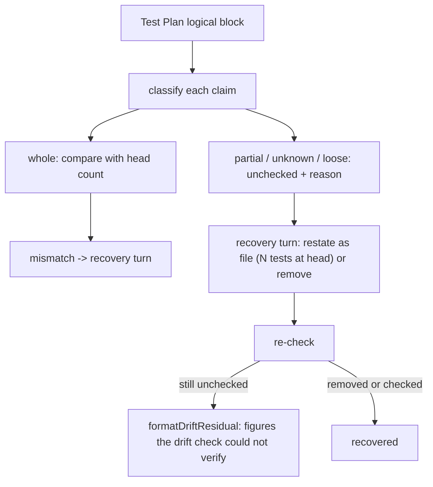

# PR Summary: review-fix drift check checks Test Plan figures per claim and asks for the rest (#3740)

## Summary

Closes #3740

- `scanTestPlan` (`worker/deno/lib/test_plan_recount.ts`) now applies the partial-addition and unknown-file skips **per claim**, not per block. Whole-file claims are compared with the head count even when a partial claim sits in the same bullet: "the new `<file>` (N tests", "`<file>` (N tests" with no "added"/"+" before it, and "now has N". Partial claims ("N tests added to `<file>`", "+N tests", "Added to `<file>` (N tests" with no "now has") are still reported unchecked, never passed.
- `runPrFeedbackDriftCheck` (`worker/deno/lib/pr_feedback_drift_check.ts`) passes every remaining unchecked figure and its reason to the review-fix recovery turn, fenced as untrusted text. The turn asks the agent to restate each one as "`<file>` (N tests at head)" or remove it. A figure still unchecked after recovery goes into `formatDriftResidual` under "Test Plan figures the drift check could not verify". The `logger.warn` stays.

## Spec

### Intent and Rationale

The #3143 drift check skipped a whole Test Plan block when one claim in it was a partial addition or named an unchanged file. A whole-file count in the same bullet was therefore never compared, and a stale total shipped. The two stale counts in pr-summary-3506 are examples. Skipped figures were also only logged, so the agent was never asked to fix them. This change narrows each skip to the claim it applies to and turns the leftovers into a recovery item.

### Essential Design Decisions

- **Claim roles.** Each claim in a logical block is `whole`, `partial`, `unknown` or `loose`. A single-claim block keeps its old skips. A multi-claim block compares its whole claims and reports every other claim unchecked with its own reason (`PARTIAL_REASON`, `UNKNOWN_CLAIM_REASON`, `LOOSE_REASON`).
- **Sentence-scope "Extended".** "Extended `a` (N tests)" governs every figure in its sentence, so those figures stay unchecked, unless the sentence also announces a new file. Without this rule the corpus replay produced a false positive on pr-summary-1823.
- **A bare "added" is not a partial marker.** `ADDED_FILE_TAIL_RE` strips a trailing "added" before the marker test, so "Added `file` (N tests)" announces a new file and is compared. Without this the replay produced a false negative on pr-summary-3395.
- **Recovery, not a block.** Unchecked figures join the existing one recovery turn. They never fail the run on their own, matching the #3381 rule that unchecked figures are reported, never passed.

### Undiscoverable Facts

- Corpus replay over the 1023 committed PR summaries changed 4 results. It removed 3 base false positives and added 2 true positives (pr-summary-3506's two stale counts). pr-summary-1823 went from 1 to 2 unchecked figures with its mismatches unchanged. It added 0 new false positives and has 0 known false negatives.
- The issue's fixture commit 6aecdbf9 is not in the shallow checkout, so the tests use the issue's quoted text.

## Evidence

- Backend-only change: no visual surface, so no screenshot.
- Issue numbers cited: #3143: Review-fix runs get no drift check: summary and docs rules (#3114, #3117, #3120) are prose only, and fix pushes still leave docs contradicting the head (VibeCoder#3134, #3095, #3132); #3244: Review-fix pushes still append to the PR summary and leave sentences the push made false, past the #3143 drift check (private-repo-A#2486, VibeCoder#3236); #3341: Review-fix pushes leave Branch outcomes path:line citations at the previous head: the drift check recounts tests but never re-checks cited lines (VibeCoder#3160, #3312); #3356: Markdown gates keep matching hard-wrapped prose one physical line at a time: each gate re-derives its own line joiner (VibeCoder#3085, #3157, #3312); #3381: Review-fix pushes that add tests leave the summary's red-on-base pass/fail figures at the earlier test file: the Test Plan recount never checks a base run (VibeCoder#3066, #3372); #3676: A healthy run that closes out a criterion as partial or missing still closes the issue with no follow-up (three private fleet PRs) (Issue #3506).
- Corpus replay: 1023 summaries, 4 changed, 3 false positives removed, 2 true positives added, 0 new false positives.

**Docs sweep** — grep: `scanTestPlan`, `could not verify`, `unchecked`, `partial addition`, `testPlanUnchecked`; section: "Test Plan recount" in `docs/workflows/pr-feedback.md`; siblings: `PARTIAL_REASON`, `testPlanMismatches`; updated: `docs/workflows/pr-feedback.md`, `docs/INTERNALS.md`, `prompts/pr_feedback/prompt.md`; docs/workflows/pr-feedback.md:178, docs/workflows/pr-feedback.md:413, docs/workflows/pr-feedback.md:426, docs/workflows/pr-feedback.md:578 — still true because they describe the mismatch path and the recount, which are unchanged; CODING-STANDARDS.md:998, CODING-STANDARDS.md:1027 — still true because they state the author's rule for figures, not the checker; DESIGN-PRINCIPLES.md:3078 — still true because it states the unchecked-is-not-passed principle this change keeps.

## Test Plan

- New `worker/deno/tests/test_plan_recount_partial_3740_test.ts` (13 tests at head): per-claim partial and unknown skips, the "now has N" total, the #3676 replay (stale totals give two mismatches, corrected totals none), the sentence-scope "Extended" rule, the bare-"added" rule, and growth guards.
- New `worker/deno/tests/pr_feedback_drift_check_3740_test.ts` (7 tests at head): recovery prompt fencing, residual rendering, recovered and still-unchecked paths, the warning count, and the clean path with no recovery turn.
- Edited expectation in `worker/deno/tests/test_plan_recount_wrap_3356_test.ts`, "wrapped partial additions are reported unchecked instead of silently skipped": it now expects 2 unchecked figures, both `PARTIAL_REASON`, instead of 1, because the issue requires "Whole-file counts written in the same bullet are skipped with it" to end and each claim to carry its own reason. Red check: forcing `governed=false` turned it red at `worker/deno/tests/test_plan_recount_wrap_3356_test.ts:259:6`.
- Fixture-only edits in `worker/deno/tests/pr_feedback_drift_check_3143_test.ts`, `worker/deno/tests/pr_feedback_drift_check_3244_test.ts` and `worker/deno/tests/pr_feedback_drift_check_3341_test.ts` keep their figures checkable, so those tests still reach the logic they assert on. `worker/deno/tests/branch_outcome_citations_facts_3396_test.ts`, `worker/deno/tests/pr_feedback_processor_drift_check_3143_test.ts` and `worker/deno/tests/pr_feedback_processor_mutation_check_3750_test.ts` drop the count from "Added `tests/rule_test.ts` (N tests)": a bare "Added" now announces a new file and is compared, and these fixtures' heads do not hold that count, so the drift check would otherwise start a recovery turn they do not expect. `worker/deno/tests/test_plan_recount_partial_3740_test.ts` is registered in `WALL_CLOCK_TEST_FILES` (`worker/deno/lib/parallel_unsafe_test_manifest.ts`) because it carries growth guards. The base branch's #3750 mutation-gate merge (952dd735) is included.
- Red checks: dropping `!multi &&` on the partial skip → 4 tests red; `TOTAL_RE` never matching → 3 red; disabling the single-claim skip → 2 red; dropping `!multi &&` on the unknown skip → 2 red; loose claims made ambiguous → red; `governed=false` → the 1823-shape test and the 3356 test red; dropping the new-file override → red; a bare "added" as a marker → red; each drift-check wiring revert (trigger, prompt argument, residual spread, fresh re-check, warning count, heading block, early-return condition) → red.
- Drift-check wiring red checks, by line in `worker/deno/tests/pr_feedback_drift_check_3740_test.ts`: dropping the `uncheckedFigures` handoff → red at :242; dropping the residual spread → red at :295 and :417; dropping the render heading block → red at :295 and :394; skipping the fresh re-check after recovery → red at :350.
- The growth test "hostile runs of the sentence-scope and added-tail checks grow linearly" cannot be made red by removing a cap, because the existing 200-character segment cap bounds the input before these checks run. It pins linear growth only.
- `deno.lock` unchanged.
- `./quality.sh < /dev/null`: exit 0, every check PASSED; config integration SKIPPED (no `.config.json` in the worktree). A first run failed markdownlint MD018 on a rewrapped `#3750)` line in `docs/workflows/pr-feedback.md`, fixed by rewrapping.

<!-- vibe-branch-outcomes -->
