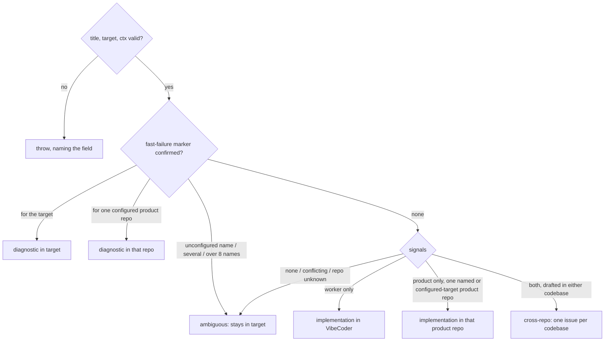

## Summary

Adds `classifyIssueRouting(draft, targetRepo, ctx)` in `worker/deno/lib/issue_routing_classifier.ts`, a pure function that decides which repository owns a draft issue and records why in four audit fields. It is tested from deterministic fixtures, four of which are the real #3607, #3630, GRQ-AutoTrader#3242 and GRQ-AutoTrader#3184 issues stored verbatim. Closes #3741.

## Spec

### Intent and Rationale

- #3691 needs one documented routing decision that can be tested without the network. This PR adds only that pure core. Filing, duplicate search and the CLI are sibling issues: not yet, #3742 and #3743 will call it.
- Signals are categorical (worker, product, named product repository) rather than scored, so every outcome can be traced to the rule and the text that fired it, and the `reason` names both.

### Essential Design Decisions

- The #2592 diagnostic rule runs first, so worker or product text in a fast-failure issue can never move it. A marker for another repository routes there only when that repository is a configured product repository (not VibeCoder), and the decision uses the configured spelling. The marker name comes from the untrusted draft body, so any other name (an unconfigured repository, VibeCoder, or a name that is not `owner/name`) counts as a conflict: the draft is `ambiguous` and stays in its target. A configured name has already passed the `owner/name` check, so matching one validates the marker name too.
- The product rule falls back to the target only when the target is a configured product repository other than VibeCoder. A product signal drafted against any other repository that names no product repository is `ambiguous` ("a product signal but no product repository").
- Marker detection calls the owner helpers `isRepoFastFailureIssue` and `isRepoFastFailureTallyIssue`. A loose scan only collects candidate names in whatever casing the body uses, so the comparison with the target can be case-insensitive while the helpers still confirm the exact marker. The tally sibling is needed because GRQ-AutoTrader#3184 carries only the tally marker.
- `ambiguous` always keeps the draft in its target (owner = subject = target), and its reason states the basis and "close nothing automatically". A missing title, target or context repository throws, naming the field, so there is no default owner.
- The worker vocabulary is limited to worker-specific paths and terms. Generic words such as "worker", "provider" and "container" also name product code (a service worker, a price provider, a Docker container), so they are not signals. Product words only count in prose, so the branch name `milestone/3127-web-pwa-refresh` in #3630 is not a product signal.

### Undiscoverable Facts

- GRQ-AutoTrader#3184's body carries `VIBE_REPO_FAST_FAILURE_TALLY:` and not the back-off marker. `isRepoFastFailureIssue` alone returns false for it, which `gh issue view 3184 --repo stSoftwareAU/GRQ-AutoTrader` confirms.
- #3607's body says "the Vibe Coder cannot transfer issues", and #3630's body contains "pwa" inside a branch name. A naive keyword rule therefore misroutes both real fixtures.

## Evidence

Backend-only change: a library module, its tests and fixtures. Nothing in the diff renders a UI.

- `deno task test:unit tests/issue_routing_classifier_test.ts` (from `worker/deno`): 20 passed, 0 failed.
- `./quality.sh < /dev/null`: `Result: PASSED (with skipped checks)`. Only `config integration` was SKIPPED.
- Mutation red-check: 36 hand-applied mutants of the classifier's branches and operands each turned the suite red. After the pre-PR verifier's findings, 5 more mutants of the new marker and product-target checks also turned it red (all listed in the facts file).
- Fixtures were fetched with `gh issue view <n> --json title,body` for VibeCoder#3607, #3630 and GRQ-AutoTrader#3242, #3184. The code depends on #3184's body holding `<!-- VIBE_REPO_FAST_FAILURE_TALLY:stSoftwareAU/GRQ-AutoTrader -->`.
- Issue numbers cited as provenance: #3741: Routing types and pure classifier with deterministic fixtures; #3691: Deterministic cross-repository issue routing and wrong-repo duplicate prevention; #2592: File repo fast-failure diagnostics in the monitored repo, not VibeCoder; #3607: PWA iPhone home-screen app: too big a gap above the header; #3630: Lane worktree creation wedges when the shared clone's HEAD dangles — heal it to the default branch; #3742: Duplicate search and write-permission check for issue routing; #3743: Routed issue filing orchestration with dry-run and audit marker.
- Public API exemption: `classifyIssueRouting`, `IssueKind`, `RoutingDecision`, `IssueRoutingDraft` and `IssueRoutingContext` have no production caller yet. The issue asks for them as the library API, and the open sibling #3743 will call them.

**Docs sweep** — grep: `classifyIssueRouting`, `isRepoFastFailureIssue`, `isRepoFastFailureTallyIssue`, `issue_routing`, `WALL_CLOCK_TEST_FILES`; section: none — no manual documents issue routing yet (#3749 will add it); siblings: `admin_only_finding_test`, `closure_verdict_test`, `top-up-3667` — no doc lists the wall-clock manifest or the top-up slices; updated: none; no hits in docs outside `docs/archive/`

## Acceptance Criteria

<!-- vibe-spec-review inputs="diff+issue-body" -->

- **met** — Fixture: the #3607 / GRQ-AutoTrader#3242 pair routes to `stSoftwareAU/GRQ-AutoTrader`, `issue_kind: implementation`. — evidence: `worker/deno/tests/issue_routing_classifier_test.ts::classifyIssueRouting - #3607 drafted in VibeCoder routes to GRQ-AutoTrader as implementation`, `::classifyIssueRouting - GRQ-AutoTrader#3242 stays in GRQ-AutoTrader as implementation` — reviewer: met
- **met** — Fixture: GRQ-AutoTrader#3184 routes to `stSoftwareAU/GRQ-AutoTrader`, `issue_kind: diagnostic`. #3630 routes to `stSoftwareAU/VibeCoder`, `issue_kind: implementation`. — evidence: `worker/deno/tests/issue_routing_classifier_test.ts::classifyIssueRouting - GRQ-AutoTrader#3184 tally issue stays in GRQ-AutoTrader as a diagnostic`, `::classifyIssueRouting - #3630 worker fix routes to VibeCoder as implementation` — reviewer: met
- **met** — Fixture: a GRQ-AutoTrader review finding about prompt or worker code routes to `stSoftwareAU/VibeCoder`. — evidence: `worker/deno/tests/issue_routing_classifier_test.ts::classifyIssueRouting - a GRQ-AutoTrader review finding about prompt code routes to VibeCoder`, `::classifyIssueRouting - a GRQ-AutoTrader review finding about worker wording routes to VibeCoder` — reviewer: partial — reason: the reviewer said both fixtures pass and called it partial only because bare generic words ("provider", "container") are not worker signals. That exclusion is deliberate, because those words also name product code; a finding that names worker or prompt code by path or worker term routes to VibeCoder.
- **met** — Fixture: a GRQ scoring bug routes to `stSoftwareAU/GRQ`. — evidence: `worker/deno/tests/issue_routing_classifier_test.ts::classifyIssueRouting - a GRQ scoring bug routes to GRQ wherever it is drafted` — reviewer: met
- **met** — A #2592 diagnostic is never reported as belonging to another repository. — evidence: `worker/deno/tests/issue_routing_classifier_test.ts::classifyIssueRouting - a #2592 diagnostic is never reported as belonging to another repository` — reviewer: met
- **met** — An ambiguous draft returns `issue_kind: ambiguous` with a non-empty `reason`. — evidence: `worker/deno/tests/issue_routing_classifier_test.ts::classifyIssueRouting - ambiguous drafts stay in their target with the basis stated` — reviewer: met
- **met** — Every decision fills in all four audit fields. — evidence: `worker/deno/tests/issue_routing_classifier_test.ts::classifyIssueRouting - every decision fills in all four audit fields`, and the `route()` helper checks this on every call — reviewer: met
- **met** — Tests and quality checks pass. — evidence: `./quality.sh < /dev/null` → `Result: PASSED (with skipped checks)` on the final code — reviewer: missing — reason: the reviewer worked from the diff alone and said "not verifiable from the diff"; the gate was run here and passed
- **unrequested** — tally-marker detection via `isRepoFastFailureTallyIssue` — reviewer: unrequested — reason: required by the #3184 fixture criterion, because #3184 carries only the tally marker
- **unrequested** — `MAX_MARKER_CANDIDATES = 8` cap that makes a body with more than 8 marker names ambiguous — reviewer: unrequested — reason: bounds the per-candidate body scan on untrusted text and fails closed to `ambiguous`
- **unrequested** — `owner/name` validation of the target and context repositories — reviewer: unrequested — reason: input validation at the trust boundary; the Failure Detection section asks for missing fields to throw by name
- **unrequested** — markers for several repositories return `ambiguous` — reviewer: unrequested — reason: a direct case of "signals conflict → ambiguous"
- **unrequested** — a marker naming anything other than the target or a configured product repository returns `ambiguous`, and the product rule uses the target only when it is a configured product repository — reviewer: not reviewed (added after the review, to fix the pre-PR verifier's two blocking findings) — reason: the marker name comes from untrusted text, and the module doc (rules 1 and 3) promises both checks
- **unrequested** — the `cross-repo` rule (worker and product signals in a draft for either codebase) — reviewer: unrequested — reason: the issue defines the `cross-repo` kind, and this is the only rule that produces it
- **unrequested** — hostile-input growth test for every pattern — reviewer: unrequested — reason: CODING-STANDARDS requires one hostile case per regex run on untrusted text
- **unrequested** — tests "VibeCoder is never counted as a product repository" and "a marker prefix quoted in prose is not a diagnostic" — reviewer: unrequested — reason: each pins a guard in the diff, and each guard turned the suite red when it was removed

## Standards Review

<!-- vibe-standards-review inputs="diff+CODING-STANDARDS.md" -->

- **clean** — regexes on untrusted text each have a hostile case (review-enforced, "Vet every regex on untrusted text"); named tests exist (review-enforced); the code reuses the owner helpers instead of copying them; the `SIMPLE-ON-PURPOSE` format is correct; fail-loud throws name the field; tests are hermetic (no `/tmp`, env, clock or network) and assume no git history; no workflow files; Australian English; no assertion removed from and no expectation changed in any existing test. Optional note: the public API has no production caller yet. It is exempt as the issue's requested API (see Evidence).

## Test Plan

- Added `worker/deno/tests/issue_routing_classifier_test.ts` (20 tests) and the fixtures `worker/deno/tests/fixtures/issue_routing/{vibecoder_3607,vibecoder_3630,grq_autotrader_3242,grq_autotrader_3184}.json`.
- The pre-PR verifier's two findings are covered by new cases in `::ambiguous drafts stay in their target with the basis stated`: a product signal drafted against `other/unlisted`, and markers for `attacker/elsewhere`, for VibeCoder, for `not-a-repo`, and for a product repository plus an unconfigured one. `::VibeCoder is never counted as a product repository` now also covers a context that lists VibeCoder as a product: VibeCoder is neither a product target nor a marker's monitored repository. Before the fix, the old code routed the `other/unlisted`, `attacker/elsewhere`, VibeCoder and `not-a-repo` cases out of `ambiguous`. The mixed-marker case was already `ambiguous`, so it is a positive control.
- Registered the new module in `docs/audits/lib-sweep-coverage/top-up-3741.json` and the growth test in `WALL_CLOCK_TEST_FILES` (`worker/deno/lib/parallel_unsafe_test_manifest.ts`), as `tests/lib_sweep_coverage_test.ts` and `tests/parallel_unsafe_test_manifest_test.ts` require. Both pass under `deno task check:manifests`.
- `deno task test:unit tests/issue_routing_classifier_test.ts`: 20 passed. `./quality.sh`: PASSED (with skipped checks).
- Red-checks: each new test was run against mutants of the code it guards and went red (36 mutants, 0 survivors). The "eight are checked" half of the cap test is a positive control; the nine-name half is the guard.
- No existing test was edited. No existing assertion was removed.

<!-- vibe-branch-outcomes -->

🤖 Generated with [Claude Code](https://claude.com/claude-code)
