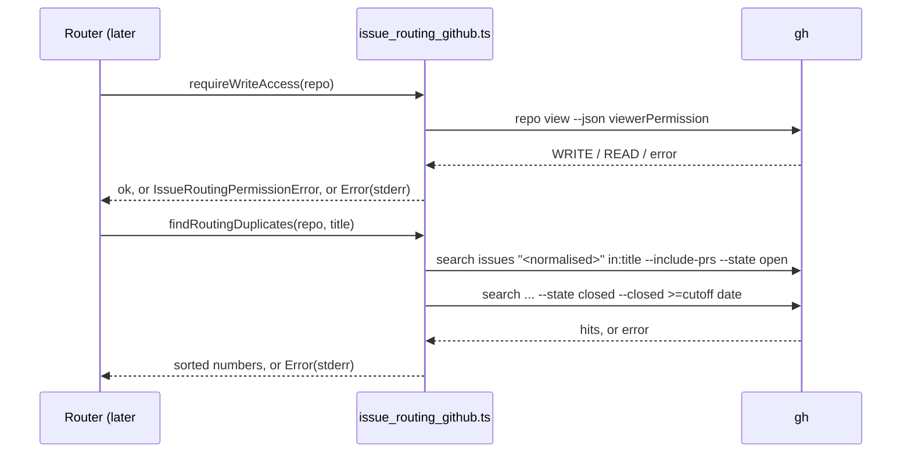

## Summary

Adds the GitHub context layer the issue router needs, in `worker/deno/lib/issue_routing_github.ts`. `findRoutingDuplicates(repo, title)` returns the numbers of matching duplicates, sorted ascending. It searches open issues and PRs, plus issues and PRs closed in the last 30 days, and matches on the normalised title. `requireWriteAccess(repo)` throws a typed `IssueRoutingPermissionError` naming the repository and the permission it observed. Both accept an injected `ghCommandFn`, so the tests make no network calls. Any `gh` failure throws with gh's stderr in the message. Closes #3742.

## Spec

### Intent and Rationale

- Before filing, the router must know whether a copy already exists and whether it may write to the owner repository. Both questions need GitHub, so they live apart from the pure #3741 classifier.
- Two `gh search issues --include-prs` calls (open, then closed with `--closed >=<date>`) cover issues and PRs in one search path. Merged PRs count as closed.
- A search finds candidates; the duplicate decision itself is an exact match on `normaliseRoutingTitle`, applied client-side.

### Essential Design Decisions

- Fail loud, never "no duplicates". A gh error, unparseable or malformed output, a closed hit with no `closedAt`, or a full 100-result page each throw. None returns a partial or empty list.
- The query is the normalised title (letters, digits and single spaces only) in quotes plus `in:title`. A draft title cannot inject search qualifiers.
- The 30-day window is applied to the millisecond client-side, because the `--closed` qualifier only filters by day.
- Only `ADMIN`, `MAINTAIN` and `WRITE` pass. A null `viewerPermission` is reported as `none`. A failure of the check itself is a plain `Error`, never a permission refusal.

### Undiscoverable Facts

- Observed: `gh search issues ... --state closed` returns merged PRs with `"state":"merged"`. A quoted phrase search matched the punctuated title `feat(routing): pure issue-routing classifier ... (#3741)` from its words alone.
- Observed: `gh repo view <repo> --json viewerPermission` returned `{"viewerPermission":"WRITE"}` for this repository and `"READ"` for `cli/cli`. Not observed: what a GitHub App installation token returns. If it is null, the check fails closed as `none`.
- No production caller exists yet. The router that calls these functions is later #3691 work.

## Evidence

Backend-only change; the evidence is the test suite. `gh` behaviour the fake is built from, observed with the real CLI:

- `gh search issues '"pure issue-routing classifier" in:title' --repo stSoftwareAU/VibeCoder --include-prs --state closed --json number,title,state,closedAt,isPullRequest` → `[{"closedAt":"2026-10-14T23:56:03Z","isPullRequest":true,"number":3762,"state":"merged",...}]`
- `gh search issues 'x' --repo stSoftwareAU/NoSuchRepoZZ --include-prs` → exit 1, `Invalid search query "( x ) repo:stSoftwareAU/NoSuchRepoZZ".` then `The listed users and repositories cannot be searched either because the resources do not exist or you do not have permission to view them.` The code carries gh's whole stderr, so both lines, including the cause on the second, reach the thrown message.
- `gh repo view stSoftwareAU/NoSuchRepoZZ --json viewerPermission` → exit 1, `GraphQL: Could not resolve to a Repository with the name 'stSoftwareAU/NoSuchRepoZZ'. (repository)`

The test fake models those rules over an in-memory store. It handles quoted-phrase-in-title matching on tokenised words, PR exclusion without `--include-prs`, open and closed state (merged counts as closed), the day-granular `--closed >=D`, `--limit`, and field projection. It rejects unknown flags and malformed queries. The tests assert the decision (the returned numbers, a rejection, whether a create was attempted), not the request text.

**Docs sweep** — grep: `findRoutingDuplicates`, `requireWriteAccess`, `IssueRoutingPermissionError`, "issue routing", "issue-routing"; section: none — no manual documents the issue-routing modules yet; siblings: `tests/issue_routing_classifier_test.ts` (the `WALL_CLOCK_TEST_FILES` list, which now names the new test), `top-up-3741` (the sweep-ledger top-ups, joined by `top-up-3742.json`); updated: none; `docs/INTERNALS.md:3740` — still true because it describes the clarity-assessment migration, not this module.

## Acceptance Criteria

<!-- vibe-spec-review inputs="diff+issue-body" -->

- **met** — An issue closed within the last 30 days is returned as a duplicate. — evidence: `worker/deno/tests/issue_routing_github_test.ts::issue_routing_github - an issue closed 10 days ago is returned` — reviewer: met
- **met** — An issue closed more than 30 days ago is ignored. — evidence: `worker/deno/tests/issue_routing_github_test.ts::issue_routing_github - an issue closed 40 days ago is ignored`, `::issue_routing_github - the 30-day cutoff is exact to the millisecond` — reviewer: met
- **met** — A PR with a matching title is returned. — evidence: `worker/deno/tests/issue_routing_github_test.ts::issue_routing_github - a matching PR is returned, open or merged` — reviewer: met
- **met** — Read-only access throws `IssueRoutingPermissionError` before any write call. — evidence: `worker/deno/tests/issue_routing_github_test.ts::issue_routing_github - read-only access attempts no issue create, write access does`, `::issue_routing_github - READ and TRIAGE are refused with IssueRoutingPermissionError` — reviewer: met
- **met** — A `gh` failure is surfaced with the stderr line that names its cause. It never becomes "no duplicates". — evidence: `worker/deno/tests/issue_routing_github_test.ts::issue_routing_github - a search in a repository that does not exist rejects`, `::issue_routing_github - a failed closed search rejects even though the open search matched`, `::issue_routing_github - a repository that does not exist fails the check with a plain Error` — reviewer: met
- **met** — Tests and quality checks pass. — evidence: `deno test -A tests/issue_routing_github_test.ts` (24 passed) and `./quality.sh` on the final head — reviewer: partial — reason: the reviewer could not run the tests or the gate ("partial (unverifiable)"); both were run here and passed
- **unrequested** — fail-closed parsing: the 100-result limit, response-shape validation and the `closedAt` check — reviewer: unrequested — reason: they apply the issue's "never becomes no duplicates" rule to truncated or malformed output, which would otherwise read as fewer duplicates
- **unrequested** — repository-slug and empty-title guards, and quoting of the normalised query — reviewer: unrequested — reason: input validation at the trust boundary; a draft title is untrusted text going into a search query
- **unrequested** — the permission set (`ADMIN`, `MAINTAIN` and `WRITE` pass; `TRIAGE` is refused) — reviewer: unrequested — reason: these are GitHub's roles that can file and label issues, so "write access" needs a defined set
- **unrequested** — `docs/audits/lib-sweep-coverage/top-up-3742.json`, the `WALL_CLOCK_TEST_FILES` entry, and the hostile-input growth test on the exported `normaliseRoutingTitle` — reviewer: unrequested — reason: repository process. A new lib module joins the sweep ledger as #3741's did, and a regex over untrusted text gets a hostile case, measured with a wall-clock growth test that must be registered in the manifest

## Standards Review

<!-- vibe-standards-review inputs="diff+CODING-STANDARDS.md" -->

- **violation** — "Fake the external service, do not assert the request": the tests asserted the query text, `--closed`, `--include-prs` and exact args — evidence: `worker/deno/tests/issue_routing_github_test.ts:101` — reason: fixed in this diff (the fake now models gh's search and permission rules, and the tests assert decisions)
- **violation** — a stub mirrors the real callee's contract: the gh fake answered any query and ignored its flags — evidence: `worker/deno/tests/issue_routing_github_test.ts:40` — reason: fixed in this diff (the fake is built from the observed gh output listed under Evidence)
- **violation** — "Nothing exists only for a test to read": new exports with no production reader — evidence: `worker/deno/lib/issue_routing_github.ts:142` — reason: fixed in this diff. The two constants are no longer exported. `findRoutingDuplicates`, `requireWriteAccess`, `IssueRoutingPermissionError` and the `ghCommandFn` seam (`GhCommandFn`, `IssueRoutingGithubDeps`) are the public API the issue asks for, and the router consumes them in later #3691 work
- **clean** — fail loud, failure reasons carry the cause, refusal tests name their rule, negative tests with positive controls, injected clock and gh, no host state, no `/tmp` use, Australian English, no source-grep tests, and no removed or edited assertions in existing tests. Review-enforced rules checked: "Nothing exists only for a test to read", "Fake the external service", "A named test must exist", "A failure-reason test asserts the cause", "A refusal test must be refused by the rule it names", "A negative test must be able to fail". Two of the reviewer's findings were not departures. First, the manifest entry `tests/issue_routing_github_test.ts` uses the manifest's own `worker/deno`-relative format, like every sibling entry; it is not a test named in this summary. Second, `normaliseRoutingTitle` stays exported because the synchronous growth helper must call the regex directly for the hostile-input case.

## Test Plan

- Added `worker/deno/tests/issue_routing_github_test.ts` (24 tests): store-driven duplicate search, fail-closed malformed output, permission check, and a hostile-input growth test on the title normaliser.
- No existing test was edited, and no assertion was removed. `worker/deno/lib/parallel_unsafe_test_manifest.ts` gains one entry.
- Red checks (one flip at a time, then restored): the millisecond cutoff, `--include-prs`, the search catch returning `[]`, `READ` allowed, the limit check, a null `closedAt` accepted, the raw title in the query, the closed search dropped, and each guard listed in the branch outcomes below. Each turned at least one named test red.
- Fake built from observed gh output (see Evidence). The production implementation it stands in for is `runGhCommand` in `worker/deno/lib/github.ts`, which throws `gh command failed (exit N): <stderr>` on failure.
- `deno test -A tests/issue_routing_github_test.ts tests/lib_sweep_top_up_files_test.ts tests/lib_sweep_coverage_test.ts tests/parallel_unsafe_test_manifest_test.ts` (from `worker/deno`): passed.
- `./quality.sh`: the result line is added after the final run on the head.

<!-- vibe-branch-outcomes -->

🤖 Generated with [Claude Code](https://claude.com/claude-code)
