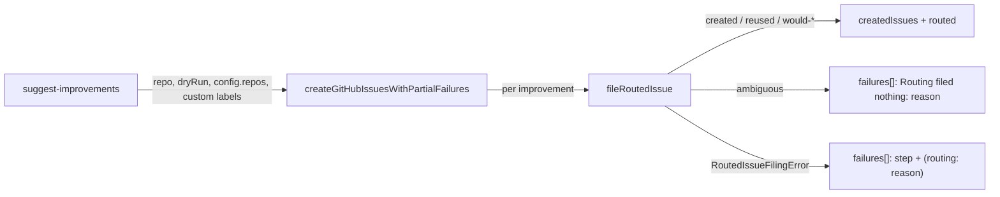

## Summary

`suggest-improvements` now files every improvement through the issue router. `createGitHubIssuesWithPartialFailures` (`worker/deno/lib/github.ts`) calls `fileRoutedIssue` (#3743) for each one, where it used to call `gh issue create` directly. An improvement that belongs to another repository is filed there. An improvement whose owner is ambiguous is not filed; it goes into `failures[]` with the routing reason. A routing error is also reported in `failures[]`, naming the failed step and, once classify has run, the routing reason. The command passes `dryRun` through, so `--dry-run --repo X` runs the router's read-only steps and reports what it would file. Closes #3745.

## Spec

### Intent and Rationale

- `suggest-improvements` filed into whatever `--repo` it was given. Routing each draft through `fileRoutedIssue` gives it the same classifier, duplicate search, permission check and audit marker as every routed filing (#3691, ask A6).
- `RoutedIssueFilingError` gains a `decision` field, so a failure after classify can carry the routing reason into `failures[]` without classifying twice.

### Essential Design Decisions

- `github.ts` loads `issue_routing_filing.ts` with a dynamic `import()` inside the function. A static import closes the cycle github.ts → issue_routing_filing.ts → issue_routing_classifier.ts → repo_fast_failure_issue.ts → needs_human_escalation.ts → label_operations.ts → github.ts. That cycle left `REPO_FAST_FAILURE_TALLY_MARKER_PREFIX` uninitialised and broke `tests/repo_fast_failure_issue_test.ts` and `tests/repo_fast_failure_tracker_test.ts` in the gate.
- `CreateIssuesResult` keeps `createdIssues` and `failures` unchanged. It gains `routed`, which records where each non-failed improvement was filed, reused or would be filed, because a number in `createdIssues` may now belong to another repository and a dry run creates nothing.
- The reserved-label pre-filter stays in `github.ts`, with the `<repo> suggest-improvements` warning context and the `customLabelPromptLabels(config)` labels. The router re-filters built-in reserved labels on its own.
- The command's routing context is `vibeCoderRepo: "stSoftwareAU/VibeCoder"` (`WORKER_REPO`) and `productRepos: config.repos`.

### Undiscoverable Facts

- Under config-optional startup, `mod.ts` builds a minimal config whose `repos` is `[]`. In that case a product-signal improvement routes as ambiguous and is reported as a failure. The generated suggestions all carry worker signals, so they route to VibeCoder.
- A `gh issue create` whose output has no issue URL is now a `create`-step failure. Before this change it was silently skipped.

## Evidence

Backend/CLI change; no UI file touched. Verified by the unit tests below.

- Production implementation behind the test fake: `worker/deno/tests/support/routing_fake_gh.ts` stands in for real `gh`, through `runGhCommand`. The change relies on the fake answering `search issues`, `repo view --json viewerPermission` and `issue create` in the shapes `findRoutingDuplicates` and `requireWriteAccess` parse in `worker/deno/lib/issue_routing_github.ts`. #3742/#3743 already built and use that fake; this PR does not change it.
- Issue numbers the diff cites: #3745: Route suggest-improvements issue filing through the issue router; #847: security: apply the operational-dispatch trust gate to custom labels; #3743: Routed issue filing orchestration with dry-run and audit marker. `Issue #2825` is carried over from the base comment above the reserved-label pre-filter.

**Docs sweep** — grep: `createGitHubIssuesWithPartialFailures`, `suggest-improvements`, `suggest_improvements`, `CreateIssuesResult`, `RoutedIssueFilingError`, "dry-run", "do not create issues"; section: none — no manual documents suggest-improvements filing or its dry-run (the only `docs/` hit is a diagram node); siblings: `createdIssues`, `failures` — every list of `CreateIssuesResult` fields is in `worker/deno/lib/github.ts` and names `routed`; updated: `worker/deno/commands/suggest_improvements.ts` (module doc), `worker/deno/lib/command_args.ts` (`SuggestImprovementsArgs.dryRun` doc), `worker/deno/lib/github.ts` (function and result docs), `worker/deno/lib/issue_routing_filing.ts` (`@throws` doc); `docs/EXTENDING.md:34` — still true because it only names the module; `worker/deno/lib/issue_routing_github.ts:8` — still true because `createGitHubIssuesWithPartialFailures` still takes injected `ghCommandFn` and `now`.

## Acceptance Criteria

<!-- vibe-spec-review inputs="diff+issue-body" -->

- **met** — An improvement that belongs to another repository is filed there, or reported as ambiguous. It is never filed in the wrong repository. — evidence: `worker/deno/tests/suggest_improvements_test.ts::suggest-improvements - a worker improvement drafted against GRQ is filed in VibeCoder (Issue #3745)`, `::suggest-improvements - an ambiguous improvement files nothing and is reported as a failure (Issue #3745)` — reviewer: met
- **met** — Each entry in `failures[]` carries the routing reason. — evidence: `worker/deno/tests/suggest_improvements_test.ts::suggest-improvements - a routing error is reported in failures[] with its step and routing reason, not dropped (Issue #3745)`, `::suggest-improvements - a classify failure is reported with its step and no routing reason (Issue #3745)` — reviewer: met — reason: the reviewer noted that ambiguous entries ("Routing filed nothing: …") and thrown errors ("(routing: …)") label the reason differently; both carry it. A classify failure has no decision yet, so it carries the classify-step error.
- **met** — Existing `worker/deno/tests/suggest_improvements_test.ts` tests still pass. — evidence: `deno task test:unit tests/suggest_improvements_test.ts` passes on the final head — reviewer: partial — reason: the reviewer flagged that "command includes repo in args when provided" now runs through `createSuggestImprovementsCommand` with a fake `gh`. Its two assertions are unchanged; the setup changed because a dry run with a repo now reaches the router, as the issue's dryRun pass-through requires.
- **met** — Tests and quality checks pass. — evidence: `./quality.sh` run on the final head (see Test Plan) — reviewer: missing — reason: the reviewer saw only the diff and could not run the gate; it was run here.
- **unrequested** — `createSuggestImprovementsCommand` factory and `SuggestImprovementsDeps` — reviewer: unrequested — reason: the dry run with a repo now calls `gh`, so the command needs an injected `gh` for tests to stay off the network; production uses the defaults.
- **unrequested** — `CreateIssuesResult.routed`, `RoutedImprovement`, and the rewritten success and dry-run messages — reviewer: unrequested — reason: without them a dry run reports nothing, and a cross-repo issue number would be reported as filed "in <repo>".
- **unrequested** — `RoutedIssueFilingError.decision` and the `step()` parameter in `issue_routing_filing.ts`, with its test — reviewer: unrequested — reason: this is how a post-classify failure carries the routing reason (criterion 2).
- **unrequested** — `createGitHubIssuesWithPartialFailures` takes a `CreateIssuesOptions` object in place of positional arguments — reviewer: unrequested — reason: it now needs a routing context, a dryRun flag and a clock as well, and every caller was updated anyway.
- **unrequested** — `productRepos: config.repos` wiring and `plural` exported from `lib/codebase_map.ts` — reviewer: unrequested — reason: the router needs product repositories, and the monitored repos are the ones configured. `plural` is reused for the new message instead of being copied.

## Standards Review

<!-- vibe-standards-review inputs="diff+CODING-STANDARDS.md" -->

- **violation** — Over-engineering: `countOf` copied the private `plural` helper — evidence: `worker/deno/commands/suggest_improvements.ts:194` — reason: fixed in this diff; `plural` is now exported from `worker/deno/lib/codebase_map.ts` and called
- **violation** — An edited expectation stayed green without its guard: "handles non-Error throws" never reached the `String(error)` arm of `describeRoutingFailure`, and no test reached its non-routing-error arm — evidence: `worker/deno/tests/github_test.ts:519`, `worker/deno/lib/github.ts:646` — reason: fixed in this diff; added "an error thrown outside the router is reported with its own message" and "a non-Error thrown outside the router is reported as text", each red-checked against its arm
- **clean** — Never Fail Silently (a missing create URL, ambiguous owner and routing errors are all failures, and `success` is false); Nothing exists only for a test to read; Every changed call site; A named test must exist; existing tests still reach their logic; Australian English. Review-enforced rules checked: Avoid over-engineering (call the existing owner), Australian English, Check where you insert.

## Test Plan

- `deno task test:unit tests/suggest_improvements_test.ts tests/github_test.ts tests/github_retry_test.ts tests/issue_routing_filing_test.ts tests/command_args_test.ts tests/codebase_map_test.ts tests/repo_fast_failure_issue_test.ts tests/repo_fast_failure_tracker_test.ts tests/vibe_env_registry_test.ts < /dev/null`, run from `worker/deno`: passed (`ok | 236 passed | 0 failed | 1 ignored`)
- `./quality.sh < /dev/null` on the final head: passed on head `2366265c` (`Result: PASSED (with skipped checks)`; only `config integration` was skipped, because there is no `.config.json` in the checkout)
- New tests in `worker/deno/tests/suggest_improvements_test.ts`, all named `… (Issue #3745)` except where noted: worker improvement drafted against GRQ filed in VibeCoder; ambiguous improvement files nothing; routing error reported with step and routing reason (the issue's Failure Detection case; red when the catch's failure push, or the `(routing:` suffix, is removed); classify failure without routing reason; error and non-Error thrown outside the router; existing issue reused; dry run with a repo makes no write call; real run files every suggestion in VibeCoder; configured custom label never self-applied (Issue #847); real run with failures; summary counts and plurals; command routes against the configured repos; injected clock sets the duplicate-search window. In `worker/deno/tests/issue_routing_filing_test.ts`: "fileRoutedIssue - a failed step carries the routing decision, or null when classify failed".
- Each changed call site was red-checked in a scratch copy outside the checkout by reverting only that caller's change:
  - command `dryRun` → false: red.
  - command `extraReservedLabels` → `[]`: red.
  - command `productRepos` → `[]`: red.
  - command `now` → `undefined`: red.
  - github `dryRun`, `ghCommandFn`, `now`, `context`, `targetRepo` and the pre-filtered labels: each red.
  - `issue_routing_filing` `step()` decision → null: red.
- Existing assertions removed or changed. Each was red-checked by deleting the catch's failure push, and each went red:
  - `assertEquals(result.createdIssues, [1, 3]);` in `worker/deno/tests/github_retry_test.ts` ("continues after failure") is now `[1, 2]`. The routing fake numbers issues per repository, and the failed create no longer consumes a number.
  - `assertEquals(result.failures[0]!.error, "HTTP 500 Internal Server Error");` in the same test is now `assertStringIncludes` for that text plus `step "create"`. The issue requires the routing step and reason in the error.
  - `assertEquals(result.failures.length, 0);` in `worker/deno/tests/github_test.ts` ("handles output without issue number") is now `1` with `step "create"`. Through the router, a create with no issue URL fails loudly; this follows from replacing the direct `issue create` with `fileRoutedIssue`.
  - `assertEquals(result.failures[0]!.error, "string error message");` in `worker/deno/tests/github_test.ts` ("handles non-Error throws") is now `assertStringIncludes`. The router wraps the error with its step.
  - `assertEquals(data.repo, "stSoftwareAU/VibeCoder");` in `worker/deno/tests/suggest_improvements_test.ts` is now `assertEquals(data.repo, VIBE)`, the same value. Red when the command's `repo` field is mutated.
- A precondition the command now adds: with a repo, a dry run calls `gh`. `command_args_test.ts` "suggest-improvements handles valid dry-run" and the two dry-run tests in `suggest_improvements_test.ts` pass no repo, so they still return before any `gh` call.

<!-- vibe-branch-outcomes -->
