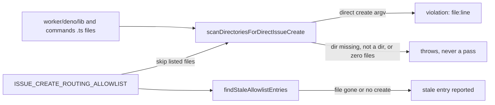

## Summary

Adds a gate that fails when a direct `gh issue create` argv appears in
`worker/deno/lib` or `worker/deno/commands` without going through
`fileRoutedIssue` (#3743) or an entry on a reasoned allowlist. The allowlist is
`ISSUE_CREATE_ROUTING_ALLOWLIST` in
`worker/deno/lib/issue_create_routing_check.ts` (line 51). It is seeded with the
30 files that build a create argv today, each with a one-line reason. No call
site is migrated. Part of #3691, builds on #3743. Closes #3746.

## Spec

### Intent and Rationale

- Several worker modules still build a `gh issue create` argv by hand, for
  example `worker/deno/lib/idle_starvation_escalation.ts`,
  `worker/deno/lib/audit_failure_notifier.ts` and
  `worker/deno/lib/repo_fast_failure_issue.ts`. Each new one would be a filing
  path that skips the router's classifier, duplicate search and permission check
  (#3691, ask A6).
- The gate records every existing direct site with a reason, so the exceptions
  are explicit and reviewable. Migrating them is separate work.
- The gate follows `worker/deno/lib/issue_create_label_check.ts`, which guards
  `--label` arguments on the same argv.

### Essential Design Decisions

- The allowlist is per file, not per call site. A new direct create in a file
  that is already allowlisted passes (see Undiscoverable Facts).
- The check fails closed. A missing scan directory throws
  (`worker/deno/lib/issue_create_routing_check.ts:311`), a scan path that is not
  a directory throws (`:318`), and a scan that examines zero `.ts` files throws
  (`:358`). A stat error other than NotFound is rethrown (`:315`).
- One quote-aware pass (`COMMENT_OR_STRING_PATTERN`, `:204`) blanks `//` and
  block comments and keeps string literals. A `//` or `/*` inside a string
  therefore neither hides a create nor invents one.
- `findStaleAllowlistEntries` (`:380`) reports an allowlisted file that is gone
  or no longer holds a direct create. This is not in the issue. It stops the
  allowlist drifting once a call site is migrated, and its read errors other
  than NotFound are rethrown (`:396`).
- The enforcement point is the real-tree scan in the unit test
  `worker/deno/tests/issue_create_routing_check_test.ts`. The gate is not wired
  into `quality_gate.ts`, which matches the sibling
  `issue_create_label_check.ts`.
- `scanContentForDirectIssueCreate`, `scanDirectoriesForDirectIssueCreate`,
  `findStaleAllowlistEntries` and `formatIssueCreateRoutingViolations` are
  exported for the tests. Scanning and reporting file and line is the API the
  issue asks for. The `filesScanned` field of the scan result is the contract
  the real-tree test asserts, so a silently broken directory walk shows up as a
  count of zero.
- `worker/deno/lib/issue_routing_filing.ts` gets a paragraph at lines 29-32 that
  points to this gate, so a reader of the chokepoint sees where the other direct
  sites are checked. The chokepoint is itself on the allowlist
  (`issue_routing_filing.ts` entry, line 118), because its direct call is the
  one `fileRoutedIssue` makes.

### Undiscoverable Facts

- Known limit: the allowlist is per file. A second direct create added to an
  already-allowlisted file is not flagged.
- Known limit: the comment and string stripper ends a string literal at the end
  of its line. A multi-line template literal is not tracked as one literal, so
  the lines inside it are scanned as code.
- Several reasons say the file files into the worker's own repository by design
  (for example `idle_starvation_escalation.ts`, `milestone_gate_wedge.ts`,
  `provider_outage_alert.ts`). Those targets are fixed on purpose and are not a
  routing miss.
- `docs/audits/lib-sweep-coverage/top-up-3746.json` records the new lib module
  in the sweep ledger. `check:manifests` requires it.

## Evidence

Tooling change; no UI file touched. Verified by the unit tests below.

**Docs sweep** — grep: `issue_create_routing_check`,
`ISSUE_CREATE_ROUTING_ALLOWLIST`, `fileRoutedIssue`, `direct` `gh issue create`;
section: none — `docs/ISSUE-ROUTING.md` does not exist, and no non-archive `.md`
file mentions `fileRoutedIssue`; siblings: `"issue_create_label_check"`,
`"CREATE_LABEL_ALLOWLIST"` — the sibling's allowlist is `CREATE_LABEL_ALLOWLIST`
in `worker/deno/lib/issue_create_label_check.ts:67`, and the label-check
documentation covers labels only; updated:
`worker/deno/lib/issue_routing_filing.ts` (module doc, lines 29-32);
`docs/AGENT-ACCOUNTABILITY.md:825-836` and
`worker/deno/lib/guarded_issue_labels.ts:10-17` — still true because they
describe the label guard only.

## Acceptance Criteria

<!-- vibe-spec-review inputs="diff+issue-body" -->

- **met** — A fixture with a new direct `issue create` call fails the check, and
  the message names the file and line. — evidence:
  `worker/deno/tests/issue_create_routing_check_test.ts::issue_create_routing_check - directory scan reports unlisted offenders only`
  (asserts `file` and `line`); the message is rendered by
  `formatIssueCreateRoutingViolations`
  (`worker/deno/lib/issue_create_routing_check.ts:413`) — reviewer: met
- **met** — The scan over the real `worker/deno/lib` and `worker/deno/commands`
  trees passes with the seeded allowlist. — evidence:
  `worker/deno/tests/issue_create_routing_check_test.ts::issue_create_routing_check - real tree has no unlisted direct create call site`,
  `::issue_create_routing_check - real allowlist has no stale entries` —
  reviewer: met
- **met** — Every allowlist entry carries a non-empty reason. — evidence:
  `worker/deno/tests/issue_create_routing_check_test.ts::issue_create_routing_check - allowlist entries are documented and specific`
  — reviewer: met
- **met** — Tests and quality checks pass. — evidence:
  `deno task test:unit tests/issue_create_routing_check_test.ts` (17 tests, see
  Test Plan); `./quality.sh` was run earlier on this branch and passed, and a
  re-run on the final head is in progress — reviewer: partial — reason: the
  quality gate's result on the final head is not recorded in this summary.
- **met** — Failure Detection: the test goes red when an unlisted direct call
  site appears. — evidence:
  `worker/deno/tests/issue_create_routing_check_test.ts::issue_create_routing_check - real tree has no unlisted direct create call site`,
  `::issue_create_routing_check - directory scan reports unlisted offenders only`
  — reviewer: met
- **met** — Failure Detection: the test goes red when a scanned directory is
  missing, so an empty scan never passes. — evidence:
  `worker/deno/tests/issue_create_routing_check_test.ts::issue_create_routing_check - fails closed on a missing scan directory`,
  `::issue_create_routing_check - fails closed when no .ts file is scanned` —
  reviewer: met
- **unrequested** — `findStaleAllowlistEntries`
  (`worker/deno/lib/issue_create_routing_check.ts:380`) and its tests. —
  reviewer: unrequested — reason: keeps the allowlist honest after a call site
  is migrated; without it an entry outlives the call site it describes.
- **unrequested** — `docs/audits/lib-sweep-coverage/top-up-3746.json`. —
  reviewer: unrequested — reason: repository process; `check:manifests` requires
  the new lib module to be recorded in the sweep ledger.
- **unrequested** — the paragraph in `worker/deno/lib/issue_routing_filing.ts`
  (lines 29-32) that points to this gate. — reviewer: unrequested — reason: the
  chokepoint's own documentation should say where the other direct create sites
  are gated.

## Standards Review

<!-- vibe-standards-review inputs="diff+CODING-STANDARDS.md" -->

- **violation** — the module doc named the wrong test path — evidence:
  `worker/deno/lib/issue_create_routing_check.ts:12` — reason: fixed in this
  diff; the doc now names
  `worker/deno/tests/issue_create_routing_check_test.ts`.
- **violation** — the non-NotFound rethrows had no test — evidence:
  `worker/deno/lib/issue_create_routing_check.ts:315` and `:396` — reason: fixed
  in this diff; added "rethrows a non-missing stat error on a scan directory"
  and "stale audit rethrows a non-missing read error".
- **violation** — a `//` inside a string was treated as a line comment —
  evidence: `worker/deno/lib/issue_create_routing_check.ts:204` — reason: fixed
  by the single quote-aware pass; "detects every direct create form" covers the
  url-string-before-argv case.
- **violation** — a `/*` inside a string opened a block comment — evidence:
  `worker/deno/lib/issue_create_routing_check.ts:204` — reason: fixed by the
  same pass; "string containing a block-comment opener does not hide a create"
  covers it.

## Test Plan

- `deno task test:unit tests/issue_create_routing_check_test.ts` from
  `worker/deno`: 17 passed. The 17 tests are in
  `worker/deno/tests/issue_create_routing_check_test.ts`.
- `./quality.sh` was run earlier on this branch and passed, with the config
  integration check skipped. A re-run on the final head is in progress; this
  summary does not record its result.
- Red checks, one flip at a time against
  `worker/deno/tests/issue_create_routing_check_test.ts`. Every flip turned at
  least one named test red:

| Flip                                             | Location                                                | Test that went red                                                                         |
| ------------------------------------------------ | ------------------------------------------------------- | ------------------------------------------------------------------------------------------ |
| drop an allowlist entry                          | `worker/deno/lib/issue_create_routing_check.ts:51`      | real tree has no unlisted direct create call site                                          |
| missing-dir guard removed                        | `worker/deno/lib/issue_create_routing_check.ts:311`     | fails closed on a missing scan directory (asserts "does not exist")                        |
| not-a-directory guard removed                    | `worker/deno/lib/issue_create_routing_check.ts:318`     | fails closed when a scan path is a file                                                    |
| zero-files guard removed                         | `worker/deno/lib/issue_create_routing_check.ts:358`     | fails closed when no .ts file is scanned                                                   |
| line-comment strip removed                       | `worker/deno/lib/issue_create_routing_check.ts:204`     | ignores create argv inside comments                                                        |
| block-comment strip removed                      | `worker/deno/lib/issue_create_routing_check.ts:204`     | ignores create argv inside comments                                                        |
| verb check changed                               | `worker/deno/lib/issue_create_routing_check.ts:270`     | ignores read verbs and other subcommands                                                   |
| stale-missing branch changed                     | `worker/deno/lib/issue_create_routing_check.ts:393`     | stale entries are missing or clean files                                                   |
| stale-clean branch changed                       | `worker/deno/lib/issue_create_routing_check.ts:399`     | stale entries are missing or clean files                                                   |
| stat catch maps non-NotFound to "does not exist" | `worker/deno/lib/issue_create_routing_check.ts:310-315` | rethrows a non-missing stat error on a scan directory                                      |
| stale read catch records a stale entry           | `worker/deno/lib/issue_create_routing_check.ts:392-395` | stale audit rethrows a non-missing read error                                              |
| quote-awareness reverted                         | `worker/deno/lib/issue_create_routing_check.ts:204`     | detects every direct create form (url-string-before-argv case)                             |
| old separate block-comment pass restored         | `worker/deno/lib/issue_create_routing_check.ts:211`     | string containing a block-comment opener does not hide a create (got `[]`, expected `[2]`) |

<!-- vibe-branch-outcomes -->

🤖 Generated with [Claude Code](https://claude.com/claude-code)
