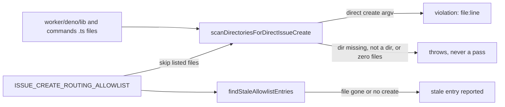

## Summary

Adds a gate that fails when a direct `gh issue create` argv appears in
`worker/deno/lib` or `worker/deno/commands` (including the gh alias
`gh issue new`, and `-R`/`--repo` placed before the verb as a string or a
template literal, and `gh api` REST or GraphQL issue creation) without going
through `fileRoutedIssue` (#3743) or an entry on a reasoned allowlist. The
allowlist is `ISSUE_CREATE_ROUTING_ALLOWLIST` in
`worker/deno/lib/issue_create_routing_check.ts` (line 64). It is seeded with the
30 files that build a create argv today, each with a one-line reason. No call
site is migrated. Part of #3691, builds on #3743. Closes #3746.

## Spec

### Intent and Rationale

- Several worker modules still build a `gh issue create` argv by hand, for
  example `worker/deno/lib/idle_starvation_escalation.ts`,
  `worker/deno/lib/audit_failure_notifier.ts` and
  `worker/deno/lib/repo_fast_failure_issue.ts`. Each new one would be a filing
  path that skips the router's classifier, duplicate search and permission check
  (#3691, ask A6).
- The gate records every existing direct site with a reason, so the exceptions
  are explicit and reviewable. Migrating them is separate work.
- The gate follows `worker/deno/lib/issue_create_label_check.ts`, which guards
  `--label` arguments on the same argv.

### Essential Design Decisions

- The allowlist is per file, not per call site. A new direct create in a file
  that is already allowlisted passes (see Undiscoverable Facts).
- `gh api` is covered too, because GitHub creates the same issue that way. An
  `"api",` argv is a candidate when its endpoint ends in `/issues` and it POSTs:
  `-X POST`, `--method POST`, `-XPOST` or `--method=POST`, or, with no explicit
  method, any of `-f`, `-F`, `--field`, `--raw-field`, `--input` (gh defaults to
  POST when it has a body). An explicit non-POST method wins, so `-X GET` with
  `-f` is a read; a method that is not a literal counts as POST. It also flags a
  `gh api graphql` argv in a file whose code names `createIssue`. A plain GET
  list, `/issues/<n>/comments`, `search/issues` and a `key=value` field that
  merely ends in `/issues` are not flagged. The real tree has no such call site,
  so no allowlist entry was needed.
- A template-literal repo flag (`` `--repo=${repo}` ``, `` `-R${repo}` ``) is
  skipped before the verb like the string form: its static text before the first
  `${` is read. An interpolation-free template reads as the string it holds; a
  verb built by interpolation is not a candidate. Nested templates inside an
  interpolation are skipped whole (`indexAfterTemplate`).
- The check fails closed. A missing scan directory throws
  (`worker/deno/lib/issue_create_routing_check.ts:736`), a scan path that is not
  a directory throws (`:743`), and a scan that examines zero `.ts` files throws
  (`:784`). A stat error other than NotFound is rethrown (`:741`).
- `stripComments` (`:292`) is one left-to-right scan. It blanks `//` and block
  comments and keeps string, template and regular-expression literals. Template
  literals may span lines, and code inside `${…}` is scanned as code, nesting
  included, so a backtick there neither ends nor opens the outer template. A `/`
  where an operand is expected opens a regex literal (`:357`), so a quote or
  backtick inside a regex does not open a string. A `//` or `/*` inside any
  literal therefore neither hides a create nor invents one. Before this, the
  pass was a regex that ended a template at the end of its line, and
  `milestone/*` in the YAML template at
  `worker/deno/lib/workflow_definitions.ts:208` opened a fake block comment that
  blanked about 600 more lines, real code included, from the scan.
- `findStaleAllowlistEntries` (`:806`) reports an allowlisted file that is gone
  or no longer holds a direct create. This is not in the issue. It stops the
  allowlist drifting once a call site is migrated, and its read errors other
  than NotFound are rethrown (`:822`).
- The enforcement point is the real-tree scan in the unit test
  `worker/deno/tests/issue_create_routing_check_test.ts`. The gate is not wired
  into `quality_gate.ts`, which matches the sibling
  `issue_create_label_check.ts`.
- `scanContentForDirectIssueCreate`, `scanDirectoriesForDirectIssueCreate`,
  `findStaleAllowlistEntries` and `formatIssueCreateRoutingViolations` are
  exported for the tests. Scanning and reporting file and line is the API the
  issue asks for. The `filesScanned` field of the scan result is the contract
  the real-tree test asserts, so a silently broken directory walk shows up as a
  count of zero.
- `worker/deno/lib/issue_routing_filing.ts` gets a paragraph at lines 29-33 that
  points to this gate, so a reader of the chokepoint sees where the other direct
  sites are checked. The chokepoint is itself on the allowlist
  (`issue_routing_filing.ts` entry, line 131), because its direct call is the
  one `fileRoutedIssue` makes.

### Undiscoverable Facts

- Known limit: the `gh api` check reads literal argv elements. An endpoint held
  in a variable (`gh(["api", endpoint, "-f", …])`) or an argv assembled
  elsewhere is not seen, and the GraphQL check is per file: a file that names
  `createIssue` and makes any `gh api graphql` call is flagged, whichever call
  creates it.
- Known limit: the allowlist is per file. A second direct create added to an
  already-allowlisted file is not flagged.
- Known limit: the scanner is a heuristic, not a TypeScript parser. A `/` after
  `)`, `]`, `}`, a number or an identifier other than a keyword such as `return`
  is read as division, so a regex literal in that position, holding a quote or
  backtick, could desync it. A one-off check over every scanned file found each
  one ends at brace depth 0 with no template left open, which a desync would
  usually break; that is evidence, not proof.
- Several reasons say the file files into the worker's own repository by design
  (for example `idle_starvation_escalation.ts`, `milestone_gate_wedge.ts`,
  `provider_outage_alert.ts`). Those targets are fixed on purpose and are not a
  routing miss.
- `docs/audits/lib-sweep-coverage/top-up-3746.json` records the new lib module
  in the sweep ledger. `check:manifests` requires it.

## Evidence

Tooling change; no UI file touched. Verified by the unit tests below.

**Docs sweep** — grep: `issue_create_routing_check`,
`ISSUE_CREATE_ROUTING_ALLOWLIST`, `fileRoutedIssue`, `direct` `gh issue create`;
section: none — `docs/ISSUE-ROUTING.md` does not exist, and no non-archive `.md`
file mentions `fileRoutedIssue`; siblings: `"issue_create_label_check"`,
`"CREATE_LABEL_ALLOWLIST"` — the sibling's allowlist is `CREATE_LABEL_ALLOWLIST`
in `worker/deno/lib/issue_create_label_check.ts:67`, and the label-check
documentation covers labels only; re-run after the PR #3864 review fix on
`issue_create_routing_check`, `gh api`, `createIssue` and `--repo=` — the only
non-archive hits are `worker/deno/lib/issue_create_routing_check.ts` and its
test, whose module docs were updated; updated:
`worker/deno/lib/issue_routing_filing.ts` (module doc, lines 29-33);
`docs/AGENT-ACCOUNTABILITY.md:825-836` and
`worker/deno/lib/guarded_issue_labels.ts:10-17` — still true because they
describe the label guard only.

## Acceptance Criteria

<!-- vibe-spec-review inputs="diff+issue-body" -->

- **met** — A fixture with a new direct `issue create` call fails the check, and
  the message names the file and line. — evidence:
  `worker/deno/tests/issue_create_routing_check_test.ts::issue_create_routing_check - directory scan reports unlisted offenders only`
  (asserts `file` and `line`); the message is rendered by
  `formatIssueCreateRoutingViolations`
  (`worker/deno/lib/issue_create_routing_check.ts:839`) — reviewer: met
- **met** — The scan over the real `worker/deno/lib` and `worker/deno/commands`
  trees passes with the seeded allowlist. — evidence:
  `worker/deno/tests/issue_create_routing_check_test.ts::issue_create_routing_check - real tree has no unlisted direct create call site`,
  `::issue_create_routing_check - real allowlist has no stale entries` —
  reviewer: met
- **met** — Every allowlist entry carries a non-empty reason. — evidence:
  `worker/deno/tests/issue_create_routing_check_test.ts::issue_create_routing_check - allowlist entries are documented and specific`
  — reviewer: met
- **met** — Tests and quality checks pass. — evidence:
  `deno task test:unit tests/issue_create_routing_check_test.ts` (25 tests, see
  Test Plan); `./quality.sh` result is in the Test Plan — reviewer: met
- **met** — Failure Detection: the test goes red when an unlisted direct call
  site appears. — evidence:
  `worker/deno/tests/issue_create_routing_check_test.ts::issue_create_routing_check - real tree has no unlisted direct create call site`,
  `::issue_create_routing_check - directory scan reports unlisted offenders only`
  — reviewer: met
- **met** — Failure Detection: the test goes red when a scanned directory is
  missing, so an empty scan never passes. — evidence:
  `worker/deno/tests/issue_create_routing_check_test.ts::issue_create_routing_check - fails closed on a missing scan directory`,
  `::issue_create_routing_check - fails closed when no .ts file is scanned` —
  reviewer: met
- **unrequested** — `findStaleAllowlistEntries`
  (`worker/deno/lib/issue_create_routing_check.ts:806`) and its tests. —
  reviewer: unrequested — reason: keeps the allowlist honest after a call site
  is migrated; without it an entry outlives the call site it describes.
- **unrequested** — `docs/audits/lib-sweep-coverage/top-up-3746.json`. —
  reviewer: unrequested — reason: repository process; `check:manifests` requires
  the new lib module to be recorded in the sweep ledger.
- **unrequested** — the paragraph in `worker/deno/lib/issue_routing_filing.ts`
  (lines 29-33) that points to this gate. — reviewer: unrequested — reason: the
  chokepoint's own documentation should say where the other direct create sites
  are gated.

## Standards Review

<!-- vibe-standards-review inputs="diff+CODING-STANDARDS.md" -->

- **violation** — the module doc named the wrong test path — evidence:
  `worker/deno/lib/issue_create_routing_check.ts:12` — reason: fixed in this
  diff; the doc now names
  `worker/deno/tests/issue_create_routing_check_test.ts`.
- **violation** — the non-NotFound rethrows had no test — evidence:
  `worker/deno/lib/issue_create_routing_check.ts:741` and `:822` — reason: fixed
  in this diff; added "rethrows a non-missing stat error on a scan directory"
  and "stale audit rethrows a non-missing read error".
- **violation** — a `//` inside a string was treated as a line comment —
  evidence: `worker/deno/lib/issue_create_routing_check.ts:347` — reason: fixed
  by the single left-to-right scan; "detects every direct create form" covers
  the url-string-before-argv case.
- **violation** — a `/*` inside a string opened a block comment — evidence:
  `worker/deno/lib/issue_create_routing_check.ts:347` — reason: fixed by the
  same scan; "string containing a block-comment opener does not hide a create"
  covers it.
- **violation** — a `/*` inside a multi-line template opened a block comment,
  hiding real code in `worker/deno/lib/workflow_definitions.ts` from the scan —
  evidence: `worker/deno/lib/issue_create_routing_check.ts:292` — reason: fixed
  in this diff; templates span lines, `${…}` is scanned as code and regex
  literals are recognised. "multi-line template containing a block-comment
  opener does not hide a create" and "template interpolations are scanned as
  code" cover it.

## Test Plan

- `deno task test:unit tests/issue_create_routing_check_test.ts` from
  `worker/deno`: 25 passed. The 25 tests are in
  `worker/deno/tests/issue_create_routing_check_test.ts`.
- `./quality.sh` run on the head after the PR #3864 review fix: Result PASSED
  (with skipped checks; deno tests, lint, type check and fmt all PASSED).
- Red checks, one flip at a time against
  `worker/deno/tests/issue_create_routing_check_test.ts`. Every flip turned at
  least one named test red:

| Flip                                                                  | Location                                                       | Test that went red                                                                                                              |
| --------------------------------------------------------------------- | -------------------------------------------------------------- | ------------------------------------------------------------------------------------------------------------------------------- |
| drop an allowlist entry                                               | `worker/deno/lib/issue_create_routing_check.ts:64`             | real tree has no unlisted direct create call site                                                                               |
| missing-dir guard removed                                             | `worker/deno/lib/issue_create_routing_check.ts:736`            | fails closed on a missing scan directory (asserts "does not exist")                                                             |
| not-a-directory guard removed                                         | `worker/deno/lib/issue_create_routing_check.ts:743`            | fails closed when a scan path is a file                                                                                         |
| zero-files guard removed                                              | `worker/deno/lib/issue_create_routing_check.ts:784`            | fails closed when no .ts file is scanned                                                                                        |
| line-comment branch removed                                           | `worker/deno/lib/issue_create_routing_check.ts:337`            | ignores create argv inside comments                                                                                             |
| block-comment branch removed                                          | `worker/deno/lib/issue_create_routing_check.ts:342`            | ignores create argv inside comments                                                                                             |
| verb check changed (`.has(verb)` dropped)                             | `worker/deno/lib/issue_create_routing_check.ts:682`            | ignores read verbs and other subcommands; a repo flag before a read verb is not a create (5 tests red)                          |
| `new` removed from `ISSUE_CREATE_VERBS`                               | `worker/deno/lib/issue_create_routing_check.ts:197`            | detects the new alias and a repo flag before the verb                                                                           |
| repo-flag skip removed (`-R`/`--repo` value, inline form; each alone) | `worker/deno/lib/issue_create_routing_check.ts:544` and `:546` | detects the new alias and a repo flag before the verb                                                                           |
| stale-missing branch changed                                          | `worker/deno/lib/issue_create_routing_check.ts:818`            | stale entries are missing or clean files                                                                                        |
| stale-clean branch changed                                            | `worker/deno/lib/issue_create_routing_check.ts:824`            | stale entries are missing or clean files                                                                                        |
| stat catch maps non-NotFound to "does not exist"                      | `worker/deno/lib/issue_create_routing_check.ts:735-741`        | rethrows a non-missing stat error on a scan directory                                                                           |
| stale read catch records a stale entry                                | `worker/deno/lib/issue_create_routing_check.ts:817-822`        | stale audit rethrows a non-missing read error                                                                                   |
| string-literal branch removed                                         | `worker/deno/lib/issue_create_routing_check.ts:347`            | detects every direct create form (url-string-before-argv case); string containing a block-comment opener does not hide a create |
| template ends at end of line                                          | `worker/deno/lib/issue_create_routing_check.ts:305`            | multi-line template containing a block-comment opener does not hide a create                                                    |
| `${…}` interpolation not tracked                                      | `worker/deno/lib/issue_create_routing_check.ts:326`            | template interpolations are scanned as code (comment-in-an-interpolation case)                                                  |
| regex literal not recognised                                          | `worker/deno/lib/issue_create_routing_check.ts:362`            | template interpolations are scanned as code (backtick-in-a-regex-literal case)                                                  |
| template-literal repo flag not skipped (always `return null`)         | `worker/deno/lib/issue_create_routing_check.ts:542`            | detects a template-literal repo flag before the verb                                                                            |
| template prefix always skipped (the `${verb}` case)                   | `worker/deno/lib/issue_create_routing_check.ts:542`            | a template-literal repo flag before a read verb is not a create                                                                 |
| nested `${…}` not skipped whole                                       | `worker/deno/lib/issue_create_routing_check.ts:417`            | detects a template-literal repo flag before the verb (nested template case)                                                     |
| GraphQL `createIssue` branch removed                                  | `worker/deno/lib/issue_create_routing_check.ts:627`            | detects issue creation through gh api (both GraphQL cases)                                                                      |
| `key=value` field excluded from endpoint candidates removed           | `worker/deno/lib/issue_create_routing_check.ts:630`            | gh api reads and other writes are not an issue create (field ending in /issues)                                                 |
| `search` look-behind removed                                          | `worker/deno/lib/issue_create_routing_check.ts:232`            | gh api reads and other writes are not an issue create (search issues with a field)                                              |
| inline `-XPOST`/`--method=` parse removed                             | `worker/deno/lib/issue_create_routing_check.ts:647`            | detects issue creation through gh api; gh api reads and other writes are not an issue create                                    |
| field-flag detection removed                                          | `worker/deno/lib/issue_create_routing_check.ts:648`            | detects issue creation through gh api (REST fields imply POST)                                                                  |
| explicit method no longer wins over fields                            | `worker/deno/lib/issue_create_routing_check.ts:651`            | gh api reads and other writes are not an issue create (explicit GET with fields)                                                |
| non-literal method no longer counts as POST                           | `worker/deno/lib/issue_create_routing_check.ts:652`            | detects issue creation through gh api (non-literal method)                                                                      |
| `gh api` detection disabled                                           | `worker/deno/lib/issue_create_routing_check.ts:685`            | detects issue creation through gh api                                                                                           |
| argv close not cut at the array end                                   | `worker/deno/lib/issue_create_routing_check.ts:567`            | detects issue creation through gh api                                                                                           |

<!-- vibe-branch-outcomes -->

🤖 Generated with [Claude Code](https://claude.com/claude-code)
