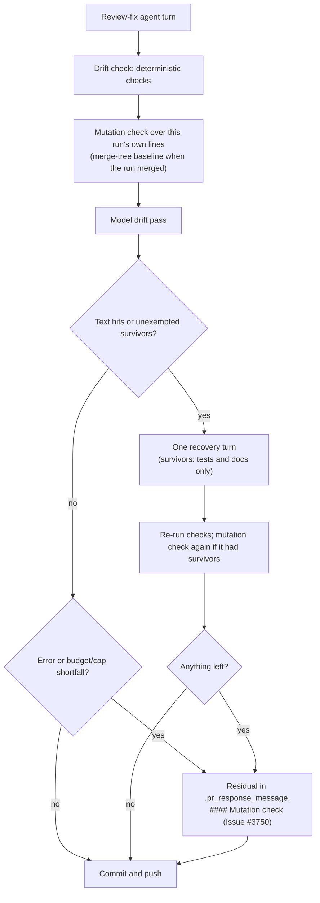

## Summary

Before this change, the diff-scoped mutation gate (#3393) ran only at PR raise. It now also runs on every review-fix push. The review-fix drift check (`runPrFeedbackDriftCheck`) mutates the lines this run added since its before-run head. Lines a base merge brought in are excluded. Each unexempted survivor is sent into the drift check's existing single recovery turn with the same wording the PR-raise gate uses (`buildMutationGateComment`). If survivors remain after that turn, they go into the PR reply under their own `#### Mutation check (Issue #3750)` heading. Closes #3750.

## Spec

### Intent and Rationale

- Review-fix rounds kept adding branches that no test pins (#3160, #3312, #3716), because the gate never ran on that path. The gate, its runner and the recovery turn already existed, so this change calls them from the review-fix run instead of adding a new gate.
- The skip, runner, budget and credentials steps the completion phase ran inline moved into `invokeMutationCheck` (`worker/deno/lib/mutation_check_invocation.ts`). Both call points now share one owner, so `skip_mutation_check`, `mutation_check_budget_seconds`, the mutant cap and `quality_credentials` behave identically at both.

### Essential Design Decisions

- **The run's own lines.** The new side is the working tree plus untracked files, because the worker commits leftover edits after the check. The old side is `beforeSha`. When the run merged a branch, the old side is `git merge-tree --write-tree <beforeSha> <merged parent>` instead, so lines that came in from the merge are not mutated. A conflict resolution counts as the run's own work. If the run merged two unrelated histories, the check refuses and reports it, because the run's lines cannot be told apart from the merged ones.
- **A review-fix push is never blocked.** Survivors are a drift hit and drive the one recovery turn. When survivors are present, that turn may change tests and docs but no production code. The check re-runs once, and only when there were survivors and the turn ran.
- **No silent pass.** A runner error, a diff that cannot be collected, or an exhausted budget or mutant cap is reported in the residual as such, never counted as clean. These outcomes never trigger a recovery turn on their own. A "not applicable" result is logged with its reason.
- `DriftCheckDeps.runMutationCheck` is a required member, so no caller can drop it silently. CI-fix runs are out of scope; `docs/mutation-check.md` says so.

### Undiscoverable Facts

- `git merge-tree --write-tree` exits 1 both for a conflicted merge and for a bad object. The tree id on the first line of stdout is validated to tell the two apart (observed with git 2.47.3).
- `git diff --no-index -- /dev/null <path>` exits 1 when the files differ and prints `+++ b/<path>`. `parseAddedLines` reads that as `<path>`, and the no-merges test asserts the key `lib/new.ts`.

## Evidence

This is a backend change; no UI files were touched.

- Call site: `worker/deno/lib/pr_feedback_processor.ts` passes `runMutationCheck: (sha) => runReviewFixMutationCheck(...)` with `runner: deps.quality.runMutationCheck` and `repoConfigs: processorDeps.repoConfigs`. Two reverts were tried, `runner: undefined` and `repoConfigs: undefined`. Each turned tests in `worker/deno/tests/pr_feedback_processor_mutation_check_3750_test.ts` red.
- The completion-phase refactor keeps its behaviour. `worker/deno/tests/completion_phase_mutation_gate_test.ts` passes unchanged except for its import line, and it still covers the credentials-failure and diff-failure paths.
- Callers checked for the new required `DriftCheckDeps.runMutationCheck`: the production call site in `pr_feedback_processor.ts` passes it. The 41 test literals in the drift-check test files pass a not-applicable stub. There are no other callers.
- Provenance numbers cited in the diff: #3750 (this issue), #3393 (the diff-scoped mutation gate), #3143 (review-fix drift check), #3577 (pre-flight gate). All are existing references.

**Docs sweep**: grep: "PR-raise gate", "before the PR is raised", "Five checks", "without changing code", `resolveMutationBudgetSeconds`, `runMutationCheck`; section: `docs/workflows/pr-feedback.md#the-workers-drift-check-issue-3143`; siblings: `staleCitations`, `citationCheckUnavailable` (the `DriftResidual` set gained `mutationSurvivors`, `mutationNote` and `mutationCheckUnavailable`); updated: `docs/mutation-check.md`, `docs/workflows/pr-feedback.md`, `docs/CONFIGURATION.md`, `README.md`, `prompts/pr_feedback/prompt.md`. Hits left in place:
- `docs/mutation-check.md:23` is still true because that sentence describes the PR-raise call point.
- `docs/mutation-check.md:77` and `docs/workflows/pr-feedback.md:573` are still true because they name the PR-raise gate's shared runner.
- `docs/CONFIGURATION.md:4575` is still true because it names both call points.

## Test Plan

- Added `worker/deno/tests/pr_feedback_mutation_check_3750_test.ts` (12 tests, against real temporary git repos and a stub runner). It covers:
  - the run's own diff with no merges, including uncommitted and untracked lines;
  - base-merge exclusion, plus a negative control where the run's only action is a merge;
  - refusal of unrelated merges, and a bad `beforeSha` refused with git's cause;
  - skip, unwired runner, budget, uncollectable diff, a runner that throws, and diff pass-through.
- Added `worker/deno/tests/pr_feedback_drift_check_3750_test.ts` (11 tests):
  - a survivor that outlives recovery (one recovery turn, a second check, the residual heading, the survivors-only lead line);
  - a survivor the recovery kills (`recovered`), and an exempted survivor (`clean`);
  - a budget shortfall (reported, no recovery), an error result, and a throwing seam;
  - a not-applicable result (`clean`);
  - residual and prompt rendering.
- Added `worker/deno/tests/pr_feedback_processor_mutation_check_3750_test.ts` (3 tests): the survivor reaches the recovery prompt and the PR comment, `skip_mutation_check` never calls the runner, and `mutation_check_budget_seconds` reaches the runner.
- Edited `worker/deno/tests/pr_feedback_drift_check_3143_test.ts`, `_3244_test.ts`, `_3341_test.ts`, `_3347_test.ts` and `worker/deno/tests/branch_outcome_citations_facts_3396_test.ts`. They only gained the required `runMutationCheck` not-applicable stub, with no assertion removed or changed. `worker/deno/tests/completion_phase_mutation_gate_test.ts` only had its import changed.
- Red checks. Each guard was broken on its own and then restored byte-identically. These breaks turned their named tests red:
  - merge exclusion removed;
  - untracked step removed;
  - skip guard removed;
  - containment refusal removed;
  - survivors removed from the recovery condition;
  - mutation re-run skipped;
  - budget removed from the clean condition;
  - error removed from the residual;
  - the uncollectable-diff check bypassed;
  - the closing-step condition inverted;
  - each processor wiring revert.
- `./quality.sh < /dev/null` on the final code: `Result: PASSED (with skipped checks)`. Every stage passed except `config integration`, which was SKIPPED. The skip predates this change and has nothing to do with it.

<!-- vibe-branch-outcomes -->

🤖 Generated with [Claude Code](https://claude.com/claude-code)
