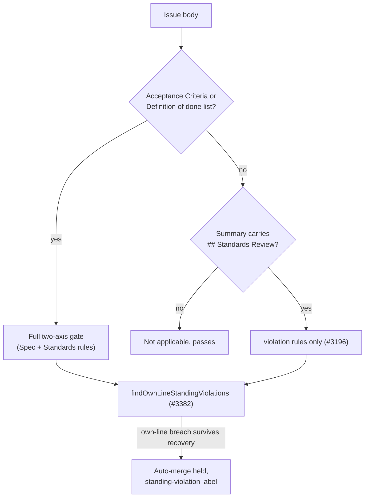

## Summary

The #3196 refusal and the #3382 standing-violation guard read a PR's Standards entries through `validateIndependentReview`. That function returned `applicable: false` and **no** Standards entries whenever `extractAcceptanceCriteria` found no `## Acceptance Criteria` list. So when an issue stated its criteria under any other heading, a PR whose own Standards Review admitted an own-line `violation` got no `standing-violation` label and had auto-merge armed (stSoftwareAU/NEAT-AI#4065, whose issue NEAT-AI#4061 used `## Definition of done`).

This PR makes two changes:

1. **The Standards axis is decoupled from the issue's criteria.** When the issue states none, the gate still parses `## Standards Review` and holds each `violation` to the #3196 rules (`violationProblems`, which both paths now share). `findOwnLineStandingViolations` therefore routes an own-line breach whatever headings the issue uses. Only the Spec-axis rules stay gated on the criteria.
2. **`## Definition of done` is recognised.** `extractAcceptanceCriteria` reads it when the issue has no Acceptance Criteria list, so the closure gate, the Spec axis and the degraded-run scope also apply to these issues.

Closes #3761.

## Spec

### Intent and Rationale

- The Standards Review judges the diff against the repo's standards, so whether its violations are checked must not depend on how the issue names its criteria. Decoupling the axis closes the gap for every heading, not just the one seen on NEAT-AI#4061.
- Recognising `## Definition of done` stops the Spec axis being skipped silently for the heading seen in the incident.

### Essential Design Decisions

- When the issue states no criteria, `applicable` is `standardsSection !== null`. A criteria-less summary without a `## Standards Review` is still not checked, because the prompt asks for no reviewers on such issues.
- Without criteria, only the `violation` rules apply. The Standards section, its provenance marker, a finding and axis separation are not required, so criteria-less PRs that follow the prompt are never newly blocked.
- `criteriaStated` on the result selects a short Standards-only remediation comment (`buildIndependentReviewComment`), so a criteria-less issue is never told "This issue states acceptance criteria".
- The `!review.applicable` operand in `findOwnLineStandingViolations` was removed as dead code: a result that is not applicable now carries no Standards entries, so `standing.length === 0` already covers it.

### Undiscoverable Facts

- The issue reported reproducing this on `main` (94795edf) with the real NEAT-AI#4061 body and the NEAT-AI#4065 PR body: renaming the issue heading to `## Acceptance Criteria` alone turned 0 standing violations into 2.

## Evidence

Backend/CLI only. No UI file is touched.

- `worker/deno/tests/completion_phase_summary_incomplete_test.ts::completion - an issue with no criteria heading still holds auto-merge on an own-line standing violation (Issue #3761)`: end to end, a criteria-less issue with an own-line standing violation now ends `summary_incomplete`, with auto-merge not armed and the PR labelled `standing-violation`.
- `worker/deno/tests/standing_violation_routing_test.ts::findOwnLineStandingViolations - an issue with no criteria heading still returns an own-line violation (Issue #3761)`: this is the issue's first regression test. It returned `[]` on base.
- `worker/deno/tests/acceptance_criteria_gate_test.ts::extractAcceptanceCriteria - reads criteria under a Definition of done heading (Issue #3761)`: this is the issue's second regression test.
- Callers checked for the changed `applicable` meaning:
  - `completion_phase.ts` (`review.applicable && !review.valid`) now blocks a criteria-less summary with a refused violation, which is intended.
  - `pr_summary_check.ts` (`fromVerdict`) reports it as blocked.
  - `closure_verdict_recovery.ts` reads `.problems` and `.valid`, but only after its own no-criteria early return.
  - `findOwnLineStandingViolations` is covered above.
- **Callers of `extractAcceptanceCriteria`:** `validateAcceptanceClosure`, `validateIndependentReview`, `extractAcceptedScope` (degraded-run guard) and `renderClosureBlocksFromVerdict`. All four are meant to treat a Definition of done list as criteria.
- Issue numbers cited:
  - #3761: Standing-violation guard (#3196, #3382) is skipped when the linked issue has no `## Acceptance Criteria` heading…
  - NEAT-AI#4061: RangeError 'Invalid array length' in CreatureUtil.makeUUID…
  - NEAT-AI#4065: Keep the caller's creature valid on every `evolveDir()` exit…

**Docs sweep** — grep: `extractAcceptanceCriteria`, `validateIndependentReview`, "no acceptance criteria", "states criteria", "no criteria", "unaffected"; section: `docs/workflows/issue-processing.md#-independent-review-on-two-axes`; siblings: "Done when", "Accepted scope so far"; updated: `prompts/issue/prompt.md`, `docs/workflows/issue-processing.md`, plus doc comments in `worker/deno/lib/acceptance_criteria_gate.ts`, `worker/deno/lib/independent_review_gate.ts`, `worker/deno/lib/closure_verdict_recovery.ts` and `worker/deno/lib/phases/completion_phase.ts`. Hits left in place:
- `prompts/issue/prompt.md:1256` — still true because the Acceptance Criteria block is emitted only when the issue states criteria.
- `prompts/issue/prompt.md:1496` — still true because it says when the blocks are emitted, not when they are checked.
- `docs/workflows/issue-processing.md:1093` — still true because reviewer dispatch is unchanged.
- `docs/workflows/issue-processing.md:1229` — still true because reviewer dispatch is unchanged.
- `docs/workflows/issue-processing.md:1034` — still true because the closure gate does not apply without criteria.
- `docs/workflows/issue-processing.md:2438` — still true because `Done when` and `Accepted scope so far` are still read only by the degraded-run scope.

## Test Plan

Tests added:

- `worker/deno/tests/acceptance_criteria_gate_test.ts`:
  - Definition of done read as criteria, including the `### Definition of Done:` variant;
  - Acceptance Criteria wins when both exist;
  - a padded near-miss heading is not a heading, and the input returns promptly;
  - `extractAcceptedScope` reads a Definition of done list;
  - the closure gate applies to a Definition of done issue.
- `worker/deno/tests/independent_review_gate_test.ts`:
  - with no criteria, a standing violation is still refused, and the same entry with `fixed in this diff` passes;
  - with no criteria, provenance and a finding are not required;
  - with no criteria, the Spec rules stay gated;
  - a no-criteria refusal gets the Standards-only comment.
- `worker/deno/tests/standing_violation_routing_test.ts`: an issue with no criteria heading still returns an own-line violation, with a `fixed in this diff` negative control.
- `worker/deno/tests/completion_phase_summary_incomplete_test.ts`: an issue with no criteria heading still holds auto-merge on an own-line standing violation.

Assertions removed from the existing test `findOwnLineStandingViolations - routing against a diff`:

- `assertEquals(inapplicable, { violations: [], notChecked: null });` — issue requirement 1 makes this untrue: `findOwnLineStandingViolations` must return the own-line violation when the issue states no criteria. It was replaced by assertions that the one violation at `foo.ts:12` is returned and `notChecked` is null.
- `assertEquals(calls, calls2);` — issue requirement 1 makes this untrue: the routing now reads the diff for a criteria-less issue. It was replaced by `assertEquals(calls, calls2 + 1, ...)`.

Edited expectation, red check: I restored the base early return in `validateIndependentReview`. The edited `routing against a diff` test went red at "no criteria still routes", along with the new gate, routing and completion tests (6 failed).

Red checks for the new tests:

- Restoring `extractAcceptanceCriteria` to read only `## Acceptance Criteria` turned the 5 Definition of done tests red.
- Forcing `applicable: true` on the no-criteria path turned "does not apply when the issue states no criteria" and "no criteria keeps the Spec rules gated" red.
- Emptying the no-criteria `problems` turned the gate refusal test, the comment test and the completion hold test red. The completion test went red at its first assertion: status `continue`, so the PR was not held.
- Inverting the `criteriaStated` branch in `buildIndependentReviewComment` turned two comment tests red.

Results:

- Targeted suites: `deno test` over the touched tests plus the importers (`closure_*`, `*degraded*`, `completion_phase_*`, `pr_summary_check_test.ts`, `review_block_template_test.ts`, `standing_violation_3613_test.ts`, `auto_merge_sweep_test.ts`, `summary_rule_gate_retry_test.ts`) passed, 0 failed.
- `markdownlint-cli2` on the two edited Markdown files reported 0 issues.
- `./quality.sh` on the code head 5f38cdbe: `Result: PASSED (with skipped checks)` — only `config integration` was skipped; deno tests, lint, type check, fmt, markdownlint, mermaid and semgrep passed.

<!-- vibe-branch-outcomes -->
