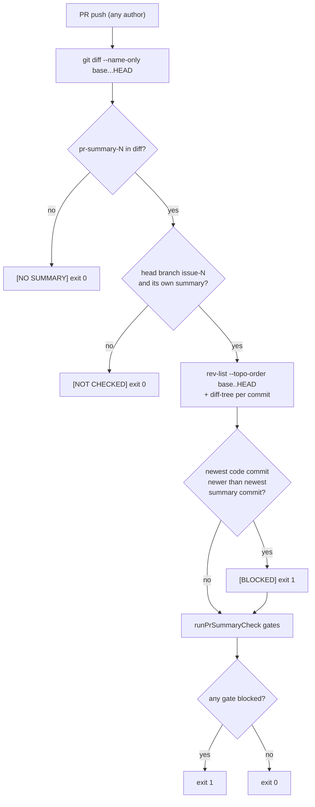

## Summary

Adds a CI check that holds every push to a worker PR to its archived summary,
whoever made the push. A new `deno task pr-summary-ci` runs in the `validate`
job of `.github/workflows/validate-scripts.yml` (gated by `quality.yml`'s
`gate`). On an `issue-<N>-…` head branch whose diff carries
`docs/archive/pr-summaries/pr-summary-<N>.md` (or its `.facts.json`), it fails
when the PR's newest commit that changes `worker/`, `prompts/` or `.claude/`
is newer than the newest commit that changes the summary or its facts file. It
then runs the existing `pr-summary-check` gates and fails on a blocked one.
`CODING-STANDARDS.md` documents the step next to the `pr-summary-check`
paragraph. Closes #3768.

## Spec

### Intent and Rationale

- Review-fix pushes from laptops and cloud sessions reach none of the worker's
  summary checks (#3143/#3244 drift check, Branch outcomes gate, mutation
  gate), so the summary stayed on the previous head (#3676 `1950dc44`,
  `6aecdbf9`). A CI step catches every pusher without the worker knowing who
  pushed, and a red check routes the PR to a CI-fix run.
- The gates are reused by calling `runPrSummaryCheck` in-process, not copied,
  so CI and the local `pr-summary-check` task cannot drift.

### Essential Design Decisions

- The PR's summary is chosen from the head branch's `issue-<N>` name
  (`issueNumberFromBranch`). A head branch with no issue number, or one whose
  own summary is absent from the diff, is reported `[NOT CHECKED]` and exits
  0. Milestone roll-ups and sync PRs carry other PRs' summaries, so picking
  one by count would judge the wrong summary.
- "Newer" is ancestry order (`git rev-list --topo-order <base>..HEAD`), not
  commit date, so a rebased or cherry-picked commit with an older date is
  still judged by its position. A commit that changes both code and the
  summary counts as a summary refresh.
- Merge commits never count. `git diff-tree` without `-m` prints no files for
  a merge, which gives the same commit set as `git log --no-merges`, so the
  `--no-merges` flag the issue proposed would have had no effect and is not
  passed. Base commits a merge brings in are outside `<base>..HEAD`.
- Gates that need the issue body or labels are reported as `[NOT_CHECKED]`,
  never as passed. File paths in the log escape control characters, so a
  crafted file name cannot start a GitHub Actions `::` workflow command line.

### Undiscoverable Facts

- PR #3716's head `440f28cd` changed the summary in the same commit as its
  code, so a freshness rule cannot see that it went stale. Its non-existent
  test *name* also passes the existing Branch outcomes gate, which checks
  that the test files exist, not the test names inside them. Catching that
  case needs the worker's drift check or a test-name lookup, which this issue
  does not add.
- CI's `actions/checkout` on `pull_request` checks out the synthetic merge
  commit. That merge contributes no files, so it never counts as a code or
  summary commit.

## Evidence

Backend/CI change, no UI. A corpus run used the real CLI on 21 real PR heads,
each in a detached temporary worktree with its real base and head branch:

| Head | Expected | Result |
|---|---|---|
| #3676 `1950dc44` (out-of-worker push) | stale | `[BLOCKED] Summary freshness`, names `1950dc44…` and the summary's last commit `a0c5e471…`, exit 1 |
| #3676 `6aecdbf9` (earlier out-of-worker push) | stale | `[BLOCKED] Summary freshness`, names `6aecdbf9…`, exit 1 |
| #3716 `440f28cd` | summary changed in the same commit | freshness passed, exit 0 (see Undiscoverable Facts) |
| Final heads of #3957, #3956, #3951, #3948, #3947, #3931, #3918, #3914, #3913, #3911, #3907, #3904, #3716, #3676 | fresh | all `[PASSED] Summary freshness`, exit 0 |
| Final head of #3915 | fresh | freshness passed; `[BLOCKED] Prompt-scrubbed Markdown`, a true positive (its summary's Mermaid arrows at lines 36-40 carry the U+2024 dot leader the scrub gate flags; it merged before the #3710 gate landed) |
| #3926 (milestone roll-up), #3935 (sync), #3953 (milestone-fix) | not this PR's summary | `[NOT CHECKED]` / `[NO SUMMARY]`, exit 0 |

Freshness: 2 of 2 known stale heads caught (0 false negatives), 0 of 14 fresh
final heads flagged (0 false positives).

**Docs sweep** — grep: `pr-summary-check`, "before the PR is raised",
"draft summary", `validate-scripts.yml`; section:
`CODING-STANDARDS.md#pr-summary-and-evidence`; siblings: "pr-summary-check",
"drift-pins-on-base", "Sweep ledger sweptAt ancestry" — no doc lists the full
set of deno tasks or validate steps, so none gained a missing member; updated:
`CODING-STANDARDS.md`; `prompts/ci_fix/prompt.md:104` — still true because it
tells a CI-fix agent to run `pr-summary-check` when it changes the summary,
which is still the local step; `prompts/pr_feedback/prompt.md:72` — still true
for the same reason; `prompts/issue/prompt.md:1230` — still true because the
first-run summary is still checked locally before the PR is raised;
`docs/pre-pr-ci-audit.md:211` — still true because it is a historical audit
row; `worker/deno/lib/pr_summary_check.ts:1` — still true because the module
still runs the worker's gates against a summary and the branch diff.

Issue numbers the diff cites as provenance: #3768: Review-fix pushes made
outside the worker get no summary check: the archived PR summary stays on the
previous head's Branch outcomes (VibeCoder#3716, #3676); #3073: Docs sweep
still misses the manual for the changed surface (the existing gate's
`issueRef`, used in a test fixture).

## Test Plan

- `worker/deno/tests/pr_summary_ci_test.ts` (new, 38 tests): pure tests of
  `isCodePath`, `summaryIssueOf`, `judgeFreshness`, `selectSummary`,
  `parseArgs`, `ciFailed` and `formatCiReport`, plus integration tests on a
  real git remote and clone (`setupGitRepoFixture`) with the real
  `runGitCommand`. The issue's listed cases:
  - code commit newer than the summary fails — `pr-summary-ci - a code commit newer than the summary blocks, naming that commit`
  - summary commit newer passes — `pr-summary-ci - a summary commit newer than the code passes freshness`
  - merge-only commits from the base are ignored — `pr-summary-ci - base-only merge commits are ignored, so a fresh summary still passes`
    (the merge also carries its own `worker/` edit; adding `-m` to
    `diff-tree` turned it red)
  - a branch with no PR summary passes with a log line — `pr-summary-ci - a branch with only code changes and no summary is no summary`
  - a `blocked` gate fails — `pr-summary-ci - a blocked gate fails even when the summary is fresh`;
    `not checked` is reported, not passed — the fresh-summary test asserts
    `[NOT_CHECKED] Acceptance-criteria closure` and the absence of
    `[PASSED] Acceptance-criteria closure`
  - ancestry order — `pr-summary-ci - a code commit that is a child of the summary but dated earlier is still stale`
    went red with `--topo-order` removed
- `worker/deno/tests/pr_summary_ci_workflow_3768_test.ts` (new, 10 tests): the
  workflow validator for the new step. The real file passes. One negative per
  invariant: step removed, `--head-branch` dropped, `env.HEAD_REF` changed,
  `${{ github.head_ref }}` interpolated into `run`, `|| true`,
  `continue-on-error: true`, `fetch-depth` removed. Plus `quality.yml`'s
  `gate` needs `validate-scripts`. Deleting the step from the YAML turned the
  positive test red.
- `deno task test tests/pr_summary_ci_test.ts tests/pr_summary_check_test.ts`:
  passed. `deno task test tests/pr_summary_ci_workflow_3768_test.ts tests/workflow_definitions_test.ts tests/workflow_hardening_test.ts tests/issue_3333_validate_scripts_pr_only_test.ts tests/pr_check_contexts_test.ts`:
  passed. `actionlint .github/workflows/validate-scripts.yml`: clean.
- `./quality.sh < /dev/null`: `Result: PASSED (with skipped checks)`. The only
  skip is `config integration`. This run was before the last three test-only
  commits, which were then run on their own: 38 passed.
- No existing test was edited or had an assertion removed.
- Callers checked: the one new call site is the CI step; reverting it
  (deleting the step) turns the workflow test red. `runPrSummaryCheck` gains
  a second caller and is unchanged.

<!-- vibe-branch-outcomes -->

🤖 Generated with [Claude Code](https://claude.com/claude-code)
