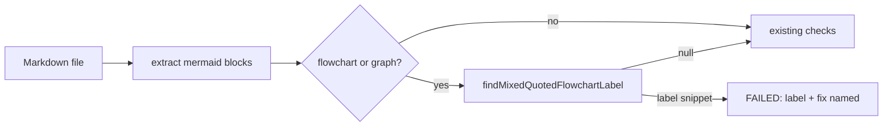

# PR Summary — Issue #3769

## Summary

`worker/deno/lib/mermaid_validator.ts` now refuses a flowchart (or `graph`) node label in which unquoted text is followed by a double-quoted string inside one `[...]`, `(...)` or `{...}` shape, such as `D[profit, percent, "since cost"]`. Mermaid's lexer reads that as a TEXT token then a STR token, which its `text` rule has no form for, so the diagram does not render, yet the validator reported PASSED. The error names the label and both fixes: quote the whole label, or write the inner quotes as `#quot;`. The new check found one real instance on the base branch, `docs/archive/pr-summaries/pr-summary-3124.md:49`, which this PR fixes in place with `#quot;` (an archived summary edited only so the gate stays green). Closes #3769.

## Spec

### Intent and Rationale

- The #3717 audit traced a private-repo-A#3252 review finding (`D[profit, percent, "since cost"]`) to a parse error the local Mermaid gate passed; the gate should catch what Mermaid itself rejects.
- The private-repo-A check is that repository's own gate and is not changed from here.

### Essential Design Decisions

- A line-local linear character scan, not a regex and not a full Mermaid parse; it is marked `SIMPLE-ON-PURPOSE` with the upgrade condition (a multi-line label or another lexer rule to refuse).
- A node opener is `[`, `(` or `{` directly after a word character and outside a quoted string, so nested shapes (`A[(...)]`, `A(("..."))`) and quoted labels containing brackets are handled.
- `%%` comment lines and `click … call fn(args)` lines are skipped: Mermaid lexes callback arguments as one token, not a node label.
- The refusal runs only for `flowchart` / `graph` blocks; other diagram types keep their existing checks.

### Undiscoverable Facts

- Mermaid's flowchart lexer emits TEXT then STR for `D[a, "b"]`; the grammar's `text` rule accepts neither TEXT STR nor STR TEXT mixes, so the parse fails (private-repo-A#3252 review at head `4228cada`).
- `#quot;` is Mermaid's entity form of `"` inside a label and renders as a quote without opening a STR token.
- A quoted edge label (`A -->|"x"| B`) is a separate lexer path and is not affected by this rule.

## Evidence

Backend/worker change; no UI file touched. Covered by unit tests listed under Test Plan.

Observed behaviour relied on: `deno run --allow-read --allow-env mod.ts check-mermaid --script-dir <dir>` on a file holding `A --> D[profit, percent, "since cost"]` now prints `a.md:1 (flowchart): Flowchart node label mixes unquoted text with a quoted string: \`D[profit, percent, "since cost"]\` — quote the whole label (e.g. D["text"]) or write the inner quotes as #quot;` and exits 1; before this change the same validator reported `mermaid: PASSED (1 file(s), 1 block(s) checked)` (issue body).

Issue numbers cited as provenance: #3769: Mermaid validator accepts a flowchart label that mixes unquoted text with a quoted string (private-repo-A#3252 review); #3124: Fleet PRs leave a literal QUALITY_RESULT_PLACEHOLDER where the quality-gate result belongs (VibeCoder2698, VibeCoder3006, VibeCoder3122); #3717: Finish #3689: Audit deployed pre-PR quality stages against actual GitHub CI failures across private-repo-C, VibeCoder and private-repo-A.

**Docs sweep** — grep: `mermaid_validator`, `check-mermaid`, "#quot;", "mixes unquoted", "Fixed by #3769"; section: `docs/INTERNALS.md` Mermaid validator section, `docs/pre-pr-ci-audit.md` review-finding table and notes; siblings: "subgraph" and "gitGraph" (the existing per-type refusals the validator lists); updated: `docs/INTERNALS.md`, `docs/pre-pr-ci-audit.md`, `docs/archive/pr-summaries/pr-summary-3124.md`; `docs/EXTENDING.md:247` — still true because it only names the validator module; `prompts/coding_guidelines/prompt.md:394` — still true because it only says gitGraph syntax is validated by the module; `docs/INTERNALS.md:5552` — still true because the module table row describes the file, not its rule list; `docs/pre-pr-ci-audit.md:106` — still true because it is an unrelated stage's gap; `docs/pre-pr-ci-audit.md:110` — still true because it is an unrelated stage's gap; `docs/pre-pr-ci-audit.md:276` — still true because it is an unrelated finding's gap; `docs/pre-pr-ci-audit.md:332` — still true because it is an unrelated finding's gap.

### Writing a gate over text

| Evasion / look-alike | Result | Test |
| --- | --- | --- |
| `D[profit, percent, "since cost"]` (issue case) | refused | rejects unquoted text then quoted string in [] (issue case) |
| same mix in `(...)` / `{...}` / under `graph` | refused | round shape, diamond shape, graph declaration tests |
| bad node second on a line | refused | rejects a bad node that is the second node on a line |
| nested opener `A[(text "x")]` | refused | rejects a nested opener holding unquoted text then quoted string |
| node id starting with `click` (`clicked[a "b"]`) | refused | still flags a node whose id starts with click |
| whole label quoted, incl. commas or brackets | accepted | accepts whole label quoted with commas; accepts quoted label containing brackets |
| quoted stadium, cylinder, subroutine, hexagon, parallelogram, double-circle | accepted | one accept test per shape |
| `#quot;` escapes after unquoted text | accepted by design | accepts #quot; escapes with unquoted text |
| quoted edge label, quoted `click` callback args | accepted | accepts quoted edge label; accepts quoted argument in click call; accepts quoted callback arguments after other arguments |
| `%%` comment line holding a bad label | ignored | ignores bad label inside a %% comment line |
| non-flowchart diagram | not checked | does not flag non-flowchart diagrams |
| label split across lines | not covered (known limit, line-local scan) | — |

All tests are in `worker/deno/tests/mermaid_validator_test.ts` under the `validateMermaidBlock - flowchart mixed label:` prefix.

- **Corpus:** the repo's own Markdown on the base branch held one true positive (`pr-summary-3124.md:49`, fixed here). An independent scan of 12,604 flowchart lines found 4 more candidates (`docs/GH-API-OPTIMISATION.md:55`, `pr-summary-2279.md:51`, `pr-summary-711.md:69`, `pr-summary-841.md:37`), all quoted edge labels, which Mermaid accepts and the check correctly passes: false positives 0, false negatives 0.
- **Fail closed:** an unclosed label is still refused and named to end of line (`names an unclosed label to end of line`), rather than passed.
- **Cheap on hostile input:** no backtracking regex (the only regex is the single-character `/\s/`); `worker/deno/tests/mermaid_validator_growth_3769_test.ts` times `A[(`×n then `)]`×n at N and 4N with `assertLinearGrowth`, registered in `WALL_CLOCK_TEST_FILES`.

## Acceptance Criteria

<!-- vibe-spec-review inputs="diff+issue-body" -->

- **met** — `worker/deno/lib/mermaid_validator.ts` refuses a flowchart node label in which unquoted text is followed by a double-quoted string inside the same `[...]` / `(...)` / `{...}` shape — evidence: `worker/deno/tests/mermaid_validator_test.ts::validateMermaidBlock - flowchart mixed label: rejects unquoted text then quoted string in diamond shape` — reviewer: met
- **met** — with an error naming the label and the fix (quote the whole label, or use `#quot;`) — evidence: `worker/deno/tests/mermaid_validator_test.ts::validateMermaidBlock - flowchart mixed label: rejects unquoted text then quoted string in [] (issue case)` — reviewer: met
- **met** — A negative test with the label above — evidence: `worker/deno/tests/mermaid_validator_test.ts::validateMermaidBlock - flowchart mixed label: rejects unquoted text then quoted string in [] (issue case)` — reviewer: met
- **met** — a positive test with `D["profit, percent, since cost"]` — evidence: `worker/deno/tests/mermaid_validator_test.ts::validateMermaidBlock - flowchart mixed label: accepts whole label quoted with commas` — reviewer: met
- **met** — The private-repo-A check is that repository's own gate and is not changed from here — evidence: `worker/deno/lib/mermaid_validator.ts::findMixedQuotedFlowchartLabel` (the diff touches only this repository) — reviewer: met

## Standards Review

<!-- vibe-standards-review inputs="diff+CODING-STANDARDS.md" -->

- **violation** — `worker/deno/lib/mermaid_validator.ts:647` — deliberate line-local scan lacked a `SIMPLE-ON-PURPOSE` marker naming its ceiling — reason: fixed in this diff
- **violation** — `worker/deno/lib/mermaid_validator.ts:717` — the unclosed-label fallback in `nodeSnippet` had no test reaching it — reason: fixed in this diff
- **violation** — `worker/deno/lib/mermaid_validator.ts:660` — a quoted `click … call fn(a, "x")` argument was a false positive (raised by the spec reviewer) — reason: fixed in this diff
- **violation** — `worker/deno/lib/mermaid_validator.ts` `isWordChar` — a `ch.length !== 1` guard no input could reach (every caller passes `charAt`) — reason: fixed in this diff (dead guard removed)
- **clean** — no other departure from `CODING-STANDARDS.md`; the archived `pr-summary-3124.md` edit is stated above, the Mermaid lexer behaviour is cited under Undiscoverable Facts, and each branch's red check is recorded in the facts file.

## Test Plan

- `deno test` on `worker/deno/tests/mermaid_validator_test.ts` and `worker/deno/tests/mermaid_validator_growth_3769_test.ts`: 68 passed in the parallel pass, 1 passed in the serial (wall-clock) pass.
- Red checks, each flip run against the suite and restored (one entry per outcome or operand in `pr-summary-3769.facts.json`): drop the `flowchart` operand (6 red); drop the `graph` operand (1); gate forced true (1); refusal forced off (8); `%%` skip removed (1); `click` operand dropped (1); whitespace operand dropped (1); `inString` operand dropped (1); opener operand dropped (3); word-character operand dropped (1); quote operand dropped (3); blank-prefix operand dropped (12); `nodeSnippet` fallback returning `""` (1).
- `check-mermaid --script-dir ../..` over the repository: PASSED after the `pr-summary-3124.md:49` fix (failed on it before).
- `./quality.sh < /dev/null`: cycle 1 FAILED (growth test not registered as wall-clock; moved to its own file and registered); cycle 2 `Result: PASSED (with skipped checks)` — only `config integration` SKIPPED, as on the base branch.

<!-- vibe-branch-outcomes -->

🤖 Generated with [Claude Code](https://claude.com/claude-code)
