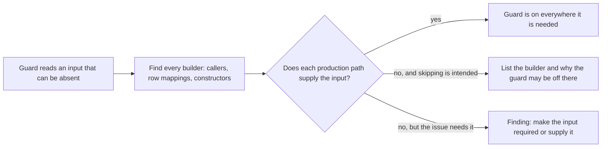

## Summary

Widens the #3253 every-caller rule so it covers a guard whose input can be absent: an optional field on a row or struct, or state that only some constructors set, as well as a defaulted parameter. The rule now asks the author to find every row mapping and constructor that builds the input. When absence must stay legal, the PR summary lists each builder and says why the guard may be off there. The shared review brief gets a step-4 check for this, so the pre-PR verifier and the fleet reviewer ask the question whatever the authoring agent remembered. Closes #3771.

## Spec

### Intent and Rationale

- The #3253 rule was cited in the VibeCoder#3318 review and still missed twice. It talked about a **parameter** with a **default** and said to grep the function's name. In both misses the input was an optional row field or constructor-set state, and grepping the guard's name finds only the guard, not the code that builds its input.
- As the issue asks, this rewords the existing sentence and adds no new rule. The review brief gets one targeted sentence next to the #3666 sentence, following that precedent.

### Essential Design Decisions

- The reworded paragraph keeps the phrases `caller_reach_3253_test.ts` already pins ("a default that silently turns the behaviour off", "so the compiler or type checker names each caller you missed"), so no existing test was edited.
- The paragraph is identical in `CODING-STANDARDS.md` and `prompts/coding_guidelines/prompt.md`. The existing #3253 test asserts that.
- "Make it required" stays the default remedy. The new exception (absence must stay legal) is stated the same way in all four places: list every builder, with why the guard may be off there.

### Undiscoverable Facts

- The issue rules out a worker gate, a lint rule and a Semgrep rule, because whether an absent input should switch a guard off depends on the linked issue. This change is guidance only, with no production code.

## Evidence

Prompt and documentation change only. The new drift test `worker/deno/tests/unsupplied_optional_guard_input_3771_test.ts` pins the widened rule on all five surfaces.

**Docs sweep** — grep: "behaviour-carrying", "turns? the behaviour off", "every caller that needs it"; section: `CODING-STANDARDS.md#test-coverage-expectations`; siblings: none — no existing set gained a member; updated: `CODING-STANDARDS.md`, `prompts/coding_guidelines/prompt.md`, `prompts/issue/prompt.md`, `prompts/pr_review_brief/prompt.md`, `docs/workflows/issue-processing.md`; `docs/workflows/issue-processing.md:1467` — still true because the #3253 history paragraph describes what that issue landed, and the new #3771 paragraph directly after it records the widening.

Issue numbers cited: #3771: Fleet guards treat an absent optional input as "off" on production paths that never supply it, despite the #3253 every-caller rule (VibeCoder#3318 and a private fleet PR); #3253: Fleet PRs wire a new argument or behaviour into some callers and miss one: an optional default or hard-coded old value hides it (VibeCoder#3251, private-repo-A#2282, VibeCoder#3095). VibeCoder#3318 is cited as the issue describes it. `repoHasStartableWork` exists at `worker/deno/lib/repo_busy_for_idle_task.ts:474` and now requests `subIssuesSummary` (line 493).

Related existing rules checked: **A new argument or behaviour reaches every caller that needs it** (#3253, reworded here); the guard-unreadable-case bullet under **Never Fail Silently** (#3615): it covers a read that **fails**, while this covers an input that is never supplied, and the two agree; **Every changed call site needs a test that goes red without it** (unchanged; the reworded paragraph still says it cannot find an unchanged caller); **Nothing exists only for a test to read** and **Narrowing a shared helper changes every caller** (unchanged, no overlap); the issue prompt's Test Plan step (restatement updated to match); the review brief's step 4 #3666 sentence (unchanged; the new sentence follows it). No rule contradicts the new wording.

Every restatement gives the same answer for the edge case "absence must stay legal": the standards paragraph and its twin, the issue prompt's Test Plan step and the manual each say to list every place that builds the value, with why the guard may be off there. The review brief accepts a path that "is meant to skip the guard" and flags one where the linked issue needs the guard.

Applied the rule to this PR's own diff: the diff adds no guard, parameter, field or constructor, so there is nothing for it to flag.

## Test Plan

- Added `worker/deno/tests/unsupplied_optional_guard_input_3771_test.ts` (4 tests: both rule surfaces, the review brief, the issue prompt's PR Summary File section, the issue-processing manual). `deno test -A tests/unsupplied_optional_guard_input_3771_test.ts tests/caller_reach_3253_test.ts tests/test_named_for_step_3666_docs_test.ts tests/pr_review_brief_shared_3395_test.ts tests/pre_pr_verifier_3395_test.ts` passed 73/73 on the final head. `worker/deno/tests/coding_guidelines_twin_drift_test.ts`, `worker/deno/tests/coding_guidelines_overlay_test.ts` and `worker/deno/tests/review_fleet_prs_unrelated_dedupe_3598_test.ts` also passed.
- Per-pin base check (`deno task drift-pins-on-base origin/milestone/fleet-guidance-guards-side-effects-and-concurrency …`, exit 0). Each phrase below is absent from the base section, so the new test goes red without this change:
  - `CODING-STANDARDS.md` § Test coverage expectations and `prompts/coding_guidelines/prompt.md` § Test Coverage Expectations: "or let its absence turn it off", "`field?`", "a field on a row or struct, and state an object is built with", "each row mapping or constructor that leaves it out", "When absence must stay legal", "say for each one why the guard may be off there", "a grep for the guard's name finds only the guard".
  - `prompts/pr_review_brief/prompt.md` § Review Mode — one change against its linked issue: "find every place that builds that input", "A path where the guard is silently off although the linked issue needs it there is a finding".
  - `prompts/issue/prompt.md` § PR Summary File: "required rather than defaulted or left absent in a way that turns the behaviour off", "is listed with why the guard may be off there".
  - `docs/workflows/issue-processing.md` § Reproduction status on a bug fix: "Grepping the guard's name finds only the guard", "An absent input must not switch a guard off unnoticed".
- No existing test was edited and no assertion was removed.
- `./quality.sh` ran on the final head: `Result: PASSED (with skipped checks)`. Only `config integration` was skipped, which is the gate's own environment skip and not related to this diff.

<!-- vibe-branch-outcomes -->

🤖 Generated with [Claude Code](https://claude.com/claude-code)
