## Summary

A fleet PR can change what a shared helper returns, refuses or finds for one
caller and regress another that the diff never touched, with no test covering
the second caller. The #3100 rule named only "narrowing" and accepted a
callers list the author wrote, so VibeCoder#3353 and a private fleet PR both
slipped through. With this change the caller list comes out of the author's
hands: before the pre-PR verifier runs, the worker's own code lists each
function or method whose body the diff changes, searches the head's tracked
sources for other places naming it, and hands each caller to the verifier as a
required item. The code — not the model — turns any caller left without a
verdict, or reported `regressed`, into a blocking finding, in the same shape
`checklistGapFindings` uses for review checklists (#3594). The guidance rule
is widened from "narrowing" to any change in what a shared helper returns,
refuses or finds, and now requires a test through each existing caller whose
behaviour the change touches. Closes #3779.

- `worker/deno/lib/caller_checks.ts` (new): the gate. `collectCallerChecks`
  reads `git diff -U0`, indexes each changed file's definitions with a
  language-agnostic line heuristic (JS/TS, bash, Rust, Python, Ruby, Go), then
  runs `git grep -w` for each name at the head. It skips test, doc, comment,
  in-diff, import-list and the definition's own lines. `renderCallerCheckSection`
  fences the caller list as untrusted text for the brief. `parseCallerVerdicts`
  reads the reply's `callers` array and throws on a malformed entry.
  `callerGapFindings` produces one finding for unreported callers and one per
  `regressed` verdict.
- `worker/deno/lib/pre_pr_verifier.ts`: `buildPrePrVerifierPrompt` gains a
  `callerChecks` field and renders the section, naming "caller list" in the
  boundary-integrity instruction only when it is present. `verifyInCheckout`
  runs `collectCallerChecks`, treats a failure as `not_checked` (never silently
  clean), parses `callers` from the reply, and appends `callerGapFindings` to
  the review's blocking findings. `parseReviewReply` is split into `replyObject`
  (raw JSON) plus the existing validation so the `callers` array is read without
  changing the reply shape the fleet reviewer shares.
- `worker/deno/lib/review_checklists.ts`: `inlineSafe` is exported so the
  caller section can bound names the same way.
- `worker/deno/lib/parallel_unsafe_test_manifest.ts`: the caller checks' linear
  regexes get a wall-clock growth test entry.
- `CODING-STANDARDS.md` and `prompts/coding_guidelines/prompt.md`: the #3100
  rule is rewritten to "**Changing what a shared helper returns, refuses or
  finds changes every caller.**", requiring a test through each existing caller
  whose behaviour the change touches; a self-written callers list no longer
  counts on its own.
- `docs/workflows/issue-processing.md`: documents the caller list the verifier
  receives, the caps (10 callers per function, 15 functions with callers, 40
  functions searched), and the not-checked outcomes.

## Spec

### Intent and Rationale

- The issue rules out a worker gate that decides semantics, a lint rule, a
  Semgrep rule and the diff-scoped mutation gate: which caller depends on
  which result is a judgement, not a syntactic property, and the regressed
  caller is outside the diff. The judgement stays with a model, but the caller
  enumeration moves into code, so the model sees every caller rather than the
  author's summary claim.
- Review checklists (#3594) already have code that turns an item left without
  a verdict into a blocking finding. The same mechanism carries the caller
  list, so no second prompt or gate is added.

### Essential Design Decisions

- **No verdict is never a pass.** A reply without `callers`, or whose entry
  does not match a listed caller, leaves that caller unreported and blocks the
  PR; a `regressed` verdict is itself a blocking finding on the caller's
  file and line.
- **The search is language-agnostic and over-inclusive on purpose.** A
  definition-line regex heuristic names functions and methods across the
  fleet's languages; a false positive costs the verifier one line, a false
  negative hides a caller, so the search keeps any non-skipped line naming the
  symbol and only drops tests, docs, comments, in-diff lines, import/export
  list lines and the definition's own line.
- **Caps bound the grep work and the prompt.** At most 10 callers are listed
  per symbol (the rest counted), at most 15 symbols with callers are listed,
  and at most 40 changed symbols are searched; the excess is a note, never a
  silent drop.
- **Fail loud.** A git diff/show/grep failure, a grep record in an unexpected
  form, or a malformed `callers` array makes the pass `not_checked`, never a
  clean pass. The reason quotes git's own first non-empty stderr line (the
  cause), not the last-line boilerplate.
- **The reply shape is unchanged.** `parseReviewReply` keeps its signature;
  `replyObject` is the shared raw-JSON step the verifier also uses to read
  `callers`, so the fleet reviewer's parser is untouched.
- **The caller list is fenced as untrusted text**, with its own boundary id,
  and the boundary-integrity instruction names "caller list" only when it is
  rendered.

### Undiscoverable Facts

- The issue body has no `## Acceptance Criteria` or Definition of done heading,
  so no closure block or two-axis review block is required, and none is
  emitted.
- The issue scopes the guidance change as a rewrite of the existing #3100
  paragraph, not an addition beside it; the drift test pins the two surfaces
  (standards and prompt) word for word.

## Evidence

Backend-only change; no UI file is touched. It is verified by unit tests
against real git with a scripted model. The four focused suites pass 116
tests: `caller_checks_3779_test.ts` (39), `pre_pr_verifier_3395_test.ts`
(69, including the retained earlier-findings regression), `narrowing_shared_helper_3100_test.ts`
(1) and `pr_review_brief_shared_3395_test.ts` (7).

The new "a git failure listing callers makes the verifier not checked" test
reaches the `!callers.ok` wiring branch. Flipping that guard to `false` broke
type-checking across the suite (the `callers.state` / `callers.reason`
narrowing is lost), and the test asserts the `not_checked` reason quotes git's
cause. No existing assertion was removed.

```mermaid
flowchart LR
    D[git diff -U0] --> P[indexDefinitions + enclosingDefinitions]
    P --> G[git grep -w per changed symbol]
    G -->|skip tests, docs, comments, in-diff, import list, definition| C[caller list]
    C -->|renderCallerCheckSection, fenced| B["brief callers"]
    B --> V[verifier model]
    V -->|callers: verdict per caller| R[parseCallerVerdicts]
    R --> F[callerGapFindings]
    C --> F
    F -->|no verdict / regressed| X[blocking finding]
```

## Test Plan

- `worker/deno/tests/caller_checks_3779_test.ts` (39 tests) covers the gate in
  isolation against real git:
  - `definitionName` across each supported language, and its rejection of
    control words, short names and ordinary calls; `assertLinearGrowth` on
    hostile definition lines (function keyword, const arrow, type annotation,
    Rust modifiers, Python async, Go receiver, bash name, class modifiers).
  - `enclosingDefinitions` for a closure and its enclosing function, an ended
    closure no longer reported, and a changed signature line.
  - `parseDiffChangedLines` for ranges, deletion anchors, deleted files,
    tab-ended names, an empty diff, and hostile hunk counts and header tabs.
  - `collectCallerChecks` for the exact caller line (skipping imports, tests,
    docs, comments, in-diff lines and the definition), the import-list bare
    name, the ten-caller cap with a note, the searched-symbols cap note, a
    tests-and-docs-only diff, git's own cause on a bad sha, and a spawn failure.
  - `renderCallerCheckSection` empty when nothing to check, and the fenced
    per-caller instruction.
  - `parseCallerVerdicts` accepting absent/valid, rejecting a non-array,
    non-object, missing field and bad verdict with the index.
  - `callerGapFindings` for a missing verdict (one finding naming it), a full
    set (no finding), a different-caller verdict (unsatisfied), backtick/case/
    `./`-insensitive matching, a `regressed` verdict (finding on the caller's
    file and line with the note), an unexpected `regressed` verdict (still a
    finding), and `unchanged`/`changed and tested` never finding.
- `worker/deno/tests/pre_pr_verifier_3395_test.ts` adds, against a scripted
  model and real git:
  - `the verifier lists an existing caller inside the fence, and a reply with no callers is blocked`
  - `a reply that gives every caller an unchanged verdict is not blocked`
  - `a caller marked regressed is a blocking finding on the caller's file and line`
  - `a malformed callers verdict makes the reply not usable, so the pass is not checked`
  - `a git failure listing callers makes the verifier not checked, never asked of the model`
  - `a change that only edits a constant gets no existing-callers section`
  The retained `runPrePrVerifier: earlier findings need complete fixed verdicts
  even when findings is empty` regression is unchanged from the base branch.
- `worker/deno/tests/narrowing_shared_helper_3100_test.ts` pins the widened
  rule's wording on both surfaces, and the added phrases (`a lookup that gains
  a fallback`, `reads "nothing found" as "leave it alone"`, `a callers-checked
  list alone does not count`) were absent from the base paragraph.
- Removed from `worker/deno/tests/narrowing_shared_helper_3100_test.ts`: assert(start >= 0, `could not locate the narrowing-helper rule in ${what}`);
  Required by: "Changing what a shared helper returns, refuses or finds changes every caller"
  Replaced by: ``assert(start >= 0, `could not locate the changing-a-shared-helper rule in ${what}`)``
- Removed from `worker/deno/tests/narrowing_shared_helper_3100_test.ts`: assert(paragraph.includes(phrase), `${surface} is missing "${phrase}" from the narrowing-helper rule: ${paragraph}`);
  Required by: "Changing what a shared helper returns, refuses or finds changes every caller"
  Replaced by: ``assert(paragraph.includes(phrase), `${surface} is missing "${phrase}" from the changing-a-shared-helper rule: ${paragraph}`)``
- Removed from `worker/deno/tests/narrowing_shared_helper_3100_test.ts`: assertEquals(narrowingHelperParagraph(standards, "CODING-STANDARDS.md"), narrowingHelperParagraph(guidelines, "coding_guidelines"), "the narrowing-a-shared-helper rule must be identical on both surfaces");
  Required by: "Changing what a shared helper returns, refuses or finds changes every caller"
  Replaced by: ``assertEquals(sharedHelperRuleParagraph(standards, "CODING-STANDARDS.md"), sharedHelperRuleParagraph(guidelines, "coding_guidelines"), "the changing-a-shared-helper rule must be identical on both surfaces")``
- `worker/deno/tests/pr_review_brief_shared_3395_test.ts` gives the prompt
  base its new `callerChecks: { expected: [], notes: [] }` field so the
  existing "carries every rule" test still runs.
- Callers checked for the new required `callerChecks` opt and the
  `parseReviewReply` split: the shared-brief test and the verifier's own
  `verifyInCheckout`. `deno check` over `lib/` passes.
- Related existing rules checked: "Narrowing a shared helper changes every
  caller" (#3100, rewritten here), "A new argument or behaviour reaches every
  caller that needs it" (#3253) and "Every changed call site needs a test that
  goes red without it". The widened rule agrees with both; neither contradicts
  the new "test through each touched caller" requirement. Applied to this PR's
  own diff: the new helpers are wired into `pre_pr_verifier.ts` (their one
  production caller) and that wiring is exercised by the verifier tests above;
  the fixture `sharedHelper` body change has its caller listed by the tests
  that read it.
- `worker/deno/lib/caller_checks.ts:92` — exempt (untestable): `if` is two characters, so the length check rejects it before the control-word set is read
- `worker/deno/lib/caller_checks.ts:100` — exempt (untestable): `do` is two characters, so the length check rejects it before the control-word set is read
- Docs sweep — grep: "Narrowing a shared helper", "starts rejecting, throwing
  on or dropping", "apply the stricter rule at the new call site", "callers",
  "pre-PR verifier"; section: `CODING-STANDARDS.md#test-coverage-expectations`,
  `docs/workflows/issue-processing.md#pre-pr-verifier-issue-3395`; siblings:
  "A new argument or behaviour reaches every caller that needs it", "Every
  changed call site needs a test that goes red without it"; updated:
  `CODING-STANDARDS.md`, `prompts/coding_guidelines/prompt.md`,
  `docs/workflows/issue-processing.md`, `worker/deno/tests/narrowing_shared_helper_3100_test.ts`.
- Issue numbers cited as provenance: #3100 (the rule this widens), #3594 (the
  checklist mechanism reused), #3766 (the same "self-written list is not
  checked" diagnosis), #3779.
- Lib sweep: the new module is claimed by
  `docs/audits/lib-sweep-coverage/top-up-3779.json`, and its growth test is
  listed in `WALL_CLOCK_TEST_FILES`.

<!-- vibe-branch-outcomes -->
