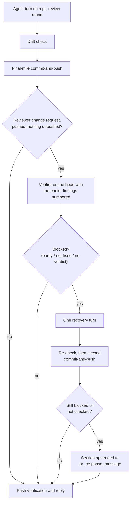

## Summary

Review-fix rounds now get an independent check before the worker replies. On a `pr_review` round that pushed a fix, the worker re-runs the pre-PR verifier (the fleet reviewer's brief) on the round's head with the change request's findings filled into `PREVIOUS_FINDINGS`. The brief asks for an `earlierFindings` verdict per finding (`fixed`, `partly`, `not fixed`), and the code — not the model — adds a blocking finding for each one marked `partly` or `not fixed` or left without a verdict. A blocked result gets one recovery turn and one re-check; whatever survives is written into the PR reply under `### Review-fix verifier (Issue #3784)`, so the round does not report those findings as resolved. Closes #3784.

## Spec

### Intent and Rationale

- The prose rules #3086, #3114 and #3348 are judged by the agent that wrote the fix, and re-reviews kept finding fixes only partly applied; the next fleet review was the first independent check.
- Reusing the existing verifier and brief, rather than a key-term grep, catches ordering defects (where a value is read) that text matching cannot.

### Essential Design Decisions

- The verdict is owed by code: `earlierFindingGapFindings` (`worker/deno/lib/pre_pr_verifier.ts`) turns a missing, `partly` or `not fixed` verdict into a blocking finding, the same shape as `checklistGapFindings` (#3594).
- `round` is a required field of the verifier input (`{kind: "pre-pr"}` or `{kind: "review-fix", prNumber, previousFindings}`), so every caller states which round it runs; the pre-PR prompt is byte-identical to before.
- The gate runs after the final-mile commit-and-push and before push verification and the reply, because the pr_feedback prompt has the agent push its own fix commits during its turn; the head is only complete then. A recovery turn's commits ride a second commit-and-push.
- A pass that cannot run, or a re-check that cannot run after a recovery turn, is reported in the reply as not checked — never read as clean or recovered.

### Undiscoverable Facts

- #3697 (hold a verifier finding instead of shipping it) and #3766 (closure verdicts) landed on the `milestone/auto-merge-holds-self-flagged-problems-never-ship` branch, not `main`, so this PR builds on `main` without them. On this path "hold" means the reply names the unresolved findings; it does not block auto-merge, which still needs the fleet re-review's approval.
- The fleet skill's `post.ts` does not act on `earlierFindings`; the brief asks the fleet reviewer to list each `partly` or `not fixed` finding under `findings` too, which is what sends a PR back.

## Evidence

Backend only — no UI files changed. The new gate, its wiring and the verifier changes are covered by the tests in the Test Plan.

Observed `gh pr view --json baseRefName,title,files` output shape (PR #3792): `files` is an array of `{path, additions, deletions, changeType}` objects and `baseRefName` is a branch name, so the gate reads `files[].path` and diffs against `origin/<baseRefName>`.

**Docs sweep** — grep: `PREVIOUS_FINDINGS`, "No earlier review", "pre-PR verifier", `earlierFindings`, "drift check"; section: `docs/workflows/pr-feedback.md#the-workers-review-fix-verifier-issue-3784`; siblings: `checklist`, `unrelatedIssues` (the brief reply fields `earlierFindings` joins); updated: `docs/workflows/pr-feedback.md`, `docs/workflows/issue-processing.md`, `docs/MODEL-AND-CACHING.md`, `.claude/skills/review-fleet-prs/SKILL.md`, `prompts/pr_feedback/prompt.md`, `prompts/pr_review_brief/prompt.md`; `docs/MODEL-AND-CACHING.md:107` — still true because that row describes the issue-phase verifier section, which still uses the `issue` phase's model; `docs/workflows/issue-processing.md:2170` — still true because the drift check still runs only on a review-fix push.

Issue numbers cited: #3086, #3114, #3348 (the prose rules named by the issue), #3395 (pre-PR verifier), #3594 (review checklists), #3697 and #3766 (milestone work named by the issue), #3143 (drift check).

## Test Plan

- Added `worker/deno/tests/pre_pr_verifier_review_fix_3784_test.ts` — `earlierFindings` parsing, gap findings, the review-fix prompt (fenced numbered findings, hostile text), and `runPrePrVerifier` on both rounds.
- Added `worker/deno/tests/review_fix_verifier_gate_3784_test.ts` — skip, clean, recovered, reported, not-checked, gh failure, missing summary, bad base ref, linked-issue fallback and the per-finding verdict log line.
- Added `worker/deno/tests/pr_feedback_processor_review_fix_verifier_3784_test.ts` — the real `processPrFeedback` wiring: when the gate is and is not called, the second commit-and-push, a failed recovery push not claimed, a throwing gate.
- Added `worker/deno/tests/change_request_findings_3784_test.ts` — `parseChangeRequestFindingEntries` against a body built by the fleet's own `reviewBody`.
- Edited fixtures only (no assertion removed): `worker/deno/tests/pre_pr_verifier_3395_test.ts`, `worker/deno/tests/completion_phase_pre_pr_verifier_3395_test.ts` and `worker/deno/tests/pr_review_brief_shared_3395_test.ts` now pass `round: { kind: "pre-pr" }` or `earlierFindings: []`; in `pre_pr_verifier_3395_test.ts` the parsed-audit comparison expects `{ ...audit, earlierFindings: [] }` because the parser now always fills the field.
- Targeted run on the final head: parallel pass 119 passed | 0 failed; serial pass 31 passed | 0 failed.
- Every branch outcome was flipped on purpose and its test went red (see the facts file).
- Callers checked for the new required `round` field: `worker/deno/lib/phases/completion_phase.ts` (passes `pre-pr`) and `worker/deno/lib/review_fix_verifier_gate.ts` (passes `review-fix`); the type checker names any other.
- `./quality.sh` on the final head: `Result: PASSED (with skipped checks)` — Deno tests parallel and serial passes PASSED; only `config integration` was skipped (no `.config.json` in the checkout).
<!-- vibe-branch-outcomes -->
