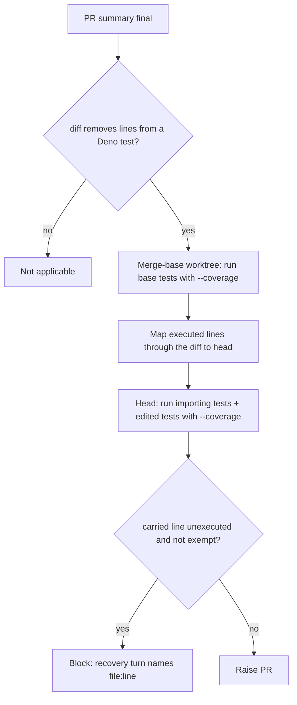

## Summary

Adds the coverage carry-over check, a PR-raise gate beside the mutation check. When a PR deletes an existing Deno test file or removes lines from one, the gate runs the base versions of those tests with line coverage at the merge base. It keeps the production lines they executed that are still present and unchanged at head, then blocks when no head test executes one of them. This catches the `rewritten-test-drops-live-branch` pattern: a test the issue rightly retires was the only test of a branch the PR leaves in place. Closes #3795.

## Spec

### Intent and Rationale

- The removed-assertion gate judges the stated reason and the mutation check mutates only added lines, so an unchanged branch orphaned by a retired test went unchecked. Which lines a test reaches is a runtime property, so the check measures coverage instead of reading source.
- A worker gate, not an optional task: the miss is information the agent never looks at.

### Essential Design Decisions

- Cost is bounded to PRs that remove test lines; pure test additions skip the check. The base run covers only the removed or edited test files, in a temporary detached `git worktree` that is removed afterwards.
- Lines are mapped through `git diff --unified=0 --no-renames <base>...HEAD`; deleted or rewritten lines are out of scope. With `--no-renames`, a renamed production file counts as deleted and is not checked.
- The head side runs, per Deno project, the tests that import a carried file directly plus the head versions of the edited tests (`SIMPLE-ON-PURPOSE`). A line reached only indirectly is reported and can be exempted with the mutation check's `` `path:line` exempt (untestable): <reason> `` convention (`parseMutationExemptions` is reused).
- A runner error fails closed (blocks); a budget exhaustion (fixed 600 s) warns and never passes; `skip_coverage_carryover_check` opts a repository out. The verdict sets `needsTestChanges`, so the recovery turn may add tests.

### Undiscoverable Facts

- Rust is not checked yet: the container installs `cargo-mutants` but not `cargo-llvm-cov`, so a Rust test removal reports not applicable with that reason.
- Observed: `deno coverage --lcov <dir>` prints `SF:/abs/path/m.ts` and `DA:<line>,<count>` records and leaves `*_test.ts` files out by default.

## Evidence

Backend/worker change; no UI files touched. Two real git + deno integration tests build a repository, delete the only test reaching a branch, and assert that branch's line is reported (and cleared when the remaining test reaches it).

**Docs sweep** — grep: `skip_mutation_check`, "mutation check", "late summary gates", "late-summary gates"; section: `docs/mutation-check.md#flow`; siblings: `skip_mutation_check`, `mutation_check_budget_seconds` — the new `skip_coverage_carryover_check` row sits beside them in `docs/CONFIGURATION.md`; updated: `docs/coverage-carryover-check.md` (new), `README.md`, `docs/CONFIGURATION.md`, `docs/mutation-check.md`, comments in `worker/deno/lib/phases/completion_phase.ts`; `docs/workflows/issue-processing.md:2213` — still true because that list names the summary gates the claim check orders against and already omits the mutation check, so it is not a list of every late gate.

Issue numbers cited: #3795: Fleet PRs that rewrite or delete a test the issue retires leave a still-live branch with no test; #3393 and #3131 are cited only as the existing mutation and removed-assertion gates.

## Test Plan

- New: `worker/deno/tests/coverage_carryover_gate_test.ts` (diff parsing and line mapping, lcov parsing, verdict and comment).
- New: `worker/deno/tests/coverage_carryover_runner_test.ts` (fake-seam runner paths plus two real git + deno integration tests).
- New: `worker/deno/tests/completion_phase_coverage_carryover_gate_test.ts` (live completion phase: blocks, exemption, budget, fail-closed error, uncollectable diff, skip switch, unwired runner).
- Added tests to `worker/deno/tests/config_test.ts` (the `skip_coverage_carryover_check` key) and `worker/deno/tests/issue_worker_wiring_test.ts` (default wiring). No existing assertion is removed or edited.
- Red checks: dropping the exemption line comparison, computing the insertion hunk end as `os + oc - 1`, replacing the base-failure cause with a fixed string, deleting the completion phase's standalone block, forcing the skip condition false, and removing the `createDefaultDeps` wiring each turned the named tests red; each was restored.
- `./quality.sh < /dev/null` on the final code: first run failed only on the lib sweep ledger (the two new modules were unclaimed), fixed by `docs/audits/lib-sweep-coverage/top-up-3795.json`; second run passed (config integration skipped, as on every local run).
- Entry points checked: `completionBody` (the standalone block and the `lateSummaryVerdicts` fold), `createDefaultDeps` (default wiring), `loadConfig` (repo_config key).
- Known limit: git C-quotes paths with non-ASCII or special characters; such a test file is not recognised, so its removal is not checked.

<!-- vibe-branch-outcomes -->
