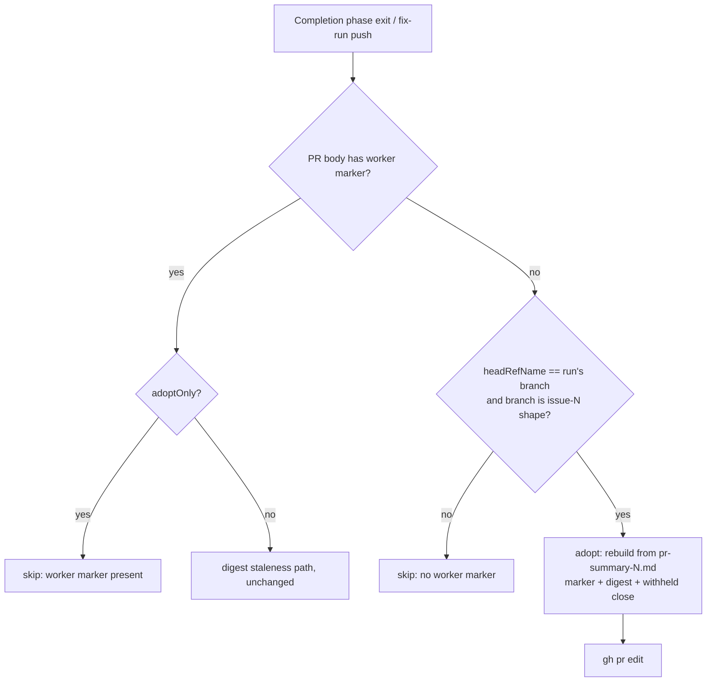

## Summary

The worker now takes over the body of a PR the agent raised itself with
`gh pr create`. Before this change, such a PR kept the agent's draft for
good. `syncPrBodyFromSummary` adopts a body that has no worker marker when
the PR's head is the run's own `issue-<N>[-slug]` branch. Adoption rebuilds
the body from `pr-summary-<N>.md` with the worker marker and the summary
digest. When the summary marks a criterion `missing`, it also applies the
#3177 withheld close (`Part of #N` plus a `## Not closing #N` section). All
three fix-run processors (PR-feedback, CI-fix and merge-conflict) now pass
their PR's head branch.

The issue run's completion phase also adopts such a PR at every exit, through
the new `adoptAgentRaisedPrBody`. This covers the exits that leave an existing
PR unfinalised: a first summary-rule block, the quality-gate time-limit skip
and the other early exits. Closes #3804.

## Spec

### Intent and Rationale

- The two fleet PRs in the issue stayed on the agent's draft because nothing
  ever stamped the worker marker. The #2022 "never touch a body the worker did
  not author" rule then kept every later sync away from them.
- The fix uses both of the issue's proposals: a completion-phase adoption at
  every exit, and the body-sync backstop for PRs already in this state. Both
  use the same assembly (`assemblePrBody`), so the #3177 withheld close is
  never re-implemented.

### Essential Design Decisions

- The condition is the branch, not the author login. Adoption needs two
  things: the PR's `headRefName` equals the run's `branchName`, and that
  branch has the worker's shape (`issueNumberFromBranch`, the existing owner
  of that shape). A marker-less PR on any other branch is still skipped with
  `no worker marker`.
- An adopted body skips the digest and before-push-SHA staleness tests, so it
  is always rebuilt. Every other sync guard still applies: a deleted summary
  file, the HEAD versus `headRefOid` check, and the "body already current"
  check.
- The completion-phase hook passes `adoptOnly: true`, so it never refreshes a
  body that already carries the marker. Before it calls the sync, it requires
  this checkout's `HEAD` to equal the pushed head (`git ls-remote origin
  refs/heads/<branch>`). The fix-run sync's ancestor allowance would otherwise
  let it describe a local summary that is not yet on the remote.
- `branchName` is a required field on `SyncPrBodyInput`, so the type checker
  names any caller that does not pass it.

### Undiscoverable Facts

- The issue reports that both affected PR bodies carried
  `vibe-quality-gate-skipped`. The hook runs after every completion outcome,
  so it does not depend on which exit left the PR unfinalised.
- An adopted body gets no `vibe-sub-agent-tier` marker. The draft carries
  none, and the issue does not ask for one.

## Evidence

This is a backend-only change. The tests below drive the real sync and
assembly code against fake `gh` and `git`.

Guards the adoption path keeps from the existing sync path: summary file
deleted → skip; checkout `HEAD` is not the PR head → skip; body already
current → skip. Excluded: the digest/legacy before-push-SHA staleness test,
because the draft was never built from the summary and so has no recorded
state to compare.

Callers of `syncPrBodyFromSummary` / `runPrBodySync` checked, each passing
`branchName`: `lib/pr_feedback_processor.ts` (`input.branchName`),
`lib/pr_ci_processor.ts` (`input.branchName`),
`lib/pr_merge_conflict_processor.ts` (`branchName` in `resolveConflict`),
`lib/agent_pr_adoption.ts` (the completion hook).

Issue numbers cited: #3804: Agent-raised fleet PRs keep the agent's draft
body; #3177: missing-criterion close guard.

**Docs sweep** — grep: `syncPrBodyFromSummary`, `pr_body_sync`, "no worker
marker", `WORKER_PR_MARKER_PREFIX`, "did not author"; section:
`docs/USAGE.md` (PR description re-sync paragraph); siblings: "no worker
marker", "summary unchanged" — these existing skip reasons gained a sibling
(`worker marker present`). They are documented only in the
`syncPrBodyFromSummary` doc comment, which now lists it. updated:
`docs/USAGE.md`, `docs/INTERNALS.md`, the module and function doc comments in
`worker/deno/lib/pr_body_sync.ts`, plus the sweep slice
`docs/audits/lib-sweep-coverage/top-up-3804.json`; `docs/workflows/issue-processing.md:2502`
and `:2567` — still true because they describe re-deriving the leading
degraded/partial-delivery section, which adoption leaves unchanged.

## Test Plan

- `worker/deno/tests/pr_body_sync_test.ts` — new tests:
  - `syncPrBodyFromSummary - Issue #3804: adopts a marker-less agent draft on the run's own branch`
    (with no before-push SHA, the edited body has `<!-- vibe-worker-issue-42 -->`,
    the digest marker, `Part of #42` and `## Not closing #42`, and no
    `Closes #42`)
  - `syncPrBodyFromSummary - Issue #3804: does not adopt when the head is another worker branch`
  - `syncPrBodyFromSummary - Issue #3804: does not adopt a marker-less PR on a non-worker branch`
  - `syncPrBodyFromSummary - Issue #3804: adoptOnly leaves a body that already carries the marker`
  - Existing tests gain the new required `branchName` input and a
    `headRefName` in the `pr view` fixture. The existing `no worker marker`
    test now sets the PR head to `feature/hand-raised`, so it still covers the
    skip for a PR on a branch that is not the run's own. No assertion was
    removed. A marker-carrying PR still goes through the normal digest path:
    the existing digest and facts tests pass unchanged.
- `worker/deno/tests/agent_pr_adoption_test.ts` — new: the hook syncs once
  `HEAD` is pushed. It does not adopt when `HEAD` differs from the pushed
  head, when the branch is not pushed, on a non-worker branch (no git call),
  with no open PR, with an unnumberable PR URL, with a blank checkout path, or
  when both `HEAD` and the remote are unreadable. A throwing dependency is
  logged and never thrown.
- `worker/deno/tests/completion_phase_unassign_test.ts` —
  `completion - Issue #3804: adopts the agent-raised PR body on the run's own branch`
  runs `workOnIssueCompletion` and asserts a `gh pr edit` carrying the worker
  marker.
- Red checks. Each mutation was applied to the committed head, the named test
  was run, and the file was restored:
  - base-branch `lib/pr_body_sync.ts` → `adopts a marker-less agent draft` red
  - `headRefName === branchName` operand forced true → `another worker branch` red
  - `issueNumberFromBranch` operand forced to a number → `non-worker branch` red
  - `adoptOnly` guard removed → `adoptOnly leaves …` red
  - `!adopting` bypass removed (legacy before-SHA skip applies) → `adopts …` red
  - completion hook call disabled → `completion - Issue #3804 …` red
  - HEAD/pushed check removed → `HEAD differs` and `not pushed` red
  - branch-shape check removed in the hook → `not a worker issue branch` red
  - `adoptOnly: false` passed by the hook → the hook's sync test red
- Targeted run: the new and edited test files, plus the 45 test files that
  reference `workOnIssueCompletion` or `syncPrBodyFn`, all passed.
- `./quality.sh` on the final code: the first run failed only on
  `tests/lib_sweep_coverage_test.ts`, because the new module was claimed by no
  sweep slice. Adding `docs/audits/lib-sweep-coverage/top-up-3804.json` fixed
  it, and the re-run reports `Result: PASSED (with skipped checks)`. Only
  `config integration` was skipped.

<!-- vibe-branch-outcomes -->
