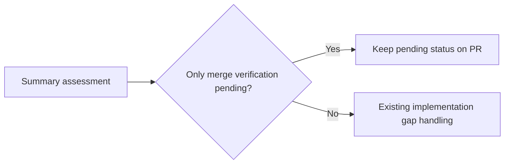

## Summary

Closes #3961.

Pending required CI/quality checks and routine clean review no longer create
partial-delivery follow-ups or nested follow-up escalation when the summary
identifies verification as the only remainder. The originating PR keeps its
honest pending entry. Failed checks, absent tests and unfinished implementation
continue through the existing gap-handling path.

The shared assessment handles initial completion, healthy and fallback runs,
issues without stated criteria, and PR-body refresh. Refresh removes an obsolete
pending-only follow-up banner without editing or closing the existing issue.

## Spec

### Intent and Rationale

- Keep mandatory merge verification on the PR instead of creating another
  implementation issue merely to await that verification.

### Essential Design Decisions

- Preserve closure statuses and acceptance/review/CI/merge gates. Recognising
  pending verification does not count it as delivered or as a passed check.
- Recognise narrow legacy pending-check wording conservatively. Unknown words
  remain actionable. A mixed criterion whose implementation is complete can
  explicitly state `reason: CI not yet verified — remaining: merge-verification-only`
  (also accepts `awaiting code review` or `quality gate not yet run`).
- Generation guidance puts routine pending checks in `## Merge verification`;
  unavailable local tooling and actual results remain in Evidence. The explicit
  remainder annotation is for verification only, never a known failed check or
  missing implementation/test repair.

### Undiscoverable Facts

- None.

## Evidence

- #3961: Keep pending required CI and clean code review out of partial-delivery
  follow-ups.
- The pending-only regressions failed against unchanged base production code.
- Three focused suites pass: 166 tests, no failures.
- Individual mutations of filtering, explicit remainder handling, legacy subject
  and reason checks, the pending-state check, criterion matching, and refresh
  handling made regression tests fail. Logs were retained during local checks.
- Docs sweep — grep: "merge-verification-only", "Pending merge verification";
  updated `CODING-STANDARDS.md`, `prompts/issue/prompt.md` and
  `docs/workflows/issue-processing.md`; section:
  `docs/workflows/issue-processing.md` → "Pending merge verification remains on
  the originating PR"; siblings: none — extends the existing shortfall
  assessment without adding a status or a separate follow-up path.

## Acceptance Criteria

- **met** — Pending required CI/quality execution or the routine clean code review stays visible on the originating PR; waiting for these checks alone does not create a partial/degraded-delivery follow-up or a nested follow-up escalation. — evidence: completion composition regression checks PR creation, retained pending text and absence of follow-up/human escalation writes.
- **met** — Update the implementation summary guidance and deterministic follow-up path, including re-synchronisation, so future summaries distinguish mandatory merge verification from actual remaining work. — evidence: shared assessment, issue prompt and standards changes; PR-body sync regression.
- **met** — Genuine failed checks, known defects, absent tests, missing implementation and mixed criteria with unfinished product work remain actionable. Do not weaken any CI, review, acceptance or auto-merge gate, or claim a pending check passed. — evidence: real/mixed-gap regressions and existing gap/completion/sync suites; closure statuses and gate implementations are unchanged.
- **met** — Regression tests cover healthy/degraded runs, no stated criteria, re-synchronisation and real/mixed gaps. — evidence: the three affected test files.

## Test Plan

- `degraded_delivery_test.ts` covers pending-only scope with and without stated
  criteria, explicit verification-only remainders, real/mixed defects, an already
  observed CI result, and unknown/unassessed checks.
- `completion_phase_degraded_delivery_test.ts` drives the production completion
  entry point for healthy and degraded runs, including an existing follow-up.
- `pr_body_sync_test.ts` drives body refresh and checks that pending status
  survives while the false follow-up banner disappears, with no follow-up write.
- Refresh with no new closure assessment retains existing follow-up provenance;
  absence of an assessment is not treated as proof of pending-only work.
- Existing test assertions were retained.

<!-- vibe-branch-outcomes -->
