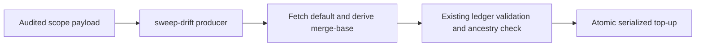

## Summary

Closes #3976.

The existing `sweep-drift` command now creates top-ups through
`--record-top-up payload.json`. The producer discovers and fetches the actual
default branch, derives the default/HEAD merge-base, and validates the serialized
record with the existing ledger and ancestry checks. Agents supply the audited
scope; the producer owns `chunk` and `sweptAt`.

Repeated generation preserves the original horizon and scope. Only finalising
`claimed` coverage as `swept` can update an existing record. Historical invalid
records still require the documented repoint procedure. Unavailable refs,
history and writes remain explicit failures with redacted diagnostics.

## Spec

### Intent and Rationale

Prevent branch-only audit references without claiming that later commits were
audited or asking an agent to copy a suitable SHA into JSON.

### Essential Design Decisions

- Extend the existing command and ledger module; reuse its parser, Git runner,
  history deepening, default-ancestry validator, file lock and atomic writer.
- Discover the remote default before fetching its tracking ref. This also works
  in a shallow feature-only clone that has no local default tracking ref.
- Lock per issue in the Git directory, confine output to the repository, retain
  the symlink refusal, and avoid rewriting unchanged records.
- Keep required CI ancestry enforcement unchanged. The producer establishes
  provenance; it does not certify that an agent actually audited its supplied list.

### Undiscoverable Facts

The public failure/claim comments linked by #3976 do not identify the installed
worker SHA or prompt revision. The retrieved target-work commit is not evidence
of the worker build. At source baseline `90a8da73`, creation guidance asked the
agent to write JSON; `sweep-drift` reported and validated records but did not
create them. The operator manual states this evidence limit and documents how
to verify the eventual merged source SHA and deployed artifact before attributing
any recurrence to this repaired path.

## Evidence

- #3976: Prevent recurring branch-only sweptAt records at the audit-record producer.
- The old command failed the production-entry regression because it did not
  serialize a top-up. The initial implementation also failed the shallow-clone
  and redacted-result regressions before those defects were fixed.
- Three focused suites pass: 61 tests. Thirty-nine isolated mutations each
  failed their named regression assertion. Production files were not changed
  by those mutation runs.
- The real Git fixture exercises feature work, squash integration, later default
  commits, repeat generation and the existing ancestry guard. Separate fixtures
  exercise shallow feature-only clones and unavailable history/default refs.
- Docs sweep — grep: "sweptAt", "merge-base", "top-up", "last modified";
  updated `docs/SECURITY-SCAN.md` and `prompts/security_scan/prompt.md`;
  section: `docs/SECURITY-SCAN.md` → "Create top-ups with the existing sweep-drift command";
  siblings: none — the existing command gains a creation mode, with no new
  command, ledger format or ancestry gate. Historical repoint guidance remains
  distinct from new-list generation.

## Acceptance Criteria

<!-- vibe-spec-review inputs="diff+issue-body" -->

- **met** — Creating a top-up on a feature or milestone branch cannot emit a branch-only `sweptAt` through the supported production path. — evidence: command-created record and existing ancestry validator. — reviewer: met
- **met** — A real-git fixture with a feature commit, squash merge and advancing default branch reproduces the old failure and passes through the repaired producer plus existing guard. — evidence: production-entry regression was red against the old command and green after repair. — reviewer: met
- **met** — Repeated generation is idempotent; existing audit coverage is not silently rewritten or overstated. — evidence: unchanged bytes/horizon, finalisation, immutable scope and status rollback regressions. — reviewer: met
- **met** — Missing history/ref failures remain visible and do not manufacture a passing record. — evidence: missing default, explicit fetch, shallow history and malformed advertisement regressions. — reviewer: met
- **met** — State which production path/build was fixed and how deployment can be verified. — evidence: source baseline, unavailable historical worker-build evidence and post-merge deployment verification are documented. — reviewer: met

## Standards Review

<!-- vibe-standards-review inputs="diff+CODING-STANDARDS.md" -->

- **violation** — Initial default discovery depended on an absent tracking ref in narrow clones. — evidence: `worker/deno/lib/lib_sweep_coverage.ts:282` and the shallow feature-only production-command fixture. — reason: fixed with remote HEAD discovery and an explicit validated tracking-ref fetch.
- **violation** — Initial producer diagnostics could expose remote secrets. — evidence: `worker/deno/lib/lib_sweep_coverage.ts:401` and the command-result redaction regression. — reason: fixed by redacting before the result sink, including payload-read failures.
- **violation** — Some invalid-input cases only asserted a generic refusal. — evidence: specific-rule matrix in `worker/deno/tests/sweep_drift_command_test.ts:418`. — reason: fixed with specific diagnostics and a shared legal control so later guards cannot satisfy the wrong case.
- **violation** — Whole-condition mutations did not establish each compound operand. — evidence: `worker/deno/lib/lib_sweep_coverage.ts:294` and `worker/deno/commands/sweep_drift.ts:125`. — reason: fixed with eleven separate operand flips and an accepted exact-root ownership fixture.
- **clean** — Independent Spec and Standards rechecks found no remaining material source or test issue. Existing validation, symlink protection, required CI, model routing and protected-branch rules remain enforced.

## Test Plan

- `worker/deno/tests/sweep_drift_command_test.ts` exercises the supported command
  through serialized records and the existing validator, including confinement,
  write failures, repeated unchanged output, specific refusal causes and redaction.
- `worker/deno/tests/lib_sweep_coverage_test.ts` and
  `worker/deno/tests/lib_sweep_top_up_files_test.ts` retain existing ledger,
  historical-record and ancestry coverage.
- No existing assertion or expected value was removed or weakened.

<!-- vibe-branch-outcomes -->
